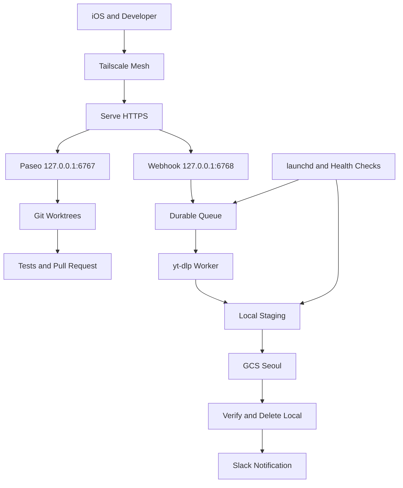
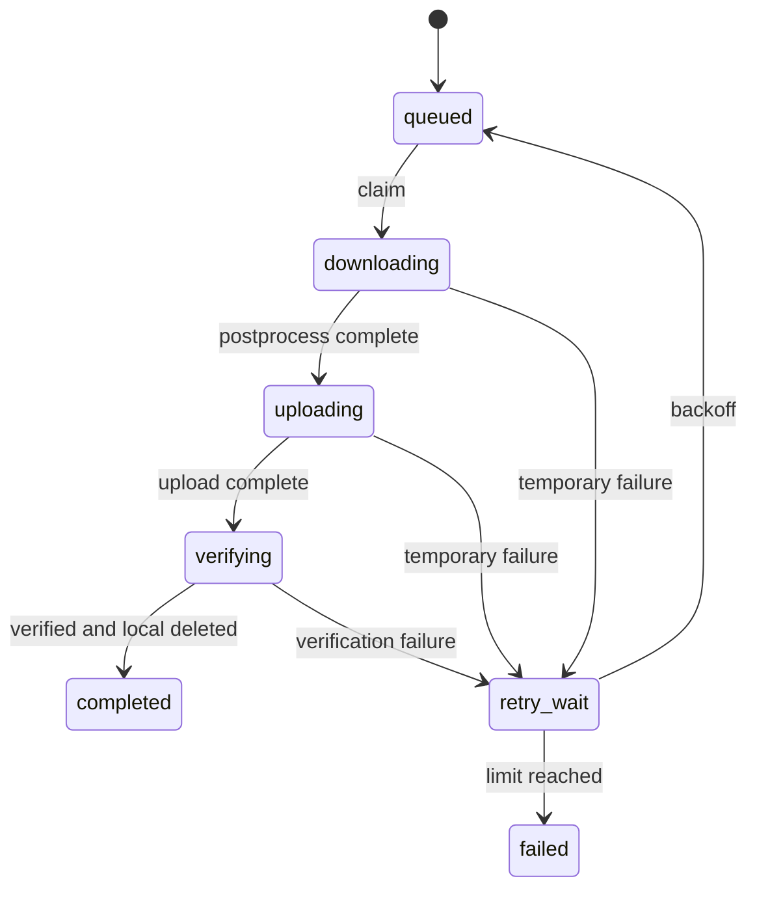

Mac mini를 켜 두는 것만으로 무인 워크스테이션이 완성되지는 않는다. 재부팅 후 디스크가 잠기거나 다운로드가 SSD를 채우면 원격 에이전트도 함께 멈춘다. 이 글은 **접근 제어, 작업 격리, 영속 큐, 검증 후 삭제**를 연결해 이러한 장애를 복구 가능한 상태로 만드는 설계다.

> 문서의 범위: 포트 6768의 웹훅, `mini-status`, `ytdl-health`는 이 글에서 정의하는 구현 계약이다. 기본 macOS 도구가 아니다. 실제 호스트의 PR URL·전력 측정·재부팅 기록은 제공되지 않았으므로 아래 실증 절차를 수행 완료 사례로 표현하지 않는다.

## 1. 아키텍처와 M4의 하드웨어 운영



| 계층 | 역할 | 보존할 상태 |
|---|---|---|
| 제어면 | Paseo 세션과 에이전트 실행 | 세션 ID, 작업 디렉터리 |
| 개발면 | Worktree별 코드 수정과 테스트 | 브랜치, SHA, PR URL |
| 접수면 | 인증과 작업 영속 저장 | 작업 ID, 중복 방지 키 |
| 처리면 | 다운로드, 후처리, 업로드 | lease, 재시도, 부분 파일 |
| 저장면 | 객체 검증과 로컬 삭제 | generation, 크기, 체크섬 |
| 운영면 | 관측과 제한된 자동 복구 | heartbeat, 오류, 정리 이력 |

### 1.1 저전력을 지속 가능한 용량으로 바꾸기

Apple은 모델과 조건별 전력 자료를 제공한다. 실제 운영에서는 외장 SSD, 인코딩, 빌드, 로컬 모델 추론의 부하가 다르므로 벽면 전력계로 유휴·평균·최대 부하를 따로 측정한다. [Apple 전력 자료](https://support.apple.com/en-au/103253)

월간 에너지는 `평균 W × 24 × 30 ÷ 1000` kWh로 추산한다. 평균 10W라는 **가정**에서는 7.2kWh이며 공유기와 UPS 전력은 별도다. 이는 M4 실측값이 아니다.

통합 메모리는 OS, 개발 도구, 로컬 모델이 함께 사용한다. Paseo는 제어 계층이며 모든 모델이 Mac 내부나 Neural Engine에서 실행되는 것은 아니다. 원격 모델을 쓰면 네트워크와 제공자 API 제한도 병목이다. 다운로드 워커는 1개로 시작하고 에이전트 병렬 수는 메모리 압력, swap, 테스트 시간을 보고 늘린다. 영상 후처리와 빌드를 무제한 병렬화하지 않는다.

유선 Ethernet, 통풍 공간, UPS, 복구 가능한 백업은 상시 운영의 기본이다. 단일 호스트는 전원과 저장 장치 장애를 공유하므로 고가용성 클러스터와 같은 무중단 보장을 제공하지 않는다.

### 1.2 절전과 전원 복귀

다음은 관리자가 검토 후 적용할 예시다. 지원 옵션과 의미는 설치된 OS의 `man pmset`으로 확인하고 변경 전 값을 기록한다.

```bash
sudo pmset -a sleep 0 womp 1 autorestart 1
pmset -g custom
pmset -g assertions
```

`sleep 0`은 유휴 시스템 절전을 끄며 화면 절전은 별도로 유지할 수 있다. `womp 1`은 지원되는 네트워크 깨우기 설정으로, 인터넷이나 Tailscale을 통한 기상 성공을 보장하지 않는다. `autorestart 1`은 전원 장애 후 복귀 설정이며 UPS와 서비스 재시작 정책을 대체하지 않는다. 업데이트 후 설정을 다시 확인한다.

### 1.3 FileVault 헤드리스 재부팅

부팅 전 디스크 잠금 해제와 OS 부팅 후 원격 접속은 다른 단계다. FileVault를 끄거나 자동 로그인을 켜는 방식으로 해결하지 않는다.

```bash
sudo fdesetup status
sudo fdesetup supportsauthrestart
```

지원 여부를 확인하고 로컬 복구 수단을 준비한 유지보수 창에서 `sudo fdesetup authrestart`를 대화형으로 실행한다. 재시작을 유발할 수 있는 명령이므로 상태 조회처럼 실행하지 않는다. 암호는 인수·스크립트·로그에 저장하지 않는다. 설치된 OS의 `man fdesetup`과 실제 하드웨어의 지원 결과를 우선한다.

인증된 재시작은 이후 모든 콜드 부팅을 자동 잠금 해제하지 않는다. Apple은 Apple silicon과 macOS 26 이상에서 조건부 SSH 잠금 해제도 설명하지만, 부팅 전 환경에서 Tailscale이 실행된다는 뜻은 아니다. 별도의 도달 가능한 복구 경로가 필요하다. [Apple Platform Security](https://help.apple.com/pdf/security/en_US/apple-platform-security-guide.pdf)

정상 재시작, OS 업데이트, 전원 복귀를 각각 시험하고 디스크 잠금 해제 → 네트워크 → 데몬 → 사용자 세션을 순서대로 확인한다.

## 2. Zero-Trust Mesh 네트워크

### 2.1 Tailscale과 비밀번호리스 SSH

공유기 포트포워딩 없이 tailnet 주소와 MagicDNS로 접속한다. Mesh 가입만으로 모든 서비스 접근을 허용하지 않고 개발자·운영자·자동화 장치를 구분해 필요한 목적지와 포트만 허용한다. 퇴사·장치 분실 시 사용자와 장치 권한을 함께 회수한다.

**Tailscale SSH 서버 지원은 macOS 설치 변형에 따라 다르다.** 공식 문서는 Linux와 macOS 오픈소스 `tailscale` + `tailscaled` CLI 조합을 서버 대상으로 설명한다. App Store와 Standalone GUI 설치에서도 동일하게 동작한다고 가정하지 않는다. [Tailscale SSH](https://tailscale.com/docs/features/tailscale-ssh), [macOS 변형 비교](https://tailscale.com/docs/concepts/macos-variants)

| 방식 | 인증 | 운영 조건 |
|---|---|---|
| Tailscale SSH | tailnet 신원과 SSH 정책 | 지원 서버 변형, 네트워크와 SSH 규칙 |
| Tailscale 위 OpenSSH | SSH 공개키 | macOS Remote Login과 SSH 정책 별도 관리 |

GUI 변형에서는 공개키 기반 `ssh operator@mini.<tailnet>.ts.net`이 대안이다. 허용 사용자를 제한하고 새 세션에서 키 인증을 확인한 뒤 암호 인증 정책을 변경한다. Tailscale SSH도 신원 제공자의 MFA와 재인증 정책이 중요하다.

### 2.2 Serve HTTPS TLS 프록시

Paseo와 웹훅은 loopback으로 제한하고 Serve가 TLS를 종료한다. Serve는 tailnet 내부 공유이며 공개 인터넷 노출 기능인 Funnel과 구분한다. 애플리케이션 인증은 별도로 유지한다. [Serve 문서](https://tailscale.com/docs/reference/tailscale-cli/serve)

```bash
tailscale serve --bg --https=443 http://127.0.0.1:6767
tailscale serve --bg --https=8443 http://127.0.0.1:6768
tailscale serve status
```

설치 버전의 도움말과 기존 라우팅을 확인한 뒤 적용한다. 이 구성에서 iOS 웹훅 URL에는 `:8443/jobs`를 포함하고 iPhone도 tailnet에 연결한다. HTTPS 인증서 발급에 필요한 DNS 설정과 호스트명의 인증서 투명성 로그 노출도 검토한다.

## 3. Paseo와 Worktree 기반 멀티 에이전트 개발

Paseo의 기본 데몬 주소는 `127.0.0.1:6767`이다. 전체 인터페이스로 넓히기 전에 Serve 연결, 현재 버전의 페어링과 인증을 확인한다. loopback은 동일 호스트의 다른 프로세스까지 차단하는 보안 경계가 아니다. [Paseo Web UI](https://github.com/getpaseo/paseo/blob/main/public-docs/web-ui.md), [Paseo CLI](https://paseo.sh/docs/cli)

### 3.1 작업 디렉터리 격리

저장소 루트에서 작업별 브랜치와 worktree를 만들고 에이전트의 cwd를 해당 디렉터리로 지정한다.

```bash
git fetch origin
git worktree add -b agent/docs-health ../mini-docs-health origin/main
git -C ../mini-docs-health status --short
```

[Git Worktree 문서](https://git-scm.com/docs/git-worktree)를 기준으로 작업당 디렉터리를 하나 배정한다. 문서와 테스트처럼 파일 소유 범위를 명시하고 공유 파일은 리더가 통합한다. Worktree는 Git 객체와 일부 메타데이터를 공유하며 프로세스 권한, 캐시, 포트, 자격 증명을 격리하지 않는다. 강한 경계가 필요하면 별도 OS 계정이나 컨테이너를 추가한다.

에이전트에는 필요한 GitHub 권한만 주고 운영 GCS·Slack 비밀을 전달하지 않는다. 개발 서버 포트도 작업별로 나눈다. launchd에서 실행하는 도구는 터미널과 PATH가 다를 수 있으므로 절대 경로와 제공자 진단으로 검증한다.

### 3.2 PR 자동화 실증 절차

실증의 산출물은 PR URL, head SHA, CI 결과, 변경 diff다. 실제 증거가 없는 상태에서는 자동화 성공률이나 시간을 만들어 쓰지 않는다.

1. 작은 문서 변경을 전용 worktree에 요청하고 완료 기준을 고정한다.
2. 저장소 검증과 `git diff --check`를 실행하고 실제 diff를 읽는다.
3. 비밀·무관한 변경이 없는지 확인한 후 커밋한다.
4. 브랜치를 push하고 검증 결과를 적은 본문으로 PR을 만든다.
5. PR URL과 SHA를 기록하고 보호 브랜치 정책에 따라 검토한다.

```bash
git diff --check
git push -u origin agent/docs-health
gh pr create --base main --head agent/docs-health --title 'docs: add health runbook' --body-file /tmp/mini-pr-body.md
```

커밋을 마친 작업 디렉터리에서 실행하는 예시다. 자동 PR 생성과 자동 병합은 별도 정책이며 필수 CI와 리뷰를 유지한다. 병합 후 미커밋 변경을 확인하고 worktree를 정리한다. [GitHub CLI PR 문서](https://cli.github.com/manual/gh_pr_create)

## 4. 이벤트 기반 미디어와 클라우드 저장소

### 4.1 iOS 단축어 웹훅 계약

단축어의 “URL 콘텐츠 가져오기”에서 HTTPS POST, JSON 본문, `Authorization: Bearer` 헤더를 설정한다. 토큰을 URL 쿼리에 넣으면 로그와 공유 기록에 남을 수 있다.

| 항목 | 계약 |
|---|---|
| 수신 | loopback 6768, 외부 경로 `/jobs` |
| 인증 | 전용 고엔트로피 토큰, 상수 시간 비교, 교체 절차 |
| 입력 | HTTPS URL 하나, 본문 크기 제한, 공급자 allowlist |
| 응답 | 영속 저장 후 `202 Accepted`와 `job_id` |
| 멱등성 | `Idempotency-Key`, 사용자 범위와 보존 기간 정의 |
| 과부하 | 속도·큐 길이·디스크 임계값, 429 또는 503 |

인증 실패는 401로 거부하고 로그의 토큰과 민감한 쿼리를 마스킹한다. 단축어를 공유할 때 비밀이 포함되지 않게 하고 교체 시 휴대전화 저장본도 갱신한다.

URL을 셸 문자열로 조합하지 않는다. 인수 배열과 `shell=False`를 사용하고 다운로드 옵션과 출력 경로는 서버가 정한다. 사설 IP·메타데이터 주소 접근, 리다이렉트, DNS 재해석을 통한 SSRF를 막는다. 미디어 CDN 접근은 필요하므로 애플리케이션 검사와 워커의 네트워크 제한을 함께 설계한다.

### 4.2 yt-dlp 비동기 큐

HTTP 요청 안에서 다운로드 완료를 기다리지 않는다. 단일 Mac에서는 SQLite 같은 영속 큐로 시작하고 원자적 claim, lease, heartbeat, 만료 작업 회수를 구현한다. 작업 ID별 staging 디렉터리로 부분 파일과 완성 파일을 구분한다.



yt-dlp의 다운로드 아카이브는 중복 방지 보조 수단이며 큐 상태를 대체하지 않는다. 후처리가 완료된 파일만 업로드 대상으로 공개한다. 동시성, 최대 파일 크기, 실행 시간, 재시도 횟수를 제한한다. 네트워크 오류에는 지수 백오프와 지터를 사용하고 지원하지 않는 URL·권한 거부는 영구 오류로 분류한다. 이용 권한이 있는 콘텐츠만 처리한다. [yt-dlp 공식 저장소](https://github.com/yt-dlp/yt-dlp)

### 4.3 GCS 서울 리전과 자동 Move

서울 리전은 `asia-northeast3`이다. 저장 비용뿐 아니라 요청·외부 전송·보존 정책의 비용을 고려한다. 버킷은 비공개로 만들고 uniform bucket-level access, public access prevention, 최소 권한 업로드 주체를 사용한다. [GCS 위치](https://cloud.google.com/storage/docs/locations)

**GCS lifecycle은 Mac의 파일을 이동하지 않는다.** 버킷 내부 객체의 보존과 저장 클래스 변경을 관리하는 기능이다. 로컬 삭제는 호스트 이관 워커의 책임이다. [Lifecycle 문서](https://cloud.google.com/storage/docs/lifecycle)

`gcloud storage mv`는 간단한 이동에 쓸 수 있지만 파일시스템의 원자적 rename과 다르다. 복구 가능한 파이프라인에서는 다음 단계를 영속 기록한다. [mv 레퍼런스](https://docs.cloud.google.com/sdk/gcloud/reference/storage/mv)

1. 작업 ID와 콘텐츠 식별자를 포함한 객체 이름을 정한다.
2. 생성 조건으로 덮어쓰기를 막고 업로드한다.
3. 객체 generation, 크기, 지원되는 CRC32C 등 무결성 정보를 검증한다. 모든 객체에 MD5가 있다고 가정하지 않는다.
4. 검증된 원격 객체 정보를 큐에 저장한다.
5. 해당 작업의 로컬 파일만 삭제하고 완료를 기록한다.
6. Slack 알림은 별도 상태로 재시도한다.

업로드 직후 종료되면 기존 객체의 내용과 generation을 확인하고 삭제 단계를 재개한다. 로컬 삭제 후 완료 기록 전에 종료되어도 저장된 검증 정보로 복구한다. 이름이 같은 객체의 존재만으로 성공을 판단하지 않는다.

### 4.4 로컬 SSD 0B의 운영 정의

목표는 **완료된 미디어의 로컬 잔여 바이트 0B**다. 다운로드 중 파일, 실패 보존 파일, 큐 DB, OS, 로그까지 0B가 되는 것은 아니다. 업로드 실패 파일을 무조건 지우면 데이터 유실이다.

용량은 `동시 작업 수 × 작업별 최대 staging 크기 + 후처리 임시 공간 + 안전 여유`로 잡는다. 원본과 변환 출력이 공존할 수 있다. 임계값 아래에서는 신규 접수를 중단하고 업로드 복구를 우선한다.

Slack에는 작업 ID, 단계, 크기, 소요 시간, 오류 분류를 보낸다. 알림 실패 때문에 완료된 다운로드를 다시 실행하지 않는다. 비공개 객체는 필요한 경우 짧은 만료 링크로 공유하고 토큰·쿠키·민감한 원본 URL은 제외한다. [Slack Webhook 문서](https://api.slack.com/messaging/webhooks)

## 5. 관측과 launchd 유지보수

### 5.1 상태 명령의 출력 계약

`mini-status`와 `ytdl-health`는 직접 구현할 운영 도구 이름이다. 사람용 출력 외에 JSON과 종료 코드를 제공하고 PID 존재만으로 정상 판정하지 않는다.

| 지표 | mini-status | ytdl-health |
|---|---|---|
| 호스트 | uptime, 전원 설정, 메모리 압력 | 디스크 여유와 staging 크기 |
| 연결 | Tailscale, Serve, Paseo 응답 | 웹훅 응답과 최근 업로드 성공 |
| 작업 | 활성 worktree와 세션 | 큐 상태별 개수, 가장 오래된 작업 |
| 복구 | 데몬 재시작 횟수 | heartbeat, lease 만료, 재시도 |

경보는 마지막 성공 시각, 대기 시간, 디스크 여유 감소를 함께 본다. 로컬 health 응답에는 비밀과 개인 URL을 넣지 않는다. HTTP 응답 성공과 실제 객체 업로드 성공을 구분하고 작은 합성 작업으로 전체 경로를 검증한다. 호스트가 꺼지면 내부 감시도 멈추므로 외부 heartbeat 감시가 필요하다.

### 5.2 LaunchAgent와 LaunchDaemon

사용자 세션에 의존하는 개발 도구는 LaunchAgent, 로그인 전 필요한 시스템 서비스는 LaunchDaemon 후보로 나눈다. LaunchAgent는 로그인 전에 시작된다고 가정하지 않는다. LaunchDaemon도 FileVault 부팅 잠금을 우회하지 않는다.

가능한 한 비관리자 계정으로 실행하고 `ProgramArguments`에는 절대 경로와 인수를 각각 넣는다. 셸의 경로 확장이나 파이프가 자동 적용되지 않는다. 작업 디렉터리, PATH, 출력 로그 권한과 회전을 명시하고 비밀을 plist에 저장하지 않는다.

장기 워커에는 제한된 재시작 정책, 정리 작업에는 `StartInterval` 또는 `StartCalendarInterval`을 쓴다. 종료가 정상인 정리 작업에 무조건 `KeepAlive`를 적용하면 반복 실행 루프가 될 수 있다. 중복 실행 잠금과 재시작 빈도 제한을 둔다. [Apple launchd 가이드](https://developer.apple.com/library/archive/documentation/MacOSX/Conceptual/BPSystemStartup/Chapters/CreatingLaunchdJobs.html)

### 5.3 자동 디스크 정리의 삭제 경계

고정된 staging 루트의 실제 경로를 확인하고 심볼릭 링크를 따라가지 않는다. 먼저 dry-run으로 대상과 예상 확보 공간을 확인한다.

- 원격 검증 기록이 있는 완료 파일만 정상 정리한다.
- 활성 lease 또는 후처리 중 파일은 삭제하지 않는다.
- 실패 업로드는 보존 기간에 따라 격리하고 복구 기회를 남긴다.
- 고아 부분 파일은 큐 참조와 실행 프로세스를 확인한 뒤 유예 기간 후 정리한다.
- 로그와 캐시는 크기·기간을 제한하되 작업 증적은 따로 보존한다.

공간 부족에서는 검증되지 않은 파일을 지우기보다 접수를 중단한다. 정리 후 큐와 GCS 상태를 대조하고 삭제 이력을 남긴다.

## 6. 장애 주입과 운영 인수 기준

| 시험 | 기대 동작 | 확인 증거 |
|---|---|---|
| 동일 웹훅 두 번 | 동일 키에 같은 작업 반환 | 큐 레코드 |
| 다운로드 중 종료 | lease 만료 후 제한 재시도 | 상태와 부분 파일 |
| GCS 권한 회수 | 로컬 보존과 오류 경보 | 오류 코드, staging 크기 |
| 업로드 직후 종료 | 원격 검증 후 삭제 재개 | generation, 복구 로그 |
| Slack 오류 | 완료 유지, 알림만 재시도 | 분리된 알림 상태 |
| 디스크 임계값 | 접수 중단과 데이터 보존 | 응답 코드, 여유 공간 |
| 로그인 없는 재부팅 | 서비스 유형별 복구 확인 | launchd와 원격 접속 |

- [ ] pmset 변경 전후 값과 실제 재부팅 복구를 기록했다.
- [ ] Tailscale 설치 변형과 SSH 지원을 확인했다.
- [ ] 6767·6768은 loopback이며 허용된 사용자만 접근한다.
- [ ] 토큰 없는 요청은 거부되고 로그에 비밀이 없다.
- [ ] PR URL, head SHA, CI 결과로 개발 자동화를 실증했다.
- [ ] 다운로드·업로드·삭제 사이 종료에도 작업이 복구된다.
- [ ] 완료 미디어 잔여량과 실패 보존량을 따로 집계한다.
- [ ] 외부 heartbeat 감시와 로컬 복구 수단을 준비했다.

안정적인 운영의 단위는 Mac 한 대보다 작다. 인증된 요청, 격리된 변경, 검증된 객체, 복구 가능한 상태 전이마다 증거를 남겨야 상시 원격 개발과 미디어 자동화를 함께 유지할 수 있다.

## 부록: 2026-11-05 호스트 관측과 검증 한계

읽기 전용 수집에서 `sleep=0`, `womp=1`, `autorestart=1`, FileVault On, `supportsauthrestart=true`를 확인했다. 최근 부팅 기록은 11월 4일 23:22이며 수집 시점 uptime은 약 11시간 20분이었다. Paseo와 웹훅 프로세스 PID도 관측됐다. 이는 설정과 순간 실행 상태의 증거이며 인증 재시작·전원 복귀·앱 복구의 성공 증거는 아니다.

저장소의 최근 PR과 Paseo·agent 검색 결과도 확인했지만, 특정 Paseo 세션에서 특정 worktree와 PR이 생성됐다는 연결 증거는 확보하지 못했다. PR 자동화는 아직 실증 절차로 읽어야 한다. 상세 수집 범위와 한계는 [증거 기록](https://github.com/Twodragon0/tech-blog/blob/main/docs/audits/2026-11-05-macmini-evidence.md)에 정리했다. 해당 기록과 이 초안을 저장소에 함께 반영한 뒤 링크를 확인한다.

### 추가 관측: 세션과 PR의 연결

11월 6일에는 별도 `claudesec` 저장소의 Paseo 저장 세션, worktree 경로, `test/ci-regression-guards` 브랜치, HEAD SHA가 [PR #596](https://github.com/Twodragon0/claudesec/pull/596)의 브랜치·SHA와 일치함을 확인했다. 이는 세션과 산출물의 연결 증거다. PR 생성 명령의 실행 추적이나 tech-blog에서 동일 자동화가 성공했다는 증거로 확대하지 않는다. 무인 재부팅은 아직 수행하지 않았으며 [복구 시험 계획](https://github.com/Twodragon0/tech-blog/blob/main/docs/runbooks/macmini-headless-reboot-recovery.md)을 별도로 준비했다.
