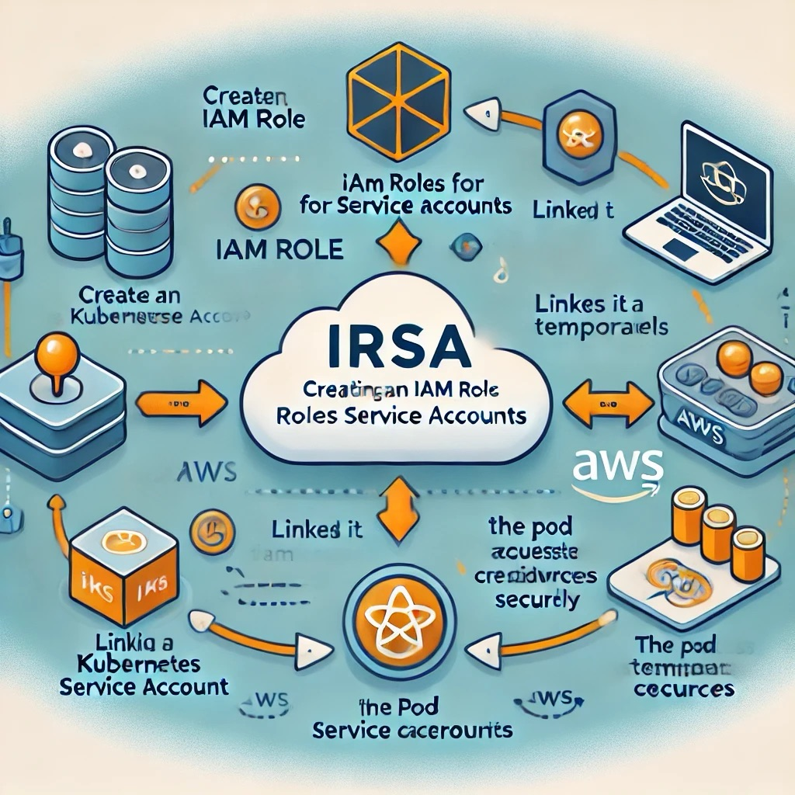
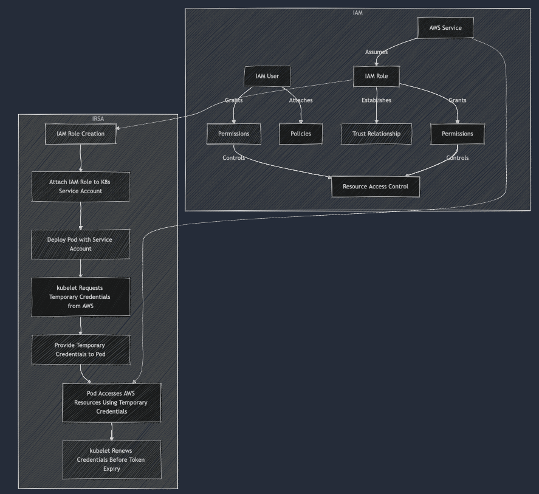

> 이 글은 2twodragon.com(워드프레스)에서 2024-08-30에 처음 게시된 글을 옮긴 것입니다.

### 1. AWS IAM(Identity and Access Management)

<strong>IAM(Identity and Access Management)</strong>는 AWS의 권한 관리 서비스로, 사용자가 특정 AWS 리소스에 접근할 수 있는 권한을 관리합니다. 간단히 말해, 누가(A) 무엇을(B) 할 수 있는지(C)를 정의하는 것입니다.

- **A(누가):** 사용자, 그룹, 역할
- **B(무엇을):** AWS 서비스, 리소스 (예: S3 버킷, EC2 인스턴스)
- **C(할 수 있는지):** 접근 권한 (예: 읽기, 쓰기, 삭제)

### 2. IRSA(IAM Roles for Service Accounts)

**IRSA**는 Kubernetes와 AWS를 통합하여 Kubernetes 파드가 AWS 리소스에 접근할 수 있도록 하는 기능입니다. Kubernetes의 서비스 어카운트(Service Account)를 AWS IAM 역할(Role)과 연결해, 파드가 필요로 하는 임시 자격 증명을 제공받아 AWS 리소스에 접근할 수 있도록 합니다.

IRSA의 장점은 Kubernetes 파드에 직접적으로 AWS 자격 증명(Access Key, Secret Key)을 하드코딩하거나 배포할 필요 없이, 안전하게 AWS 리소스에 접근할 수 있다는 점입니다.

### 3. IAM과 IRSA의 차이점

- **IAM:** 일반적으로 AWS에서 사용자가 AWS 리소스에 접근할 때 사용하는 권한 관리 시스템입니다.
- **IRSA:** Kubernetes 환경에서 파드가 AWS 리소스에 접근할 수 있도록 해주는 IAM의 확장 기능입니다. 이 기능은 Kubernetes의 서비스 어카운트를 이용해 AWS IAM 역할과 연결됩니다.

### 4. IRSA 동작 원리

IRSA가 동작하는 과정을 이해하기 쉽게 단계별로 설명하겠습니다:

1\. **서비스 어카운트와 IAM 역할 연결:**

- Kubernetes에서 특정 파드에 할당된 서비스 어카운트를 AWS IAM 역할과 연결합니다. 이 역할은 파드가 접근할 수 있는 AWS 리소스를 정의합니다.

2\. **파드 실행 시 임시 자격 증명 획득:**

- 파드가 실행되면, Kubernetes의 **kubelet**이 AWS와 통신하여 해당 파드에 할당된 IAM 역할을 기반으로 임시 자격 증명(Temporary Credentials)을 획득합니다.

3\. **파드 내에서 자격 증명 사용:**

- 획득한 임시 자격 증명은 파드 내의 특정 경로에 저장되며, 파드는 이 자격 증명을 사용해 AWS 리소스(S3, DynamoDB 등)에 접근할 수 있습니다.

4\. **토큰 로테이션:**

- 임시 자격 증명은 유효 기간이 있으며, 보통 24시간 내에 만료됩니다. kubelet은 만료 전에 새로운 자격 증명을 자동으로 갱신하여 파드에 제공하므로, 파드는 중단 없이 AWS 리소스에 접근할 수 있습니다.

### 5. IRSA 알고리즘 그림

아래는 IRSA의 동작 과정을 그림으로 표현한 알고리즘입니다.

### 6. 결론

IRSA를 사용하면 Kubernetes 파드가 AWS 리소스에 안전하게 접근할 수 있습니다. 이는 Kubernetes와 AWS IAM의 기능을 결합하여 이루어지며, IAM 역할과 Kubernetes 서비스 어카운트를 연결해 사용합니다. 이 과정에서 kubelet이 임시 자격 증명을 관리하며, 파드는 이를 통해 AWS 리소스에 무중단으로 접근할 수 있습니다.

이해하기 쉽도록 정리한 알고리즘과 설명을 통해, IRSA와 IAM의 개념을 명확히 이해하는 데 도움이 되었길 바랍니다.
