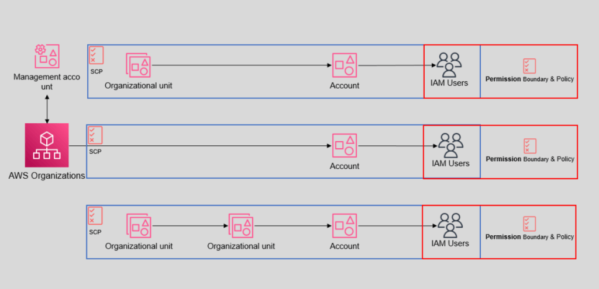
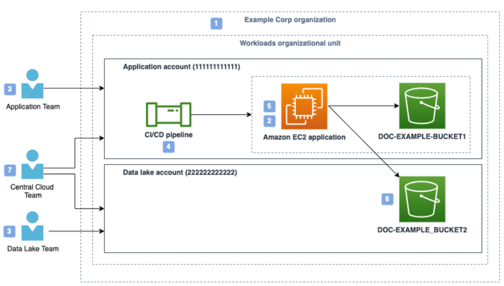

> 이 글은 2twodragon.com(워드프레스)에서 2024-10-19에 처음 게시된 글을 옮긴 것입니다.

🔑 **AWS Organizations**는 여러 AWS 계정을 중앙에서 관리할 수 있는 필수 도구입니다! 대규모 조직에서 팀과 프로젝트를 체계적으로 관리하고, 보안과 비용 관리를 통합적으로 할 수 있어요.

### AWS Organizations의 3가지 기본 구성 요소:

1.  **Root**: 조직 계층의 최상단. 모든 계정 관리는 여기서 시작됩니다.
2.  **OU (Organizational Unit)**: 팀별, 프로젝트별 계정을 그룹화! **SCP**로 접근 권한을 중앙에서 제어할 수 있어요. 🔒
3.  **Account**: AWS 리소스를 직접 사용하는 기본 계정.

### SCP (Service Control Policy)란?

특정 **OU**나 **계정**에 적용되는 권한 정책으로, 하위 계정까지 일관된 권한 관리가 가능합니다. 📋

특정 서비스나 작업에 대한 액세스를 제한할 때 매우 유용해요!

### 왜 AWS Organizations을 선택해야 할까요?

1.  **중앙 관리**: 여러 계정을 그룹화해 일관된 관리 가능! 👩‍💻
2.  **세밀한 권한 제어**: SCP로 서비스별 접근을 통제! 🔐
3.  **통합 결제**: 여러 계정의 비용을 한 번에 관리 💳
4.  **보안 강화**: CloudTrail, Security Hub로 모든 계정의 보안을 중앙에서 관리 🛡️

### 효율적 관리 도구:

- **AWS Control Tower** 🏢
  - 계정을 안전하게 설정하고 규정을 자동으로 적용! **Landing Zone**과 **가드레일**로 보안을 유지.
- **AWS Identity Center (SSO)** 🔑
  - 한 번의 인증으로 여러 계정에 접근! 보안은 더 철저하게! 🙌
- **IAM Permission Set** 🎯
  - 팀별, 역할별 권한을 사전에 정의해 간편하게 관리.
- **Okta 연동** 🔐
  - IAM과 함께 사용해 보안 강화를 위한 사용자 관리 및 MFA 적용!

---

### IAM 정책 유형, 어떻게 활용할까?

1.  **아이덴티티 기반 정책**: 사용자의 작업을 세밀하게 제어하고 관리할 때 사용됩니다.
2.  **리소스 기반 정책**: S3 버킷과 같은 AWS 리소스에 직접 연결하여 다른 계정과 안전하게 공유할 때 유용해요!
3.  **서비스 제어 정책 (SCP)**: AWS 계정 및 조직 단위에 일괄적인 보안 규정을 적용하고 관리.
4.  **권한 경계**: IAM 역할이나 사용자에게 부여되는 최대 권한을 제한해 과도한 권한을 방지!

이 이미지는 Example Corp 조직에서 두 개의 AWS 계정을 활용한 애플리케이션 아키텍처를 보여줍니다. <strong>Application Account(111111111111)</strong>와 <strong>Data Lake Account(222222222222)</strong>라는 두 계정이 있으며, 각 팀이 역할을 담당하여 관리합니다. 여기서 CI/CD 파이프라인과 EC2 애플리케이션, 그리고 두 개의 S3 버킷이 포함되어 있습니다.

### 설명:

1.  **Example Corp Organization**: Example Corp 전체 조직을 나타냅니다. 이 조직에는 여러 AWS 계정이 포함되어 있으며, 조직 단위로 관리됩니다.
2.  **Workloads Organizational Unit (OU)**: 이 조직 단위 내에 애플리케이션과 데이터 레이크 계정이 속해 있습니다. 각 계정은 특정 작업을 수행하도록 구성되었습니다.
3.  **Application Team**: 애플리케이션 팀은 애플리케이션 계정과 데이터 레이크 계정에서 애플리케이션 배포와 관리를 담당합니다.
4.  **CI/CD Pipeline**: 애플리케이션 계정 내에서 지속적인 통합 및 배포(CI/CD)를 담당하는 파이프라인입니다. 이 파이프라인은 Amazon EC2 애플리케이션에 필요한 자원을 배포하고 관리합니다.
5.  **Amazon EC2 Application**: 애플리케이션 계정에 배포된 EC2 인스턴스에서 실행되는 애플리케이션입니다. 이 애플리케이션은 DOC-EXAMPLE-BUCKET1과 DOC-EXAMPLE-BUCKET2라는 두 S3 버킷에 액세스합니다.
6.  **DOC-EXAMPLE-BUCKET1 & DOC-EXAMPLE-BUCKET2**: 애플리케이션 계정(111111111111)에 위치한 DOC-EXAMPLE-BUCKET1과 데이터 레이크 계정(222222222222)에 위치한 DOC-EXAMPLE-BUCKET2는 S3 버킷으로, EC2 애플리케이션에서 데이터를 저장하거나 읽는 데 사용됩니다.
7.  **Central Cloud Team**: 중앙 클라우드 팀은 전체 보안 및 권한 관리, 그리고 정책을 설정하고 관리하는 역할을 맡고 있습니다. 중앙 클라우드 팀은 모든 계정에서 일관된 보안 가이드를 제공합니다.

이 아키텍처는 여러 팀이 AWS 환경에서 협업하여 중앙 보안 정책(SCP) 및 권한 경계를 관리하면서 애플리케이션을 효율적으로 배포하고 관리하는 방법을 보여줍니다.

이 정책들을 적절히 조합해 AWS 환경에서 효율적인 관리와 보안을 유지하세요!

더 많은 정보는 [IAM 정책 가이드](https://aws.amazon.com/ko/blogs/security/iam-policy-types-how-and-when-to-use-them/)에서 확인할 수 있어요! 📚✨
