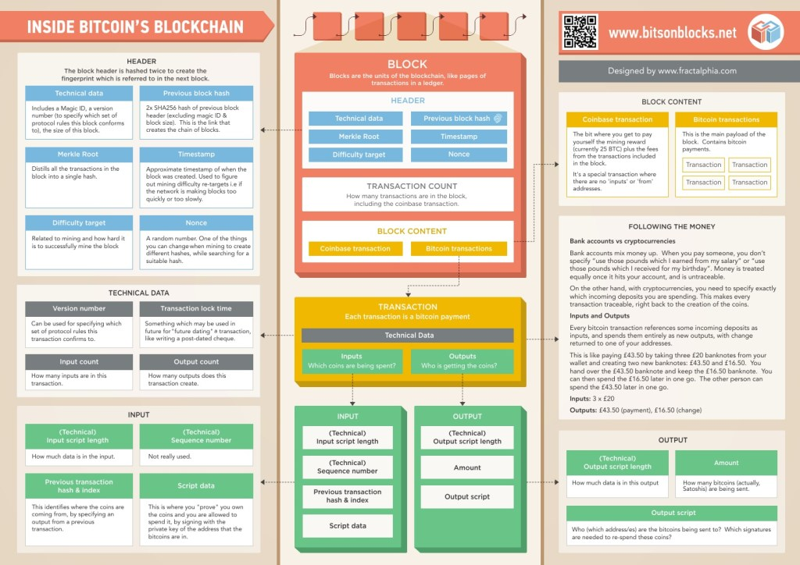
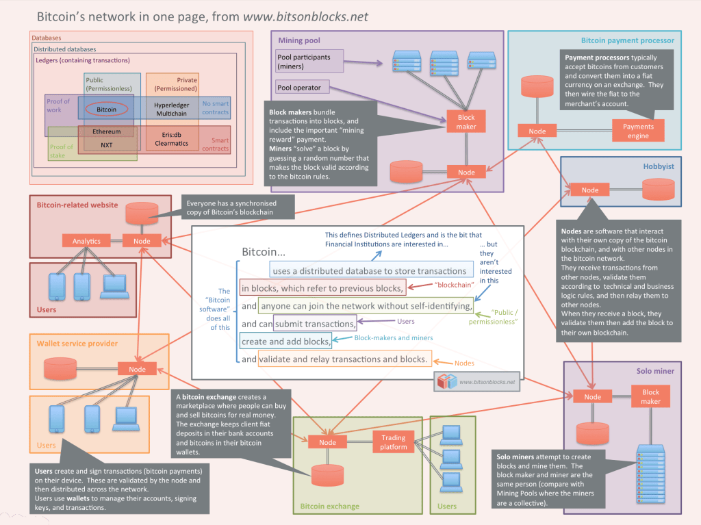

> 이 글은 2twodragon.com(워드프레스)에서 2024-11-13에 처음 게시된 글을 옮긴 것입니다.

비트코인의 블록체인은 그 구조와 작동 방식이 독특하여 많은 사람들의 관심을 받고 있습니다. 이번 포스팅에서는 비트코인 블록체인의 내부를 상세히 설명하고, 주요 구성 요소들이 어떻게 상호작용하는지를 이해하기 쉽게 정리해보겠습니다. 😊💡

## 비트코인 블록체인의 내부 구조 이해하기

비트코인은 분산 원장을 기반으로 한 블록체인 기술을 통해 모든 거래 내역을 기록하고 유지합니다. 이러한 블록체인의 작동 원리를 파악하는 것은 비트코인의 본질을 이해하는 데 중요한 역할을 합니다. 그럼 비트코인의 블록 내부를 자세히 들여다보겠습니다. 🧱✨

*blockchain in bitcoin*

**1. 블록의 구조** 🔗

비트코인 블록체인은 각각의 블록이 체인 형태로 연결된 구조입니다. 각 블록은, 블록 헤더와 트랜잭션 내용으로 구성됩니다.

- **Header(헤더):**

블록 헤더는 해시를 생성하는 데 사용되며, 다음과 같은 요소들로 구성됩니다.

- **Technical Data:** 프로토콜의 버전 정보가 포함됩니다.
- **Previous Block Hash:** 이전 블록의 해시 값으로, 블록 간 연결을 형성하여 블록체인의 무결성을 유지합니다.
- **Merkle Root:** 해당 블록의 모든 트랜잭션을 하나의 해시 값으로 압축한 것.
- **Timestamp:** 블록이 생성된 대략적인 시각을 나타내며, 채굴 난이도 조정을 위해 사용됩니다.
- **Difficulty Target:** 채굴의 난이도 수준을 나타냅니다.
- **Nonce:** 적합한 해시 값을 찾기 위해 변경할 수 있는 숫자로, 채굴 과정에서 중요한 역할을 합니다. 🔧⛏️

## 2. 블록의 내용(Block Content)

블록의 내용에는 블록 헤더 외에 두 가지 주요 요소가 포함됩니다.

- **Coinbase Transaction:** 블록을 생성한 채굴자에게 보상을 지급하는 특별한 트랜잭션입니다. 입력과 출력 주소가 없으며, 블록의 첫 번째 트랜잭션으로 존재합니다.
- **Bitcoin Transactions:** 사용자가 전송한 비트코인 트랜잭션들이 포함됩니다. 이는 블록의 메인 데이터 부분을 구성하며, 블록체인에 기록됩니다. 📈💰

## 3. 비트코인 트랜잭션(Transaction)

각 트랜잭션은 비트코인 결제를 나타내며, 트랜잭션의 구조는 다음과 같습니다.

- **Inputs(입력):** 트랜잭션의 자금 출처를 나타냅니다. 이는, 이전 트랜잭션에서 사용된 코인을 가져오는 것입니다.
- **Outputs(출력):** 비트코인을 받는 주소와 그 수량을 지정합니다.
- **Technical Data:** 트랜잭션의 버전, 입력/출력 수, 잠금 시간 등의 정보를 포함합니다. 🔐📝

## 4. 입력과 출력의 상세 구조

**입력(Input):**

- **Previous Transaction Hash & Index:** 현재 트랜잭션에 사용되는 코인의 출처를 정의합니다. 이전 트랜잭션의 특정 부분을 참조해 코인의 출처를 확인합니다.
- **Script Data:** 비트코인을 소유하고 있다는 증명을 포함하며, 보통 개인 키로 서명된 데이터입니다. 이는 소유자가 코인을 사용할 수 있는 권한을 증명하는 역할을 합니다. ✍️🔑

**출력(Output):**

- **Amount:** 전송되는 비트코인의 양을 나타내며, 사토시 단위로 표시됩니다. 사토시는 비트코인의 최소 단위로, 1 BTC는 1억 사토시입니다.
- **Output Script:** 비트코인이 보내질 주소 및 다시 사용하기 위해 필요한 서명 정보를 포함합니다. 이 스크립트는 수신자의 공개 키를 포함하여, 비트코인이 누구에게 전송되었는지 확인할 수 있게 합니다. 🪙📜

## 비트코인과 전통적 금융 시스템의 차이점

비트코인은 전통적인 금융 시스템과 몇 가지 주요 차이점이 있습니다. 은행 계좌의 자금은 출처가 모호할 수 있습니다. 예를 들어, “내 연봉에서 번 돈”, “생일에 받은 돈”처럼, 돈의 출처를 넓은 범위에서 설명할 수 있습니다. 반면, 비트코인에서는 모든 트랜잭션이 블록체인에 기록되어 있어, 명확하게 추적할 수 있습니다. 이러한 기록은 누구나 열람할 수 있으며, 거래의 투명성과 보안을 높여줍니다. 🔒🧐

## 트랜잭션의 흐름 예시

비트코인 트랜잭션의 작동 방식을 예로 들어보겠습니다. 한 사용자가 다른 사람에게 £43.50의 비트코인을 보내려 할 때, 사용자는 기존에 보유한 £20 단위의 입력을 결합하여 £43.50를 지불하고, 나머지 £16.50의 잔돈은 새 출력으로 설정할 수 있습니다. 이는 마치 하나의 지폐를 사용하고 남은 잔돈을 돌려받는 것과 유사합니다. 사용된 입력과 출력은 블록체인에 기록되어, 거래 내역의 투명성과 보안을 보장합니다. 💳✅

## 비트코인의 핵심 구성 요소 및 그 작동 원리

비트코인 네트워크는 다양한 요소로 구성되어 있으며, 이 요소들은 네트워크의 무결성과 원활한 작동을 위해 서로 밀접하게 상호작용합니다. 다음은 비트코인 네트워크의 구성 요소와 그 작동 방식을 설명합니다.

*bitcoin network*

## 1. 비트코인 네트워크의 구성 요소 상세

- **노드(Node):** 비트코인 네트워크의 기본 단위로, 네트워크의 모든 노드는 비트코인의 블록체인 사본을 보유하고 있습니다. 노드는 트랜잭션을 검증하고, 검증된 트랜잭션을 다른 노드와 공유하여 전파합니다. 이러한 노드의 활동은 네트워크의 보안성과 투명성을 보장합니다. 🌐🖥️
- **블록 메이커(Block maker):** 새로운 블록을 생성하기 위해 트랜잭션을 모아 블록을 구성하는 주체입니다. 일반적으로 채굴자라고 불리며, 주어진 난이도 목표를 충족하는 해시 값을 찾기 위해 무작위로 Nonce를 변경합니다. 성공적으로 블록을 생성하면 비트코인 보상을 받습니다. ⛏️🪙
- **채굴 풀(Mining pool):** 여러 채굴자들이 하나의 그룹으로 모여 작업의 부담을 나누고 보상을 공유하는 구조입니다. 단독으로 블록을 채굴하는 것보다 더 빠르고 효율적으로 블록을 찾을 수 있습니다.
- **솔로 마이너(Solo miner):** 독립적으로 블록을 생성하고자 하는 채굴자로, 성공 시 보상을 독점적으로 차지할 수 있습니다. 하지만, 성공 확률은 채굴 풀보다 낮을 수 있습니다. 🎯🤔

## 2. 비트코인과 분산 원장 기술

- **분산 원장:** 중앙 집중형 서버나 데이터베이스가 아닌, 네트워크의 모든 참여자가 동일한 데이터베이스 사본을 가지고 있습니다. 이로 인해 데이터 조작이 어려워지고, 보안성이 높아집니다. 분산 원장은 모든 트랜잭션이 체인 형태로 기록되며, 참여자 모두가 동등하게 데이터를 공유합니다. 📂💻
- **블록:** 각 블록은 이전 블록의 해시를 포함하고 있어, 블록체인이 일종의 ‘디지털 체인’처럼 연결됩니다. 이는 데이터의 불변성을 보장하고, 네트워크의 모든 참여자가 동일한 기록을 보유할 수 있게 합니다. 🔗📝

## 3. 네트워크와 노드 간의 상호작용 과정

노드는 비트코인 네트워크에서 중요한 역할을 하며, 트랜잭션의 생성, 검증, 전파에 참여합니다. 새로운 블록이 생성되면, 네트워크의 각 노드는 이를 검증하고, 자신의 블록체인 사본에 추가합니다. 이러한 과정을 통해 모든 참여자가 동일한 데이터를 공유하며 네트워크의 신뢰성이 유지됩니다. 🔄📡

## 4. 비트코인 관련 주요 서비스

- **비트코인 거래소:** 사용자가 법정 화폐로 비트코인을 사고팔 수 있는 플랫폼입니다. 거래소는 사용자의 예금을 은행 계좌에 보관하고, 비트코인은 비트코인 지갑에 보관합니다. 이는 비트코인을 쉽게 거래할 수 있도록 도와줍니다. 💳💸
- **지갑 서비스 제공자:** 비트코인 지갑은 사용자가 자신의 비트코인을 보관하고, 서명하여 거래를 생성할 수 있도록 지원하는 서비스입니다. 사용자의 개인 키를 안전하게 관리하여 비트코인의 소유권을 보장합니다. 🔐📲
- **결제 프로세서:** 고객의 비트코인 결제를 받아, 이를 법정 화폐로 전환한 후 상인에게 지급합니다. 이를 통해 상인은 비트코인을 결제 수단으로 사용할 수 있지만, 법정 화폐를 통해 거래의 안전성을 유지할 수 있습니다. 💱🏷️

## 5. 비트코인 사용자와 거래 과정

- **사용자:** 비트코인 사용자는 디바이스를 통해 비트코인 거래를 생성하고 서명할 수 있습니다. 이러한 거래는 네트워크 내의 노드에 의해 검증되며, 검증된 거래는 다른 노드로 전파되고 블록에 추가됩니다. 비트코인은 개인 간의 P2P 네트워크를 통해 빠르고 안전한 거래가 가능합니다. 🚀🔗

## 비트코인 네트워크의 특징

비트코인 네트워크의 가장 큰 특징은 탈중앙화와 투명성입니다. 모든 트랜잭션은 블록체인에 기록되며, 누구나 이 기록을 확인할 수 있습니다. 또한, 네트워크의 모든 참여자가 동일한 데이터를 보유하고 있어 신뢰할 수 있는 거래 시스템을 제공합니다. 이러한 투명성과 탈중앙화는 금융 시스템의 혁신을 가져왔으며, 비트코인을 단순한 디지털 자산 이상의 가치로 평가받게 합니다. 💎🔐

이 포스팅을 통해 비트코인 네트워크의 구조와 작동 원리에 대한 이해가 높아지길 바랍니다. 비트코인은, 기술적 복잡성을 지닌 디지털 자산으로, 그 핵심인 블록체인 기술은 다양한 분야에 응용 가능성이 큽니다. 앞으로도 비트코인과 블록체인 기술에 대한 흥미로운 발전이 이어지길 기대해 봅니다! 😊🚀
