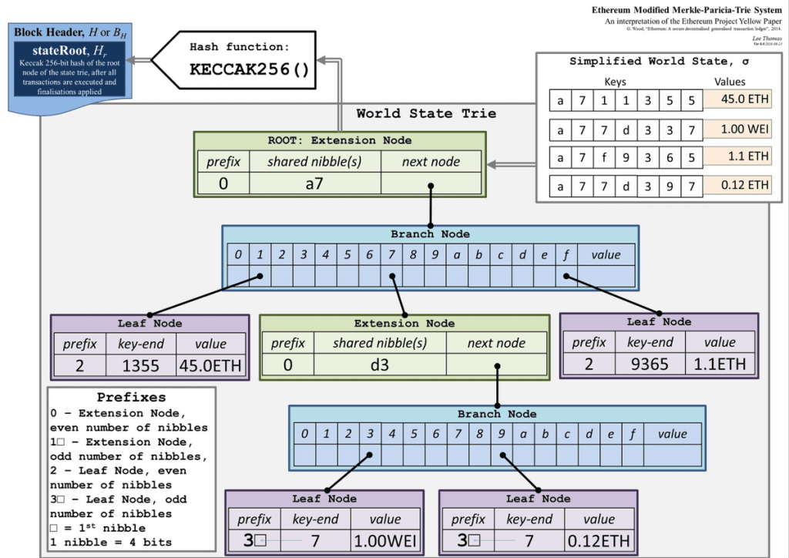

> 이 글은 2twodragon.com(워드프레스)에서 2024-11-15에 처음 게시된 글을 옮긴 것입니다.

비트코인에 이어 이번 포스팅에서는 이더리움 블록체인의 내부를 상세히 설명하고, 주요 구성 요소들이 어떻게 상호작용하는지를 이해하기 쉽게 정리해보겠습니다. 😊💡

### 이더리움 블록체인의 내부 구조 이해하기

이더리움은 단순한 암호화폐를 넘어 스마트 계약(Smart Contract)과 탈중앙화 애플리케이션(DApps)을 지원하는 강력한 플랫폼으로, 그 블록체인 구조와 작동 원리는 비트코인과는 몇 가지 중요한 차이점이 있습니다. 이 포스팅에서는 이더리움 블록체인의 내부 구조와 주요 구성 요소들이 어떻게 상호작용하는지를 자세히 살펴보겠습니다. 🧱✨

*devkly*

#### 1. 블록의 구조

이더리움 블록체인은 비트코인과 유사하게 블록 헤더와 트랜잭션으로 구성되지만, 추가적으로 상태(State)와 스마트 계약 코드가 포함됩니다.

- **Header(헤더):** 블록 헤더는 블록의 메타데이터를 포함하며, 다음과 같은 요소들로 구성됩니다.
- **Parent Hash:** 이전 블록의 해시 값으로, 블록 간의 연결을 형성하여 블록체인의 무결성을 유지합니다.
- **Uncle Hash:** 이더리움에서는 ‘Uncle’ 블록이라 불리는 보조 블록을 포함하여 보안성과 채굴 효율성을 높입니다.
- **Coinbase:** 블록을 생성한 채굴자에게 보상을 지급하는 주소입니다.
- **State Root:** 블록 내의 모든 계정 상태를 하나의 해시로 압축한 값입니다.
- **Transaction Root:** 블록 내의 모든 트랜잭션을 하나의 해시로 압축한 값입니다.
- **Receipt Root:** 트랜잭션 영수증의 루트 해시입니다.
- **Logs Bloom:** 블록 내의 로그 데이터를 효율적으로 필터링할 수 있는 데이터 구조입니다.
- **Difficulty:** 채굴 난이도 수준을 나타냅니다.
- **Number:** 블록의 높이(체인 내 위치)를 나타냅니다.
- **Timestamp:** 블록이 생성된 시간을 나타냅니다.
- **Extra Data:** 추가적인 데이터를 포함할 수 있는 필드입니다.
- **Nonce:** 채굴 과정에서 사용되는 숫자로, 적합한 해시 값을 찾기 위해 변경됩니다. 🔧⛏️

#### 2. 블록의 내용(Block Content)

이더리움 블록의 내용은 블록 헤더 외에 다양한 트랜잭션과 상태 변경 사항을 포함합니다.

- **Transactions (트랜잭션):** 사용자 간의 이더 전송이나 스마트 계약 실행을 포함한 모든 활동이 트랜잭션 형태로 기록됩니다. 각 트랜잭션은 다음과 같은 요소로 구성됩니다.
- **Nonce:** 계정에서 발생한 트랜잭션의 순서를 나타냅니다.
- **Gas Price:** 트랜잭션 처리에 필요한 가스의 가격을 지정합니다.
- **Gas Limit:** 트랜잭션 실행에 사용할 수 있는 최대 가스 양을 설정합니다.
- **To:** 트랜잭션 수신자의 주소입니다.
- **Value:** 전송되는 이더의 양입니다.
- **V, R, S:** 트랜잭션의 서명 요소로, 보안을 보장합니다.
- **Smart Contracts (스마트 계약):** 이더리움은 Turing 완전 언어를 사용하여 복잡한 스마트 계약을 작성할 수 있습니다. 스마트 계약은 특정 조건이 충족될 때 자동으로 실행되는 코드 조각입니다. 📝🔗

#### 3. 이더리움 트랜잭션(Transaction)

이더리움의 트랜잭션은 비트코인과 유사하지만, 더 많은 기능을 제공합니다.

- **Data (데이터):** 스마트 계약 호출 시 필요한 추가 데이터를 포함할 수 있습니다.
- **Gas:** 트랜잭션 실행에 필요한 연산 비용을 나타내며, 네트워크의 혼잡도에 따라 변동됩니다. 🔐📝

#### 4. 입력과 출력의 상세 구조

**입력(Input):**

- **Previous Transaction Hash & Index:** 현재 트랜잭션에 사용되는 이더의 출처를 정의합니다.
- **Script Data:** 이더를 소유하고 있다는 증명을 포함하며, 개인 키로 서명된 데이터입니다. 이는 소유자가 이더를 사용할 수 있는 권한을 증명합니다. ✍️🔑

**출력(Output):**

- **Amount:** 전송되는 이더의 양을 나타내며, Wei 단위로 표시됩니다. 1 Ether는 10^18 Wei입니다.

<!-- -->

- **Output Script:** 이더가 보내질 주소와 필요한 서명 정보를 포함합니다. 이는 수신자의 공개 키를 포함하여 이더가 누구에게 전송되었는지 확인할 수 있게 합니다. 🪙📜

#### 5. 이더리움과 전통적 금융 시스템의 차이점

이더리움은 전통적인 금융 시스템과 몇 가지 주요 차이점을 가지고 있습니다. 전통적인 금융 시스템에서는 자금의 출처가 모호할 수 있지만, 이더리움 블록체인에서는 모든 트랜잭션이 투명하게 기록되어 명확하게 추적할 수 있습니다. 또한, 스마트 계약을 통해 자동화된 계약 실행이 가능하여 거래의 신뢰성과 효율성을 높입니다. 🔒🧐

### 트랜잭션의 흐름 예시

이더리움 트랜잭션의 작동 방식을 예로 들어보겠습니다. 한 사용자가 다른 사람에게 2 ETH를 보내려 할 때, 사용자는 기존에 보유한 1 ETH 단위의 입력을 두 개 사용하여 총 2 ETH를 지불하고, 나머지 0.5 ETH의 잔돈은 새 출력으로 설정할 수 있습니다. 이는 마치 여러 개의 지폐를 사용하여 원하는 금액을 지불하고 남은 잔돈을 돌려받는 것과 유사합니다. 사용된 입력과 출력은 블록체인에 기록되어 거래 내역의 투명성과 보안을 보장합니다. 💳✅

### 이더리움의 핵심 구성 요소 및 그 작동 원리

이더리움 네트워크는 다양한 요소로 구성되어 있으며, 이 요소들은 네트워크의 무결성과 원활한 작동을 위해 서로 밀접하게 상호작용합니다. 다음은 이더리움 네트워크의 구성 요소와 그 작동 방식을 설명합니다.

#### 1. 이더리움 네트워크의 구성 요소 상세

- **노드(Node):** 이더리움 네트워크의 기본 단위로, 모든 노드는 블록체인의 사본을 보유하고 있습니다. 노드는 트랜잭션을 검증하고, 검증된 트랜잭션을 다른 노드와 공유하여 전파합니다. 🌐🖥️
- **마이너(Miner):** 새로운 블록을 생성하기 위해 트랜잭션을 모아 블록을 구성하는 주체입니다. 마이너는 주어진 난이도 목표를 충족하는 해시 값을 찾기 위해 Nonce를 변경하며, 성공적으로 블록을 생성하면 이더리움 보상을 받습니다. ⛏️🪙
- **스테이킹 풀(Staking Pool):** 이더리움 2.0에서는 작업 증명(PoW)에서 지분 증명(PoS)으로 전환되었습니다. 여러 참여자가 스테이킹 풀에 참여하여 블록 생성에 필요한 지분을 제공하고 보상을 공유합니다.
- **Validator:** PoS 시스템에서 블록을 검증하고 생성하는 역할을 합니다. Validator는 일정량의 이더를 스테이킹하고, 네트워크의 합의에 참여하여 보상을 받습니다. 🎯🤔

#### 2. 이더리움과 분산 원장 기술

- **분산 원장:** 중앙 집중형 서버나 데이터베이스가 아닌, 네트워크의 모든 참여자가 동일한 데이터베이스 사본을 가지고 있습니다. 이는 데이터 조작이 어려워지고, 보안성이 높아집니다. 분산 원장은 모든 트랜잭션이 체인 형태로 기록되며, 참여자 모두가 동등하게 데이터를 공유합니다. 📂💻
- **• 블록:** 각 블록은 이전 블록의 해시를 포함하고 있어, 블록체인이 일종의 ‘디지털 체인’처럼 연결됩니. 이는 데이터의 불변성을 보장하고, 네트워크의 모든 참여자가 동일한 기록을 보유할 수 있게 합니다. 🔗📝

*eth*

#### 3. 네트워크와 노드 간의 상호작용 과정

노드는 이더리움 네트워크에서 중요한 역할을 하며, 트랜잭션의 생성, 검증, 전파에 참여합니다. 새로운 블록이 생성되면, 네트워크의 각 노드는 이를 검증하고, 자신의 블록체인 사본에 추가합니다. 이러한 과정을 통해 모든 참여자가 동일한 데이터를 공유하며 네트워크의 신뢰성이 유지됩니다. 🔄📡

#### 4. 이더리움 관련 주요 서비스

- **이더리움 거래소:** 사용자가 법정 화폐로 이더를 사고팔 수 있는 플랫폼입니다. 거래소는 사용자의 예금을 은행 계좌에 보관하고, 이더는 이더리움 지갑에 보관됩니다. 이는 이더를 쉽게 거래할 수 있도록 도와줍니다. 💳💸
- **지갑 서비스 제공자:** 이더리움 지갑은 사용자가 자신의 이더를 보관하고, 서명하여 거래를 생성할 수 있도록 지원하는 서비스입니다. 사용자의 개인 키를 안전하게 관리하여 이더의 소유권을 보장합니다. 🔐📲
- **스마트 계약 플랫폼:** 스마트 계약을 개발하고 배포할 수 있는 플랫폼으로, 개발자들이 탈중앙화 애플리케이션(DApps)을 구축할 수 있게 합니다. 이는 다양한 산업 분야에서 혁신적인 솔루션을 제공할 수 있습니다. 🛠️💡

#### 5. 이더리움 사용자와 거래 과정

- **사용자:** 이더리움 사용자는 디바이스를 통해 이더리움 트랜잭션을 생성하고 서명할 수 있습니다. 이러한 거래는 네트워크 내의 노드에 의해 검증되며, 검증된 거래는 다른 노드로 전파되고 블록에 추가됩니다. 이더리움은 개인 간의 P2P 네트워크를 통해 빠르고 안전한 거래가 가능합니다. 🚀🔗

### 이더리움 네트워크의 특징

이더리움 네트워크의 가장 큰 특징은 탈중앙화와 스마트 계약 지원입니다. 모든 트랜잭션은 블록체인에 기록되며, 누구나 이 기록을 확인할 수 있습니다. 또한, 네트워크의 모든 참여자가 동일한 데이터를 보유하고 있어 신뢰할 수 있는 거래 시스템을 제공합니다. 스마트 계약을 통해 자동화된 계약 실행이 가능하여 다양한 산업 분야에서 혁신을 이끌고 있습니다. 이러한 투명성과 탈중앙화는 금융 시스템뿐만 아니라 여러 분야의 혁신을 가져왔으며, 이더리움을 단순한 디지털 자산 이상의 가치로 평가받게 합니다. 💎🔐

이 포스팅을 통해 이더리움 네트워크의 구조와 작동 원리에 대한 이해가 높아지길 바랍니다. 이더리움은 기술적 복잡성을 지닌 강력한 플랫폼으로, 그 핵심인 블록체인 기술은 다양한 분야에 응용 가능성이 큽니다. 앞으로도 이더리움과 블록체인 기술에 대한 흥미로운 발전이 이어지길 기대해 봅니다! 😊🚀

#### 출처

- [코인 역사](https://spri.kr/posts/view/23301?code=data_all&study_type=industry_trend&utm_source=perplexity&utm_source=perplexity)
- <https://ethereum.org/en/learn/>
- [devkly.com](https://devkly.com/blockchain/ethereum-state/?utm_source=perplexity&utm_source=perplexity)
