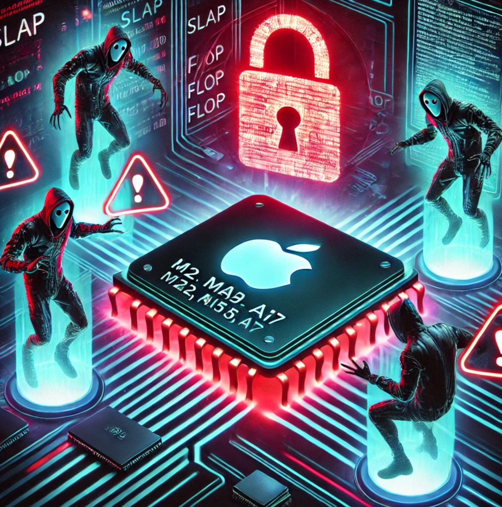
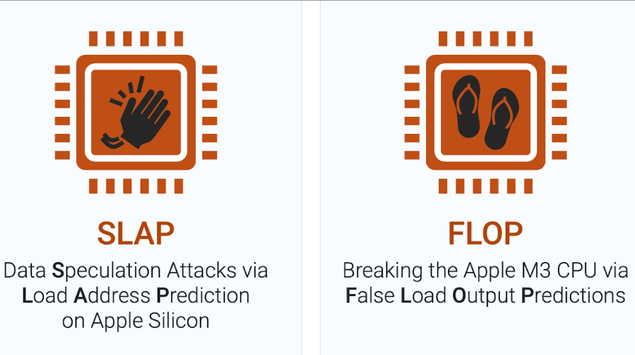

> 이 글은 2twodragon.com(워드프레스)에서 2025-01-31에 처음 게시된 글을 옮긴 것입니다.

최근 발견된 <strong>SLAP(추측적 로드 주소 예측)</strong>과 **FLOP(잘못된 로드 출력 예측)** 취약점이 애플의 최신 M2, M3, A15, A17 시리즈 칩에 영향을 미치고 있습니다. 🍎💻📱

---

### 애플 M & A 시리즈 칩이란?

애플의 **M 시리즈**와 **A 시리즈**는 애플이 자체 설계한 고성능 반도체로, 각각 Mac과 iPhone, iPad 등에 탑재되어 있습니다.

- **M 시리즈 (예: M1, M2, M3)** **용도**: MacBook, Mac Mini, iMac 등 데스크톱 및 노트북에 탑재.
  - **특징**: 고성능과 에너지 효율성을 동시에 제공, 통합된 아키텍처로 뛰어난 멀티태스킹 성능. ⚡️🔋
- **A 시리즈 (예: A15, A17)** **용도**: iPhone, iPad에 탑재.
  - **특징**: 뛰어난 처리 속도와 그래픽 성능, AI 및 머신러닝 기능 강화. 📱🤖

### 애플 반도체의 중요성

애플의 자체 반도체는 하드웨어와 소프트웨어의 최적화를 통해 뛰어난 사용자 경험을 제공합니다.

- **성능 향상**: 빠른 처리 속도와 효율적인 전력 관리. 🚀🔧
- **통합 보안**: 하드웨어 수준에서의 보안 기능 강화. 🔐🛡️
- **에코시스템 통합**: 다양한 애플 기기 간의 원활한 호환성 제공. 📲🔗

### 과거의 주요 취약점

애플 반도체는 그 혁신성에도 불구하고 몇 가지 보안 취약점이 발견된 바 있습니다.

- **Spectre & Meltdown**: **발견 시기**: 2018년
  - **영향**: 대부분의 현대 프로세서에 영향을 미치며, 데이터 유출 가능성.
  - **대응**: 소프트웨어 패치와 펌웨어 업데이트를 통해 완화. 🛠️🔄
- **Rowhammer 공격** **발견 시기**: 2019년
  - **영향**: 메모리 오류를 유발해 시스템 권한 상승 가능성.
  - **대응**: 메모리 컨트롤러 개선 및 소프트웨어 방어 강화. 🧱🔒

---

### 새로운 보안 위협: SLAP & FLOP 취약점

최근 <strong>SLAP(추측적 로드 주소 예측)</strong>과 **FLOP(잘못된 로드 출력 예측)** 취약점이 애플의 최신 M2, M3, A15, A17 시리즈 칩에 영향을 미치고 있습니다. 🍎💻📱

### 취약점이란?

- **SLAP** **대상**: M2/A15 이후 칩
  - **공격 방식**: 로드 주소 예측기를 조작해 경계를 벗어난 데이터 액세스 🔍🔓
- **FLOP** **대상**: M3/A17 이후 프로세서
  - **공격 방식**: 잘못된 로드 값 예측을 이용해 메모리 안전 검사 우회 🕵️‍♂️🔐

### 위험 요소

- **데이터 유출**: 암호화 키, 신용카드 정보, 이메일 내용 등 민감한 정보 탈취 가능 💳📧🔑
- **보안 경계 우회**: 브라우저 샌드박스를 탈출하여 시스템 전반에 접근 🖥️🔓
- **광범위한 영향**: 2021년 이후 출시된 대부분의 Mac, iPhone, iPad가 대상 📅📱💻

### 공격 방식

악성 웹사이트를 통해 Safari와 Chrome 브라우저에서 공격이 이루어지며, 추측 실행 기능을 악용하여 사용자 데이터를 탈취합니다. 🌐🕸️💣

### 애플의 대응

애플은 이 문제를 인정하고 패치를 준비 중이며, 현재로서는 사용자에게 즉각적인 위험은 없다고 보고 있습니다. 최신 보안 업데이트를 꾸준히 확인하고 설치하는 것이 중요합니다. 🔄🛠️

### 사용자 보호 방법

1.  **브라우저 업데이트**: Safari, Chrome 등을 최신 버전으로 유지하세요. 📲🔄
2.  **보안 소프트웨어 사용**: 콘텐츠 차단기 및 보안 확장 프로그램을 활성화하세요. 🛡️🔧
3.  **주의**: 출처가 불분명한 웹사이트 방문 시 주의하세요. 🚫🌐

### 정보 보안 방법

안전한 디지털 생활을 위해 다음의 정보 보안 방법을 실천하세요:

1.  **강력한 암호 사용**: 복잡한 비밀번호를 설정하고 주기적으로 변경하세요. 🔑🔄
2.  **다단계 인증(2FA) 활성화**: 계정 보안을 강화하기 위해 다단계 인증을 사용하세요. 📲🔒
3.  **소프트웨어 업데이트**: 운영체제와 애플리케이션을 최신 상태로 유지하여 취약점을 방지하세요. 💻🔄
4.  **안티바이러스 및 방화벽 사용**: 악성 소프트웨어로부터 시스템을 보호하세요. 🛡️🦠
5.  **데이터 암호화**: 중요한 데이터를 암호화하여 무단 접근을 방지하세요. 🔐📂
6.  **교육과 인식 향상**: 피싱 공격과 같은 소셜 엔지니어링 위협에 대비해 보안 교육을 받으세요. 🎓🧠
7.  **백업 전략 수립**: 중요한 데이터를 정기적으로 백업하여 데이터 손실에 대비하세요. 💾🔄

### 사이버 보안의 중요성

사이버 보안은 개인과 조직 모두에게 필수적인 요소입니다. 그 중요성은 다음과 같습니다:

- **데이터 보호**: 개인정보, 금융 정보 등 민감한 데이터를 안전하게 보호하여 사생활 침해를 방지합니다. 🔒📊
- **비즈니스 연속성**: 사이버 공격으로 인한 비즈니스 중단을 예방하여 기업의 신뢰성을 유지합니다. 🏢🔄
- **경제적 손실 방지**: 사이버 공격으로 인한 금전적 피해를 예방하고, 복구 비용을 절감합니다. 💰🚫
- **사회적 신뢰 유지**: 개인과 조직의 사이버 보안은 사회 전체의 신뢰성을 유지하는 데 필수적입니다. 🌍🤝
- **법적 준수**: 다양한 데이터 보호법과 규정을 준수하여 법적 문제를 예방합니다. 📜⚖️
- **국가 안보**: 중요한 인프라와 시스템의 보안을 유지하여 국가 안보에 기여합니다. 🏛️🔐

### 미래 전망

공격 기술이 계속 발전함에 따라 사용자와 보안 전문가 모두의 지속적인 경계가 필요합니다. 조직은 자동화된 웹 순찰 시스템을 도입해 잠재적인 악성 사이트를 식별하고 모니터링할 필요가 있습니다. 🔍🤖

🔗 **출처** 🔗

1.  [Apple to patch SLAP and FLOP web browser vulnerabilities](https://macdailynews.com/2025/01/28/apple-to-patch-slap-and-flop-web-browser-vulnerabilities/)
2.  [New Apple CPU side-channel attacks steal data from browsers](https://www.bleepingcomputer.com/news/security/new-apple-cpu-side-channel-attack-steals-data-from-browsers/)
3.  [SLAP/FLOP: Apple Silicon’s ‘Son of Spectre’ Critical Flaws](https://securityboulevard.com/2025/01/slap-flop-apple-silicon-richixbw/)

🔗 **더 자세한 정보는 프로필 링크를 확인하세요!** 🔗

**Stay Safe, Stay Secure!** 🔒
