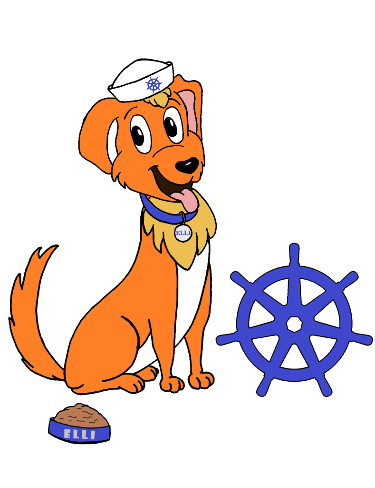

> 이 글은 2twodragon.com(워드프레스)에서 2025-02-16에 처음 게시된 글을 옮긴 것입니다.

EKS Cluster의 버전 업그레이드 과정은 단순히 최신 기능 도입을 넘어서, 클러스터 보안 강화, 애플리케이션 가용성 유지, 그리고 다양한 인프라 구성 요소의 변경 사항을 종합적으로 고려해야 하는 작업입니다. 이번 포스트에서는 EKS Cluster 업그레이드 시 고려해야 할 주요 요소와 무중단 배포(Zero-downtime Deployment)를 위한 전략, 그리고 최근 이슈로 떠오른 IMDSv2 전환 관련 내용을 자세히 살펴봅니다.

1\. EKS Cluster 업그레이드 고려사항

1.1. 사전 준비 및 백업

- 릴리즈 노트 및 문서 확인: 새 버전(예: 1.29 → 1.32)에서 변경된 내용과 호환성 이슈를 미리 파악합니다.
- 백업 및 롤백 계획: 클러스터 구성, 애플리케이션 설정, 데이터베이스 등 주요 요소의 백업을 진행하고, 문제가 발생할 경우 신속히 롤백할 수 있도록 대비합니다.

1.2. 노드 드레인(Node Drain)과 PDB(Pod Disruption Budget) 설정

업그레이드 시 노드 유지보수나 교체를 위해 kubectl drain 명령을 사용하면, 해당 노드의 모든 pod를 다른 노드로 재배치하게 됩니다. 이 과정에서 PodDisruptionBudget(PDB) 설정은 애플리케이션 가용성을 유지하는 데 중요한 역할을 합니다.

- PDB의 역할: PDB는 애플리케이션이 항상 일정 수 이상의 pod를 유지하도록 보장하여, 업그레이드 또는 유지보수 중에 발생할 수 있는 서비스 중단을 예방합니다. 예를 들어:

`apiVersion: policy/v1 kind: PodDisruptionBudget spec: minAvailable: 1 selector: matchLabels: app: your-app`

위와 같이 설정된 경우, pod 수가 1개라면 Allowed Disruptions가 0이 되어 pod eviction(축출)이 차단되므로, 노드 드레인 작업이 무한 대기 상태에 빠질 수 있습니다.

- Allowed Disruptions 계산: Kubernetes는 아래와 같이 계산합니다.

`disruptionsAllowed := currentHealthy - desiredHealthy if expectedCount <= 0 || disruptionsAllowed <= 0 { disruptionsAllowed = 0 }`

- currentHealthy: 현재 Ready 상태의 pod 수
- desiredHealthy: PDB 스펙에 따라 유지되어야 하는 최소 pod 수 (예, minAvailable 또는 maxUnavailable에 의해 결정)

자세한 계산 방식은 [Kubernetes 공식 문서의 PDB Calculation](https://kubernetes.io/docs/tasks/run-application/configure-pdb/#pdb-calculation)을 참고하세요.

1.3. 단계적 업그레이드 및 노드 드레인

- 순차적 진행: 한 번에 모든 노드를 drain하지 않고, 각 노드별로 새 pod가 다른 노드에 재배치되고 Ready 상태로 전환된 후 기존 pod를 종료하는 방식으로 진행합니다.
- 임시 PDB 조정: 긴급 상황에는 maxUnavailable 값을 백분율(예: maxUnavailable: 25%)로 조정하거나 임시로 증가시켜, 노드 드레인 작업이 원활하게 진행되도록 할 수 있습니다.

2\. 무중단 배포(Zero-downtime Deployment) 전략

업그레이드와 유지보수 중에도 애플리케이션의 연속성을 보장하기 위해 무중단 배포 전략을 사용하는 것이 중요합니다.

2.1. 롤링 업데이트 (Rolling Updates)

- 점진적 교체: 기존 pod를 순차적으로 대체하여, 항상 일정 수의 pod가 서비스 중임을 보장합니다.
- Readiness/Liveness Probe 사용: 새 pod가 완전히 준비되었는지 확인한 후 트래픽을 전달함으로써, 미완료 상태의 pod로 인한 장애를 방지합니다.

2.2. Blue-Green Deployment

- 두 환경 병행 운영: 현재 운영 중인 Blue 환경과 새 버전의 Green 환경을 동시에 구성한 후, Green 환경이 준비되면 트래픽을 전환합니다.
- 빠른 롤백: 문제가 발생할 경우 Blue 환경으로 즉시 복귀할 수 있어 다운타임을 최소화할 수 있습니다.

2.3. Canary Deployment

- 부분적 배포: 새 버전을 일부 pod나 특정 사용자 그룹에 먼저 배포하여 모니터링한 후, 이상이 없을 경우 전체 배포를 진행합니다.
- 모니터링 및 리소스 관리: 새로운 버전의 성능과 안정성을 면밀히 모니터링하며, 문제가 감지되면 즉시 대응할 수 있습니다.

2.4. 임시 Replica 증가

- 서비스 연속성 확보: 업그레이드 전 임시로 replica 수를 늘려, pod eviction 등 작업 중에도 서비스 중단을 방지합니다.
- 작업 완료 후 복구: 업그레이드 완료 후 정상 replica 수로 되돌려 리소스 최적화를 진행합니다.

3\. 추가 고려사항: IMDSv2 전환 전략

AWS에서는 보안 강화 목적으로 Instance Metadata Service Version 2(IMDSv2) 사용을 권장하고 있으며, EKS 업그레이드 시에도 이 설정이 중요한 고려 요소로 부각되고 있습니다.

3.1. IMDSv2란?

- 보안 강화: IMDSv2는 기존 IMDSv1보다 세션 토큰 기반 인증 방식을 사용하여, SSRF(Server-Side Request Forgery) 등 보안 취약점을 줄여줍니다.
- AWS 권장 사항: 최신 보안 모범 사례에 따라, AWS는 IMDSv2를 기본적으로 사용하도록 권장하고 있습니다.

3.2. 강제화 vs. 선택적 적용

- 강제화 적용:
- 장점: 보안성이 크게 향상되어 인스턴스 메타데이터 접근 시 인증이 강화됩니다.
- 주의사항: 기존 레거시 애플리케이션이나 AMI가 IMDSv2를 지원하지 않을 경우, 호환성 문제가 발생할 수 있으므로 사전 테스트가 필수적입니다.
- 선택적 적용:
- 유연성: 호환성 문제로 인해 IMDSv2를 즉시 강제화하지 않고, 선택적으로 적용할 수 있습니다.
- 점진적 전환: 테스트 및 검증을 거쳐, 안정성이 확보된 후 강제화로 전환하는 단계적 전략을 사용할 수 있습니다.

3.3. 적용 방법

- EC2 인스턴스 설정: IMDSv2는 EC2 인스턴스의 launch template 또는 CloudFormation 템플릿에서 메타데이터 옵션을 통해 설정할 수 있습니다.
- 검증 및 테스트: 클러스터 업그레이드 전, 별도의 테스트 환경에서 IMDSv2 전환 효과와 애플리케이션 호환성을 충분히 검증합니다.
- 업그레이드 전략에 통합: 클러스터 업그레이드 작업 시 IMDSv2 적용 여부를 명확히 결정하고, 선택적 적용을 통해 문제 발생 시 빠른 대응이 가능하도록 준비합니다.

4\. 통합 전략: EKS 업그레이드 및 무중단 배포 실행 단계

업그레이드와 무중단 배포를 동시에 달성하기 위한 단계별 전략은 다음과 같습니다.

1\. 사전 준비: 릴리즈 노트 확인, 백업, 롤백 계획 수립, 현재 PDB 및 IMDSv2 설정 상태 점검 및 필요시 임시 조정

2\. 업그레이드 전 트래픽 분산 및 Replica 증가: 무중단 배포를 위해 replica 수를 임시로 증가시키고, Canary 또는 Blue-Green 전략을 통해 새 버전의 안정성을 검증

3\. 노드 드레인 및 업그레이드 진행: 노드를 순차적으로 drain하면서, 각 노드의 pod가 다른 노드에 안전하게 재배치되는지 확인. IMDSv2 적용 여부도 함께 검증하며, 호환성 문제 발생 시 선택적 적용 전략을 활용

4\. 모니터링 및 검증: 업그레이드 전 과정에서 애플리케이션 상태, PDB Allowed Disruptions, IMDSv2 호환성, 노드 상태 등을 면밀히 모니터링

5\. 후처리 및 복구: 업그레이드 완료 후 임시로 증가시킨 replica 수와 PDB 설정, 그리고 IMDSv2 설정(선택적 적용 → 강제화 전환 등)을 최종 점검 및 복구

5\. 결론

EKS Cluster 업그레이드는 클러스터 구성 요소, 애플리케이션 가용성, 보안 강화 등 다양한 측면을 종합적으로 고려해야 하는 작업입니다.

- 노드 드레인 및 PDB 설정은 업그레이드 시 애플리케이션의 최소 가용성을 보장하는 핵심 요소이며, 무중단 배포 전략(롤링 업데이트, Blue-Green, Canary, 임시 Replica 증가 등)을 통해 사용자에게 서비스 중단 없이 새로운 버전을 제공할 수 있습니다.
- 또한, IMDSv2 전환은 최신 보안 모범 사례를 적용하는 중요한 변화로, 강제화와 선택적 적용 전략을 상황에 맞게 검토하여 점진적으로 도입하는 것이 바람직합니다.

이와 같이 여러 요소를 통합한 전략을 수립하면, 최신 기능 도입과 함께 보안, 가용성, 호환성을 모두 만족하는 안정적인 EKS Cluster 운영이 가능합니다.

참고 자료

- [Kubernetes 공식 문서: Configure Pod Disruption Budgets](https://kubernetes.io/docs/tasks/run-application/configure-pdb/#pdb-calculation)
- [DevOps Log – EKS 업그레이드 사례](https://devops-log.meiko.co.kr/eks-1)
- [AWS 공식 문서 – Instance Metadata Service Version 2](https://docs.aws.amazon.com/AWSEC2/latest/UserGuide/configuring-instance-metadata-service.html)

이 글이 EKS Cluster 업그레이드와 무중단 배포, 그리고 IMDSv2 전환 전략에 대한 이해에 도움이 되길 바랍니다. 질문이나 추가 의견이 있으시면 댓글로 남겨주세요!
