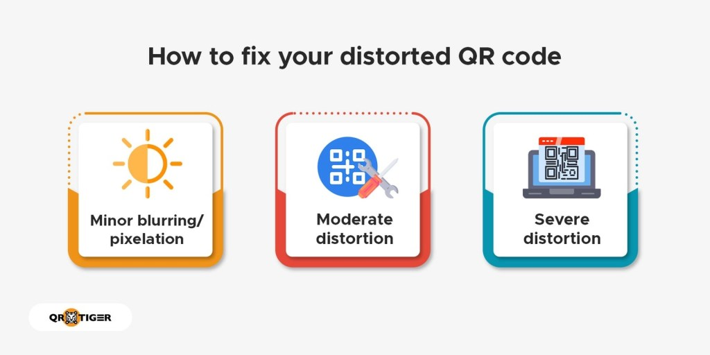
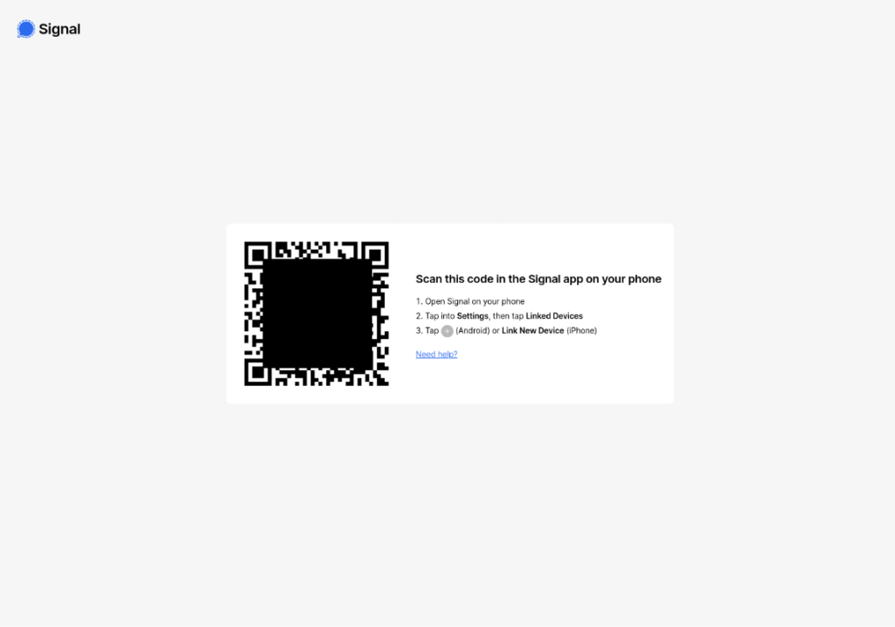

> 이 글은 2twodragon.com(워드프레스)에서 2025-02-22에 처음 게시된 글을 옮긴 것입니다.

QR 코드는 정말 편리하지만, 스캔 전 반드시 주의해야 할 점들이 있어요. 안전하지 않은 QR 코드는 악성 웹사이트 접속, 악성 소프트웨어 설치, 피싱 공격 등 여러 위험을 내포하고 있답니다. 😱

### QR 코드 스캔 안전 수칙

1.  확실한 출처에서 제공된 QR 코드만 스캔하세요.
    - 출처 확인
    - 의심스러운 장소나 출처가 불분명한 코드는 피하는 것이 좋습니다. 🚫
2.  랜딩 페이지 검토
    - 스캔 후 연결되는 페이지가 안전한지 먼저 확인하세요.
    - 모바일 친화적이라도 의심스러운 내용이 있다면 바로 나가세요. 🔍
3.  보안 도구 활용
    - 멀웨어 스캐너 기능이 포함된 QR 코드 리더 앱을 사용하면 더욱 안전합니다.
    - 공용 Wi‑Fi 사용 시 VPN을 활용해 보세요. 🌐
4.  QR 코드의 외관 확인
    - 코드 주변에 충분한 여백이 있는지, 복잡한 디자인 요소가 섞여 있지 않은지 확인해보세요.
    - 디자인에 혼동이 있다면 스캔 전에 주의 깊게 살펴보세요. 👀
5.  악의적인 QR 코드의 위험 인지
    - 피싱 공격: 가짜 웹사이트로 유도해 로그인 정보나 신용카드 정보를 탈취할 수 있어요.
    - 악성 소프트웨어 설치: 기기에 멀웨어를 설치해 개인정보 유출 및 기기 제어 위험이 있습니다.
    - 개인 정보 유출 및 금융 사기: 위치 정보, 브라우저 기록 등 중요한 데이터가 노출될 수 있어요. ⚠️

### 안전 팁

- 신뢰할 수 없는 곳이나 이메일/문자 메시지로 전달된 QR 코드는 절대 스캔하지 마세요!
- 언제나 최신 보안 앱과 VPN으로 내 디바이스를 보호하세요. 🔒

### Signal 사용자 주목!

최근 러시아 위협 행위자들이 Signal의 “연결된 기기” 기능을 악용하는 정교한 공격 기법이 포착되었어요. 이들은 합법적인 Signal 그룹 초대나 보안 경고처럼 위장한 악성 QR 코드를 통해 피해자의 계정을 공격자 제어 기기에 연결시키며, 메시지를 실시간으로 가로채는 위험한 수법을 사용하고 있습니다. 😨

### 공격 방식 & 주요 특징

- 정교한 위장: 합법적인 그룹 초대나 보안 메시지로 위장해 사용자가 안심하고 스캔하도록 유도합니다.
  - 일부 공격은 특수 군사 애플리케이션을 모방한 피싱 페이지에 악성 QR 코드를 삽입해 표적화 공격을 진행합니다.

- 실시간 메시지 가로채기: 피해자의 기기를 손상시키지 않고, 공격자가 제어하는 기기로 Signal 계정을 연결해 메시지를 실시간으로 가로채는 기술이 사용됩니다.
- 전술의 다양화: 광범위 캠페인에서는 가짜 그룹 초대나 보안 경고를 활용하고, 표적화 공격에서는 군사 애플리케이션 모방 피싱 페이지와 악성 JavaScript 페이로드를 배포해 사용자 정보 및 위치 데이터를 탈취합니다. ⚠️

### 주요 위협 행위자: UNC5792 & UNC4221

- UNC5792: Signal 그룹 초대장을 변조하여 합법적인 리디렉션 코드를 악성 URI로 교체, 피해자의 계정을 공격자 제어 기기에 연결합니다.
- UNC4221: 우크라이나 군사 요원을 대상으로 Kropyva 포병 유도 애플리케이션을 모방한 맞춤형 피싱 키트를 사용하며, Kropyva 테마 피싱 페이지에 악성 QR 코드를 삽입해 사용자 정보와 위치 데이터를 수집합니다.

### 안전 수칙

- Signal의 연결된 기기 기능 사용 시 항상 주의 깊게 확인하세요.
- 정기적으로 보안 업데이트 및 앱 검증을 통해 계정을 보호하세요. 🔐

### 출처

1\. Hackers Exploit Signal’s Linked Devices Feature to Hijack Accounts via Malicious QR Codes <https://thehackernews.com/2025/02/hackers-exploit-signals-linked-devices.html>

2\. Russian phishing campaigns exploit Signal’s device-linking feature <https://www.bleepingcomputer.com/news/security/russian-phishing-campaigns-exploit-signals-device-linking-feature/>

3\. Google report warns of Russian threat groups targeting Signal Messenger <https://siliconangle.com/2025/02/19/google-report-warns-russian-threat-groups-targeting-signal-messenger/>

4\. Russian State Hackers Target Signal to Spy on Ukrainians <https://www.infosecurity-magazine.com/news/russian-hackers-signal-spy/>

5\. Google: Russia targeting users of encrypted messaging app Signal <https://www.washingtontimes.com/news/2025/feb/19/google-russia-targeting-users-encrypted-messaging-app-signal/>

이 게시글을 통해 QR 코드 스캔과 Signal 사용 시 발생할 수 있는 위험 요소들을 미리 파악하고, 안전한 디지털 생활을 유지하시길 바랍니다! 😊
