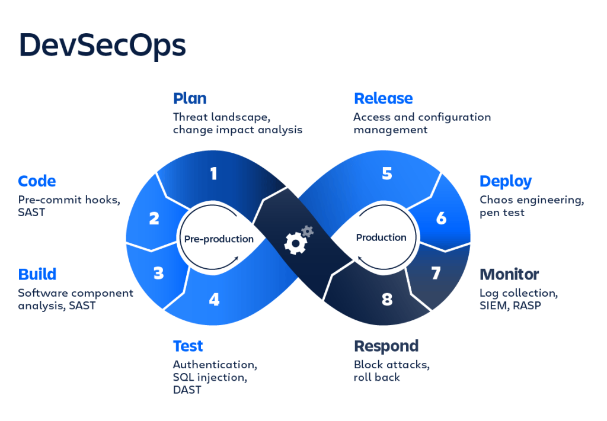
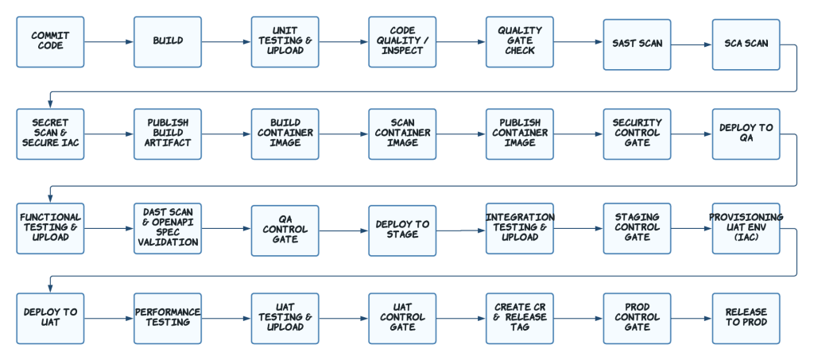

> 이 글은 2twodragon.com(워드프레스)에서 2025-03-13에 처음 게시된 글을 옮긴 것입니다.

GitHub는 전 세계적으로 가장 많이 사용되는 소프트웨어 개발 플랫폼으로, 다양한 협업 도구와 개발 생태계를 제공하여 개발자의 생산성을 극대화합니다. 이 글에서는 GitHub의 기본 기능과 함께 최근 개발 환경에서 주목받고 있는 **DevSecOps**, **GitHub Actions**, 그리고 **보안 기능**에 대해 자세히 알아보겠습니다.

---

## GitHub란 무엇인가요?

GitHub는 Git을 기반으로 한 분산형 소스코드 관리 플랫폼으로, 개발자가 코드 저장소(Repository)에 코드를 관리하고 협업을 할 수 있도록 지원합니다. 주요 기능은 다음과 같습니다.

## 주요 기능

- **버전 관리 및 코드 저장소**: 효율적인 코드 관리, 브랜치, 머지(Merge) 기능 제공
- **협업 도구**: Pull Request, 코드 리뷰, 프로젝트 관리 등
- **이슈 트래킹**: 프로젝트 이슈를 관리하고 추적할 수 있는 시스템
- **통합 도구(Integration)**: CI/CD 도구, 클라우드 서비스, Slack 등 다양한 외부 서비스와의 연동
- **GitHub Pages**: 정적 웹사이트 호스팅 지원
- **GitHub Actions**: CI/CD 및 자동화 워크플로 구축
- **코드 보안 및 분석**: 보안 취약점 탐지 및 코드 품질 분석 도구 내장

GitHub는 최근 Microsoft 인수 후 적극적인 클라우드 통합과 보안 기능 강화를 통해 더욱 발전하고 있습니다.

---

## DevSecOps와 GitHub의 역할

## DevSecOps란?

DevSecOps(Development, Security, Operations)는 개발(Dev), 보안(Sec), 운영(Ops)을 통합하여 애플리케이션 배포 주기 전반에 걸쳐 보안을 적용하는 전략입니다. 빠르게 변화하는 개발 환경에서 보안을 별도의 단계가 아닌 개발 프로세스 전체에 걸쳐 내재화하는 것이 목적입니다.

## GitHub에서의 DevSecOps 적용

GitHub는 DevSecOps 전략을 효과적으로 구현할 수 있는 다양한 기능을 제공합니다.

**코드 스캐닝(Code Scanning)**:

- GitHub의 기본 코드 스캐닝은 코드 작성 단계에서부터 보안 취약점을 탐지합니다.
- CodeQL과 같은 고급 보안 엔진으로 코드 취약점을 실시간 분석합니다.

**Dependabot(의존성 관리)**:

- 소프트웨어 의존성에서 발생하는 보안 취약점을 자동으로 탐지하고 알림을 제공합니다.
- 자동으로 보안 패치가 포함된 업데이트 Pull Request를 생성합니다.

**비밀 관리(Secrets Management)**:

- GitHub Secrets 기능을 통해 API 키나 암호와 같은 민감 정보를 안전하게 저장하고 관리할 수 있습니다.
- GitHub Actions와 통합하여 CI/CD 과정에서 보안 수준을 높일 수 있습니다.

---

## GitHub Actions를 통한 CI/CD 자동화

## GitHub Actions란?

GitHub Actions는 코드 통합(Continuous Integration, CI), 배포(Continuous Delivery, CD), 자동화 작업을 GitHub 플랫폼 내에서 간편하게 수행할 수 있도록 돕는 기능입니다.

## GitHub Actions 주요 장점

- YAML 기반의 쉬운 워크플로 구성
- GitHub의 생태계와 긴밀히 통합
- 다양한 외부 서비스와의 손쉬운 연결 지원
- CI/CD 파이프라인 구축을 단순화하여 개발 속도 향상

## GitHub Actions 주요 활용 사례

- **자동 테스트 및 빌드**: 코드 변경 시 자동으로 테스트 및 빌드 수행
- **자동 배포 및 릴리즈 관리**: AWS, Azure, Google Cloud 등 클라우드 서비스에 손쉽게 배포
- **정기적인 보안 스캔 및 의존성 체크**: 예약된 시간마다 보안 점검 및 업데이트 수행
- **자동화된 보안 패치 적용**: Dependabot과 통합하여 의존성 취약점을 자동 해결

---

## GitHub 보안 기능 총정리

현대 개발 환경에서 코드 보안은 최우선 과제입니다. GitHub는 아래와 같은 강력한 보안 기능들을 제공합니다.

## 1. 보안 감사 로그(Audit Logs)

- 사용자, 관리자의 모든 활동(코드 접근, API 호출 등)을 기록하여 추적
- 규정 준수(GDPR, ISO27001, SOC2) 요구사항 충족
- 비정상 활동 탐지 및 사고 조사 시 신속한 대응 지원

## 2. 코드 스캐닝(Code Scanning)

- 정적 분석을 통해 코드의 잠재적 취약점을 식별 및 보고
- PR 단계에서 취약점을 미리 탐지하고 방지 가능

## 3. Dependabot(의존성 관리)

- 소프트웨어 의존성의 취약점을 주기적으로 확인하여 자동 패치 적용 지원
- 보안 업데이트 PR을 자동으로 생성하여 개발자의 부담을 경감

## 4. 비밀 관리(Secrets Management)

- 민감한 데이터를 GitHub 내에 안전하게 저장하고 CI/CD 과정에서만 접근 가능
- 민감 정보가 코드에 노출되는 것을 방지하여 보안 위협 감소

## 5. 보안 권한 관리 및 액세스 통제

- RBAC(역할 기반 접근 제어)를 통해 정확한 권한 설정 및 관리
- 최소 권한 원칙 적용하여 보안 리스크 최소화

---

## GitHub를 활용한 효과적인 DevSecOps 전략 수립

조직에서 GitHub의 기능을 최대한 활용하여 DevSecOps를 효과적으로 적용하기 위해서는 다음과 같은 전략적 접근이 필요합니다.

- **보안 우선 문화 확립**: 개발 초기부터 보안을 중요시하는 조직 문화 구축
- **자동화된 보안 점검 워크플로 설정**: GitHub Actions를 활용한 코드 보안 점검 자동화 구현
- **실시간 모니터링 및 감사 로그 활성화**: 감사 로그를 적극적으로 활용하여 위협 탐지 및 사고 대응 능력 강화
- **지속적 개선(CI/CD)**: 보안 취약점 발견 시 신속히 대응하는 자동화 시스템 구현

---

## 결론

GitHub는 단순한 코드 저장소가 아니라, **DevSecOps와 보안, 자동화를 포괄하는 종합적인 협업 개발 플랫폼**으로 발전하고 있습니다. GitHub의 기능들을 적극적으로 활용하면 조직의 보안성을 높이고 생산성을 극대화할 수 있습니다.

특히 GitHub의 보안 감사 로그, 코드 스캐닝, GitHub Actions와 같은 기능은 조직의 보안 위협을 사전에 예방하고 신속히 대응하는 핵심 역할을 합니다. 따라서 조직은 GitHub를 단순한 코드 저장소가 아니라 **DevSecOps 환경 구축을 위한 필수 플랫폼**으로 적극적으로 활용해야 합니다.
