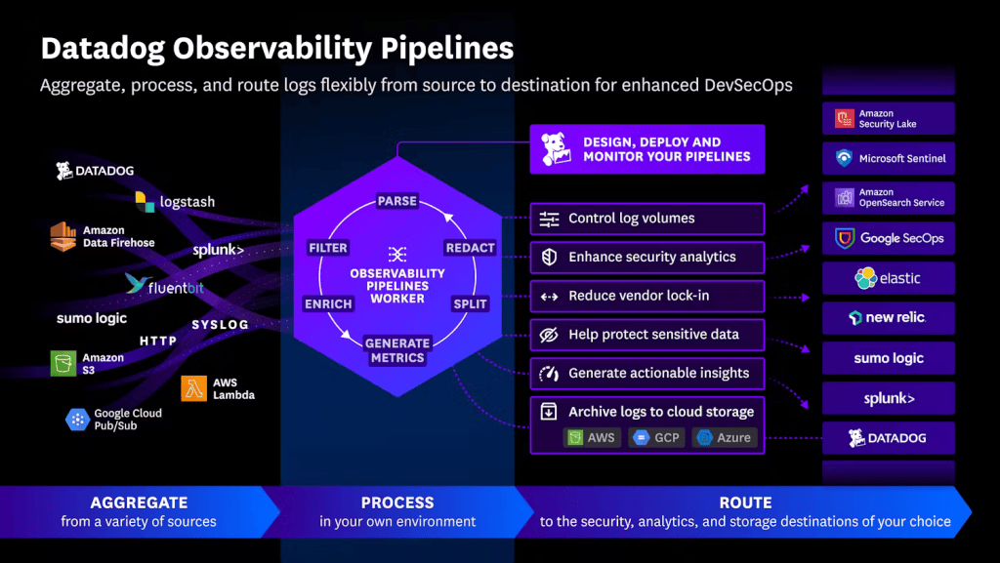
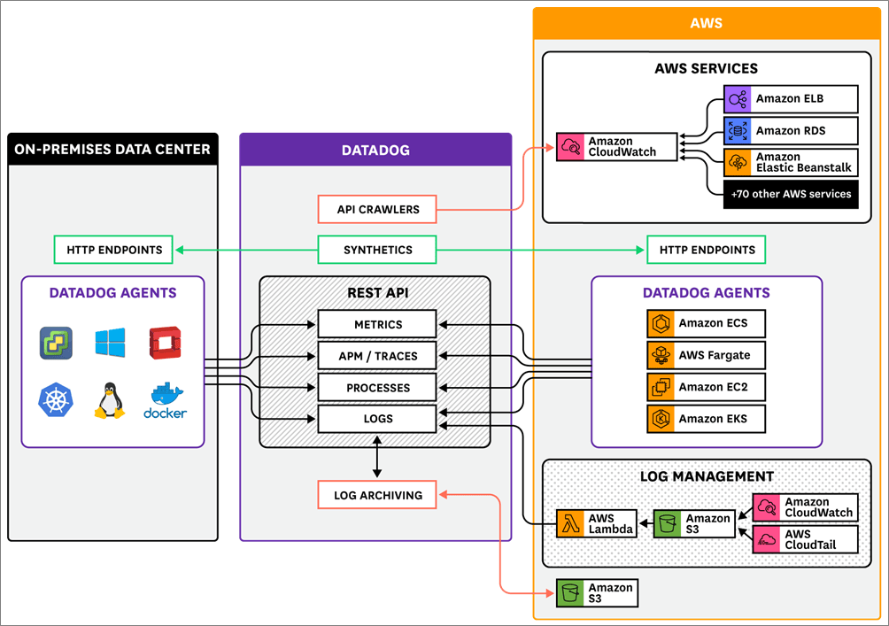

> 이 글은 2twodragon.com(워드프레스)에서 2025-03-14에 처음 게시된 글을 옮긴 것입니다.

오늘날 대부분의 기업은 클라우드 환경으로 빠르게 전환하고 있습니다. 하지만, 이러한 클라우드 전환은 편리함과 효율성뿐 아니라 복잡성 및 보안 위험이라는 새로운 과제도 함께 가져옵니다. 이에 따라 조직들은 더 많은 가시성과 높은 수준의 보안을 제공하는 **Datadog**과 같은 통합 모니터링 플랫폼에 주목하고 있습니다.

이번 포스팅에서는 **Datadog의 주요 기능**을 소개하고, 특히 **DevSecOps 환경 구축**, **GitHub Actions 통합**, **Cloud SIEM을 활용한 보안 강화**, 그리고 <strong>애플리케이션 성능 모니터링(APM)</strong>에 대해 집중적으로 알아보겠습니다.

---

## Datadog이란?

**Datadog**은 하나의 플랫폼에서 **애플리케이션 모니터링(APM), 인프라 모니터링, 보안(SIEM), 로그 분석, 통합 관리** 등을 제공하는 클라우드 기반 통합 모니터링 솔루션입니다.

Datadog는 다양한 클라우드 환경(AWS, Azure, GCP 등) 및 컨테이너 환경(Kubernetes 등), DevOps 툴(GitHub, Jenkins 등)과도 긴밀하게 통합되어, 모든 인프라와 애플리케이션을 단일 플랫폼에서 관리할 수 있습니다.

---

## Datadog 주요 기능 살펴보기

## 주요 기능 요약

- **통합 인프라 모니터링**
- **애플리케이션 성능 모니터링(APM)**
- **Cloud SIEM을 통한 보안 위협 탐지**
- **GitHub Actions와의 긴밀한 통합**
- **로그 수집 및 분석**
- **효율적인 리소스 관리 및 비용 최적화**

---

## 1. DevSecOps 환경과 Datadog의 역할

**DevSecOps**는 소프트웨어 개발, 운영, 보안을 통합하여 보안을 개발 초기부터 반영하는 문화입니다. Datadog는 DevSecOps 환경을 구축하기 위한 다음과 같은 필수 기능을 제공합니다.

- 코드 배포 단계부터 **실시간 보안 점검**
- 코드 품질 및 취약성에 대한 즉각적인 피드백 제공
- 보안 위협을 즉시 탐지하고 알림을 통해 신속한 대응 지원

특히 Datadog의 Code Analysis 및 Cloud SIEM 기능을 통해 DevSecOps 환경의 보안과 운영 품질을 크게 향상할 수 있습니다.

---

## 2. GitHub Actions와 Datadog의 강력한 통합

GitHub Actions는 코드 배포 자동화를 간편하게 지원하는 GitHub 내장 CI/CD 도구입니다. GitHub Actions와 Datadog를 통합하면 다음과 같은 장점을 얻을 수 있습니다:

- **배포 직후 성능 지표 및 보안 상태 즉각 모니터링**
- 성능 저하나 오류 발생 시 즉각적인 알림 및 대응 가능
- CI/CD 과정에서 발생 가능한 보안 문제를 실시간 감지하여 DevSecOps 프로세스 효율 극대화

GitHub Actions와 Datadog의 통합은 배포 과정의 자동화뿐 아니라, 배포 후 즉각적인 보안 및 성능 모니터링을 가능하게 하여 조직의 DevSecOps 전략에 필수적인 요소입니다.

---

## 2. Datadog의 Cloud SIEM – 보안 위협 탐지 및 대응

Datadog의 **Cloud SIEM(Security Information and Event Management)** 기능은 클라우드 환경의 보안 위협을 실시간으로 감지하고 분석할 수 있는 기능입니다.

**✅ Datadog Cloud SIEM의 주요 기능:**

- AWS, Azure, Google Cloud 서비스와의 즉각적인 연동으로 실시간 위협 탐지
- AWS CloudTrail, IAM 활동, API 호출 등을 실시간으로 모니터링하고 비정상 활동을 즉시 탐지
- **통합 대시보드**를 통해 보안 상태를 한눈에 확인하고 대응 가능
- 자동 알림 설정을 통해 사고 발생 시 신속한 대응 가능

## Datadog Cloud SIEM을 통한 보안 강화 전략

- 감사 로그 분석을 통한 사용자 활동 추적 및 비정상적인 접근 탐지
- 의심스러운 행동 및 이상 탐지를 기반으로 자동화된 경고 설정
- 내부 사용자 행동 및 API 접근 기록을 투명하게 관리하여 규정 준수(GDPR, ISO 27001, SOC 2 등)를 충족

---

## 3. Datadog APM(애플리케이션 성능 모니터링)의 활용법

Datadog APM(Application Performance Monitoring)은 애플리케이션의 성능을 실시간으로 추적하고 문제를 빠르게 진단할 수 있는 기능입니다. Datadog APM은 다음과 같은 장점을 제공합니다:

- **실시간 성능 추적**: API 요청의 응답 시간, 에러율, DB 쿼리 성능 등을 상세하게 모니터링
- **트레이싱(Tracing)**: 애플리케이션 내부 코드 단위로 성능 및 오류 분석 가능
- **성능 이상 시 즉각 알림**을 통해 장애 예방 및 빠른 문제 해결 지원
- 애플리케이션 성능 병목 지점을 정확히 파악하여 최적화에 도움 제공

## Datadog APM 사용 시 기대 효과

- 애플리케이션의 성능 문제를 코드 레벨에서 빠르게 진단하여 문제 해결 시간을 단축
- 사용자 경험 향상 및 서비스 가용성 증대
- 운영 효율성 및 신속한 배포 사이클 확보 가능

---

## 4. Datadog 감사 로그 및 리소스 관리

## 감사 로그의 중요성

Datadog는 조직 내에서 발생하는 모든 활동을 감사 로그(Audit Logs)로 기록합니다.

- 감사 로그는 API 요청, 인프라 변경, 보안 정책 변경 등 모든 활동을 기록하여 보안 사고 발생 시 원인을 신속히 추적 가능
- GDPR, ISO27001, SOC2와 같은 규정 준수에도 필수적

## 효율적인 리소스 관리(Integration)

Datadog와 AWS Integration을 통해 리소스 사용 현황을 한눈에 파악하고, 비효율적인 자원 낭비를 사전에 방지할 수 있습니다.

- 자원 낭비 및 비용 급증을 즉시 발견하고 알림
- 사용하지 않는 리소스나 비효율적인 설정을 즉각 개선하여 비용 절감 가능

---

## Datadog를 통한 완벽한 DevSecOps 구현 가이드 (정리)

Datadog는 클라우드 기반의 다양한 기능을 통해 조직의 DevSecOps 전략에 필수적인 역할을 수행합니다. 이를 종합적으로 활용하면 다음과 같은 이점을 얻을 수 있습니다:

- **DevSecOps 전략 강화**: CI/CD 단계부터 성능 및 보안 관리 가능
- **GitHub Actions 통합**: 배포 즉시 실시간 성능 및 보안 상태 파악
- **Cloud SIEM 활용한 보안 강화**: 실시간 위협 탐지 및 대응 능력 확보
- **APM을 통한 성능 최적화**: 애플리케이션 문제를 빠르게 해결하고 서비스 안정성 강화
- **효율적인 리소스 관리 및 비용 절감**: 클라우드 비용 최적화 지원

---

## 결론

Datadog은 더 이상 단순한 모니터링 툴이 아닌, **클라우드 시대의 DevSecOps를 위한 필수 플랫폼**으로 자리매김했습니다. 애플리케이션 성능 관리(APM), 보안 탐지 및 대응(Cloud SIEM), 효율적인 리소스 관리 기능 등을 통해 조직의 클라우드 환경 운영과 보안 수준을 크게 개선할 수 있습니다.

지금 Datadog과 함께 더 안전하고 효율적인 클라우드 환경을 만들어보세요!
