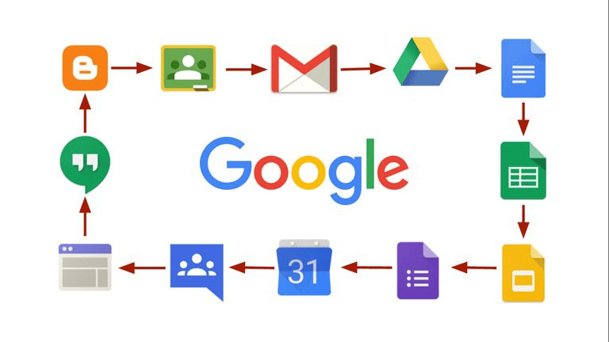

> 이 글은 2twodragon.com(워드프레스)에서 2025-03-17에 처음 게시된 글을 옮긴 것입니다.

현대의 비즈니스 환경에서는 보안과 협업, 그리고 효율적인 업무 처리가 필수적입니다. 구글은 이러한 요구를 충족하기 위해 Google Workspace(구 G Suite)를 비롯한 다양한 엔터프라이즈 솔루션을 제공합니다. 이번 포스팅에서는 구글의 강력한 보안 기능과 함께 드라이브, 메일, DLP, 라벨링, 크롬 플러그인 보안, 조직 단위(OU) 관리, Google Vault, 그리고 개인정보 보호 활동 등 다양한 기능들이 기업 환경에서 어떻게 활용될 수 있는지 살펴보겠습니다. 😊

## 1. 구글 보안: 안심할 수 있는 데이터 보호

### 강력한 인증 및 접근 관리

구글은 다단계 인증(Multi-Factor Authentication, MFA)과 단일 로그인(Single Sign-On, SSO) 기능을 통해 사용자 계정 보호를 강화합니다. 이를 통해 무단 접근을 방지하고, 기업의 민감한 데이터가 안전하게 유지됩니다. 👍

### 데이터 암호화 및 전송 보안

저장 및 전송 중인 데이터는 모두 암호화되어 해커 공격이나 데이터 유출에 대비할 수 있습니다. 이로 인해 내부 문서, 이메일, 파일 등 모든 정보가 안전하게 보호됩니다. 🔐

### 관리 콘솔과 모니터링 도구

Google Admin 콘솔은 IT 관리자가 조직 내 보안 정책을 손쉽게 설정하고, 사용자 활동을 모니터링할 수 있도록 도와줍니다. 실시간 로그 분석과 경고 시스템을 통해 이상 징후를 신속하게 파악할 수 있습니다. 📊

### 데이터 손실 방지(DLP) 기능과 라벨링

구글의 DLP 기능은 민감 정보(예: 개인 식별 정보, 금융 정보 등)가 외부로 유출되지 않도록 모니터링하고 제어하는 역할을 합니다.

- **DLP 정책**: 관리자는 특정 키워드, 패턴, 또는 정규 표현식을 기반으로 데이터 전송을 제어할 수 있으며, 민감 데이터가 포함된 이메일이나 문서의 전송을 차단하거나 경고를 발생시킬 수 있습니다.
- **라벨링 기능**: 문서와 이메일에 보안 라벨을 적용하여 민감도에 따른 접근 권한과 취급 방식을 자동화할 수 있습니다. 이를 통해 내부 정보 보호와 규제 준수를 더욱 효과적으로 관리할 수 있습니다. 🛡️

### 조직 단위(OU) 관리

OU를 활용하면 회사 내 부서나 팀별로 맞춤형 보안 정책 및 설정을 적용할 수 있습니다.

- **세분화된 정책 적용**: 각 OU에 대해 개별적으로 보안 정책, 앱 접근, 데이터 공유 권한 등을 설정할 수 있어 부서별 특성과 요구에 맞는 보안 관리를 실현할 수 있습니다.
- **효율적인 관리**: 중앙 관리 콘솔을 통해 OU별 사용자와 기기를 쉽게 관리하고 모니터링할 수 있습니다. 👥

### 추가 보안 기능: Google Vault 및 Cloud Identity

- **Google Vault 기능**: Google Vault는 전자 데이터 보관, 검색, 내보내기 기능을 제공하여 법적 이슈나 감사 대비를 위한 데이터 보관 및 관리를 용이하게 합니다. Vault를 통해 이메일, 채팅 기록, 문서 등 중요한 데이터를 안전하게 보존하고, 필요 시 신속하게 검색하여 대응할 수 있습니다. 이를 통해 기업은 내부 정보의 투명성을 확보하고, 규제 및 법적 요구사항을 충족시킬 수 있습니다.
- **Google Cloud Identity**: 사용자의 디바이스 및 앱에 대한 접근 관리를 강화하여, 보다 통합된 보안 체계를 구축할 수 있습니다. 📁

### 개인정보 보호 활동

구글은 개인정보 보호를 위해 지속적인 모니터링과 규제 준수 활동을 수행합니다.

- **데이터 보호 및 프라이버시 정책**: 구글은 개인정보 보호를 위해 엄격한 정책을 적용하며, 관련 법규 및 국제 표준을 준수합니다.
- **투명한 데이터 처리**: 사용자 데이터의 수집, 처리, 저장에 대해 투명하게 공개하며, 사용자 스스로 개인정보 설정을 관리할 수 있는 도구를 제공합니다.
- **정기적인 보안 감사**: 기업과 정부 기관의 요구에 맞춰 정기적인 보안 감사와 외부 인증을 통해 개인정보 보호 수준을 지속적으로 개선하고 있습니다. 🔒

## 2. Google Drive: 협업과 클라우드 스토리지의 핵심

### 파일 저장과 버전 관리

Google Drive는 클라우드 기반의 파일 저장소로, 언제 어디서나 안전하게 파일을 업로드하고 관리할 수 있습니다. 버전 관리 기능을 통해 파일의 이전 버전으로 손쉽게 복원할 수 있어, 실수나 오류에 대비한 안전장치로 작용합니다. 📂

### 실시간 협업 기능

동료들과 동시에 문서를 편집하고 코멘트를 남길 수 있는 Google Docs, Sheets, Slides 등의 애플리케이션은 실시간 협업을 극대화합니다. 이는 원격 근무 환경에서도 팀 간의 소통과 생산성을 높이는 데 큰 역할을 합니다. 👥💬

### 공유와 접근 권한 관리

Drive의 강력한 공유 기능을 통해 파일이나 폴더를 특정 사용자와 공유하고, 읽기, 쓰기, 편집 등 세밀한 접근 권한을 설정할 수 있습니다. 이를 통해 외부 파트너와의 협업도 안전하게 진행할 수 있습니다. 🔑

### 추가 기능: Google Cloud Search

Google Cloud Search를 활용하면 조직 내 모든 구글 애플리케이션과 저장소에서 필요한 정보를 빠르게 검색할 수 있어, 업무 효율성을 더욱 향상시킬 수 있습니다. 🔍

## 3. Gmail: 엔터프라이즈 이메일의 표준

### 첨단 스팸 필터링 및 보안

Gmail은 강력한 스팸 필터링과 바이러스 검사 기능을 갖추고 있어, 사용자가 불필요한 메일이나 악성 이메일로부터 보호받을 수 있습니다. 또한, 이메일 암호화 기능을 통해 기밀 정보를 안전하게 주고받을 수 있습니다. 🚫📧

### 비즈니스에 최적화된 사용자 인터페이스

직관적인 인터페이스와 다양한 플러그인 및 애드온을 통해 사용자 맞춤형 이메일 환경을 제공하며, 이는 업무 효율성을 극대화합니다. ⚙️

### 통합 커뮤니케이션 플랫폼

Gmail은 Google Meet, Google Chat 등 다른 구글 엔터프라이즈 도구와의 통합을 통해 하나의 플랫폼 내에서 이메일, 화상회의, 채팅 등을 seamless하게 이용할 수 있습니다. 🤝

## 4. 추가 보안 기능: 구글 크롬 플러그인 보안 & 관리형 브라우저 환경

### 안전한 브라우징 환경 제공

구글 크롬은 다양한 보안 확장 프로그램을 지원하여 브라우징 시 발생할 수 있는 위협으로부터 사용자를 보호합니다.

- **보안 플러그인 관리**: 조직 내에서 승인된 플러그인만 사용하도록 설정할 수 있으며, 이를 통해 악성 플러그인 설치 위험을 줄일 수 있습니다.
- **관리형 브라우저 환경**: 관리 콘솔을 통해 브라우저 사용 정책을 적용하고, 특정 사이트나 확장 프로그램에 대한 접근을 제한하여 보다 안전한 인터넷 환경을 구축할 수 있습니다. 🔍🛡️

## 5. 그 외의 엔터프라이즈 기능들

### Google Meet

원격 회의와 화상 회의를 위한 Google Meet은 HD 화질, 실시간 자막 기능, 그리고 다양한 회의 관리 도구를 제공하여 원격 근무 환경에서도 원활한 커뮤니케이션을 지원합니다. 📹

### Google Calendar

일정 관리와 공유 기능이 탁월한 Google Calendar는 팀 전체의 일정 조율 및 회의 예약을 손쉽게 할 수 있도록 도와줍니다. 📆

### Google Chat & Spaces

프로젝트별 채널(Spaces)과 실시간 대화 기능을 제공하여 관련 문서와 정보를 공유할 수 있는 통합 협업 환경을 구축합니다. 💬

### 추가 도구: Google Forms & Google Sites

- **Google Forms**: 설문조사, 피드백 수집 등 다양한 업무 프로세스를 자동화하여 데이터를 효율적으로 관리할 수 있습니다.
- **Google Sites**: 팀이나 부서별 웹사이트를 손쉽게 제작하여 내부 정보 공유 및 프로젝트 관리를 지원합니다. 📝

## 결론

구글 엔터프라이즈 솔루션은 강력한 보안 체계와 협업 도구들을 통해 기업의 데이터 보호와 업무 효율성을 극대화합니다.

- **보안 측면**: 다단계 인증, 데이터 암호화, DLP 및 라벨링, OU를 통한 세분화된 정책 관리, Google Vault와 Cloud Identity, 그리고 구글 크롬 플러그인 보안을 통해 내부 데이터 유출 및 외부 위협에 대한 대비가 가능합니다.
- **개인정보 보호 활동**: 구글은 엄격한 데이터 보호 정책과 정기적인 보안 감사를 통해 사용자와 기업의 개인정보를 안전하게 관리하며, 투명한 데이터 처리 및 프라이버시 설정 도구를 제공하여 개인정보 보호에 앞장서고 있습니다.
- **협업 측면**: Google Drive, Gmail, Meet, Calendar, Chat, Cloud Search, Forms, Sites 등 다양한 도구를 통해 원활한 협업 환경을 구축할 수 있습니다.

구글의 혁신적인 기술을 도입하여 비즈니스 프로세스를 혁신하고, 변화하는 보안 위협에 효과적으로 대응해 보시기 바랍니다. 여러분의 조직에서도 구글 솔루션을 통해 안정적이면서도 생산적인 업무 환경을 만들어 보세요. 😊
