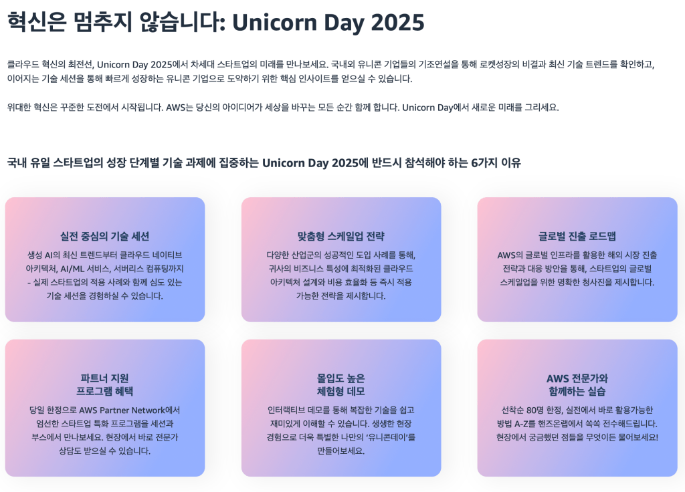
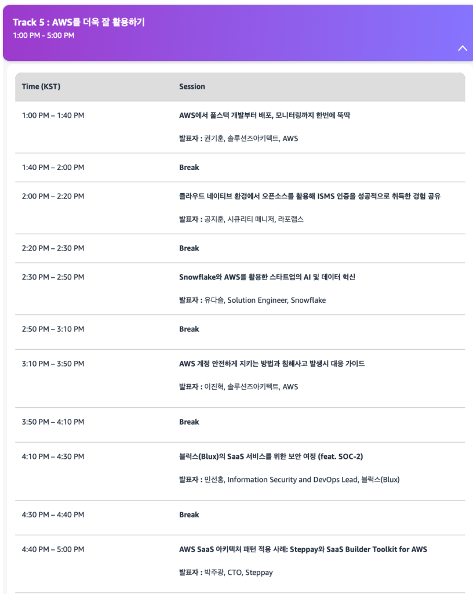

> 이 글은 2twodragon.com(워드프레스)에서 2025-03-18에 처음 게시된 글을 옮긴 것입니다.

디지털 전환과 클라우드 기술의 폭발적 발전에 따라, 기업들은 AI와 클라우드를 통해 비즈니스 모델을 혁신하는 동시에, 안전한 IT 인프라 구축과 보안 관리에 더욱 주의를 기울이고 있습니다. 2025년 AWS 유니콘데이에서는 AI 및 클라우드 기술의 최신 트렌드와 함께, ISMS-P 인증기준에 따른 보안 아키텍처와 AWS 보안 관리 전략에 대한 다양한 사례와 모범 사례가 집중적으로 논의되었습니다.

이번 포스팅에서는 두 가지 주요 주제를 통합하여, 앞으로 기업들이 어떻게 기술 혁신을 도모하고 동시에 보안 위협에 대응할 수 있는지 자세히 살펴보겠습니다.

---

**1. AI와 클라우드 혁신 트렌드** **🤖☁️**

## AI와 클라우드의 융합 – 자동화와 최적화의 가속화

AI와 클라우드가 결합함에 따라 기업들은 강력한 자동화, 비용 절감, 운영 최적화를 동시에 달성하고 있습니다. 이번 유니콘데이에서는 AWS의 다양한 솔루션이 주목받았습니다.

## 주요 트렌드

- **AutoML의 발전:** AI 모델 개발이 단순화되어 비개발자들도 AI를 활용할 수 있는 환경이 조성되고 있습니다.
- **실시간 데이터 분석 및 AI 예측:** AWS Lambda와 SageMaker를 통한 실시간 데이터 분석, 예측 모델 적용 사례가 증가하고 있습니다.
- **Edge AI와 클라우드의 결합:** 클라우드 기반 AI 모델을 엣지 디바이스에서 실행하여 지연 시간을 줄이고, 신속한 대응이 가능해졌습니다.

## AWS의 최신 AI 및 클라우드 서비스

AWS는 이번 행사에서 AI 및 클라우드 기술을 지원하는 다양한 서비스와 기능 업데이트를 발표했습니다. 특히 주목할 만한 서비스는 다음과 같습니다.

- **AWS Bedrock:** 맞춤형 AI 모델을 쉽게 구축하여 AI 애플리케이션 개발을 가속화합니다.
- **AWS Amplify Gen2:** TypeScript 기반 풀스택 개발 프레임워크로, 프론트엔드와 백엔드의 실시간 연동 및 자동화된 백엔드 구축을 지원합니다.
- **AWS SageMaker Nova Reel:** 머신러닝 모델을 실시간 배포하고 최적화할 수 있는 AI 솔루션입니다.
- **AWS Lambda 기반 서버리스 AI:** 최소한의 백엔드 인프라로 AI 기능을 손쉽게 통합할 수 있어, 빠른 개발과 비용 효율적인 운영을 돕습니다.

## 스타트업 및 유니콘 기업들의 성공 사례

유니콘데이에서는 여러 기업들이 AWS와 AI를 활용한 혁신 사례를 공유했습니다.

- **야놀자 – AI 기반 숙박 플랫폼 혁신:** 숙박업을 단순 예약 서비스에서 유통산업의 핵심으로 재편하며, AI 기반 최적 가격 예측 시스템과 마이크로서비스 아키텍처(MSA)를 통해 플랫폼 확장성을 확보하였습니다.
- **AI 코드 리뷰 자동화 시스템:** 사내 AI 솔루션과 AWS CodeWhisperer를 활용하여 코드 리뷰를 자동화, 개발 생산성을 극대화하고 코드 품질을 향상시킨 사례가 주목받았습니다.

## AI+클라우드 기반 개발 환경의 진화

AWS의 서버리스 및 AI 도구를 활용하면 개발자들은 보다 빠르고 효율적인 환경에서 서비스를 구축할 수 있습니다.

- **AWS Lambda & Bedrock:** 서버리스 환경에서 AI 모델을 빠르게 배포할 수 있습니다.
- **AWS Amplify Backend:** 프론트엔드 변경 사항이 즉각적으로 반영되어 개발 속도를 크게 향상시킵니다.
- **CloudWatch AI 모니터링:** 클라우드 인프라의 성능을 실시간으로 분석하고 자동 최적화하는 도구로 활용됩니다.

---

**2. ISMS-P 인증기준 아키텍처와 AWS 보안 관리 전략** **🔒**

기술 혁신이 가속화되는 만큼 보안 위협도 함께 증가합니다. 이에 따라, 기업들은 ISMS-P 인증기준을 충족하는 동시에 AWS 환경에서 철저한 보안 관리 체계를 구축하고 있습니다.

## 보안 아키텍처 구성

안전한 보안 아키텍처는 사용자 인증부터 클라우드 인프라 운영까지 모든 단계에서 다층 보안을 적용합니다.

- **보안 접근 흐름:** **사용자 ↔ CAA(허용된 디바이스) ↔ GWS ↔ Okta, Keycloak ↔ AWS, GCP, EKS**, 각 단계에서 인가된 디바이스와 사용자만 접근하도록 제한하며, SSO 솔루션을 통해 효율적인 인증 및 권한 관리를 실시합니다.
- **내부 네트워크 접근 및 최소 권한 원칙:** 인가된 PC만 내부 네트워크에 접근하도록 설정하고, 데이터베이스 접근 시 Teleport RBAC, MFA, 프록시를 활용한 리버스 터널링 등으로 안전하게 운영합니다.

## AWS 계정 및 접근 관리

AWS 보안을 강화하기 위한 주요 관리 전략은 다음과 같습니다.

- **Root 계정 보안 강화:** Root 계정에 반드시 MFA를 설정하고, 일상 작업은 최대한 IAM 계정을 활용하여 Root 계정 사용을 자제합니다.
- **IAM 계정 및 Access Key 관리:** IAM MFA를 필수 적용하고, 각 Role별로 DBA, Network 등 11개 관리자 권한을 세분화하여 부여합니다. 개발자에게는 PowerUserAccess 권한을 최소한의 범위 내에서 제공하여, 최소 권한 원칙을 철저히 준수합니다.
- **모니터링 도구 활용:** **GuardDuty**를 통해 의심스러운 활동 및 위협을 실시간 모니터링하여 신속한 대응 체계를 구축합니다.

## 클라우드 인프라 취약점 점검 및 관리

- **Prowler:** AWS 환경의 취약점, 권한 과잉, 설정 오류 등을 점검하는 오픈 소스 도구로, 주기적인 보안 상태 점검에 활용됩니다.
- **AWS Inspector 및 Security Hub:** 제한적 취약점 점검을 보완하기 위해 보안 이벤트 및 취약점 정보를 통합 관리합니다.

**AWS 침해사고 분석 대응 시나리오** **🚨**

사이버 침해사고 발생 시 신속한 대응은 피해를 최소화하는 핵심입니다. AWS 환경에서의 대응 프로세스는 다음과 같습니다.

1. **초기 대응 및 지원 요청:**

- 침해사고 발생 시, AWS Support에 계정 보안 문제에 대한 도움을 요청합니다.
- 자격 증명 보고서를 활용해 의심스러운 계정을 신속하게 삭제하거나 격리합니다.

2. **외부 액세스 분석 및 로그 점검:**

- **Access Analyzer**를 통해 외부에서 접근하는 AWS 서비스나 리소스를 분석하고, 의심스러운 트래픽은 아카이브합니다.
- **CloudTrail 로그**를 통해 Root, CreateUser, CreateRole, CreateAccessKey, AccessKey 생성 및 사용 기록을 꼼꼼히 추적합니다.

3. **피해 복구 및 반복 방지:**

- 침해사고로 인한 피해 금액 지원 가능 여부를 확인하고, 빠르게 복구 조치를 취합니다.
- **GenAI를 활용한 로그 분석**을 통해 사고 원인을 철저히 분석하고, 동일한 실수가 반복되지 않도록 보안 정책을 강화합니다.

---

**3. 기대 효과 및 미래 전망** **🌈**

**혁신과 보안의 균형:** AI와 클라우드 기술을 통해 기업들은 신속한 개발, 운영 최적화, 비즈니스 혁신을 달성할 수 있습니다. 동시에, ISMS-P 인증기준에 따른 보안 아키텍처와 AWS 보안 모범 사례를 적용함으로써, 사이버 위협에 대한 효과적인 방어 체계를 구축할 수 있습니다.

## 주요 기대 효과

- **안전한 네트워크 구성 및 무단 접근 차단:** 다층 보안 체계를 통해 인가된 사용자와 디바이스만 접근할 수 있습니다.
- **세분화된 접근 제어와 최소 권한 원칙:** 역할 기반 접근 제어, MFA, Access Key 관리로 보안 리스크를 대폭 줄입니다.
- **지속적인 취약점 관리 및 신속한 사고 대응:** Prowler, Inspector, Security Hub, GuardDuty 등 도구를 통해 클라우드 인프라의 보안 상태를 항상 최신으로 유지합니다.
- **효율적인 로그 분석 및 반복 사고 방지:** GenAI 기반 로그 분석을 통해 사고 원인을 철저히 파악하고, 보안 정책을 지속적으로 개선합니다.

---

## 마무리

2025년 유니콘데이는 AI와 클라우드 혁신이 비즈니스 성장을 가속화하는 중요한 동력이 되고 있음을 보여주었습니다. 동시에, 안전한 IT 인프라 구축과 보안 관리 전략은 디지털 시대의 필수 요소임을 재확인할 수 있었습니다. 기업들은 최신 AWS 서비스와 보안 도구를 활용해 혁신을 이루는 동시에, 체계적인 보안 아키텍처와 침해사고 대응 시나리오를 통해 안전한 디지털 환경을 구축해야 합니다.

여러분의 조직도 AI·클라우드 혁신과 보안 관리 전략을 균형 있게 도입하여, 미래의 사이버 위협에 능동적으로 대응하시길 바랍니다.

자세한 내용과 최신 업데이트는 [AWS 유니콘데이 2025 공식 페이지](https://pages.awscloud.com/aws-unicorn-day-2025-reg.html#agenda)에서 확인해 보세요.

💡 **여러분의 생각은?**

유니콘 기업으로 도약하기 위해 AI와 클라우드를 어떻게 활용하고 계신가요? 또한, 보안 위협에 대응하기 위한 전략은 어떤 방식으로 마련하고 계신지 의견을 댓글로 공유해 주세요!

---

이 포스팅이 AI와 클라우드 혁신, 그리고 보안 전략을 이해하는 데 도움이 되길 바랍니다. 추가적인 질문이나 토론하고 싶은 내용이 있다면 언제든지 댓글로 남겨주세요!
