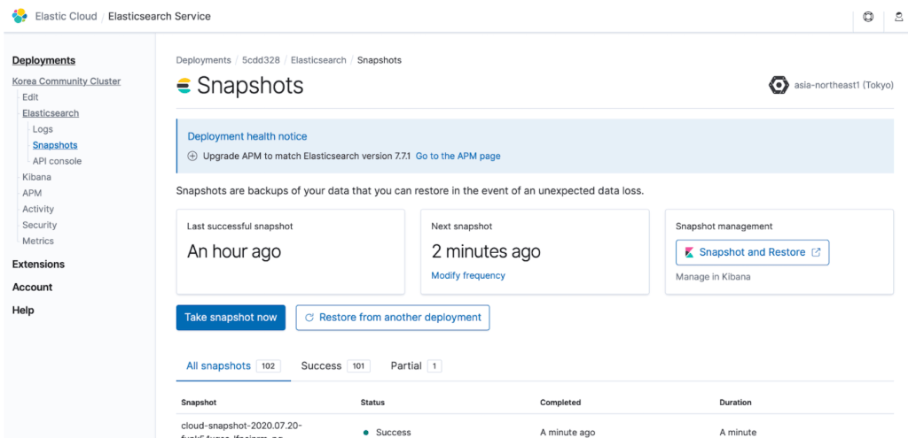
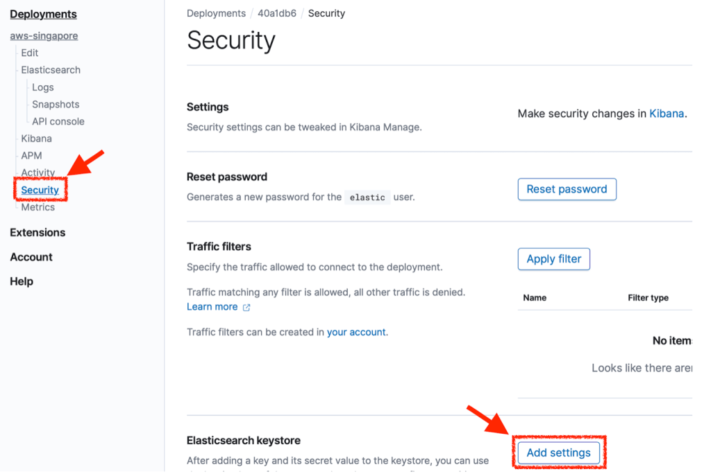

> 이 글은 2twodragon.com(워드프레스)에서 2025-03-21에 처음 게시된 글을 옮긴 것입니다.

최근 Elasticsearch 클러스터에서 S3 스냅샷 저장소를 사용할 때 “The AWS Access Key Id you provided does not exist in our records”라는 오류가 발생했습니다. 클러스터 내 일부 노드는 IAM Role을 통한 자격 증명이 제대로 작동하는 반면, 한두 노드에서는 잘못된 자격 증명이 전달되어 문제가 발생했습니다. 원인으로는 한 노드의 라우팅 테이블 차이와 함께 Elasticsearch keystore에 잘못된 AWS 키가 캐시된 경우가 의심되었습니다. 😱

이번 포스트에서는 문제 상황과 해결 과정을 단계별로 정리하고, keystore에서 잘못된 AWS 키를 제거하는 방법과 클러스터 내 각 노드 간 통신(Open Port) 확인 방법까지 자세하게 설명합니다. 🚀



---

## 문제 상황 개요

- **오류 메시지:** S3 저장소를 사용해 스냅샷을 생성할 때 일부 노드에서 “InvalidAccessKeyId” 오류가 발생했습니다.

## 환경

- **클러스터 구성:** 3개의 노드로 구성
- **IAM Role:** 모든 노드에 IAM Role이 할당되어 S3Full 권한을 보유
- **설정:** Elasticsearch 설정 파일이나 환경 변수에 AWS Access Key와 Secret Key는 명시하지 않음
- **네트워크:** 한 노드만 라우팅 테이블이 다른 것으로 의심되어, 클러스터 내 노드 간 통신이나 S3 통신에 문제가 있을 수 있음

---

## 문제 해결 단계

## 1. 클러스터 노드 및 네트워크 환경 점검

- **노드 환경 확인:** 클러스터의 모든 노드가 동일하게 EC2 인스턴스에서 실행되고 있는지 확인합니다. 만약 일부 노드가 온프레미스나 EC2 외부에서 실행 중이라면, 인스턴스 프로파일을 통해 자격 증명을 획득할 수 없습니다.
- **라우팅 테이블 점검:** 한 노드의 라우팅 테이블이 다른 노드와 다르다면, 해당 노드가 외부 S3 엔드포인트(예: s3.ap-northeast-2.amazonaws.com)로 나가는 트래픽이나 클러스터 내 IP 통신에 문제가 생길 수 있습니다. AWS 보안 그룹 및 네트워크 ACL, 라우팅 테이블 설정을 재검토하여 모든 노드 간 통신이 원활한지 확인합니다.

---

## 2. Elasticsearch 설정 검토

- **IAM Role 사용 확인:** elasticsearch.yml 파일이나 JVM 옵션에서 AWS Access Key, Secret Key와 관련된 설정이 남아 있지 않은지 확인합니다. 올바른 설정은 EC2 인스턴스 메타데이터(169.254.169.254)를 통해 IAM Role 자격 증명을 가져오도록 구성하는 것입니다.
- **AWS 리전 설정 명시:** 클러스터 내 모든 노드가 동일한 AWS 리전을 사용하도록 아래와 같이 elasticsearch.yml 파일에 추가합니다.

```yaml
cloud.aws.region: "ap-northeast-2"
```

이 설정은 AWS SDK가 올바른 S3 엔드포인트를 선택하는 데 중요한 역할을 합니다.

---

## 3. 캐시된 자격 증명 문제 해결: Snapshot Repository 삭제 및 노드 재시작

이전에 생성된 snapshot repository가 잘못된 자격 증명을 캐싱하고 있을 가능성이 있습니다.

- **Snapshot Repository 삭제:** 모든 노드에서 아래 API를 사용해 저장소를 삭제합니다.

```text
DELETE /_snapshot/your_snapshot_repository
```

- **클러스터 전체 재시작:** 모든 노드를 재시작하여 캐시된 잘못된 자격 증명이 초기화되도록 합니다.

```bash
sudo systemctl restart elasticsearch
```

재시작 후 모든 노드가 정상적으로 클러스터에 조인되는지 Elasticsearch 로그를 확인합니다.

---

## 4. Repository 재생성 및 검증

- **Repository 재생성:** 재시작 후, IAM Role 기반으로 S3 스냅샷 저장소를 재생성합니다. AWS Access Key나 Secret Key를 명시하지 않습니다.

```text
PUT /_snapshot/your_snapshot_repository
{
  "type": "s3",
  "settings": {
    "bucket": "your-bucket-name",
    "region": "ap-northeast-2"
  }
}
```

- **Repository 검증:** 저장소가 정상적으로 생성되었는지 검증 API를 사용해 확인합니다.

```text
POST /_snapshot/your_snapshot_repository/_verify
```

정상 응답이 나오면 저장소 설정이 올바르게 적용된 것입니다.

---

## 5. Elasticsearch Keystore에서 AWS 키 확인 및 제거



만약 이전에 잘못된 AWS 자격 증명이 Elasticsearch keystore에 저장되어 있다면, 이를 제거해야 합니다.

- **Keystore 목록 확인:** 아래 명령어로 keystore에 저장된 모든 키를 확인합니다.

```text
./bin/elasticsearch-keystore list
./elasticsearch-keystore list
```

- **특정 키 제거:** 예를 들어, s3.client.default.access_key와 s3.client.default.secret_key가 존재한다면 아래와 같이 제거합니다.

```text
./bin/elasticsearch-keystore remove s3.client.default.access_key
./bin/elasticsearch-keystore remove s3.client.default.secret_key
```

- **노드 재시작:** keystore에서 키를 제거한 후, 모든 노드를 재시작하여 올바른 인스턴스 프로파일(IAM Role) 자격 증명이 적용되도록 합니다.

---

## 6. 노드 간 통신(Open Port) 확인

클러스터 내 각 노드가 서로 통신할 수 있어야 S3 스냅샷 작업과 클러스터 동기화가 정상적으로 이루어집니다.

## a. Telnet 또는 Netcat을 이용한 연결 테스트

- **Telnet 사용 예시:**

```text
telnet <노드_IP> 9300
```

예를 들어, node-1의 IP가 10.1.45.14인 경우:

```text
telnet 10.1.45.14 9300
```

연결이 성공하면 해당 포트가 열려 있음을 의미합니다. ✨

- **Netcat 사용 예시:**

```text
nc -zv <노드_IP> 9300
```

예를 들어:

```text
nc -zv 10.1.45.14 9300
```

## b. 방화벽 및 네트워크 설정 점검

- **보안 그룹 및 네트워크 ACL:** AWS 보안 그룹이나 네트워크 ACL 설정에서 9300번 포트(노드 간 통신용)와 9200번 포트(HTTP 통신용)가 서로 허용되어 있는지 확인합니다.
- **라우팅 테이블 확인:** 모든 노드가 동일한 서브넷 또는 올바른 라우팅 경로를 가지고 있는지 점검합니다. 한 노드만 라우팅 테이블이 다르면 다른 노드와의 통신이 차단될 수 있으므로, 해당 설정을 수정해야 합니다.

---

## 결론

문제의 근본 원인은 한 노드의 라우팅 테이블 차이와 keystore에 캐시된 잘못된 AWS 키로 인해 S3 접근 시 “InvalidAccessKeyId” 오류가 발생한 것입니다.

따라서, 다음 단계로 문제를 해결할 수 있습니다.

1. **Elasticsearch keystore에서 잘못된 AWS 키 제거:**

- ./bin/elasticsearch-keystore list 명령어로 저장된 키를 확인합니다.
- ./bin/elasticsearch-keystore remove s3.client.default.access_key 및 ./bin/elasticsearch-keystore remove s3.client.default.secret_key 명령어로 키를 제거합니다.
- 제거 후 모든 노드를 재시작하여 캐시된 자격 증명이 초기화되도록 합니다.

2. **노드 간 통신(Open Port) 확인:**

- telnet 또는 nc -zv 명령어를 사용해 각 노드의 9300 포트(및 필요시 9200 포트)가 열려 있는지 테스트합니다.
- AWS 보안 그룹, 네트워크 ACL, 라우팅 테이블 설정을 점검하여 모든 노드가 서로 통신할 수 있도록 설정합니다.

이와 같이 keystore에서 잘못된 AWS 키를 제거하고, 클러스터 내 노드 간 네트워크 통신을 보장하면 IAM Role 기반 자격 증명을 통한 S3 접근 문제가 해결됩니다. 🔧💪

이 글이 여러분의 Elasticsearch 클러스터에서 S3 스냅샷 문제를 해결하는 데 도움이 되길 바랍니다. 질문이나 추가 이슈가 있다면 댓글로 남겨주세요! 😊👍
