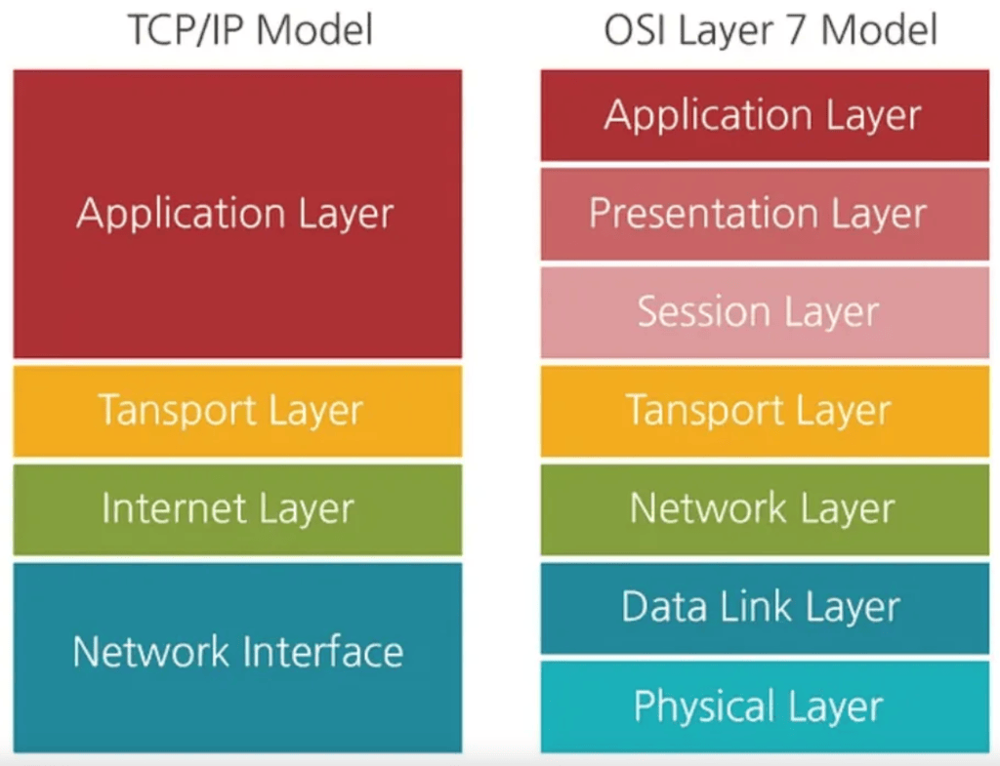
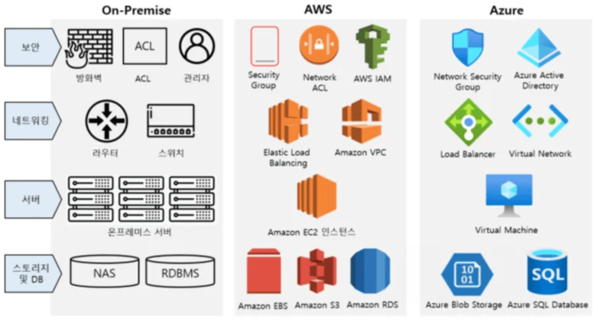
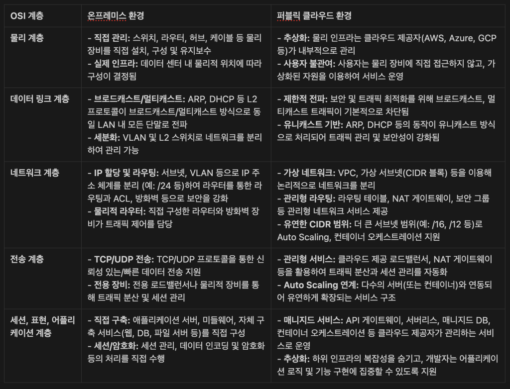
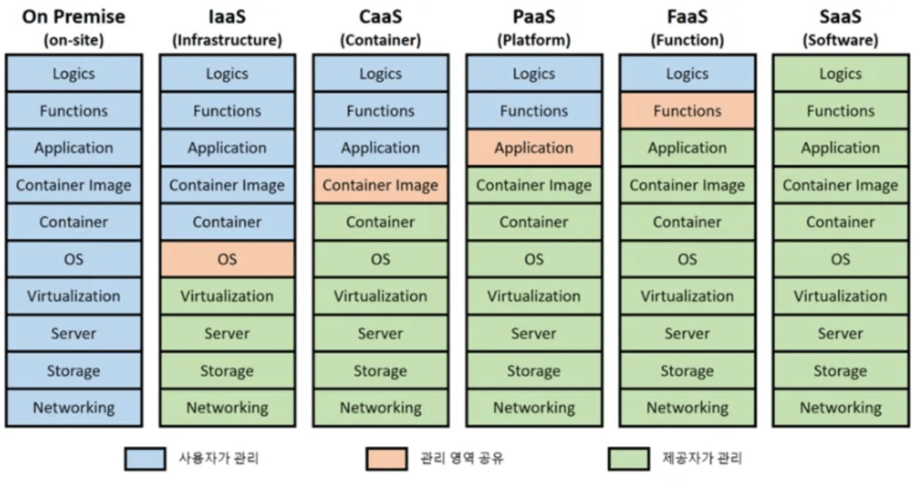
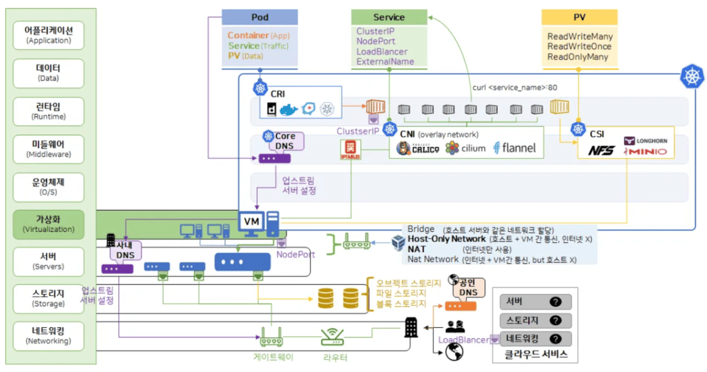

> 이 글은 2twodragon.com(워드프레스)에서 2025-03-22에 처음 게시된 글을 옮긴 것입니다.

## 1. 온프레미스(IDC) vs 클라우드 데이터 센터(CDC)

전통적인 온프레미스(일반 데이터 센터)는 기업이 직접 구축한 시설에서 다양한 플랫폼(메인프레임, 유닉스, 윈도우)을 운영합니다. 반면, 클라우드 데이터 센터는 설비 설치와 유지보수 부담 없이 IT 비즈니스에 집중할 수 있도록 지원합니다.

| **구분** | **일반 데이터 센터(IDC)** | **클라우드 데이터 센터(CDC)** |
|----|----|----|
| **IT 인프라** | 다양한 플랫폼(메인프레임, 유닉스, 윈도우)  – 금융 관련 전산 업무 등 복잡한 작업 처리 | 단일 플랫폼(현재는 주로 윈도우 기반) – 일관된 환경으로 관리 |
|  |  |  |
| **전력밀도** | 저밀도 (보통 1~3Kw/Rack) | 고밀도 (10Kw/Rack 이상, 고사양의 서버를 집중 배치하여 자원 효율성을 극대화) |
| **데이터센터 구조** | 설비 확장이 제한적인 구조 | 모듈형, 유연한 IT 인프라 확장을 지원 – 필요에 따라 빠른 확장이 가능 |
|  |  |  |
| **운영** | IT 인프라와 설비를 별도로 관리하여 운영 | 안전성과 비용 효율적인 통합 관리 – 인프라 구축 부담 없이 비즈니스에 집중 |
|  |  |  |

*데이터 센터 전환의 이유:*

- **유연성:** 빠른 확장과 축소가 가능
- **안전성:** 클라우드 제공자가 최신 보안 업데이트와 관리 제공
- **비용 최적화:** 초기 투자비용 절감과 운영 비용 효율성을 통한 비용 절감

아래는 OSI 7계층 전체를 통합하여, **온프레미스** 환경과 **퍼블릭 클라우드** 환경의 네트워크 구성 및 동작 특징을 한눈에 비교할 수 있도록 정리한 통합 표와 이에 대한 부연 설명입니다.

[Medium.com에서 보기](https://medium.com/harrythegreat/osi계층-tcp-ip-모델-쉽게-알아보기-f308b1115359)

<https://twodragon.tistory.com/557>

---

---

## 2. AWS, Azure, GCP 주요 서비스 비교

퍼블릭 클라우드의 대표 기업인 AWS, Azure, GCP는 각기 다른 명칭과 특징을 가진 서비스를 제공합니다. 아래는 각 클라우드 플랫폼의 핵심 서비스와 장단점을 비교한 내용입니다.

| **구분** | **AWS** | **Azure** | **GCP** |
|----|----|----|----|
| **컴퓨팅 서비스** | **Elastic Compute Cloud (EC2)** | **Virtual Machines** | **Compute Engine** |
| **스토리지** | **Amazon S3** | **Azure Blob Storage** | **Cloud Storage** |
| **네트워크** | **Amazon VPC** | **Azure Virtual Network** | **Cloud Virtual Network** |
| **보안** | **Amazon GuardDuty** | **Advanced Threat Protection** | **Event Threat Detection** |
| **계정/권한 관리** | **IAM** | **Active Directory Role based Access Control (RBAC)** | **Cloud Identity** |
| **주요 장점** | 1\. 광범위하고 성숙한 서비스 제공 2. 안정적인 인프라 지원 | 1\. MS 제품과의 높은 통합성 2. 하이브리드 클라우드 친화적 | 1\. 분석/머신러닝 투자 집중 2. 자동화 환경 구축에 유리한 옵션 |
| **단점** | 1\. 서비스가 너무 많아 관리가 복잡 2. 고급 지식 필요 | 1\. 대규모 구현에 한계 존재 2. 구현을 위한 전문 기술 요구 | 1\. 계약 협상에서 엄격 2. 소규모 파트너 생태계 형성 어려움 |

*각 클라우드 플랫폼은 서비스 이름은 다르지만, 기본적으로는 컴퓨팅, 스토리지, 네트워크, 보안, 계정/권한 관리 등 인프라 전반에 걸친 솔루션을 제공하여 기업이 원하는 비즈니스를 더욱 유연하고 안정적으로 운영할 수 있도록 도와줍니다.*

---

## 3. 클라우드 서비스 모델: On-Premise vs IaaS vs CaaS vs PaaS vs FaaS vs SaaS

클라우드 환경은 전통적인 온프레미스 환경과는 다르게 여러 서비스 모델로 나누어져 있으며, 각 모델은 인프라 관리의 추상화 수준에 따라 구분됩니다.

- **On-Premise (IDC):**
  - 자체 데이터 센터에서 물리 서버, 네트워크, 스토리지를 직접 관리 및 운영
- **IaaS (Infrastructure-as-a-Service):**
  - **예:** AWS EC2, Azure Virtual Machines
  - 고객이 가상 머신, 네트워크, 스토리지 등 인프라 자원을 임대하여 사용
- **CaaS (Containers-as-a-Service):**
  - **예:** AWS ECS, EKS, Azure Kubernetes Service (AKS)
  - 컨테이너 기반 어플리케이션을 배포 및 관리하는 서비스
- **PaaS (Platform-as-a-Service):**
  - **예:** AWS Lambda (서버리스), Google App Engine, SAP Cloud Platform
  - 어플리케이션 개발을 위한 플랫폼을 제공하여 인프라 관리 없이 애플리케이션에 집중할 수 있게 함
- **FaaS (Function-as-a-Service):**
  - **예:** AWS Lambda, Azure Functions, Google Cloud Functions
  - 단위 함수 단위로 서버리스 환경에서 코드를 실행, 이벤트 기반 처리에 최적화
- **SaaS (Software-as-a-Service):**
  - **예:** Office365, Google Workspace
  - 완성된 소프트웨어를 서비스 형태로 제공하여 사용자가 직접 설치나 유지보수를 할 필요 없음

클라우드의 서비스 모델은 고객의 요구에 따라 점진적으로 인프라 관리의 부담을 줄이고, 개발과 비즈니스에 더 집중할 수 있도록 설계되어 있습니다.

이처럼 온프레미스 환경은 물리적 인프라와 직접적으로 연결된 네트워크 구성 요소들을 직접 관리하는 반면, 퍼블릭 클라우드 환경은 물리 계층부터 하위 네트워크 기능을 클라우드 제공자가 추상화 및 관리하여 사용자에게는 보다 유연하고 확장 가능한 가상 네트워크 및 서비스로 제공됩니다.

기존 내용을 바탕으로 **온프레미스**, **가상머신(VM) 기반 가상화**, **클라우드** 환경의 차이와 발전 과정을 설명하는 통합 글입니다. 이 글에서는 가상화 기술의 전개, 각 기술의 특징, 그리고 쿠버네티스와 연계되는 개념들을 함께 다루어 IT 인프라 관리와 서비스 운영에 대한 전체적인 그림을 제시합니다.

---

## 4. 온프레미스 vs 가상머신 가상화 vs 클라우드

<https://www.inflearn.com/blogs/6905>

### 온프레미스 (On-Premise) 환경

- **물리 인프라 직접 관리**온프레미스 환경에서는 기업이나 조직이 데이터 센터 내에 물리 서버, 네트워크 장비(스위치, 라우터 등), 스토리지 시스템을 직접 구축하고 관리합니다.
  - **장점:**
    - 완벽한 제어권을 바탕으로 맞춤형 보안 정책 구현 가능
    - 내부 네트워크 환경(예, LAN)의 자유로운 구성과 확장
  - **단점:**
    - 초기 투자 비용과 유지보수에 많은 비용과 노력이 소요됨
    - 물리적 제약으로 확장성이 제한적일 수 있음
- **실제 리소스 기반 서비스 제공**온프레미스 구축 시 ARP, DHCP 등 로우레벨 네트워크 프로토콜이 자연스럽게 작동하며, VLAN 또는 서브넷을 통해 내부 네트워크를 세분화하고 보안 및 효율성을 높입니다.

---

### 가상머신(VM) 기반 가상화

- **가상화 기술의 등장과 발전**물리 서버의 비용과 관리 부담을 줄이기 위해 등장한 기술이 바로 **가상머신 가상화**입니다.
  - **호스트 가상화 (Hosted Virtualization):**
    - **구조:** 물리 서버 위에 Host OS가 존재하고, 그 위에서 하이퍼바이저(예: VMware Workstation, VirtualBox 등)를 실행해 여러 VM(Guest OS)를 생성합니다.
    - **용도:** 주 운영체제 외에 일시적으로 다른 운영체제가 필요할 때 사용하며, 개발 및 테스트 환경에 적합합니다.
  - **하이퍼바이저(VMware ESXi, Hyper-V 등) 가상화:**
    - **구조:** 물리 서버 위에 바로 하이퍼바이저가 설치되어 Host OS 없이 VM을 직접 관리합니다.
    - **특징:** 오버헤드가 줄어들어 성능이 우수하며, 데이터 센터에서 본격적인 업무용 시스템 운영 시 주로 사용됩니다.
- **가상화의 효과**
  - **자원 효율성:** 하나의 물리 서버에서 여러 VM을 동시에 운영함으로써 하드웨어 자원을 효율적으로 활용할 수 있습니다.
  - **관리 편의성:** 중앙 집중식 관리 도구와 자동화 기술을 활용해 VM 생성, 배포 및 장애 복구를 보다 용이하게 수행할 수 있습니다.
  - **보안과 격리:** 각 VM은 독립된 운영체제 환경을 제공하므로, 하나의 VM에서 문제가 발생해도 다른 VM에 영향이 적습니다.

---

### 클라우드 환경

- **클라우드의 등장 및 추상화**클라우드 컴퓨팅은 온프레미스와 전통적인 VM 가상화를 한 단계 더 추상화한 형태로, **인프라를 서비스(Infrastructure as a Service, IaaS)**, **플랫폼 서비스(PaaS)**, **소프트웨어 서비스(SaaS)** 등 다양한 모델을 제공합니다.
  - **특징:**
    - **물리 인프라 추상화:** 클라우드 제공자가 데이터 센터 내의 물리 인프라와 네트워크, 스토리지를 관리하고, 사용자는 가상 자원(VPC, 가상 머신, 스토리지 등)을 API나 콘솔을 통해 제어합니다.
    - **확장성 및 유연성:** 필요에 따라 리소스를 신속하게 확장(또는 축소)할 수 있으며, Auto Scaling, 로드밸런싱 등 관리형 서비스를 통해 서비스 운영을 자동화할 수 있습니다.
    - **비용 효율성:** 사용한 만큼 비용을 지불하는 OPEX 모델을 통해 초기 투자 비용을 크게 낮출 수 있습니다.
- **가상화 기술과 클라우드 네이티브**최근에는 **컨테이너** 기술과 **쿠버네티스** 같은 오케스트레이션 도구가 부상하면서, 전통적인 VM 가상화와는 또 다른 차원의 추상화를 실현하고 있습니다.
  - **컨테이너 vs VM:**
    - **컨테이너:** Host OS의 커널을 공유하면서 애플리케이션 실행에 필수적인 라이브러리와 바이너리만 포함하여, 빠른 기동과 작은 사이즈를 자랑합니다.
    - **VM:** 각 VM마다 별도의 운영체제를 포함하기 때문에 오버헤드는 크지만, 보다 강력한 격리와 독립성을 제공합니다.
  - **쿠버네티스와 클라우드 네이티브:**
    - 쿠버네티스는 컨테이너를 관리하는 데 최적화된 플랫폼으로, Pod, Service, Persistent Volume(PV) 등 주요 리소스를 추상화하여 기존의 물리 서버, 네트워크, 스토리지 역할을 대신합니다.
    - 이를 통해 클라우드 환경에서는 개발자는 인프라의 복잡성을 신경쓰지 않고, 애플리케이션 로직과 서비스 개발에 집중할 수 있습니다.

---

## 5. 가상화 기술과 쿠버네티스에서의 리소스 추상화

### 가상화 기술 비교

| **항목** | **호스트 가상화** | **하이퍼바이저 가상화** | **컨테이너 가상화** |
|----|----|----|----|
| **구조** | 물리 서버 내 Host OS 위에서 하이퍼바이저 실행, 그 위에 여러 VM 실행 | 물리 서버 위에 직접 하이퍼바이저 설치, Host OS 없이 VM 생성 | Host OS의 커널 공유, 애플리케이션과 필요한 라이브러리만 포함 |
| **장점** | 사용 중인 OS 환경 내에서 보조적으로 다른 OS 실행 | 오버헤드 감소, 성능 우수, 데이터센터 환경에 적합 | 경량화, 빠른 시작/종료, 높은 자원 효율성 |
| **단점** | Host OS의 자원 공유로 인한 성능 제약 | VM 관리 및 배포 복잡성, 초기 구축 비용 증가 | 격리성은 상대적으로 낮고, 보안 및 네트워킹에 대해 별도의 도구/설정 필요 |

### 쿠버네티스의 핵심 리소스와 온프레미스 구성 요소 대응

쿠버네티스는 기존 데이터 센터의 **물리 서버**, **네트워크**, **스토리지** 구성 요소를 추상화하여 제공하는데, 그 대표적인 리소스는 다음과 같습니다.

1.  **Pod**
    - **역할:** 컨테이너(혹은 컨테이너들의 집합)가 실행되는 최소 단위
    - **온프레미스 대응:** 물리 서버나 VM 위에서 애플리케이션이 설치되어 동작하는 역할과 유사하지만, 훨씬 가볍게 실행되고, 쉽게 배포·이동할 수 있음
2.  **Service**
    - **역할:** Pod 간 혹은 외부와의 네트워크 통신을 위해 추상화된 네트워크 접점 제공
    - **온프레미스 대응:** 실제 네트워크 장비(예: 로드밸런서, 라우터)를 통해 트래픽을 분산하고 관리했던 기능을 대신함
    - **유형:**
      - **ClusterIP:** 클러스터 내부 통신 전용
      - **NodePort:** 각 노드 단위의 네트워크 포트를 통한 외부 접근
      - **LoadBalancer:** 클라우드 관리형 로드밸런서를 통한 외부 트래픽 처리
      - **ExternalName:** 외부 DNS 이름과의 매핑 제공
3.  **Persistent Volume(PV)**
    - **역할:** 데이터 저장소를 클러스터에 추상화하여 제공, Pod가 필요할 때 동적으로 연결 가능
    - **온프레미스 대응:** 물리적 스토리지(파일 서버, SAN 등)나 VM 환경에서 따로 구축하는 스토리지 인프라의 역할을 대신함
    - **지원:** CSI(Container Storage Interface) 등을 통해 다양한 종류의 스토리지(파일, 블록)와 연동

---

## 6. 결론: IT 인프라의 진화와 현재의 클라우드

전통적인 온프레미스 환경에서는 물리적 서버, 네트워크, 스토리지 등 각각을 직접 관리하며 **보안**과 **성능 최적화**를 위해 다양한 장비와 솔루션을 도입했습니다.

이후 가상머신 기술이 등장하면서, 하나의 물리 서버 위에 여러 VM을 동시 운영해 자원 효율성을 높이고 관리 부담을 경감시켰으며, 데이터 센터에서는 이러한 기술을 통해 **비용 절감**과 **운영 자동화**를 도모했습니다.

최근에는 클라우드 컴퓨팅과 컨테이너 기술, 그리고 쿠버네티스를 중심으로 **인프라 추상화**가 더욱 진일보했습니다.

- **클라우드 환경**에서는 물리 인프라의 복잡한 관리 대신, 가상 네트워크, 관리형 로드밸런서, 자동 확장(Auto Scaling) 같은 서비스 덕분에 개발자와 운영팀이 핵심 비즈니스 애플리케이션에 집중할 수 있게 되었습니다.
- **쿠버네티스**는 온프레미스의 서버, 네트워크, 스토리지 구성을 추상화하여 Pod, Service, PV 등으로 대신하고, 이를 통해 애플리케이션 배포와 운영의 민첩성을 극대화합니다.

이러한 변화는 IT 인프라를 단순히 “서버와 네트워크” 이상의 개념으로 확장시키며, 가상화 기술에 대한 이해와 더불어 클라우드 및 컨테이너 생태계에 대한 이해가 필수적임을 보여줍니다.

온라인 강의나 블로그를 통해 VM과 컨테이너, 그리고 클라우드 네이티브의 세계를 이해하는 것은 IT 환경의 근본 변화와 그 활용 방법을 이해하는 데 큰 도움이 됩니다.

---

이와 같이 온프레미스, 가상머신 가상화, 그리고 클라우드 환경은 각기 다른 특성과 장점을 가지고 있으며, 현재 IT 인프라는 이들 기술이 단계적으로 발전 및 통합되어 서비스의 확장성과 운영 효율을 극대화하고 있습니다.
