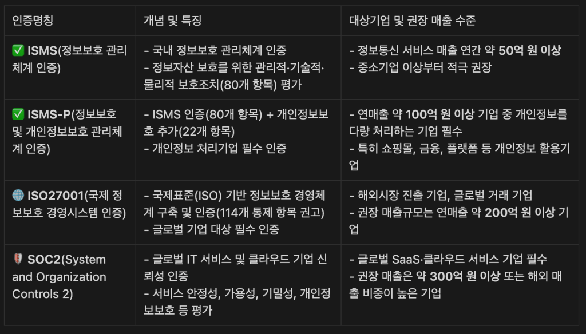
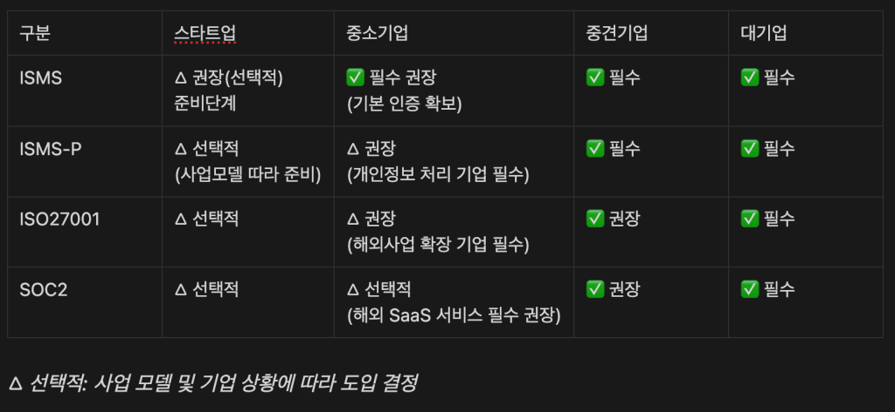
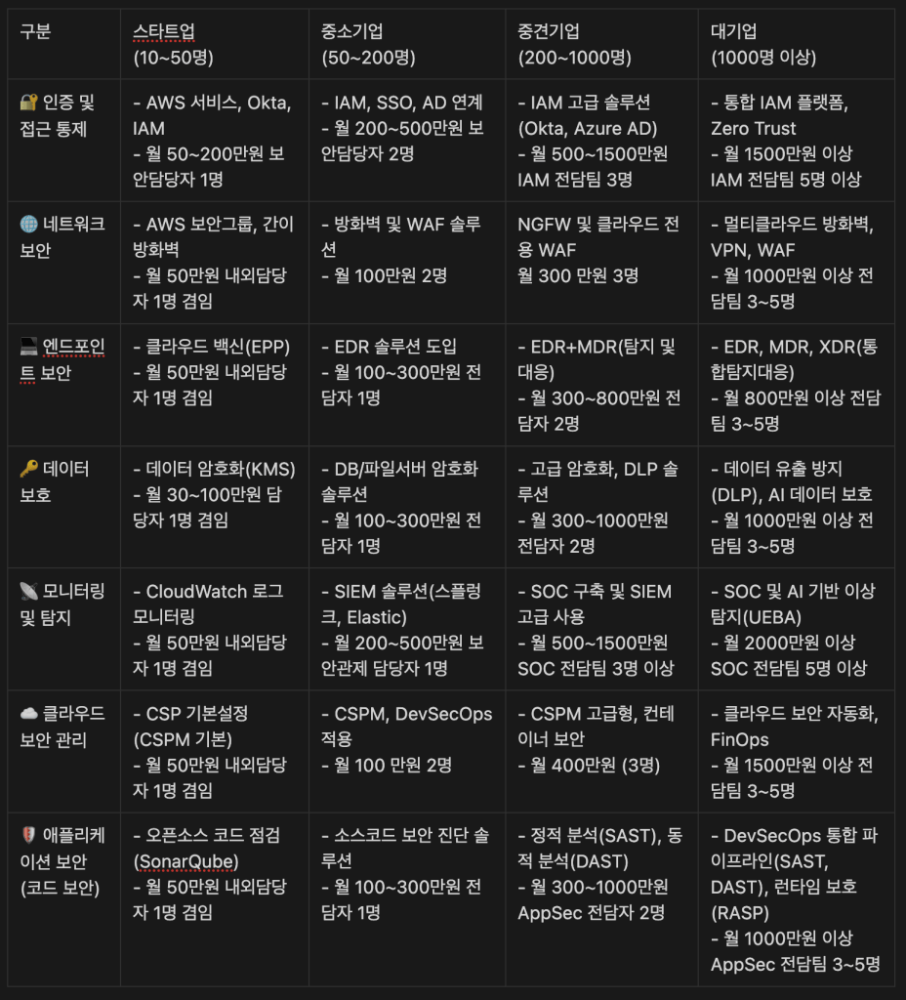

> 이 글은 2twodragon.com(워드프레스)에서 2025-03-23에 처음 게시된 글을 옮긴 것입니다.

### 정보보안의 주요 목표

1.  **정보보안**은 기밀성, 무결성, 가용성을 유지하여 데이터를 보호하는 기술과 정책이다.
2.  데이터가 존재하는 이상 반드시 보안이 필요하며, 이는 정보의 중요성과 가치 때문임을 의미한다.
3.  **클라우드 보안**은 클라우드 환경에서 데이터·애플리케이션·인프라를 보호하는 정책 및 기술이다.
4.  클라우드는 물리적 통제가 어렵고, 인터넷 기반이므로 특화된 보안 전략이 요구된다.
5.  클라우드 환경을 정확히 이해해야만 효과적 보안이 가능하다는 철학(클라우드를 알아야 보안을 한다)이 중요하다.

✅ **CISO(정보보호최고책임자)의 주요 역할 및 보안 인증 대응 전략**

---

## 1. CISO의 주요 역할

| 구분           | 세부 내용                                                  |
|----------------|------------------------------------------------------------|
| 전략 수립      | 기업의 정보보안 전략 수립 및 로드맵 제시                   |
| 리스크 관리    | 보안 위험 식별, 평가, 관리 체계 구축 및 운영               |
| 정책 수립      | 정보보안 정책, 지침, 표준 개발 및 관리                     |
| 법적 준거성    | ISMS, ISMS-P, ISO27001, SOC2 등 정보보안 인증 확보 및 유지 |
| 보안 인식 교육 | 임직원 대상 보안 교육 및 보안 문화 확산                    |
| 사고 대응      | 침해사고 대응 및 복구 계획 수립 및 운영                    |
| 기술 관리      | 보안 기술 솔루션 도입 및 유지 관리                         |
| 보고 및 소통   | 경영진 및 이해관계자 대상 보안 현황 정기 보고              |

✅ **CISO의 역할 (관련 인증 중심)**

- **인증 전략 수립 및 관리**
  - ISMS, ISMS-P, ISO27001, SOC2 인증 로드맵 작성 및 이행 관리
  - 내부 프로세스 구축 및 인증 지속 유지 관리
- **리스크 및 준거성 관리**
  - 인증 별 요구사항에 맞는 리스크 관리 체계 구축
  - 보안 컴플라이언스 체계 지속적 모니터링 및 개선 활동 수행
- **내외부 소통 및 보고**
  - 경영진 대상 인증 확보 현황 및 이슈 보고
  - 내·외부 감사 대응 및 관리 총괄

## 2. 보안 인증 제도(ISMS, ISMS-P, ISO27001, SOC2) 대응 전략

📌 **ISMS, ISMS-P, ISO27001, SOC2 인증 개념 및 권장 매출 규모**

### 매출 규모별 권장 인증 요약표

| 연 매출                             | 추천 인증                    |
|-------------------------------------|------------------------------|
| ~50억 원 미만                       | ISMS 준비                    |
| 50억 원 이상                        | ISMS                         |
| 100억 원 이상                       | ISMS, ISMS-P                 |
| 200억 원 이상                       | ISMS, ISMS-P, ISO27001       |
| 300억 원 이상(글로벌 IT서비스 기업) | ISMS, ISMS-P, ISO27001, SOC2 |

## 3. 인증 별 기업 권장 대응 수준

## 4. CISO의 인증 대비 권장 업무 및 활동

- **내부 프로세스 구축 및 관리**
  - 정보보호 조직 구성 및 책임자 지정
  - 정기적인 보안 위험 평가 및 관리 프로세스 운영
  - 내부 보안 규정 및 지침 수립·운영 및 점검
- **보안 기술 솔루션 관리**
  - IAM, SIEM, DLP, EDR 등 기업 규모에 맞는 보안 솔루션 운영
  - 클라우드 환경 보안(CSPM, DevSecOps, 애플리케이션 보안)
- **외부 인증 대응 및 관리**
  - ISMS, ISMS-P, ISO27001, SOC2 인증 준비 및 유지
  - 인증 주기별 외부 감사 대응 및 유지관리 활동
- **정기적 교육 및 인식 강화**
  - 전사 임직원 보안 인식 제고를 위한 교육 프로그램 정기 운영
  - 보안 문화 조성을 위한 사내 캠페인 및 커뮤니케이션 활동
- **침해 사고 대응 체계 수립**
  - 침해사고 대응 계획(IRP) 수립 및 주기적 훈련 수행
  - 사고 발생 시 대응·복구 프로세스 즉시 가동 및 재발 방지 조치

---

📊 **기업 규모별 필수 보안 솔루션, 비용 및 인원 배치**

📌 **규모별 요약**

| 기업 규모 | 총 예상 월 비용 | 보안 전담 인력  |
|-----------|-----------------|-----------------|
| 스타트업  | 200~450만원     | 1명 (겸임 가능) |
| 중소기업  | 750~1,800만원   | 3~5명           |
| 중견기업  | 2,300~6,000만원 | 8~12명          |
| 대기업    | 7,000만원 이상  | 20명 이상       |

> 권장사항: 기업 규모 및 성장 단계에 따라 보안 예산 및 인력을 점진적으로 확장하고, 다양한 보안을 포함한 포괄적 보안 전략을 수립해야 합니다.

📘 **요약 및 결론**

CISO는 조직 내 모든 정보보호 활동을 총괄하며, 정보보호 관련 국내외 인증(ISMS, ISMS-P, ISO27001, SOC2)에 대한 준비 및 대응을 포함한 보안 체계를 구축하고 운영합니다. 기업 규모와 사업모델에 따라 적합한 보안 인증을 선택적으로 또는 필수적으로 획득하여 신뢰성과 경쟁력을 확보하는 것이 중요합니다.
