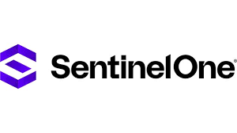
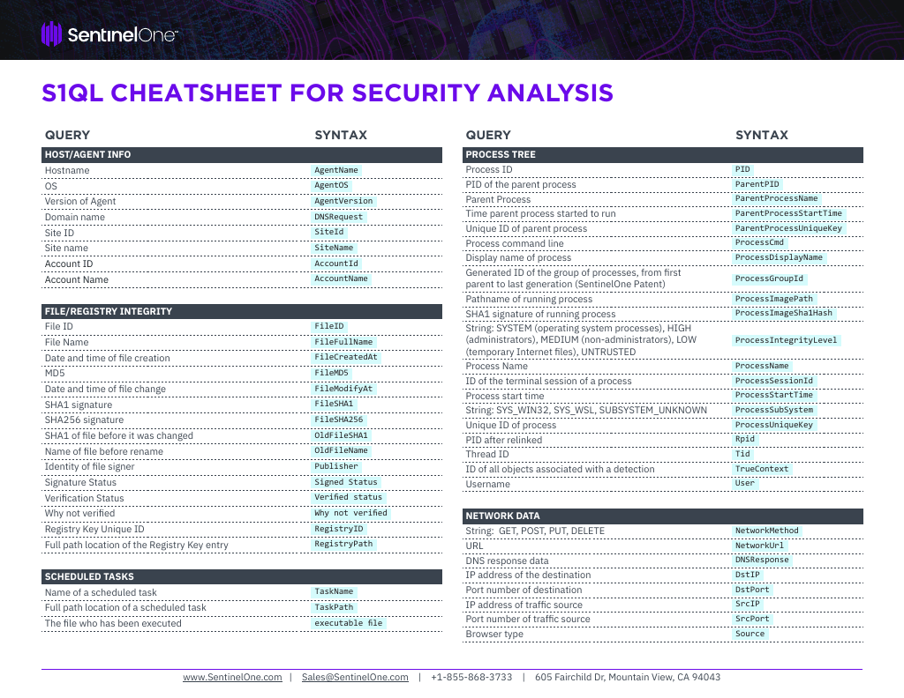

> 이 글은 2twodragon.com(워드프레스)에서 2025-03-24에 처음 게시된 글을 옮긴 것입니다.

최근 사이버 위협이 날로 진화함에 따라, 기업들은 지능적이고 신속한 대응이 가능한 보안 솔루션을 필요로 하고 있습니다. SentinelOne은 **AI 기반 자율 엔드포인트 보호 플랫폼**으로, 실시간 위협 탐지, 예방 및 대응을 제공합니다. 이번 포스팅에서는 SentinelOne의 전반적인 개요와 함께 주요 기능, 그리고 Deep Visibility 및 VirusTotal 연동 기능을 비롯해 Device Control, Network Control, 미보호 엔드포인트, 태그, Cloud Rougues, Star Custom Rules, Application Scan Policy 기능까지 자세히 살펴보겠습니다. 😊

---

## 1. SentinelOne이란?

SentinelOne은 엔드포인트 보안 분야에서 **실시간 위협 탐지 및 대응**을 제공하는 통합 솔루션입니다.

- **자율적 보안 운영:** 머신러닝과 행동 기반 AI를 통해 알려진 위협은 물론 제로데이 공격까지 자동 탐지 및 차단합니다.
- **자동화된 대응:** 위협 발생 시 격리, 종료, 삭제 등 자동화된 조치로 빠르게 대응하여 피해를 최소화합니다.
- **종합 가시성:** 엔드포인트에서 발생하는 다양한 이벤트와 로그를 수집, 분석하여 심층적인 보안 인사이트를 제공합니다.

---

## 2. 주요 기능

### 2.1. 엔드포인트 탐지 및 대응 (EDR)

- **실시간 위협 탐지:** 행동 기반 AI와 머신러닝을 통해 악성 행위 및 이상 징후를 실시간으로 감지합니다.
- **자동화된 대응:** 위협 발생 시 자동화된 조치로 피해 확산을 차단합니다.
- **포렌식 분석:** 사고 발생 시 상세 로그와 이벤트 데이터를 제공하여 원인 분석 및 후속 대응에 도움을 줍니다.

### 2.2. Deep Visibility 및 VirusTotal 연동

### Deep Visibility

- **광범위한 데이터 수집:** 엔드포인트의 프로세스, 네트워크, 파일 시스템 등 다양한 로그와 이벤트를 수집해 전체 활동을 모니터링합니다.
- **심층 분석:** 이벤트 상관관계 분석과 이상 행동 탐지를 통해 공격 전개 과정을 파악하고, 상위 발생 프로세스 및 이벤트 통계를 대시보드로 제공합니다.
- **데이터 마스킹:** 민감한 정보는 클라우드 전송 시 자동으로 마스킹 처리되어 개인정보 보호와 보안 정책 준수를 보장합니다.
- **대시보드 활용:** 직관적인 시각화 도구를 통해 전체 엔드포인트의 보안 상태를 한눈에 파악할 수 있습니다.

### VirusTotal 연동

- **파일 분석:** 다운로드되거나 실행되기 전 파일의 해시값과 구조를 분석하여, 외부 다수의 안티바이러스 엔진 정보와 SentinelOne의 분석 결과를 비교합니다.
- **추가 검증:** 파일 실행 후, Behavioral AI 엔진과 VirusTotal 연동을 통해 위협 인텔리전스를 보강하여 정밀한 정/오탐 분석을 수행합니다.
- **신속한 위협 대응:** 내부 분석과 외부 위협 정보를 통합해 빠르고 정확한 위협 대응 전략을 수립할 수 있습니다.

> **팁:** Deep Visibility와 VirusTotal 연동을 함께 활용하면 단순 모니터링을 넘어 정밀 분석과 위협 인텔리전스 확보에 큰 도움이 됩니다. 👍

### 2.3. 원격 분석 및 지원 (Remote Shell)

- **즉각적 원격 진단:** 웹 콘솔에서 CMD, PowerShell 또는 Linux 셸에 원격 접속하여 문제를 빠르게 진단할 수 있습니다.
- **운영체제 기본 명령어 사용:** 별도의 전용 명령어 없이 각 OS의 기본 명령어를 활용하여 유연하게 대응합니다.
- **원격 지원:** 장애 발생 시 신속한 원격 지원으로 문제 해결 시간을 단축시킬 수 있습니다.

### 2.4. 업그레이드 정책: EA vs GA

- **EA (Early Access) 버전:**
  - 최신 기능 및 개선사항을 조기에 테스트할 수 있도록 제공되며, 일부 기능은 실험적일 수 있습니다.
  - 테스트 환경이나 제한적인 엔터프라이즈 환경에서의 도입이 권장됩니다.
- **GA (General Availability) 버전:**
  - 충분한 검증과 테스트를 거쳐 안정성이 확보된 버전으로, 전사적 배포에 적합합니다.
  - 자동화된 업그레이드 정책을 통해 운영 환경에 원활하게 적용할 수 있습니다.

> **참고:** 안정성을 중시하는 경우 GA 버전을, 새로운 기능 체험을 원한다면 EA 버전을 선택하세요. 😀

### 2.5. 기타 주요 기능 및 정책

- **Device Control 🔒**
  - USB, 외부 스토리지 등 이동식 디바이스의 사용을 제어하여, 민감 데이터 유출 위험을 줄일 수 있습니다.
  - 기업 정책에 따라 특정 디바이스만 허용하도록 설정할 수 있습니다.
- **Network Control 🌐**
  - 엔드포인트의 네트워크 연결을 모니터링하고, 비인가 연결이나 비정상 트래픽을 차단하여 내부 네트워크 보안을 강화합니다.
- **미보호 엔드포인트 (Unprotected Endpoints) ⚠️**
  - 보안 솔루션이 설치되지 않았거나 최신 패치가 적용되지 않은 엔드포인트를 자동으로 식별해 신속한 보안 강화 조치를 취할 수 있도록 지원합니다.
- **태그 (Tags) 🏷️**
  - 각 엔드포인트나 보안 이벤트에 태그를 부여하여, 부서, 위치, 보안 상태 등 기준에 따라 쉽게 그룹화하고 관리할 수 있습니다.
- **Cloud Rougues ☁️**
  - 클라우드 환경에서 비인가 클라우드 서비스나 이상 인스턴스를 감지하여, 클라우드 보안 위협에 대한 인사이트를 제공합니다.
- **Star Custom Rules ⭐**
  - 사용자가 커스텀 보안 규칙을 생성하여 특정 이벤트나 행동을 우선적으로 감지할 수 있도록 합니다.
  - 기업 특유의 보안 요구 사항에 맞춘 맞춤형 방어 체계를 구축할 수 있습니다.
- **Application Scan Policy 📋**
  - 엔드포인트에 설치된 어플리케이션을 주기적으로 스캔하여 취약점, 버전 불일치, 비인가 소프트웨어 사용 등을 식별합니다.

이를 통해 소프트웨어 관리 및 보안 강화를 동시에 달성할 수 있습니다.

> **팁:** 위의 기능들을 종합적으로 활용하면, SentinelOne이 제공하는 엔드포인트 보안 기능을 극대화하여 보다 세밀하고 체계적인 보안 운영이 가능합니다. 😊

---

## 3. 활용 사례 및 Best Practices

### 3.1. 기업 보안 운영의 효율화

- **자동화된 보안 대응:** AI 기반 위협 탐지와 자동 대응 기능 덕분에 보안 운영팀의 수동 대응 부담을 크게 줄이고, 실시간 위협 차단이 가능합니다.
- **종합 로그 분석:** Deep Visibility와 Application Scan Policy를 통해 수집된 로그 및 어플리케이션 데이터를 분석하여 보안 정책 준수를 철저히 관리할 수 있습니다.

### 3.2. 위협 탐지 및 정밀 분석

- **정/오탐 분석:** 파일 다운로드 전 해시값 및 구조 분석, 파일 실행 후 Behavioral AI 분석으로 악성 행위를 정밀하게 판단합니다.
- **연관 분석:** Deep Visibility 기능으로 탐지된 위협과 관련된 모든 이벤트, 프로세스, 레지스트리 정보를 상세하게 분석할 수 있습니다.
- **VirusTotal 활용:** 외부 위협 인텔리전스와 내부 분석 결과를 통합해 정밀 분석 및 신속한 대응 전략을 수립할 수 있습니다.

### 3.3. 원격 지원 및 장애 대응

- **신속한 원격 진단:** Remote Shell 기능을 통해 원격으로 문제를 진단하고 해결, 장애 발생 시 빠르게 대응할 수 있습니다.
- **다양한 OS 지원:** 윈도우, 리눅스 등 다양한 운영체제에서 일관된 지원을 제공하여 통합 관리가 용이합니다.

### 3.4. 보안 인사이트 제공 및 위협 헌팅

- **대시보드 및 통계 분석:** SentinelOne 대시보드를 통해 엔드포인트 점유율, 이벤트 통계 등 핵심 보안 지표를 쉽게 파악할 수 있습니다.
- **위협 헌팅:** 실시간 로그와 이벤트 데이터를 기반으로 비정상적인 행위나 이상 징후를 신속하게 탐지하고 사전 예방 조치를 취할 수 있습니다.

---

### 4. 결론

SentinelOne은 AI 기반 자율 엔드포인트 보안 플랫폼으로,

- **실시간 위협 탐지 및 자동 대응**
- **심층 로그 및 이벤트 분석 (Deep Visibility)**
- **외부 위협 인텔리전스 연동 (VirusTotal)**
- **원격 진단 및 지원 (Remote Shell)**
- **Device & Network Control, 미보호 엔드포인트 식별, 태그 관리, Cloud Rougues, Star Custom Rules, Application Scan Policy**

등 다양한 기능을 통해 기업 보안 운영에 혁신적인 변화를 가져옵니다. 각 기능을 적절히 활용하면 신속하고 효율적인 보안 대응 체계를 구축할 수 있으며, 종합적인 위협 인텔리전스를 통해 보다 안전한 엔드포인트 환경을 마련할 수 있습니다. SentinelOne을 통해 여러분의 보안 전략을 한층 강화해 보시길 바랍니다. 😊👍
