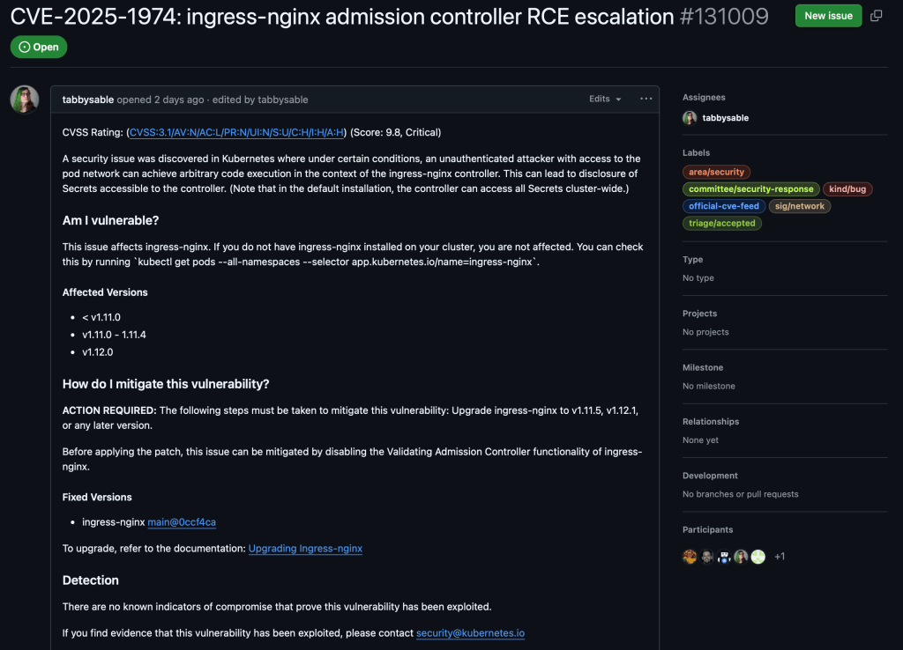

> 이 글은 2twodragon.com(워드프레스)에서 2025-03-25에 처음 게시된 글을 옮긴 것입니다.

최근 Amazon EKS 클러스터에 구성된 nginx‑ingress 컨트롤러가 여러 보안 취약점(CVE-2025-1098, CVE-2025-1974, CVE-2025-1097, CVE-2025-24514, CVE-2025-24513)의 영향을 받을 수 있음이 확인되었습니다. 이번 글에서는 취약점의 개요, 영향을 받는 환경 확인 방법, 완화 및 업그레이드 조치, 그리고 helm 명령 실행 시 나타난 경고 메시지에 대해 자세히 알아보겠습니다 😊.



---

## 1. 문제 개요 및 취약점 정보

**취약점 목록:**

- CVE-2025-1098
- CVE-2025-1974
- CVE-2025-1097
- CVE-2025-24514
- CVE-2025-24513

**영향:** 이들 취약점은 nginx‑ingress 컨트롤러에 영향을 미치며, 악의적인 사용자가 이를 이용해 클러스터 내 리소스 접근, 데이터 노출 또는 서비스 거부 공격(DoS) 등 다양한 보안 위협을 야기할 수 있습니다 🔥.

## 관련 참고 자료

- [Kubernetes GitHub 이슈](https://github.com/kubernetes/kubernetes/issues/131009)
- [Ingress‑nginx 업그레이드 가이드](https://kubernetes.github.io/ingress-nginx/deploy/upgrade/)

---

## 2. 영향을 받는 고객 및 리소스 확인

## 대상 환경

Amazon EKS 클러스터를 운영 중인 모든 계정이 이번 취약점의 대상입니다. 특히 nginx‑ingress 컨트롤러를 사용 중인 클러스터의 경우, 취약점에 노출될 가능성이 있으므로 해당 리소스의 확인 및 대응이 필수적입니다.

## 클러스터 확인 방법

- **AWS Health Central:** AWS Health Central의 **Account Health \> Other events (or Event Log) \> Eks security notification** 항목에서 최신 보안 알림을 확인할 수 있습니다.
- **Affected Resources 탭:** 알림 내 **영향을 받는 리소스 (Affected Resources)** 탭에서 취약점에 노출된 클러스터 목록을 확인하세요.

---

## 3. 완화 조치 및 업그레이드 방법

## 3.1 취약점 완화 전략

1. **취약점 확인:** 클러스터에 구성된 nginx‑ingress 컨트롤러의 현재 버전을 확인합니다.

2. **보안 패치 적용:** Kubernetes 및 ingress‑nginx의 공식 가이드라인에 따라 최신 보안 패치가 적용된 버전으로 업그레이드합니다.

3. **업그레이드 전 테스트:** 서비스 중단을 최소화하기 위해 별도의 테스트 환경에서 충분히 검증한 후 프로덕션 클러스터에 적용합니다 😊.

## 3.2 업그레이드 단계

아래는 ingress‑nginx 컨트롤러 업그레이드 시 일반적으로 따르는 단계입니다:

- **Step 1: 현재 버전 확인**

```bash
helm ls
```

현재 배포된 ingress‑nginx 컨트롤러 버전을 확인합니다.

- **Step 2: Helm 저장소 업데이트**

```bash
helm repo update
```

최신 차트 정보를 반영합니다.

- **Step 3: 업그레이드 실행**

공식 [업그레이드 가이드](https://kubernetes.github.io/ingress-nginx/deploy/upgrade/)를 참고하여 아래와 같이 업그레이드 명령을 실행합니다.

```bash
helm upgrade ingress-nginx ingress-nginx/ingress-nginx --namespace ingress-nginx --version <최신 버전>
```

*버전 번호는 공식 문서를 통해 확인한 최신 버전을 입력합니다.*

- **Step 4: 업그레이드 검증**

업그레이드 후 로그와 서비스 상태를 확인하여 정상 동작 여부를 검증합니다 🔍.

---

## 4. helm ls 경고 메시지와 보안 파일 권한 이슈

업그레이드 명령 실행 시 아래와 같은 경고 메시지가 나타날 수 있습니다:

```yaml
WARNING: Kubernetes configuration file is team-readable. This is insecure. Location: /Users/../../configs/prod/kubeconfig
WARNING: Kubernetes configuration file is world-readable. This is insecure. Location: /Users/../../configs/prod/kubeconfig
```

## 경고 메시지 해석 및 해결 방안

- **원인:** kubeconfig 파일의 권한이 너무 넓게 설정되어(그룹, world 모두 읽기 가능) 보안상 취약할 수 있다는 경고입니다.
- **해결:** 해당 파일의 권한을 제한하여 안전하게 설정해야 합니다.

```bash
chmod 600 /Users/../../configs/prod/kubeconfig
```

위 명령어를 통해 파일 소유자만 읽고 쓸 수 있도록 권한을 설정할 수 있습니다 👍.

---

## 5. 결론 및 추가 조치

Amazon EKS 클러스터에서 nginx‑ingress 컨트롤러를 사용하는 경우, 이번 보안 취약점에 대해 신속하게 대응하는 것이 매우 중요합니다.

- **즉시 조치:** 취약점에 노출된 클러스터를 확인 후 최신 보안 패치로 업그레이드하여 취약점을 제거합니다.
- **추가 모니터링:** AWS Health Central 및 관련 보안 공지를 지속적으로 모니터링해 추가 업데이트나 보완 조치가 필요한지 확인합니다.
- **지원 요청:** 문제가 지속될 경우, [AWS Support](https://aws.amazon.com/support)로 문의하여 추가 지원을 받으세요.

---

## 참고 자료

- [Kubernetes GitHub 이슈: CVE 관련 토론](https://github.com/kubernetes/kubernetes/issues/131009)
- [Ingress‑nginx 업그레이드 가이드](https://kubernetes.github.io/ingress-nginx/deploy/upgrade/)
- [AWS Support](https://aws.amazon.com/support)
