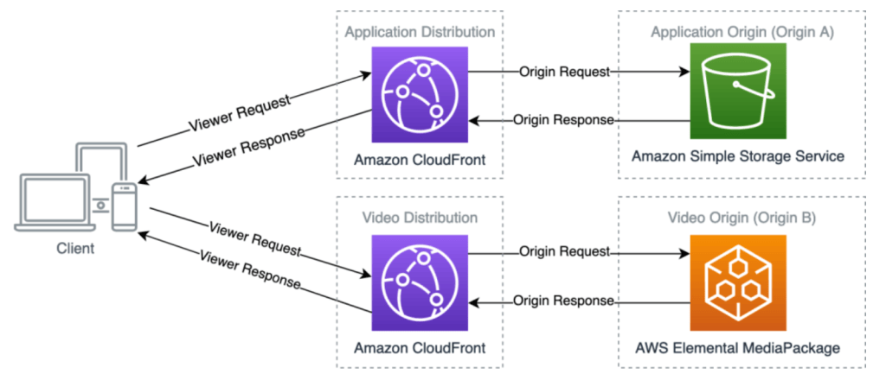

> 이 글은 2twodragon.com(워드프레스)에서 2025-03-28에 처음 게시된 글을 옮긴 것입니다.

**CloudFront, Cloudflare, S3의 개념과 CORS의 필요성 및 보안적 위협요인에 대한 이해를 통합적으로 정리한 문서**입니다.



---

## 개념 및 보안 이슈 요약

## Amazon S3란?

<strong>Amazon S3(Simple Storage Service)</strong>는 AWS에서 제공하는 객체 스토리지 서비스입니다. 주로 정적 웹사이트 호스팅이나 파일(이미지, 영상 등) 저장 용도로 많이 사용됩니다.

---

## CloudFront란?

**CloudFront**는 AWS가 제공하는 글로벌 CDN(콘텐츠 전송 네트워크) 서비스로, 웹 콘텐츠를 사용자에게 빠르고 효율적으로 전달합니다. S3 같은 원본(origin)의 콘텐츠를 캐싱하고 글로벌 엣지 로케이션에서 빠르게 제공합니다.

---

## Cloudflare란?

**Cloudflare**는 CDN과 DNS, 웹 방화벽(WAF), DDoS 보호를 통합 제공하는 서비스입니다. 웹사이트의 성능 향상과 보안을 강화하기 위해 CloudFront와 함께 구성하여 사용하기도 합니다.

---

## CORS란? (Cross-Origin Resource Sharing)

CORS는 서로 다른 도메인 간의 자원 요청(리소스 요청)을 브라우저가 허용하도록 규정하는 보안 메커니즘입니다.

브라우저 보안 정책인 **동일 출처 정책(Same-Origin Policy)** 은 원칙적으로 서로 다른 도메인 간의 자원 접근을 제한합니다. 하지만 API, 이미지, 동영상과 같은 리소스를 외부 도메인에서 접근하려면 CORS 설정을 통해 접근을 명시적으로 허용해야 합니다.

## CORS가 필요한 이유

- API 요청이나 정적 콘텐츠를 서로 다른 도메인에서 안전하게 호출할 수 있도록 허용하기 위함입니다.
- CORS를 설정하지 않으면 브라우저가 외부 도메인의 리소스를 차단하여 서비스 이용이 어려워집니다.

---

## CORS 설정 시 위협 요인 및 보안의 중요성

CORS를 잘못 설정하면 아래와 같은 보안 위협이 발생할 수 있습니다.

**⚠️ 주요 위협 요인:**

- **무분별한 허용(\*) 설정 시 민감한 리소스 노출 위험**
- 공격자가 악성 웹사이트를 통해 사용자의 브라우저에서 민감한 데이터에 접근하거나 변조 가능
- 잘못된 헤더 설정으로 불필요한 리소스 접근 허용, 데이터 탈취 가능성 존재

**🔒 보안이 중요한 이유:**

- CORS는 외부 도메인 접근 허용 여부를 결정하는 중요한 보안 정책입니다.
- 특히 금융정보, 개인정보와 같이 민감한 데이터가 포함된 API 및 콘텐츠 제공 시, 엄격하고 명시적인 CORS 정책이 필수적입니다.

---

아래는 **위의 개념과 중요성을 기반으로 Cloudflare + CloudFront + Amazon S3를 이용한 CORS의 안전한 구성 및 보안 최적화 방법**을 단계별로 통합한 내용입니다.

---

## 권장 구성 구조

```text
[Client] 
  ↓ HTTPS
[Cloudflare (DNS/WAF)]
  ↓ HTTPS (Full-Strict SSL)
[CloudFront (CDN, Response Headers)]
  ↓ HTTPS (Origin Access Control)
[Amazon S3 (Origin)]
```

---

## 권장 헤더 설정 값 (시간 환산)

| **헤더** | **설정값** | **분(minute)** | **시간(hour)** | **일(day)** |
|----|----|----|----|----|
| Access-Control-Max-Age | **600초** | 10분 | 0.1667시간 | 약 0.00694일 |
| Strict-Transport-Security | **31536000초** | 525600분 | 8760시간 | 365일 (1년) |

- Access-Control-Max-Age → **10분** (최적의 성능과 보안 균형)
- Strict-Transport-Security → **1년** (보안 최적 권장값)

---

## Amazon S3의 엄격한 CORS 구성 예시

AWS 콘솔 → S3 → 버킷 선택 → 권한 → CORS 구성:

```json
[
  {
    "AllowedHeaders": ["Authorization", "Content-Type", "X-Requested-With"],
    "AllowedMethods": ["GET", "HEAD", "OPTIONS"],
    "AllowedOrigins": ["https://mydomain.com"],
    "ExposeHeaders": ["ETag"],
    "MaxAgeSeconds": 600
  }
]
```

- 반드시 명시된 특정 도메인만 허용 (절대 \* 사용 금지)
- 최소한의 헤더와 메서드만 허용

---

## CloudFront의 Response Headers Policy 설정

AWS CloudFront → Policies → Response Headers Policy:

## CORS 권장 설정

| **항목**                      | **값**                      |
|-------------------------------|-----------------------------|
| Access-Control-Allow-Origin   | `https://mydomain.com`        |
| Access-Control-Allow-Methods  | GET, HEAD, OPTIONS          |
| Access-Control-Allow-Headers  | Authorization, Content-Type |
| Access-Control-Max-Age        | 600                         |
| Access-Control-Expose-Headers | ETag                        |

## Security Headers 설정 (권장)

| **항목**                  | **값**                                       |
|---------------------------|----------------------------------------------|
| Strict-Transport-Security | max-age=31536000; includeSubDomains; preload |
| X-Content-Type-Options    | nosniff                                      |
| X-Frame-Options           | DENY 또는 SAMEORIGIN                         |
| X-XSS-Protection          | 1; mode=block                                |

---

## Cloudflare를 통한 CloudFront 앞단 보호 (DNS/WAF 구성)

## DNS만 사용하는 경우 (Private DNS)

- 간단히 DNS만 Cloudflare로 관리, CDN 역할은 CloudFront가 전담

| **타입** | **이름**         | **대상**                     | **프록시 상태**      |
|----------|------------------|------------------------------|----------------------|
| CNAME    | cdn.mydomain.com | d111111abcdef.cloudfront.net | DNS only (회색 구름) |

---

## DNS + WAF 적용한 고급 보안 구성 (권장)

- Proxy 활성화하여 Cloudflare의 WAF로 보호 (DDoS, Bot 관리 등)

| **타입** | **이름** | **대상** | **프록시 상태** |
|----|----|----|----|
| CNAME | cdn.mydomain.com | d111111abcdef.cloudfront.net | Proxy 활성화 (주황색) |

- SSL/TLS Encryption 모드: **Full (Strict)** 설정 필수 (CloudFront ACM 인증서 필요)
- Cloudflare IP만 CloudFront 접근 허용 설정

---

## CloudFront + Cloudflare 구성 시 주의사항 및 권장 설정

- Cloudflare의 Proxy 활성화 시 일부 CloudFront 고유 헤더는 제거될 수 있음
- Cloudflare로 인해 Client IP는 CF-Connecting-IP 헤더를 통해 확인 필요
- AWS CloudFront의 접근을 Cloudflare IP 대역으로 제한하여 보안 향상

---

## 월간 예상 비용 예시 (트래픽 1TB 기준)

| **서비스** | **항목** | **비용** | **비고** |
|----|----|----|----|
| Amazon S3 | 스토리지 | \$0.025/GB | 월 1TB 사용시 약 **\$25.60** |
| CloudFront | 트래픽 | \$0.114/GB <br>(서울 기준) | 월 1TB 사용시 약 **\$116.74** |
| Cloudflare | DNS/WAF | \$25 (Pro Plan 기준) | 무제한 트래픽 포함 |

- **월 총 예상 비용**: 약 **\$167.34**

---

## 최종 권장 구성 요약 및 결론

- Cloudflare + CloudFront + S3를 결합한 구성은 성능과 보안을 균형있게 최적화합니다.
- 명시적이고 엄격한 CORS 정책으로 데이터 보안 위협을 방지합니다.
- Cloudflare WAF를 통해 외부 공격으로부터 강력한 보호를 제공합니다.

이 구성을 통해 높은 보안성과 안정성을 갖춘 웹 인프라를 구축할 수 있습니다.
