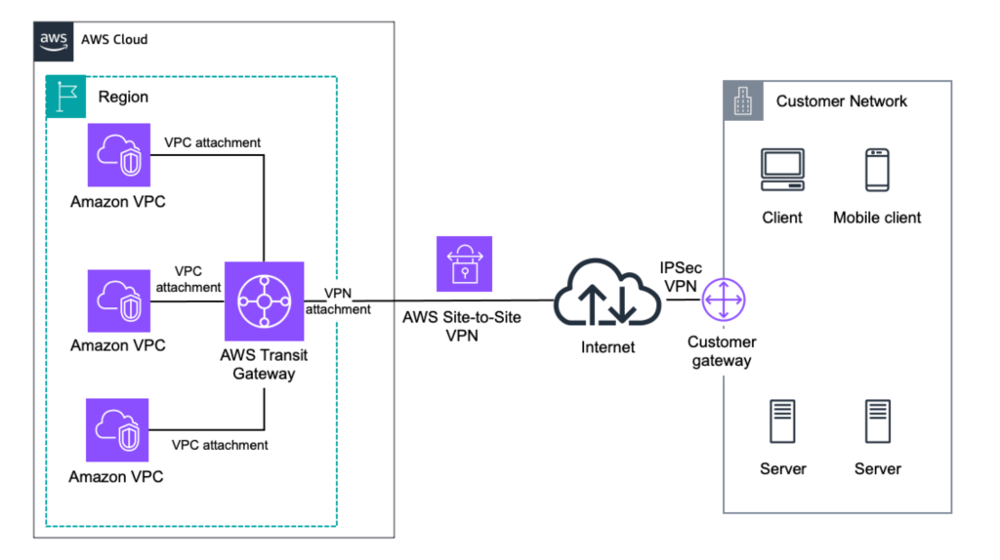
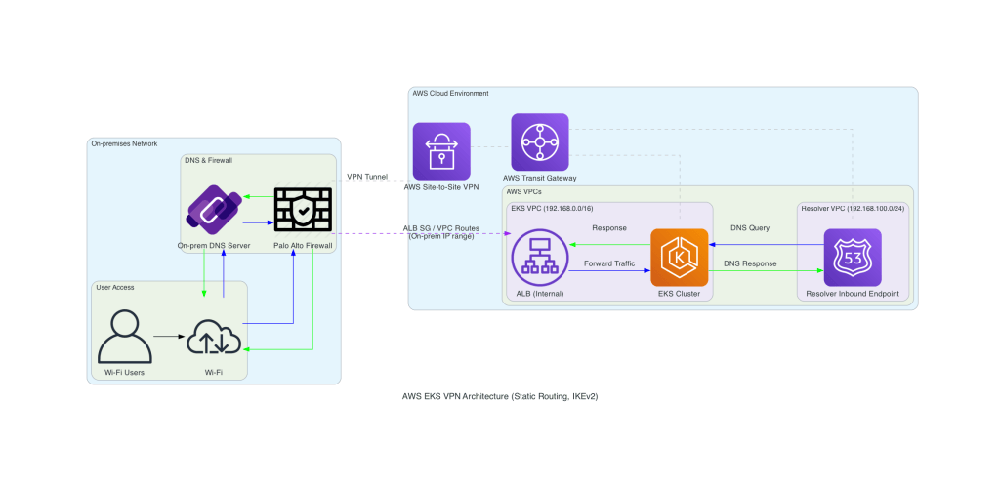

> 이 글은 2twodragon.com(워드프레스)에서 2025-03-31에 처음 게시된 글을 옮긴 것입니다.

아래는 **사내 Wi-Fi 사용자가 AWS 클라우드의 EKS 내부 서비스(ClusterIP)에 안전하게 접근**할 수 있도록 구축하는 상세한 통합 가이드입니다.



---

### 1. 최종 아키텍처 구성도 (상세)



---

### 2. 구성 요소 상세 설명

| **서비스/구성요소** | **설명 및 역할** |
|----|----|
| **사내 Wi-Fi 사용자** | AWS 내 프라이빗 EKS 서비스에 접근을 요청하는 사용자 |
| **사내 DNS 서버** | AWS Private DNS(eks.internal) 요청을 받아 Resolver로 전달하는 역할 |
| **Palo Alto Firewall** | 온프레미스 보안 담당, AWS와의 VPN 터널(Static,IKEv2) 연결 및 관리 |
| **AWS Site-to-Site VPN** | Palo Alto Firewall과 AWS 간의 보안 터널 (Static Routing, IKEv2) |
| **AWS Transit Gateway (TGW)** | VPN과 VPC(Resolver,EKS)를 연결하여 네트워크를 중앙에서 관리 |
| **Route53 Resolver** | 온프레미스의 DNS 요청을 AWS 내부 DNS로 전달 및 응답처리 |
| **Route53 Private Hosted Zone** | AWS 내부 서비스 도메인(eks.internal)을 관리하는 프라이빗 DNS 영역 |
| **EKS 클러스터 (ClusterIP 서비스)** | Kubernetes 기반 컨테이너 워크로드 관리, 프라이빗 IP를 가진 내부 서비스 |

---

### 3. 단계별 상세 구축 방법

### ① AWS Site-to-Site VPN (Static Routing, IKEv2)

- AWS VPN 생성 시 **Static Routing** 및 **IKEv2** 선택 필수
- Palo Alto Firewall에 다음과 같이 정적 경로 추가 예시:

```text
set network virtual-router default routing-table ip static-route AWS_VPC destination 192.168.0.0/16 interface tunnel.x
```

### ② AWS Transit Gateway (TGW)

### Attachments 설정 (예시)

| **리소스**              | **CIDR**         | **Attachment ID 예시**       |
|-------------------------|------------------|------------------------------|
| VPN Attachment          | 10.100.0.0/16    | tgw-attach-0123456789abcdef0 |
| EKS VPC Attachment      | 192.168.0.0/16   | tgw-attach-abcdef01234567890 |
| Resolver VPC Attachment | 192.168.100.0/24 | tgw-attach-fedcba9876543210  |

### TGW Route Table 수동 구성 예시

| **Destination CIDR** | **Target Attachment** |
|----|----|
| 10.100.0.0/16 (온프레미스) | VPN Attachment (tgw-attach-0123456789abcdef0) |
| 192.168.0.0/16 (EKS VPC) | EKS VPC Attachment (tgw-attach-abcdef01234567890) |
| 192.168.100.0/24 (Resolver VPC) | Resolver Attachment (tgw-attach-fedcba9876543210) |

- Association: EKS VPC, Resolver VPC 필수
- Propagation: 사용하지 않음 (Static Routing이므로)

### ③ EKS VPC Route Table 구성

| **Destination CIDR (사내 CIDR)** | **Target (TGW)**           |
|----------------------------------|----------------------------|
| 10.100.0.0/16                    | Transit Gateway (tgw-xxxx) |

### ④ Route53 Resolver 설정 (필수)

- **Inbound Endpoint** 구성:
- 서브넷 최소 2개 IP (예: 10.0.10.10, 10.0.11.10)
- Security Group에서 DNS(UDP/TCP 53) 허용 (사내 CIDR)
- **Resolver 서브넷 Route Table 필수**:

```yaml
Destination: 10.100.0.0/16 (사내 CIDR)
Target: Transit Gateway (tgw-xxxx)
```

### ⑤ 사내 DNS 서버 Forwarding 구성

- 사내 DNS 서버에서 조건부 전달자로 AWS Resolver IP 설정 (BIND 예시):

```text
zone "eks.internal" {
    type forward;
    forwarders { 10.0.10.10; 10.0.11.10; };
};
```

### ⑥ Route53 Private Hosted Zone

- 프라이빗 도메인 생성 및 EKS ClusterIP 서비스 연결:

```text
myservice.eks.internal → [ClusterIP 주소]
```

### ⑦ EKS 노드 Security Group 설정

| **Type**    | **Protocol** | **Port(s)** | **Source**       | **설명**               |
|-------------|--------------|-------------|------------------|------------------------|
| Custom TCP  | TCP          | 80,443 등   | 10.100.0.0/16    | 온프레미스 접근 허용   |
| Custom UDP  | UDP          | 53(옵션)    | 10.100.0.0/16    | DNS 질의 허용(옵션)    |
| All traffic | All          | All         | Node SG 자체     | 노드 간 내부 통신 허용 |
| HTTPS       | TCP          | 443         | Control Plane SG | EKS API 통신 필수 허용 |

---

### 최종 체크리스트

- \[✅\] AWS VPN Static 라우팅 (IKEv2)
- \[✅\] TGW Attachments 및 Routes 설정
- \[✅\] EKS VPC Route Table 설정
- \[✅\] Route53 Resolver Endpoint 구성
- \[✅\] Resolver VPC Route Table 설정
- \[✅\] 사내 DNS Forwarding 설정
- \[✅\] Route53 Private Hosted Zone 설정
- \[✅\] EKS ClusterIP 서비스 DNS 설정
- \[✅\] EKS 노드 Security Group 구성
- \[✅\] Palo Alto Firewall Static Routing 추가

---

### 최종 연결 테스트 방법

```text
# DNS 테스트
dig myservice.eks.internal

# 통신 테스트
ping [EKS_Service_IP]
telnet [EKS_Service_IP] [Port]
```

---

### 구성의 핵심 이점 요약

- VPN 및 프라이빗 DNS 기반으로 외부 노출 최소화
- TGW 중앙 관리로 네트워크 운영 간소화
- 내부 DNS(eks.internal)를 통해 편리한 서비스 접근
- Kubernetes 서비스 안전한 내부 IP 사용 (ClusterIP)

---

### 왜 다른 CIDR 간 통신이 가능한가?

- TGW는 서로 다른 CIDR을 가진 네트워크를 연결하고, 라우팅 테이블을 이용해 패킷을 정확한 목적지로 전달합니다.
- VPN 터널은 중간 네트워크(169.254.x.x)를 이용하여 양측의 네트워크를 연결하며, 라우팅 테이블의 정보로 정확히 패킷을 전달합니다.
- 서로의 라우팅 테이블만 정확히 설정되면, **다른 CIDR의 네트워크 간에도 문제없이 통신 가능**합니다.
