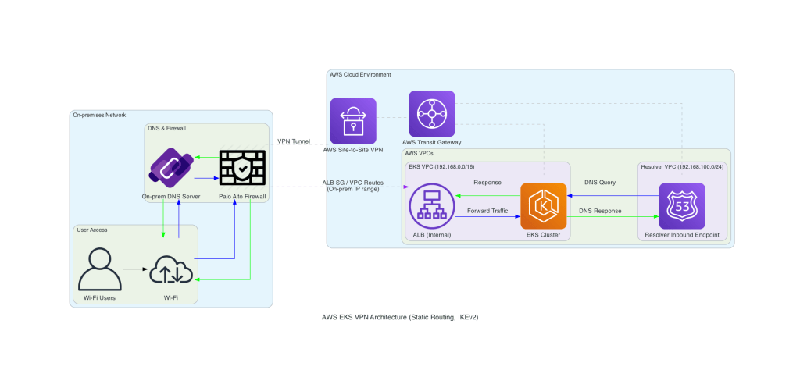

> 이 글은 2twodragon.com(워드프레스)에서 2025-04-04에 처음 게시된 글을 옮긴 것입니다.

클라우드 시스템 아키텍처를 설계하고 문서화하는 작업은 매우 중요합니다. 하지만 매번 GUI 기반의 툴을 사용해 다이어그램을 그리는 것은 번거롭고, 버전 관리 측면에서도 어려움이 있습니다. 이에 Python 코드를 통해 다이어그램을 자동으로 생성할 수 있는 **Diagrams** 라이브러리가 주목받고 있습니다.

## Diagrams란?

Diagrams는 Python 코드를 이용해 클라우드 인프라와 온프레미스 네트워크 등의 시스템 아키텍처를 시각적으로 표현할 수 있는 오픈소스 라이브러리입니다.  
이 도구는 AWS, Azure, GCP, Kubernetes, Alibaba Cloud, Oracle Cloud와 같은 주요 클라우드 서비스뿐만 아니라, 온프레미스 노드와 다양한 프로그래밍 언어 및 프레임워크도 지원합니다. 코드를 기반으로 다이어그램을 작성하기 때문에 Git 등의 버전 관리 도구를 활용해 변경 이력을 쉽게 관리할 수 있다는 장점이 있습니다.

## 설치 및 환경 구성

Diagrams를 사용하려면 Python 3.6 이상과 Graphviz가 필요합니다. 여기서는 가상환경을 통해 프로젝트별 독립 환경을 구성하는 방법을 소개합니다.

### 1. 가상환경 생성 및 활성화

터미널에서 아래 명령어를 통해 가상환경을 생성합니다.

```text
python3 -m venv env
```

생성한 가상환경을 활성화합니다.

- **macOS / Linux:**`source env/bin/activate`
- **Windows:**`env\Scripts\activate`

가상환경이 활성화되면 프롬프트 앞에 `(env)`가 표시됩니다.

### 2. 필요한 패키지 설치

가상환경이 활성화된 상태에서 다음 명령어로 Diagrams를 설치합니다.

```bash
pip install diagrams
```

또한 Diagrams는 Graphviz에 의존하므로 시스템에 Graphviz가 설치되어 있어야 합니다.  
운영체제별 설치 방법은 다음과 같습니다.

- **Ubuntu/Debian:**`sudo apt-get install graphviz`
- **macOS (Homebrew 사용 시):**`brew install graphviz`
- **Windows:**  
  [Graphviz 공식 웹사이트](https://graphviz.org/download/)에서 설치 파일을 다운로드 후 설치하고, 환경 변수 PATH에 추가합니다.

## Quick Start: 간단한 예제

가상환경과 필수 패키지가 모두 설치되었다면, 간단한 예제 코드를 작성해보세요. 예를 들어, 아래의 Python 코드를 작성하고 실행하면 `web_service.png` 이미지 파일이 생성됩니다.

```python
from diagrams import Diagram
from diagrams.aws.compute import EC2
from diagrams.aws.network import ELB

with Diagram("Web Service", show=False):
    ELB("lb") >> EC2("web") 
```

코드 몇 줄만으로 클라우드 아키텍처 다이어그램을 손쉽게 생성할 수 있습니다.

## Jupyter Notebook에서 활용하기

매번 터미널에서 실행하고 생성된 이미지를 확인하는 것이 번거로울 수 있습니다. 이런 경우 Jupyter Notebook을 활용하면, 코드 수정 후 바로 결과를 시각적으로 확인할 수 있어 개발 효율성이 크게 향상됩니다.

1.  **Jupyter Notebook 환경 구성**  
    Docker 및 Docker Compose를 활용하여 Jupyter Notebook 환경을 빠르게 구성할 수 있습니다. Docker 환경 내 터미널에서 Graphviz와 Diagrams를 설치하세요.`sudo apt update sudo apt install graphviz sudo pip3 install diagrams`
2.  **Notebook 내 코드 실행 및 이미지 출력**  
    Notebook 셀에 Diagrams 예제 코드를 작성한 후 실행하면, 사이드 메뉴나 파일 브라우저에 생성된 이미지 파일을 확인할 수 있습니다. 또한, 아래 코드를 통해 Notebook 내에서 이미지를 바로 출력할 수도 있습니다.`from IPython.display import Image Image(filename='web_service.png')`

## 다이어그램에서 한글 지원하기

다이어그램에 한글을 포함시키려 할 때, 기본적으로 한글이 깨지는 문제가 발생할 수 있습니다. 이를 해결하려면 시스템에 한글 폰트를 설치해야 합니다. 예를 들어, Ubuntu나 Debian 기반 시스템에서는 아래 명령어를 사용합니다.

```bash
sudo apt-get install -y fonts-nanum
```

설치가 완료된 후 다이어그램을 다시 생성하면 한글이 정상적으로 출력되는 것을 확인할 수 있습니다.

---

## Diagrams를 활용한 AWS EKS VPN 아키텍처 다이어그램 생성하기

클라우드 인프라를 코드로 관리하는 Diagrams 라이브러리는 AWS, Azure, GCP 등 주요 클라우드 제공사의 아키텍처 요소와 온프레미스 구성요소를 모두 지원합니다. 이를 통해 Git 등의 버전 관리 시스템과 통합하여 변경 이력을 체계적으로 관리할 수 있습니다.

이번 포스팅에서는 Python 코드를 이용해 온프레미스 네트워크와 AWS 클라우드 환경 간 VPN 터널, DNS, 방화벽, ALB 및 EKS 클러스터 간의 통신 흐름을 포함한 다이어그램을 작성하는 방법을 살펴보겠습니다.



## 전체 코드 예제

아래 코드는 Diagrams 라이브러리를 이용하여 AWS EKS VPN 아키텍처를 시각화하는 예제입니다.  
코드를 실행하면 “AWS EKS VPN Architecture (Static Routing, IKEv2)”라는 이름의 이미지 파일이 생성됩니다.

```python
from diagrams import Diagram, Cluster, Edge
from diagrams.aws.network import SiteToSiteVpn, TransitGateway, Route53, ALB
from diagrams.aws.compute import EKS
from diagrams.onprem.network import Internet
from diagrams.onprem.client import User
from diagrams.onprem.dns import Coredns
from diagrams.generic.network import Firewall as PaloAlto

graph_attr = {
    "splines": "ortho",
}

with Diagram("AWS EKS VPN Architecture (Static Routing, IKEv2)", show=False, direction="LR", graph_attr=graph_attr):

    # On-premises Network
    with Cluster("On-premises Network"):
        with Cluster("User Access"):
            wifi_users = User("Wi-Fi Users")
            wifi = Internet("Wi-Fi")

            wifi_users >> Edge(color="black") >> wifi

        with Cluster("DNS & Firewall"):
            dns_onprem = Coredns("On-prem DNS Server")
            palo_fw = PaloAlto("Palo Alto Firewall")

            wifi >> Edge(color="blue") >> dns_onprem
            dns_onprem >> Edge(color="green") >> wifi

            dns_onprem >> Edge(color="blue") >> palo_fw
            palo_fw >> Edge(color="green") >> dns_onprem

            wifi >> Edge(color="blue") >> palo_fw
            palo_fw >> Edge(color="green") >> wifi

    # AWS Cloud Environment
    with Cluster("AWS Cloud Environment"):
        vpn = SiteToSiteVpn("AWS Site-to-Site VPN")
        tgw = TransitGateway("AWS Transit Gateway")

        with Cluster("AWS VPCs"):
            with Cluster("EKS VPC (192.168.0.0/16)"):
                eks_cluster = EKS("EKS Cluster")
                alb = ALB("ALB (Internal)")
                # ALB와 EKS 간의 트래픽 전달 (요청/응답)
                alb >> Edge(color="blue", label="Forward Traffic") >> eks_cluster
                eks_cluster >> Edge(color="green", label="Response") >> alb

            with Cluster("Resolver VPC (192.168.100.0/24)"):
                resolver_inbound = Route53("Resolver Inbound Endpoint")

            # DNS Resolution 통신
            resolver_inbound >> Edge(color="blue", label="DNS Query") >> eks_cluster
            eks_cluster >> Edge(color="green", label="DNS Response") >> resolver_inbound

        tgw - Edge(color="gray", style="dashed") - [eks_cluster, resolver_inbound]
        vpn - Edge(color="gray", style="dashed") - tgw

    # VPN Tunnel (AWS ↔ On-prem)
    palo_fw - Edge(color="gray", style="dashed", label="VPN Tunnel") - vpn

    # 온프라미스 대역이 ALB Security Group / VPC Subnet Routes에 추가됨을 표현
    palo_fw >> Edge(color="purple", style="dashed", label="ALB SG / VPC Routes\n(On-prem IP range)") >> alb
```

## 코드 설명

- **온프레미스 네트워크 구성**
  - **User Access 클러스터:**  
    Wi-Fi 사용자를 나타내는 `User("Wi-Fi Users")`와 Wi-Fi 네트워크를 나타내는 `Internet("Wi-Fi")`를 정의합니다.
  - **DNS & Firewall 클러스터:**  
    온프레미스 DNS 서버(`Coredns("On-prem DNS Server")`)와 Palo Alto 방화벽(`PaloAlto("Palo Alto Firewall")`)을 구성하고, 각 요소 간의 양방향 통신 경로(파란색/녹색 엣지)를 설정합니다.
- **AWS 클라우드 환경 구성**
  - **VPN 및 Transit Gateway:**  
    AWS Site-to-Site VPN과 Transit Gateway를 통해 온프레미스 네트워크와 AWS 환경을 연결합니다.
  - **AWS VPCs 클러스터:**
    - **EKS VPC (192.168.0.0/16):**  
      EKS 클러스터(`EKS("EKS Cluster")`)와 내부 ALB(`ALB("ALB (Internal)")`)를 포함하며, ALB와 EKS 간의 트래픽 흐름을 표현합니다.
    - **Resolver VPC (192.168.100.0/24):**  
      Route53 Resolver Inbound Endpoint(`Route53("Resolver Inbound Endpoint")`)를 사용하여 DNS Resolution 통신 경로를 구성합니다.
  - **내부 통신 연결:**  
    Transit Gateway를 통해 EKS 클러스터와 Resolver Inbound Endpoint가 연결되고, VPN 터널을 통해 온프레미스와 AWS 클라우드 간의 통신이 이루어집니다.
- **온프레미스 대역 적용**
  - Palo Alto 방화벽에서 ALB Security Group 및 VPC Subnet Routes에 온프레미스 IP 대역이 추가됨을 나타내는 엣지를 설정하여, 외부 요청이 내부로 유입되는 경로를 명시합니다.

## 결론

Diagrams는 코드로 클라우드 아키텍처를 손쉽게 그릴 수 있는 강력한 도구입니다. Diagrams 라이브러리를 사용하면 몇 줄의 코드로 복잡한 클라우드 인프라 아키텍처를 시각화할 수 있으며, 코드 기반으로 다이어그램을 작성하기 때문에 Git을 통한 버전 관리와 협업이 용이합니다.  
이와 같이 AWS, 온프레미스 네트워크, DNS, 방화벽 등 다양한 구성요소를 코드로 표현해 인프라 설계를 체계적으로 관리해보세요!

- **코드 기반**으로 다이어그램을 생성하므로 Git을 통해 변경 이력을 관리할 수 있음.
- **다양한 클라우드 플랫폼 및 온프레미스** 환경을 지원해 인프라 설계 및 문서화 작업을 단순화
- 또한, **Jupyter Notebook**과 연계하여 실시간으로 결과를 확인할 수 있는 점은 개발 및 문서화에 큰 이점을 제공

다이어그램을 통한 인프라 아키텍처 관리(또는 DaC, Diagrams as Code)는 점점 더 중요해지는 DevOps 환경에서 큰 역할을 하며, 여러분의 클라우드 인프라를 더욱 효율적으로 관리할 수 있도록 도와줄 것입니다.

## 참고 사이트

- [Diagrams 공식 홈페이지](https://diagrams.mingrammer.com/)
- [Diagrams GitHub Repository](https://github.com/mingrammer/diagrams)
- [Diagrams Getting Started 문서](https://diagrams.mingrammer.com/docs/getting-started/installation)

---

이와 같이 Diagrams를 활용하여 클라우드 아키텍처를 코드로 관리하는 방법에 대해 살펴보았습니다. 여러분의 인프라 설계 및 문서화 작업에 도움이 되길 바랍니다.
