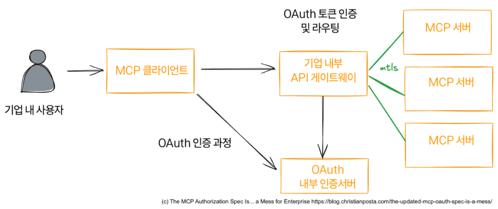
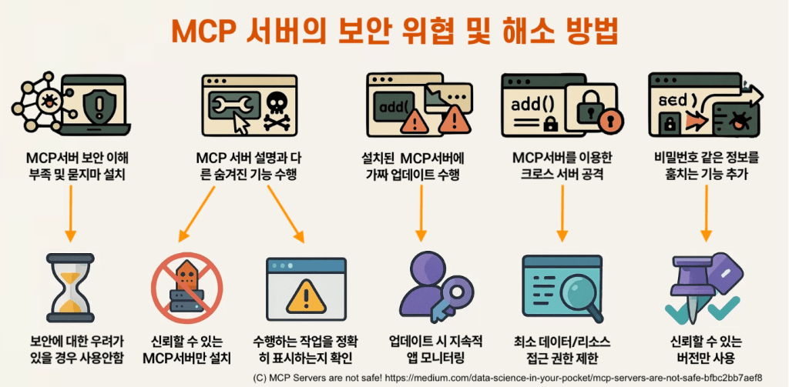

> 이 글은 2twodragon.com(워드프레스)에서 2025-04-09에 처음 게시된 글을 옮긴 것입니다.

AI 기술의 확산과 함께 **MCP(Model Context Protocol)** 사용도 급격히 늘고 있습니다. MCP는 AI 시스템이 외부 도구, 소프트웨어, 데이터 소스 등과 연동할 수 있게 해주는 강력한 프로토콜이지만, 이로 인해 새로운 보안 이슈도 함께 떠오르고 있습니다.

이번 글에서는 **MCP 사용 시 발생 가능한 보안 리스크**와 이를 해결하기 위한 실질적인 대응 방안을 정리했습니다.

---

## MCP란?

<strong>MCP(Model Context Protocol)</strong>는 AI가 외부 애플리케이션 및 도구들과 **안전하게 상호작용**할 수 있도록 설계된 표준 프로토콜입니다. 주로 아래와 같은 기능을 지원합니다:

- OAuth 기반 인증 및 외부 서비스 연동
- 다양한 플러그인 확장 기능
- AI와의 문맥 유지(세션 기반)
- 외부 데이터 호출 및 명령 수행

---

## MCP 사용 시 보안 위협 요소

| **보안 위협 요소** | **설명** | **위험도** |
|----|----|----|
| **OAuth 인증 미흡** | 토큰 유출 시 인증 우회 및 세션 탈취 가능 | 매우 높음 |
| **프롬프트 인젝션** | 악성 명령이 포함된 입력으로 시스템 오작동 유도 | 매우 높음 |
| **플러그인 취약점** | 외부 확장 기능을 통한 악성 코드 유입 가능 | 높음 |
| **민감 데이터 유출** | 다양한 앱·도구와 연동되면서 데이터 노출 가능성 증가 | 매우 높음 |
| **문맥 지속성 문제** | 대화 내역에 민감 정보가 계속 남아 있을 수 있음 | 높음 |
| **세션 하이재킹** | 세션 토큰 재사용을 통한 권한 탈취 | 높음 |
| **원격 호출 및 API 악용** | MCP를 통해 비인가 서버로 정보 유출 가능 | 중간~높음 |
| **코드 유출 및 변조** | 소스코드 관리 툴과 연동된 경우, MCP 경유 유출 가능 | 높음 |
| **엔드포인트 보안** | 사용자의 기기 보안이 약할 경우 MCP 경유 침해 가능 | 높음 |

---

## 실제 예시: 민감 정보와 MCP

MCP는 외부 앱(iTerm, VSCode, Notion 등)과 연결되어 동작하기 때문에 **IAM Role, Access Key, API Key, Secrets Manager 등의 민감정보**가 모델 문맥에 포함될 수 있습니다.

> 예: 사용자가 AWS CLI를 열어 Key를 확인한 뒤, 같은 세션에서 AI를 호출하면 해당 정보가 노출될 수 있음

이를 방지하려면:

- **사용자 주의 교육**
- **문맥 정보 자동 정제 시스템**
- **민감 정보 DLP(Data Loss Prevention) 연동**

이 필요합니다.

---

## 보안 대응 방안 정리

| **보안 영역** | **대응 방안** |
|----|----|
| **인증 및 접근 제어** | OAuth 프로토콜 강화, 주기적 토큰 갱신, RBAC 적용 |
| **프롬프트 검증** | 명령어 실행 제한, 입력 정규화, 프롬프트 필터링 시스템 구축 |
| **플러그인 관리** | 화이트리스트 운영, 보안 검증 필수화, 사용자 확인 절차 삽입 |
| **데이터 보호** | 저장/전송 암호화 (TLS 1.2+), 민감 데이터 분리 암호화, DLP 연동 |
| **세션 보안** | 세션 재사용 탐지, 세션 토큰 만료 설정, AI 문맥 메타데이터 암호화 |
| **코드 보안** | 저장소 접근 제한, 자동 코드 스캐너 도입, Git 연동 정책 강화 |
| **엔드포인트 보안** | 기기 보안 업데이트, 위협 탐지 및 방지 솔루션 도입, 비인가 앱 차단 |
| **사용자 인식 개선** | 보안 교육, 정책 고지, 피드백 수렴 및 개선 주기화 |

---

## 인사이트 참고 ① — QueryPie 화이트페이퍼 요약

📄 [*“MCP 시대를 위한 특권 접근 제어(PAM)의 재정의”*](https://www.querypie.com/ko/resources/discover/white-paper/15/redefining-pam-for-the-mcp-era)

**주요 메시지:**

- **기존 PAM 체계는 AI를 고려하지 않음** → LLM의 문맥 내 정보 호출은 새로운 형태의 접근 위협
- “Prompt-to-Privileged Action” 문제: AI가 사람을 대신해 민감한 명령을 실행할 수 있는 구조
- 접근 정책은 ID 중심에서 **행동 기반 권한 모델**로 진화해야 함 (예: “이 사용자가 이 행동을 해도 되는가?”)

✅ **추천 전략**:

- 정책 중심의 접근 제어(PDP)와 감사 로깅 강화
- **Session-level PAM** 도입 필요 (프롬프트 단위 감시)
- Prompt Layer에서의 **DLP 정책** 및 리스크 감지 시스템 연동

---

## 인사이트 참고 ② — 기술 블로그 요약

📄 [*“AI와 API 보안, 어떻게 대비할까” – by Channy Yun (AWS)*](https://channy.creation.net/blog/1937)

**핵심 요점:**

- **AI 시스템은 자동으로 API 호출 권한을 부여받는 경우가 많아 취약점이 치명적**
- 사용자가 의도치 않게 **AI를 통해 백엔드 시스템을 제어**하게 될 수도 있음
- **“AI도 사용자처럼 최소 권한 원칙 적용”** 필수

✅ **추천 전략**:

- IAM, API Gateway, Scope 제어 등 **프로그래머블 보안 레이어 구축**
- API 호출 권한은 반드시 분리된 Role로 구성하고, **세션 만료시간 단축**
- 로깅/모니터링을 통해 비정상 호출 탐지 체계 강화

## 마무리

MCP는 AI의 능력을 극대화하는 혁신적인 기술이지만, **그만큼 보안 리스크도 분명히 존재**합니다. 특히 다양한 앱, 저장소, 사용자 기기와 연결되는 만큼, **보안은 기술 도입 초기부터 함께 설계되어야** 합니다.

> “AI가 똑똑해질수록, 우리가 더 철저해져야 한다.”

MCP를 안전하게 사용하기 위해선 다음의 3가지를 기억하세요:

1.  **프롬프트 단위 보안 통제**
2.  **AI 권한은 인간보다 더 좁게 설계**
3.  **사용자뿐만 아니라 ‘세션’도 감시 대상**

이 글이 여러분의 조직이나 팀이 MCP를 안전하게 도입하는 데 도움이 되기를 바랍니다.

---

## 참고 자료

- [OpenAI Security & Privacy](https://openai.com/security-and-privacy/)
- [OWASP LLM 보안 가이드라인](https://github.com/OWASP/www-project-top-10-for-large-language-model-applications)
- [Stytch: MCP 소개 블로그](https://stytch.com/blog/model-context-protocol-introduction)
