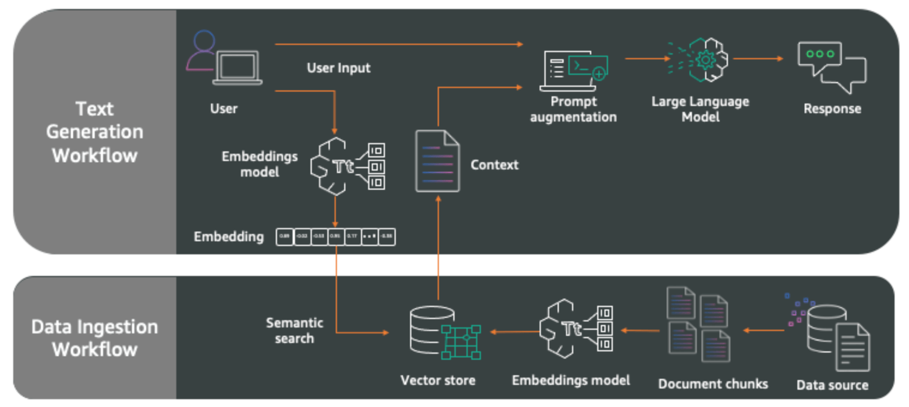
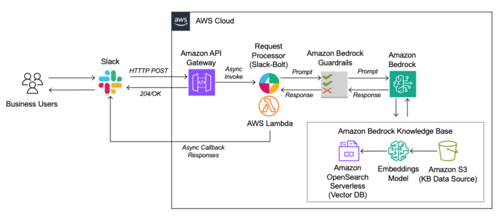
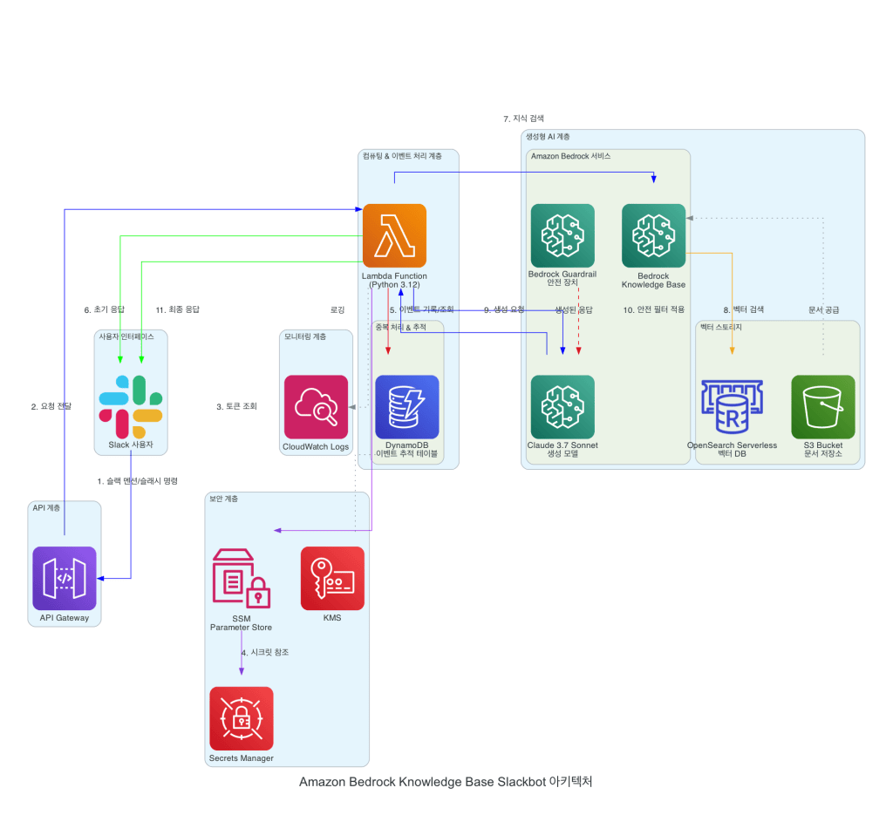
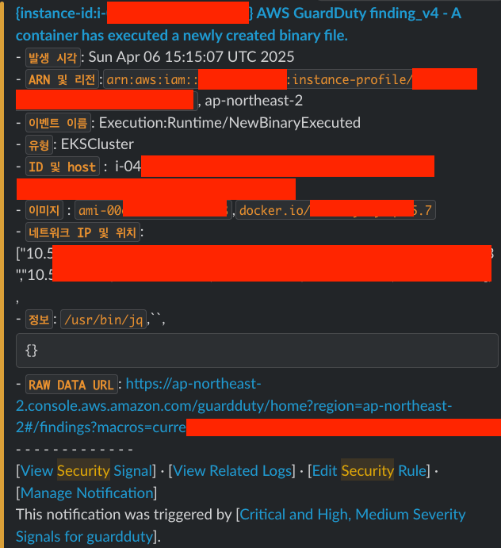
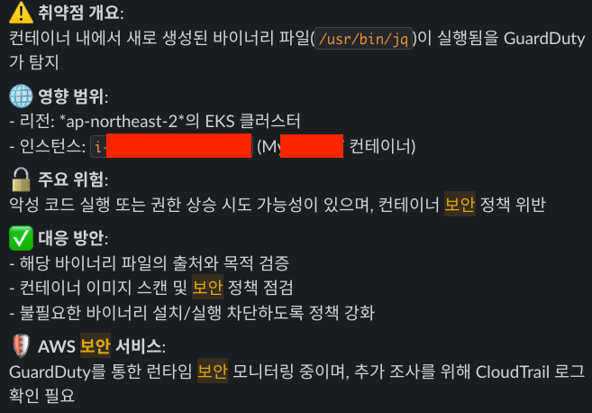
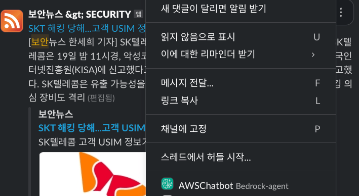
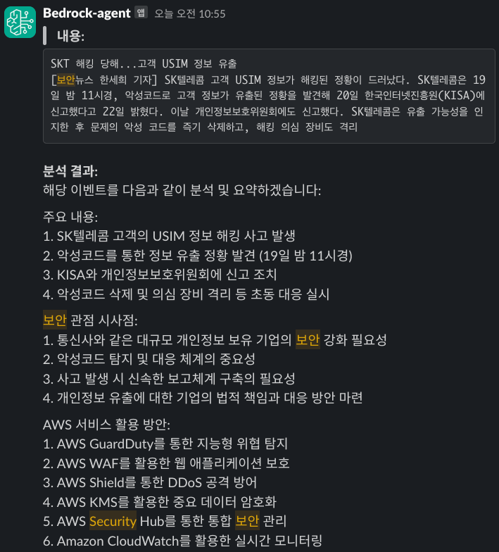

> 이 글은 2twodragon.com(워드프레스)에서 2025-04-22에 처음 게시된 글을 옮긴 것입니다.

최근 IT 운영(AIOps) 분야에서 Generative AI의 활용은 더욱 활발해지고 있습니다. 특히 Slack과 같은 협업 플랫폼과의 통합은 업무 생산성을 크게 향상시키죠. 이번 포스팅에서는 Amazon Bedrock과 AWS CDK를 이용해 AIOps 챗봇을 구축하는 과정을 상세히 소개합니다. 특히, 초기에 자주 겪는 권한 관련 문제를 해결하는 방법부터, Slack에서 다양한 방식으로 챗봇과 상호작용하는 방법까지 함께 알아보겠습니다! 💬✨

### Slack 기반 AIOps 챗봇 아키텍처 및 주요 구성요소

Slack과 Amazon Bedrock을 이용해 구축한 AIOps 챗봇의 전체 아키텍처는 다음과 같습니다. 이를 통해 사용자 질문 처리, 장애 분석, 로그 요약 등의 기능을 효율적으로 처리할 수 있습니다. 👩‍💻🚀

---

## 아키텍처 구성도



```text
[사용자 (Slack)]
      │
      ├── Slack Slash 명령 (/ask-aws)
      ├── 봇 멘션 (@챗봇)
      └── 메시지 바로가기 (Shortcuts)
      │
[Slack Events API / Interactivity]
      │
      └── Amazon API Gateway (또는 Socket Mode via WebSocket)
            │
            └── AWS Lambda (Slack 이벤트 처리)
                  │
                  ├── Amazon Bedrock (Claude 모델 호출)
                  └── Amazon CloudWatch Logs (로그 수집)
                        │
                        └── (선택적) Amazon S3 (지식 베이스, 로그 데이터 저장)
```

---

## 주요 구성 요소 설명



*<https://aws.amazon.com/ko/blogs/machine-learning/create-a-generative-ai-assistant-with-slack-and-amazon-bedrock/>*



### 1. Slack 플랫폼

Slack을 통해 사용자와 챗봇이 직접 소통합니다.

- /ask-aws 명령어, @봇멘션, 메시지 액션 등 다양한 방식 지원
- 이벤트와 인터랙션 처리를 위해 Slack Events API와 Interactivity 활용

### 2. Amazon API Gateway 또는 Slack Socket Mode

사용자의 요청을 Slack에서 받아 Lambda 함수로 전달합니다.

- **API Gateway (권장)**: 확장성 및 보안성 우수, 프로덕션에 적합
- **Socket Mode**: 개발 단계에서 방화벽 문제를 피할 수 있어 편리

### 3. AWS Lambda

Slack의 요청을 처리하는 서버리스 컴퓨팅 환경입니다.

- Slack 이벤트 수신 후 Amazon Bedrock 호출
- Amazon IAM으로 보안 강화
- 이벤트 로깅을 통해 운영 이슈 추적 가능 (CloudWatch Logs 활용)

### 4. Amazon Bedrock (Claude 모델)

AWS 내에서 관리형 AI 모델을 제공합니다.

- Claude (Anthropic) 모델을 사용하여 자연어 질문 처리
- 장애 진단, 로그 분석, 보고서 생성 등에 사용 가능
- IAM 권한 (bedrock:InvokeModel)을 통해 호출 관리 및 보안 유지

### 5. Amazon CloudWatch Logs

모니터링과 디버깅을 위해 Lambda 함수의 로그를 수집합니다.

- 운영 장애 발생 시 신속한 분석 가능
- 로그 데이터 활용해 추후 개선점 발견 및 대응 가능

### 6. (선택적) Amazon S3

챗봇의 응답이나 지식 기반(Knowledge Base)을 관리하기 위한 데이터 저장소입니다.

- Retrieval-Augmented Generation (RAG) 구현 시 필요
- 대량의 로그나 참고자료를 효율적으로 관리할 수 있음

---

## 작동 흐름 예시 (슬래시 명령어)

1.  사용자가 Slack에서 /ask-aws 최근 장애 요약 명령 실행
2.  Slack API가 이벤트를 AWS API Gateway를 통해 Lambda 함수로 전달
3.  Lambda 함수가 Bedrock의 Claude 모델 호출 (bedrock:InvokeModel)
4.  Bedrock에서 생성된 자연어 응답을 Lambda가 Slack API로 다시 전달
5.  Slack 채널에서 사용자에게 결과 응답

```text
사용자 → Slack → API Gateway → Lambda → Bedrock
Bedrock → Lambda → API Gateway → Slack → 사용자
```

---

## GuardDuty, CloudTrail, SentinelOne, Zscaler, Okta 로그를 Amazon Bedrock과 Slack으로 실시간 분석하기

Slack에서 챗봇에게 멘션(@봇)을 통해 보안 로그 분석을 요청하면, Amazon Bedrock의 Claude 모델을 활용하여 실시간으로 보안 로그를 분석하고, 간결하고 이해하기 쉬운 형태로 응답을 제공합니다. 이를 통해 IT/보안팀이 빠르게 상황을 파악하고 대응할 수 있도록 지원합니다. 🚨🔍

---

## 작동 흐름도

```text
사용자: "@SecurityBot 최근 GuardDuty 경고 요약해줘!"
              │
[Slack (App Mention 이벤트 발생)]
              │
[AWS API Gateway 또는 Socket Mode]
              │
[AWS Lambda 이벤트 처리]
              │
├── Slack Logs에서 GuardDuty 로그 조회 🔐
├── Amazon S3에서 AWS Best Practices, CloudTrail, Okta등 솔루션 로그 조회 🗂️
│
[Amazon Bedrock (Claude 모델)]
              │
[AWS Lambda로 분석 결과 전달]
              │
[Slack 채널로 결과 응답]
```

---

## 상세 작동 설명

### 1. Slack App Mention 이벤트 발생

사용자가 Slack에서 챗봇을 멘션하며 로그 분석 요청을 합니다.

- 예시 요청 메시지:
- @SecurityBot 지난 24시간 동안 SentinelOne 로그에서 탐지된 위협들을 요약해줘!

### 2. AWS Lambda에서 이벤트 수신

Slack의 이벤트는 API Gateway 또는 Socket Mode를 통해 AWS Lambda로 전달됩니다.

- Lambda 함수가 Slack 메시지의 내용을 파싱하여 어떤 솔루션의 로그를 분석할지 판단합니다.

### 3. 보안 로그 데이터 수집

Lambda 함수는 다음과 같은 방법으로 로그 데이터를 조회합니다.

|                |                                            |
|----------------|--------------------------------------------|
| **솔루션**     | **데이터 소스 및 수집 방법**               |
| 🛡️ GuardDuty   | Amazon CloudWatch Logs 또는 GuardDuty API  |
| 📖 CloudTrail  | Amazon S3 저장 로그를 AWS Athena로 쿼리    |
| 🔒 SentinelOne | S3 또는 SIEM 저장된 로그, API 호출         |
| ☁️ Zscaler     | S3 로그 스토리지에서 조회 또는 API 활용    |
| 🔑 Okta        | Okta API로 이벤트 로그 조회 또는 S3/Athena |

- 보통 AWS Athena를 활용하면 여러 로그 소스를 SQL 방식으로 빠르게 조회 가능합니다.

### 4. 로그 데이터를 Amazon Bedrock (Claude)로 분석

Lambda 함수는 수집된 보안 로그를 Amazon Bedrock의 Claude 모델로 전송해 분석합니다.

- Claude 모델에게 로그 데이터와 분석 요청을 전달합니다.
- 예를 들면: “다음은 지난 24시간 동안의 SentinelOne 탐지 로그입니다.
- 이 로그에서 탐지된 주요 보안 위협을 최대 5가지로 요약해 주세요. \[로그 데이터 입력\]”

### 5. Slack으로 분석 결과 응답

Claude 모델이 자연어 분석 결과를 반환하면, Lambda가 이를 Slack API를 통해 다시 채널에 응답합니다.

예시 응답 메시지 (🔒 최근 24시간 SentinelOne 위협 요약)

1.  랜섬웨어 감염 시도: 호스트 3대 탐지 (격리 조치 완료 ✅)
2.  악성코드 다운로드 시도: 사용자 계정 ‘john.doe’ 차단됨 🚫
3.  권한상승 공격 탐지: 호스트 ‘server-prod-01’에서 탐지 ⚠️
4.  수상한 스크립트 실행: 사용자 ‘admin02’ 세션에서 발견됨 🔍
5.  의심스러운 네트워크 연결 시도: 외부 IP 185.x.x.x 연결 차단됨 🌐

---

## 1. 초기 문제: Amazon Bedrock 모델 접근 오류

처음 AWS CDK로 구축한 Slack 챗봇은 사용자가 /ask-aws 명령어를 입력하면 Lambda 함수가 실행되어 Amazon Bedrock의 Claude 모델을 호출하도록 설계되었습니다. 그러나 실제로 사용해보니 Lambda 로그에서 AccessDeniedException 오류가 발생했는데요.

```yaml
AccessDeniedException: User: <> is not authorized to perform: bedrock:InvokeModel on resource: <>
```

원인은 바로 **IAM 역할**에 bedrock:InvokeModel 권한이 제대로 부여되지 않은 것이었습니다. AWS Bedrock을 사용할 때는 두 가지 체크가 필요합니다:

- ✅ **Bedrock 콘솔에서 모델 접근 허용 여부 확인**
- ✅ **IAM 정책에 bedrock:InvokeModel 액션 추가**

---

## 2. AWS CDK로 IAM 권한 문제 해결하기

이 문제를 해결하기 위해 AWS CDK에서 Lambda 함수 실행 역할의 IAM 정책을 다음과 같이 명시적으로 수정해줬습니다.

```javascript
const claudeModelArn = 'arn:aws:bedrock:us-east-1::foundation-model/anthropic.claude-3-sonnet-20240229-v1:0';

const bedrockInvokePolicy = new iam.PolicyStatement({
  effect: iam.Effect.ALLOW,
  actions: ['bedrock:InvokeModel'],
  resources: [claudeModelArn],
});

requestProcessorLambda.addToRolePolicy(bedrockInvokePolicy);
```

✅ **핵심 포인트**:

- **명시적인 권한 부여**
- **최소 권한 원칙 준수** (특정 모델 ARN 지정)
- Lambda 환경변수에 모델 ID 설정

이후 CDK를 다시 배포하자 문제가 해결되었습니다! 🎉

---

## 3. Slack 챗봇 기능 확장하기

이제 기본적인 문제가 해결됐으니 챗봇이 더 유용해지도록 Slack에서의 상호작용 방식을 다양화했습니다. <strong>Slack Bolt Framework (Python)</strong>를 이용해 다음과 같은 기능을 추가했습니다:



### 챗봇 멘션 응답 (@봇이름)

사용자가 봇을 직접 멘션할 때 즉각 반응하도록 이벤트를 설정했어요.

```text
@app.event("app_mention")
async def handle_app_mention(event, say):
    query = event["text"].replace(f"<@{bot_user_id}>", "").strip()
    response_text = f"'{query}'에 대해 분석 중입니다! 🔍"
    await say(text=response_text, thread_ts=event["ts"])
```



### Slash 명령어 (/ask-aws)

기존의 슬래시 명령어도 더 견고하게 개선했습니다.

```text
@app.command("/ask-aws")
async def handle_ask_aws_command(ack, command, say):
    await ack()
    query = command["text"].strip()
    response_text = f"'{query}' 요청을 처리 중이에요! 🚧"
    await say(text=response_text)
```

### 메시지 바로가기 (Shortcuts)

특정 메시지를 바로 분석할 수 있도록 메시지 액션도 추가했습니다.

```text
@app.command("/ask-aws")
async def handle_ask_aws_command(ack, command, say):
    await ack()
    query = command["text"].strip()
    response_text = f"'{query}' 요청을 처리 중이에요! 🚧"
    await say(text=response_text)
```

이렇게 다양한 상호작용으로 사용자 경험(UX)을 크게 향상시킬 수 있었답니다! 🤖✨





---

## 4. Amazon Bedrock vs. Anthropic API: 왜 Bedrock인가?

Bedrock과 Anthropic의 직접 API 통합을 비교하면 Bedrock 사용에 많은 이점이 있습니다.

|  |  |  |
|----|----|----|
| **기능** | **Amazon Bedrock ✅** | **Anthropic API** |
| API 관리 | AWS SDK 하나로 여러 모델 지원 | 별도 API 키 관리 |
| 보안 | AWS IAM 통합, 세부 접근제어 | API 키 기반 별도 관리 |
| AWS 서비스 통합 | Lambda, S3, CloudWatch 등 자연스러운 연동 | 별도의 통합 코드 필요 |
| 모델 다양성 | Anthropic 외 Cohere, Meta 등 다양한 모델 지원 | Anthropic 모델만 가능 |
| 운영 편의성 | AWS가 관리(확장성, 가용성 보장) | 별도 운영 필요 |

즉, AWS 환경에서는 Bedrock이 더 편리하고 효율적이라는 거죠! 👍

---

## 5. 결론 및 미래 방향

지금까지 Amazon Bedrock과 Slack Bolt Framework를 활용해 강력한 AIOps 챗봇을 구축했습니다. 주요 배운 점은 다음과 같습니다:

- 📌 **IAM 권한 설정**은 필수!
- 📌 <strong>IaC(AWS CDK)</strong>로 인프라 관리 신뢰성 확보!
- 📌 Slack의 **다양한 이벤트와 상호작용** 활용!

앞으로 챗봇을 더 스마트하게 만들 수 있는 방법은 다음과 같습니다:

- 📚 **지식 베이스(KB) 연동**
- 🤖 **Amazon Bedrock Agents 활용**
- 🔄 **대화 기억 기능(Conversational Memory)**
- 🔍 **더 강력한 자연어 이해(NLU)**
- 🛡️ **Guardrails를 통한 안전성 강화**
- ✅ **AWS KMS**: 민감한 데이터 암호화 및 보안 관리

### 보안 및 운영 관리 포인트

- **최소 권한 원칙** 적용: Lambda 함수는 필요한 로그 소스에만 접근 가능하게 IAM 정책 설정
- **민감한 데이터 암호화**: AWS KMS를 이용하여 로그 및 분석 데이터 보호
- **로그 및 분석 내역 저장**: 필요시 Amazon S3로 보관하여 후속 감사 및 추가 분석에 활용 가능

이처럼 Amazon Bedrock과 Slack을 통합한 AIOps 챗봇은 강력한 확장성과 보안성을 갖추어 IT 운영 효율성을 극대화할 수 있습니다! 🔥📈

이제 여러분도 Generative AI로 더 강력한 업무 자동화에 도전해보세요! 🚀✨
