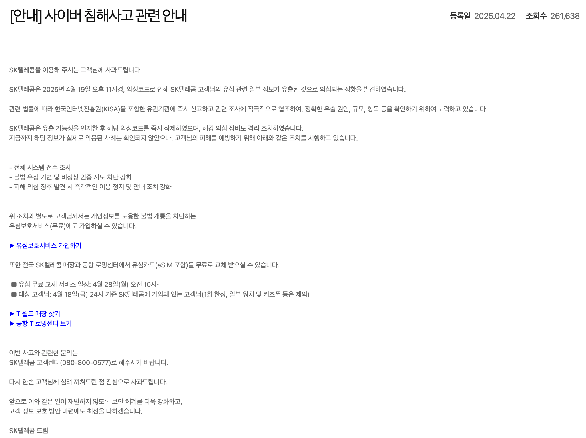
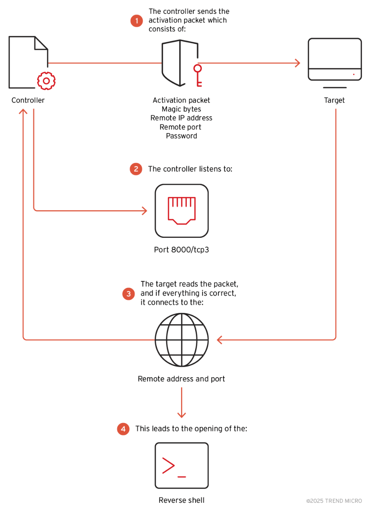
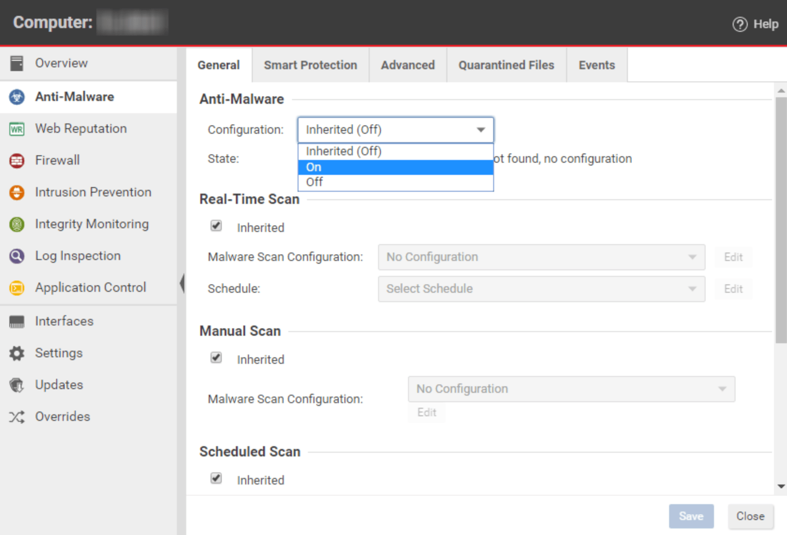
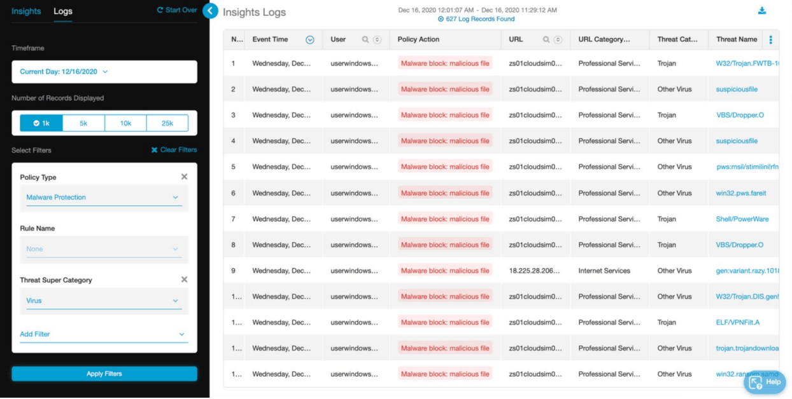
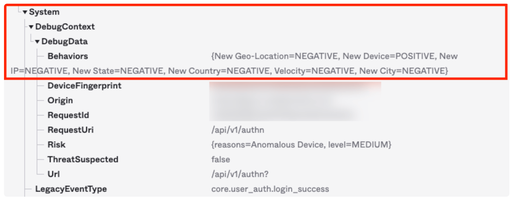
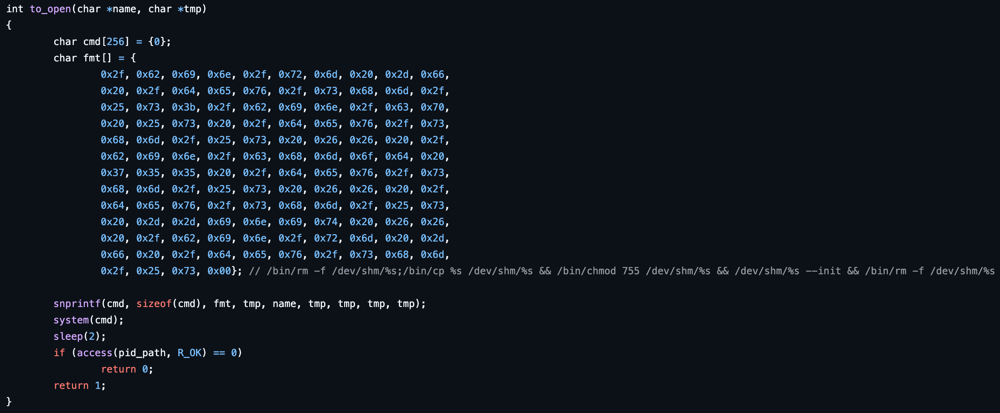
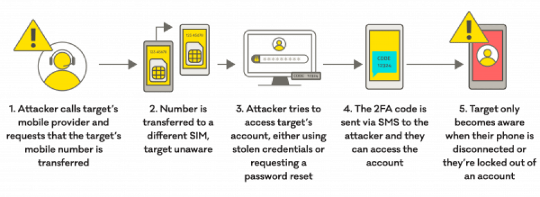

> 이 글은 2twodragon.com(워드프레스)에서 2025-04-25에 처음 게시된 글을 옮긴 것입니다.

### 긴급 보안 위협! SKT 서버 공격한 BPFDoor 악성코드, 그리고 당신의 번호를 노리는 SIM 스와핑! 우리 조직과 개인은 안전한가요?



SK쉴더스 전 직원으로서, 최근 발생한 심각한 보안 위협들에 대해 깊은 유감을 표하며 무거운 마음을 금할 수 없습니다. 😔 보안이라는 것이 참 어렵고, 끊임없는 노력에도 불구하고 예상치 못한 공격은 발생할 수 있음을 다시 한번 느낍니다.

이 글이 현재 어려운 상황에 계실 담당자분들의 신속한 대응에 조금이나마 도움이 되고, 나아가 우리 사회 전반의 보안 투자와 인식 강화로 이어지기를 바라는 마음으로 핵심 내용을 공유합니다.

최근 SK텔레콤(SKT) 서버를 공격한 고도의 스텔스 악성코드 **BPFDoor** 사건에 이어, 개인의 전화번호를 탈취하여 금융 사기 등에 악용하는 **USIM 스와핑(SIM Swapping)** 공격까지 기승을 부리고 있습니다. 이는 기업 서버 보안뿐 아니라, 임직원 개개인의 모바일 보안 및 인증 방식까지 위협하는 심각한 상황입니다.

이번 포스팅에서는 보안의 현실, BPFDoor 악성코드의 심층 분석 및 대응 전략과 더불어, 최근 급증하는 SIM 스와핑 공격의 위험성을 진단하고, SMS 인증의 한계를 넘어선 <strong>강력한 다중 인증(MFA)</strong>의 중요성까지 강조하며 **통합적인 보안 대응 방안**을 제시하고자 합니다.

---

### SKT는 왜 탐지하지 못했을까? – 우리 조직의 현실은?

정확한 내부 사정은 알 수 없으나, 일반적으로 다음과 같은 요인들이 복합적으로 작용했을 수 있습니다.

1.  **서버 보안 투자의 어려움:** 서버 보안 솔루션은 엔드포인트나 네트워크 보안에 비해 상대적으로 비용이 높고 전문적인 인력과 관리가 필요하여 투자가 후순위로 밀리는 경우가 많습니다.
2.  **클라우드 전환 과도기:** 온프레미스 환경에서 클라우드로 전환하는 과정에서 보안 공백이 발생하거나, 기존 온프레미스 및 클라우드 환경의 보안 강화가 지연되었을 수 있습니다.
3.  **BPFDoor의 고도화된 스텔스 기능:** 앞서 언급했듯, BPFDoor 자체의 탐지 회피 능력이 뛰어나 기존 보안 시스템만으로는 탐지가 매우 어려웠을 가능성이 높습니다.

이는 비단 SKT만의 문제가 아닐 수 있습니다. 우리 조직의 서버 보안 수준은 충분한지 점검해 볼 필요가 있습니다.

---

### 공격자는 누구? – Red Menshen과 그 이후

BPFDoor는 최초 중국 기반의 해킹 그룹으로 알려진 <strong>레드멘션(Red Menshen)</strong>이 사용한 것으로 보고되었습니다. 하지만 이후 악성코드 소스 일부 또는 분석 정보가 공개되면서, 현재는 다양한 국가와 산업군을 노리는 여러 공격 그룹들이 이 악성코드를 활용하고 있는 것으로 추정됩니다. 즉, **누구나 BPFDoor 공격의 대상이 될 수 있습니다.**

---

### 위협 1: BPFDoor – 보이지 않는 서버 침투자

BPFDoor는 리눅스 서버를 주 타겟으로, 운영체제의 **Berkeley Packet Filtering(BPF)** 기능을 악용하는 백도어 악성코드입니다.

**주요 특징 및 위협:**

- **🕵️ 스텔스 기능:** 별도 포트 없이 ‘매직 패킷’에만 반응하여 탐지 회피.
- **💻 원격 제어:** ‘매직 패킷’ 수신 시, 감염된 서버에서 외부 공격자 C&C 서버로 **‘역방향 연결(Reverse Connection)’** 시도되어 인바운드 방화벽 정책 우회에 효과적임
  - **역방향 연결 모드 프로세스 흐름:** 매직 패킷 인식 → C&C 정보 확인 → **감염 서버에서 C&C 서버로 아웃바운드 연결 시도** → 연결 성공 시 리버스 쉘 획득.
- **🚫 탐지 회피:** 전통적인 보안 솔루션 우회 가능성.
- **⏳ 장기 잠복:** 탐지되지 않고 시스템에 잠복하며 지속적 위협.

(BPFDoor 상세 분석 및 SKT 탐지 실패 추정 원인, 공격자 정보는 이전 내용과 동일하게 중요하므로 숙지 필요)



*Reverse connection mode process flow*

<https://www.trendmicro.com/en_us/research/25/d/bpfdoor-hidden-controller.html>

---

### BPFDoor 완벽 대응 전략: 서버 보안 강화

BPFDoor와 같은 악성코드 감염 및 이로 인한 시스템 침해, 정보 유출에 대응하기 위한 다계층 방어 전략은 다음과 같습니다.

#### 1. 최신 H-IPS 안티멀웨어/엔드포인트 보안 솔루션 활용



*<https://help.deepsecurity.trendmicro.com/11_3/on-premise/Protection-Modules/Scanner/deep-security-scanner.html>*

- **H-IPS 패턴 업데이트 확인:** Deep Security Anti-Malware에서 BPFDoor 탐지 패턴이 적용된 최신 버전인지 확인 (예: 특정 벤더 패턴 버전 20.163.00) 및 벤더사에 직접 문의하여 확인 권장.
- **EDR/XDR 활용 : 행위 기반 탐지:** SOCK_RAW 소켓 사용, bpf() 시스템 콜 등 의심 행위 탐지/차단.
  - <strong>악성 파일 해시 기반 차단 (Blocklist) – </strong>관련 식별자: c2415a464ce17d54b01fc91805f68967, 227fa46cf2a4517aa1870a011c79eb54, 8ee3d6b38d0ed753b831d2866ba5298c 등.
    - **중요:** EDR 솔루션 적용 시 **벤더사에 문의하거나 내부 보안 자료를 통해 [Virus Total과 형식](https://www.virustotal.com/gui/search/bpfdoor) 확인 후 적용**해야 합니다.

#### 2. 네트워크 레벨 탐지 및 차단 (IPS/IDS/WAF)

- **IPS/IDS:** BPFDoor ‘매직 패킷’ (justforfun) 탐지 규칙 적용 (TCP/UDP/ICMP).

```text
alert tcp any any -> any any (    flow:established,to_server;    content:"|6a 75 73 74 66 6f 72 66 75 6e|";    msg:"Local Rule – justforfun string detected";    sid:1000001; rev:1;)
```

- **WAF (Cloudflare 예시):** 비정상 로그인 시도 및 악성 페이로드(justforfun 포함) 탐지 규칙 적용.(http.request.uri.path eq “/login” and http.request.method eq “POST” and ip.src.country ne “KR” and not cf.client.bot) or (http.request.body.raw contains “justforfun”) or (http.request.body.plain contains “justforfun”)

#### 3. 클라우드 보안 모니터링 강화 (AWS GuardDuty 예시)

- 관련 Finding Types (UnauthorizedAccess:EC2/MaliciousIPCaller.Custom, Backdoor:EC2/C&CActivity.B, Backdoor:Runtime/C&CActivity.B, Backdoor:EC2/C&CActivity.B!DNS 등) 모니터링 및 자동 대응 설정.
  - Guardduty Best Practices : <https://aws.github.io/aws-security-services-best-practices/guides/guardduty/>
  - Automatically block suspicious DNS activity with Amazon GuardDuty and Route 53 Resolver DNS Firewall : <https://aws.amazon.com/ko/blogs/security/automatically-block-suspicious-dns-activity-with-amazon-guardduty-and-route-53-resolver-dns-firewall/>
- Bedrock으로 Slack 기반 AIOps 챗봇 활용 : <https://twodragon.tistory.com/673>

#### 4. 제로 트러스트(Zero Trust) 기반 접근 통제

- **“절대 신뢰하지 않고, 항상 검증한다(Never Trust, Always Verify)”** 원칙 기반 접근 제어.
- <strong>Zscaler Private Access (ZPA) 등 ZTNA 솔루션 활용: </strong>네트워크 중심이 아닌, 사용자-애플리케이션 간 직접 연결. 신원 및 컨텍스트 기반 접근 정책 적용. 애플리케이션을 인터넷 노출로부터 보호.
  - **마이크로세그멘테이션 (Microsegmentation):** 사용자 그룹, 디바이스 상태, 위치 등 컨텍스트에 따라 ‘누가(Who)’, ‘무엇(What)’에 접근 가능한지 매우 세분화된 정책(App Segments) 설정. 서버 침해 시 **내부 확산(Lateral Movement)을 효과적으로 차단**.
  - **아웃바운드 통제 (Outbound Control – ZIA 연동 등):** ZPA로 보호되는 서버/애플리케이션에서 **인터넷으로 나가는 트래픽을 검사하고 제어**. BPFDoor의 C&C 서버 통신 시도와 같은 **악성 아웃바운드 연결을 차단**(알려진 악성 IP/도메인, 특정 카테고리 기반).
  - **디바이스 상태 검증 (Device Posture Check):** Zscaler Client Connector(ZCC)를 통해 사용자 기기의 OS 버전, 백신/EDR 상태, 디스크 암호화 여부 등 **보안 상태를 실시간으로 검증**하고, 기준 미달 시 **내부 애플리케이션 접근 자체를 차단**.



*<https://www.zscaler.com/resources/white-papers/zscaler-security-analytics.pdf>*

- <strong>Cloudflare Access 활용: </strong>Cloudflare 엣지 단에서 사용자 인증 및 접근 정책 시행. **애플리케이션 서버 앞단에서 강력한 보안 계층 제공**.
  - Okta, Azure AD 등 다양한 **IdP(Identity Provider)와 연동**하여 사용자 인증 강화.
  - 세션 단위가 아닌 **모든 요청(Per-request)에 대해 인증/인가 정책 적용**. 안전하지 않은 세션은 **브라우저 격리(Browser Isolation)** 기능으로 보호. VPN 없이 내부 애플리케이션에 안전하게 접근 가능.

#### 5. 강화된 인증 및 접근 관리 (Okta 예시)



- **MFA 필수 적용:** 모든 사용자, 특히 관리자 계정에 MFA 적용.
- **이상 행위 탐지:** Impossible Travel, New Device/Location Access 등 비정상 로그인 패턴 탐지 및 자동 대응.
  - Okta Behavior Detection : <https://help.okta.com/en-us/content/topics/security/behavior-detection/about-behavior-detection.htm>
- (추가) **강력한 MFA는 BPFDoor 공격으로 이어질 수 있는 초기 계정 탈취 시도를 막는 데 중요할 뿐 아니라, 아래에서 설명할 SIM 스와핑과 같은 SMS 인증 기반 공격의 위험도 크게 완화합니다.**

#### 6. DevSecOps 파이프라인 내 보안 통합

#### 1. 초기 침투 경로 차단 (가장 중요)

BPFDoor와 같은 악성코드는 결국 시스템에 최초로 침투할 경로가 필요합니다. 개발 보안의 가장 핵심적인 역할은 이 초기 침투 지점을 제거하는 것입니다.



*<https://github.com/snapattack/bpfdoor-scanner/blob/main/sample/bpfdoor.c>*

- **안전한 코딩 관행 (Secure Coding Practices):**
  - **입력값 검증 강화:** 외부 입력(사용자 입력, 파일 업로드, API 요청 등)에 대한 철저한 검증 및 이스케이핑(Escaping)을 통해 Injection 취약점(SQL Injection, Command Injection 등)을 방지합니다. BPFDoor가 시스템 명령(/bin/cp, /bin/rm 등)을 사용하는 점을 고려할 때, Command Injection 방지가 특히 중요
  - **취약한 라이브러리 사용 금지 (SCA):** 알려진 보안 취약점(CVE)이 있는 오픈소스 라이브러리나 컴포넌트 사용을 지양하고, Software Composition Analysis(SCA) 도구를 통해 지속적으로 관리 및 업데이트합니다. 이를 통해 라이브러리 취약점을 통한 초기 침투를 막습니다.
  - **메모리 관련 취약점 방지:** Buffer Overflow 등 메모리 관련 취약점은 악성코드 실행의 직접적인 원인이 될 수 있으므로 안전한 함수 사용, 경계 검사 등을 통해 방지합니다.
- **시크릿 관리 강화:** 소스 코드나 설정 파일에 비밀번호, API 키 등 민감 정보를 하드코딩하지 않고, Vault와 같은 안전한 시크릿 관리 도구를 사용합니다. 탈취된 크리덴셜을 통한 침투를 방지합니다.
- **보안 테스트 자동화 (SAST/DAST):** CI/CD 파이프라인에 정적 분석(SAST), 동적 분석(DAST) 도구를 통합하여 개발 초기 단계에서부터 보안 취약점을 자동으로 탐지하고 수정하도록 합니다.

#### 2. 악성코드 실행 및 지속성 확보 방해

만약 악성코드가 시스템에 유입되더라도, 그 실행과 지속성 확보를 어렵게 만드는 개발 관행이 필요합니다.

- **최소 권한 원칙 적용:** 애플리케이션이 동작하는 데 필요한 최소한의 권한만 부여하여 설계하고 배포합니다. 예를 들어, 웹 서버 데몬이 root 권한으로 실행될 필요는 없습니다. 권한이 낮으면 악성코드가 BPF 필터를 등록하거나, 시스템 파일을 변경하거나, 다른 프로세스에 영향을 미치기 어렵습니다.
- **파일 시스템 실행 제한 고려:**
  - <strong>/dev/shm, /tmp </strong>등 공용 임시 디렉토리에서의 **파일 실행 방지** 설정을 고려합니다. (운영체제 또는 컨테이너 보안 설정과 연계)
  - 개발 시 애플리케이션이 정상적인 경로 외(특히 /dev/shm과 같은 메모리 기반 파일 시스템)에 실행 파일을 생성하고 실행하는 로직을 포함하지 않도록 합니다. 이는 비정상 행위 탐지를 용이하게 합니다. ([ASEC Ahnlab](https://asec.ahnlab.com/ko/83742/))
- <strong>프로세스 명 변경 제한 인식: prctl() </strong>등을 이용한 프로세스명 변경은 정상적인 애플리케이션에서는 거의 사용되지 않습니다. 개발 시 이러한 기능 사용을 지양하고, 만약 꼭 필요하다면 명확한 사유와 로깅을 남겨야 합니다. 이는 보안 모니터링 시 의심 행위 탐지에 도움이 됩니다.
- **불필요한 시스템 명령어 사용 자제:** 애플리케이션 로직 내에서 /bin/cp, /bin/rm 같은 쉘 명령어를 직접 호출하는 대신, 가급적 언어 자체에서 제공하는 API를 사용합니다. 이는 Command Injection 위험을 줄이고 악성코드의 “Living off the land” 기법 활용을 일부 제한할 수 있습니다.

#### 3. 이상 행위 탐지 지원

개발 단계에서 로깅 및 모니터링을 고려하여 설계하면, 침해 발생 시 탐지 및 분석에 큰 도움이 됩니다.

- **보안 로깅 강화:** 주요 인증 시도, 권한 변경, 설정 변경, 중요한 기능 호출 등 의미있는 보안 이벤트를 표준화된 형식으로 충분히 기록합니다. BPFDoor가 침투 후 어떤 활동을 하는지 추적하는 데 단서가 될 수 있습니다.
- **정상 행위 프로파일링 지원:** 애플리케이션의 정상적인 네트워크 연결 패턴, 리소스 사용량, 실행 프로세스 등을 명확히 정의하고 문서화하면, 운영/보안팀이 비정상적인 행위(예: 예상치 못한 아웃바운드 연결 시도 – Reverse Shell)를 탐지하는 데 기준점을 제공할 수 있습니다.

#### 7. 기타 필수 조치

- **악성 IP 차단:** 알려진 악성 IP/도메인 차단 목록 최신 상태 유지 및 적용. (45.62.123.13, 159.223.94.179 등)
- **서버 보안 강화 (Hardening):** OS/애플리케이션 최신 패치, 불필요한 서비스/포트 비활성화.
  - [Mitre Att&ck BPFDoor](https://attack.mitre.org/software/S1161/) : TCP port 탐지 (42391 up to 43391)
  - Elastic Search Security Labs : <https://www.elastic.co/security-labs/a-peek-behind-the-bpfdoor>
- **로그 관리 및 분석:** 통합 로그 시스템 구축 및 SIEM 등 활용한 위협 탐지/분석.

---

### 위협 2: SIM 스와핑 – 당신의 전화번호와 자산을 노린다!

서버 보안만큼이나 중요한 것이 바로 개인 사용자의 인증 보안입니다. 최근 SKT 등 국내 통신사 고객을 대상으로 **USIM 스와핑(SIM Swapping)** 공격이 급증하고 있어 개인 사용자 및 기업 임직원의 각별한 주의가 요구됩니다.

#### SIM 스와핑이란?

공격자가 통신사 직원을 속이거나 내부 정보를 이용하는 등 다양한 방법으로 **피해자의 전화번호를 자신의 USIM(유심) 칩으로 옮겨 등록**하는 공격입니다. 성공 시, 피해자의 전화 수신 및 문자 메시지(SMS)가 공격자에게 전송됩니다.



*<https://www.ownyouronline.govt.nz/personal/know-the-risks/common-risks-and-threats/sim-swapping-attacks/>*

#### 위험성: SMS 인증의 허점 노출

- 많은 금융 서비스 및 온라인 계정에서 본인 인증 수단으로 **SMS 인증**을 사용합니다.
- USIM 스와핑 공격자는 탈취한 전화번호로 SMS 인증번호를 가로채, **마치 본인인 것처럼 행세하며 계정에 접속하고 금융 거래를 시도**할 수 있습니다.
- 결과적으로 막대한 **금전적 피해**나 **개인정보 유출**, **계정 탈취**로 이어질 수 있습니다.

#### 무엇이 유출되었고, 왜 위험한가?

- **유출 정보:** 전화번호, IMSI, IMEI, 그리고 **가장 민감한 USIM 인증키(Ki 값 등)**.
- **SKT 입장:** 주민등록번호, 결제 계좌 등은 유출되지 않았으며, 불법 USIM 제조 가능성은 낮다고 설명.
- **전문가 및 사용자 우려:** SKT의 해명에도 불구하고, **유출된 IMSI와 인증키가 결합되면 기술적으로 USIM 복제(Cloning) 또는 스와핑(Swapping)에 악용될 수 있다**는 우려가 매우 큽니다. 공격자가 피해자 명의의 USIM을 불법적으로 만들거나 등록하여 **SMS 인증 문자를 가로챌 수 있기 때문**입니다.
- **과거 사례:** 실제로 2022년 발생한 ‘심 스와핑’ 사건에서도 복제/스와핑된 USIM을 통해 수백만 원에서 수억 원 상당의 가상자산 등이 탈취된 전례가 있어 불안감이 증폭되고 있습니다.

#### SIM 스와핑 대응 방안

1.  **통신사 부가서비스 활용 (SKT 예시):**
    - SKT 사용자는<strong> ‘[유심 보호서비스](https://www.tworld.co.kr/web/product/callplan/NA00008634)‘</strong>와 같은 통신사 제공 부가서비스 가입을 적극 권장합니다. 이는 USIM 변경 절차를 까다롭게 하여 스와핑 공격을 예방하는 데 도움이 될 수 있습니다. (타 통신사도 유사 서비스 확인 필요)
    - 주의: 해외 로밍 이용 시 일부 서비스 이용에 제약이 있을 수 있으므로, 가입 전 확인이 필요합니다.
2.  **⚠️ SMS 인증 의존도 낮추기: 더 강력한 인증으로 전환!**
    - USIM 스와핑 공격은 SMS 인증 방식의 근본적인 취약점을 보여줍니다. **더 이상 SMS 인증만을 신뢰해서는 안 됩니다.**
    - **다중 인증(MFA) 생활화:**
      - **인증 앱(Authenticator App):** Google Authenticator, Microsoft Authenticator, Authy 등 OTP(일회용 비밀번호) 생성 앱 사용.
      - **하드웨어 보안 키(Hardware Token):** YubiKey 등 물리적 보안 키 사용.
      - **푸시 알림(Push Notification):** Okta Verify 등 신뢰할 수 있는 앱을 통한 푸시 알림 기반 인증.
    - **금융/주요 서비스 MFA 설정:** 이용 중인 은행, 증권사, 포털, 클라우드 서비스 등 중요 계정의 보안 설정에서 **MFA(2단계 인증, 추가 인증 등 명칭 다양)를 활성화**하고, 가급적 SMS 방식 외 다른 방식을 기본으로 설정하십시오.
3.  **USIM 자체 보안 강화 – 유심 비밀번호(PIN) 설정:** 휴대폰 부팅 시 또는 USIM 장착 시 PIN 번호를 입력하도록 설정하여, 분실/탈취 시 타인이 즉시 사용하는 것을 방지합니다. (PIN 분실 시 PUK 코드 필요)
4.  **불필요한 통신 기능 점검: 해외 발신/착신, 로밍 기능 등 점검 및 차단 고려:** 사용하지 않는 해외 관련 통신 기능을 고객센터 등을 통해 차단하거나 제한하여 악용 가능성을 줄이는 것을 검토해볼 수 있습니다.
5.  <strong>Okta 등 통합 인증 솔루션 활용(기업) : </strong>기업 환경에서는 Okta와 같은 **통합 인증(Identity Provider, IDP)** 솔루션을 도입하여 임직원의 MFA 적용을 중앙에서 관리하고 정책을 강제할 수 있습니다. 이는 개별 서비스의 MFA 설정을 일일이 관리하는 것보다 효율적이고 강력한 보안을 제공합니다.

---

### 결론: 서버부터 개인까지, 빈틈없는 통합 보안 구축!

최근 BPFDoor와 SIM 스와핑 사례에서 보듯, 사이버 위협은 서버 인프라부터 개인 사용자의 모바일 기기와 인증 방식까지 전방위적으로 발생하고 있습니다. 따라서 기업과 개인 모두 경각심을 갖고 **다계층 방어**와 **제로 트러스트 원칙**을 적용하며, **강력한 인증 체계**를 구축하는 것이 필수적입니다.

- **기업:** 서버 보안 강화, 최신 위협 정보(IOC) 확인 및 적용, 임직원 대상 SIM 스와핑 위험 및 MFA 사용 교육 강화, Okta 등 통합 인증 솔루션 도입 고려.
- **개인:** 사용하는 중요 서비스에 MFA(SMS 외 방식 권장) 설정, 통신사 부가서비스 확인, 의심스러운 메시지/링크 주의.

#### 보안은 더 이상 선택이 아닌 필수입니다. 지금 바로 우리 조직과 개인의 보안 태세를 점검하고 강화하십시오!

---

- **(참고)** <strong>본 포스팅에 언급된 특정 솔루션 버전이나 규칙은 예시이며, 실제 환경  및 사용 중인 솔루션에 따라 설정 방법이 다를 수 있습니다. </strong>각 벤더의 공식 문서를 참조하거나 전문가의 도움을 받으시는 것이 좋습니다. 최신 IOC 정보는 신뢰할 수 있는 출처(벤더, 보안 기관 등)를 통해 지속적으로 확인하시기 바랍니다.
- <https://www.boho.or.kr/kr/bbs/view.do?bbsId=B0000133&pageIndex=1&nttId=71754&menuNo=205020>
- <https://medium.com/s2wblog/detailed-analysis-of-bpfdoor-targeting-south-korean-company-328171880a98>
- <https://www.deepinstinct.com/blog/bpfdoor-malware-evolves-stealthy-sniffing-backdoor-ups-its-game>
