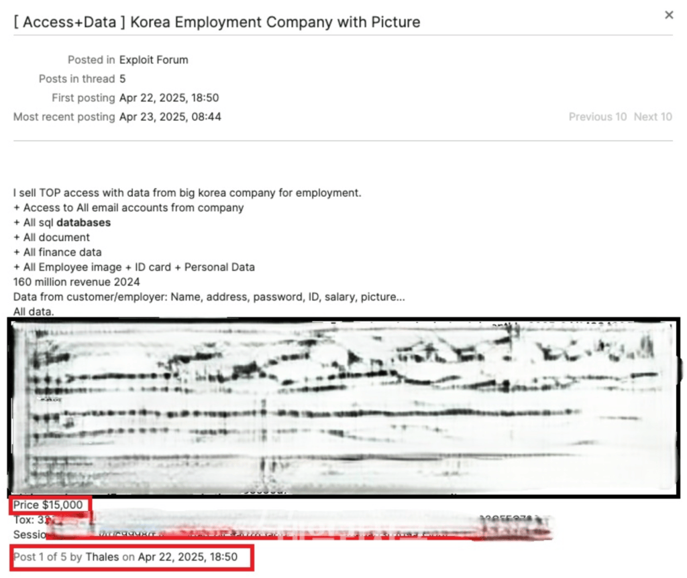

> 이 글은 2twodragon.com(워드프레스)에서 2025-04-28에 처음 게시된 글을 옮긴 것입니다.

안녕하세요! 여러분의 IT 소식을 발 빠르게 전해드리는 블로거입니다. 오늘은 정말 심각하고 우려스러운 보안 사고 소식을 전해드리게 되었습니다. 국내 BPO(비즈니스 프로세스 아웃소싱) 전문 기업인 **KS한국고용정보**가 외부 해커의 공격으로 인해 대규모 내부 데이터 유출 피해를 입었고, 이 데이터가 현재 다크웹에서 버젓이 판매되고 있다는 충격적인 정황이 포착되었습니다. 😟

---

### 사건 개요: 도대체 무슨 일이?

- **피해 기업:** KS한국고용정보 (ksjob.co.kr) – BPO 전문 기업
- **발생 시점:** 2025년 4월 초 침해 시작 추정 (4월 5일 관리자 계정 정보 탈취 정황 포착) → 4월 19일경 내부 시스템 침입 및 자료 유출 → 4월 22일 다크웹 판매 게시
- **유출 규모:** **총 22GB** 분량의 내부 데이터
- **판매 정보:** 다크웹 해킹 포럼 ‘익스플로잇 포럼(Exploit Forum)’에서 사용자명 <strong>‘Thales’</strong>가 **15,000달러**에 판매 중 (Tox 메신저, PGP 서명으로 연락)
- **유출 경로 (추정):**
  1.  **초기 침투:** **LummaC2 인포스틸러** 악성코드를 통해 관리자 계정 정보(크리덴셜, 세션 토큰 등) 탈취
  2.  **내부 접근:** 탈취한 관리자 계정으로 내부 시스템 접근
  3.  **자료 유출:** 내부 시스템에 저장된 대규모 데이터 외부 유출

– <https://www.dailysecu.com/news/articleView.html?idxno=165636>[\[단독\] 해커, KS한국고용정보 22GB 분량 내부 데이터 유출…다크웹서 15,000달러에 판매중 – 데국내 BPO(비즈니스 프로세스 아웃소싱) 전문 기업 KS한국고용정보가 외부 해커의 침입으로 인해 대규모 개인정보 유출 사고를 당한 것으로 확인됐다. 유출된 데이터는 총 22GB 분량에 달하며, 현재www.dailysecu.com](https://www.dailysecu.com/news/articleView.html?idxno=165636)

---

### 유출된 정보: 단순 개인정보를 넘어선 위험성

KS한국고용정보 측은 내부 공지를 통해 이름, 생년월일, 주민등록번호 뒷자리, 이메일, 주소, 전화번호, 비밀번호, 계좌번호 등 기본 개인정보 유출 사실을 인정했습니다. 이 중 일부는 암호화된 상태라고 밝혔지만, 문제는 여기서 그치지 않았습니다.

**더욱 심각한 것은 암호화되지 않은 상태로 유출된 고위험 문서들입니다:**

- **신분증 사본:** 주민등록증, 운전면허증 등
- **금융 정보:** 통장 사본, 급여명세서
- **계약 및 증명서:** 근로계약서, 가족관계증명서, 주민등록등본, 혼인관계증명서 등
- **기타 민감 정보:** 임직원 사진, 자필 서명 등

이러한 문서 정보는 단순 정보 조회를 넘어, **신분 도용, 사칭, 직접적인 금융 사기 등 2차, 3차 범죄에 즉시 악용될 가능성이 매우 높습니다.** 특히 **수년 전 퇴사한 임직원들의 정보까지 포함**되어 있어, 개인정보 보관 및 파기 정책에 심각한 문제가 있었음을 시사합니다.

---

### 유출 경위 심층 분석: LummaC2와 APT 가능성

보안 전문가들은 이번 사고가 단순 침해를 넘어 **APT(지능형 지속 위협)** 수준의 공격일 수 있다고 평가합니다.

1.  **LummaC2 인포스틸러:** 초기 침투에 사용된 LummaC2는 사용자 PC에 잠입하여 저장된 비밀번호, 세션 토큰, 암호화폐 지갑 정보 등을 훔쳐내는 악성코드입니다.
2.  **잠깐, LummaC2 인포스틸러란 무엇일까요? 🧐** LummaC2는 최근 기승을 부리는 대표적인 **정보 탈취형 악성코드(Infostealer)** 중 하나입니다. 주로 피싱 이메일, 불법 소프트웨어 다운로드, 악성 광고 등을 통해 유포되며, 감염된 PC에서 ▲웹 브라우저에 저장된 계정 정보(ID/PW) ▲세션 쿠키 ▲암호화폐 지갑 정보 ▲시스템 정보 등 민감 정보를 훔쳐내어 공격자의 서버로 전송합니다. 특히 이렇게 탈취된 기업 내부망 접근 계정 정보는 이번 사례처럼 더 큰 규모의 해킹 공격을 위한 발판으로 악용되는 경우가 많아 매우 위험합니다. LummaC2는 **서비스형 악성코드(Malware-as-a-Service, MaaS)** 형태로 판매되기도 해, 다양한 공격자들이 비교적 쉽게 구매하여 이용할 수 있다는 특징도 있습니다.
3.  **권한 상승 및 내부망 이동:** 공격자는 탈취한 초기 계정(관리자 계정으로 추정)을 발판 삼아 내부 시스템에 접근하고, 추가적인 권한 상승이나 내부망 이동(Lateral Movement)을 통해 중요 데이터가 저장된 서버에 도달했을 가능성이 큽니다.
4.  **대규모 데이터 유출:** 22GB라는 방대한 양의 데이터가 유출된 것은 공격자가 상당 기간 내부 시스템에 머물며 데이터를 수집하고 외부로 빼돌렸음을 의미합니다.

---

### 다크웹 판매: Exploit Forum과 공격자 ‘Thales’

이번 사건의 심각성을 더하는 것은 유출된 데이터가 실제 다크웹에서 거래되고 있다는 점입니다. 데이터는 ‘익스플로잇 포럼(Exploit Forum)’에서 ‘Thales’라는 사용자에 의해 판매되고 있었습니다.

> **Exploit Forum과 ‘Thales’는 누구일까요? 🕵️‍♂️** 여기서 언급된<strong> ‘익스플로잇 포럼(Exploit Forum, Exploit.in)’</strong>은 주로 러시아어를 사용하는 가장 오래되고 악명 높은 **엘리트 해킹 포럼** 중 하나입니다. 회원 가입이 매우 까다롭고, 일반적인 다크웹 마켓플레이스와 달리 고도의 기술적 논의, 제로데이 취약점 거래, 주요 랜섬웨어 그룹 활동 등과 연관된 곳으로 알려져 있습니다. 이런 폐쇄적이고 전문적인 포럼에서 데이터가 판매된다는 것은 유출된 정보의 민감도와 공격자의 수준을 짐작게 하는 부분입니다.
>
> 판매자 ‘Thales’의 구체적인 신원이나 소속 그룹은 현재로서는 이 포럼에서 사용하는 아이디 외에는 알려진 바가 없습니다. 하지만 이러한 주요 포럼에서 활동하며 대규모 데이터를 거래한다는 점 자체가 **전문적인 해커 혹은 조직범죄 그룹**일 가능성을 시사합니다.

(사진 설명: 다크웹 포럼 내 판매자와 구매 희망자 간 대화 내용 캡처)

---

### 전문가 지적 및 구체적인 대응 방안 권고

이번 사태를 통해 드러난 문제점과 함께, 유사 사고 방지를 위한 구체적인 대응 방안은 다음과 같습니다.

**1. 데이터 관리 및 정책 강화:**

- **퇴직자 개인정보 자동 삭제 시스템 도입:** 법적 보존 기한 및 내부 규정에 따라 퇴직자의 개인정보(특히 민감 문서)가 자동으로 안전하게 파기되는 프로세스를 구축하고 정기적으로 검증해야 합니다.
- **중요 문서 식별 및 분류:** 내부 데이터 중 민감도(신분증, 계약서, 금융 정보 등)를 식별하고 분류하는 체계를 갖춰야 합니다.
- **접근 통제 강화:** 분류된 민감 데이터에 대해 최소 권한 원칙에 따라 접근 권한을 부여하고, 접근 로그를 철저히 모니터링해야 합니다.

**2. 기술적 보안 강화:**

- **전방위적 암호화 적용:**
  - **정형 데이터:** 데이터베이스 내 주민등록번호, 계좌번호 등 민감 컬럼은 반드시 암호화(TDE, 컬럼 레벨 암호화 등)합니다.
  - **비정형 데이터:** 파일 서버나 클라우드 스토리지에 저장된 신분증 사본, 계약서 등 **문서 파일 자체를 암호화** (DRM, 파일/폴더 단위 암호화, 스토리지 서비스 암호화 등)하는 것이 필수적입니다.
  - **전송 구간:** 내부 및 외부 모든 데이터 전송 구간에 TLS 등 강력한 암호화 프로토콜을 적용합니다.
  - **키 관리 시스템(KMS):** 암호화 키의 생성, 저장, 관리, 교체, 폐기 전 과정에 걸쳐 안전한 키 관리 시스템(AWS KMS, Azure Key Vault, HashiCorp Vault 등)을 도입하고 접근을 엄격히 통제합니다.
- **클라우드 보안 강화 (Cloud Security):**
  - **CSPM (Cloud Security Posture Management):** 클라우드 환경의 보안 설정 오류, 규정 준수 위반, 과도한 권한 등을 지속적으로 탐지하고 교정합니다.
  - **IAM (Identity and Access Management):** 클라우드 리소스 접근 시 최소 권한 원칙을 엄격히 적용하고, 모든 관리자 계정 및 중요 역할에 **MFA를 강제**합니다. 정기적인 권한 검토는 필수입니다.
  - **클라우드 데이터 보안:** 클라우드 네이티브 암호화 기능(S3 SSE, RDS 암호화 등)을 적극 활용하고, 데이터 검색/분류 서비스(Macie, DLP 등)로 민감 데이터를 식별 및 보호합니다.
  - **CWPP (Cloud Workload Protection Platform):** 클라우드 내 워크로드(VM, 컨테이너 등) 보안을 강화합니다.
- **다크웹 위협 인텔리전스 도입:** 자사 관련 정보(도메인, 임직원 계정, 유출 데이터 등)가 다크웹 등에서 불법적으로 거래되거나 논의되는지 전문 서비스를 통해 지속적으로 모니터링하고, 위협 발견 시 선제적으로 대응합니다.

**3. 개발 및 운영 프로세스 개선 (DevSecOps):**

- **DevSecOps 기반 보안 내재화:** 개발 라이프사이클 초기부터 보안을 통합합니다.
  - **CI/CD 파이프라인 보안 자동화:** SAST, SCA, DAST, IaC 스캔, 컨테이너 스캔 등을 자동화하여 배포 전 취약점을 제거합니다.
  - **안전한 코딩 표준 적용 및 교육:** 개발자 대상 시큐어 코딩 교육을 정기적으로 실시하고 가이드라인을 적용합니다.
  - **시크릿 관리 자동화:** 코드나 설정 파일 내 민감 정보(API 키, 비밀번호 등) 하드코딩을 금지하고, Vault 등 연동하여 안전하게 관리합니다.
  - **보안 고려 인프라 코드(IaC):** 인프라 구성 시 보안 설정을 코드로 관리하고, 배포 전 보안 취약점 및 설정 오류를 검증합니다.

---

### 마무리하며: 우리에게 남겨진 과제

KS한국고용정보 데이터 유출 사고는 LummaC2와 같은 인포스틸러 악성코드의 위험성, 내부 시스템 접근 통제의 중요성, 그리고 무엇보다 **민감한 비정형 데이터(문서, 이미지 등)에 대한 철저한 관리 및 파기 정책의 필요성**을 다시 한번 일깨워 줍니다. 특히 클라우드 활용 증가와 함께 이에 맞는 보안 전략 수립 및 암호화, 키 관리가 더욱 중요해졌습니다.

유출된 데이터가 실제 다크웹에서 판매되고 있는 만큼, 해당 기업 임직원 및 퇴사자분들의 2차 피해가 우려되는 상황입니다. 개인정보보호위원회, KISA, 경찰청 등 관계 기관의 신속하고 철저한 조사가 이루어져야 할 것입니다.

우리 모두는 언제든 이러한 보안 위협의 대상이 될 수 있다는 경각심을 갖고, 개인 정보 보호 수칙 준수 및 사용하는 서비스의 보안 정책에 관심을 기울여야 하겠습니다. 🙏
