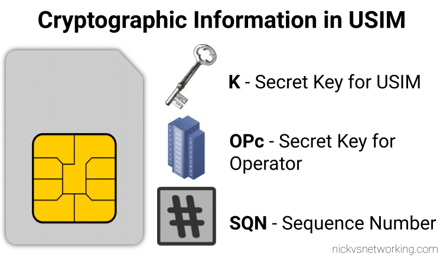
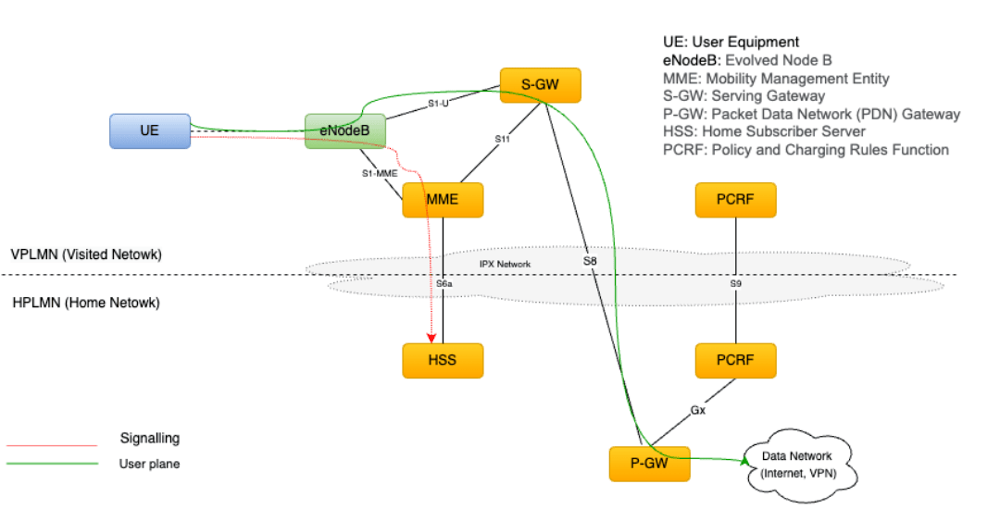
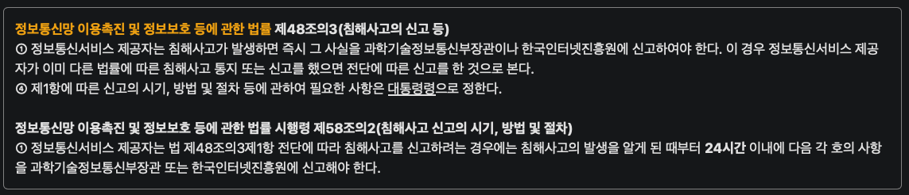

> 이 글은 2twodragon.com(워드프레스)에서 2025-04-28에 처음 게시된 글을 옮긴 것입니다.

안녕하세요! 여러분의 IT 소식을 발 빠르게 전해드리는 블로거입니다.

오늘은 정말 충격적이고 심각한 소식을 가져왔습니다. 바로 2025년 4월에 발생한 SK텔레콤의 대규모 유심(USIM) 정보 유출 사태입니다. 😟

### 사건 개요: 무슨 일이 있었나?

- **언제?** 2025년 4월 (최초 인지 4월 18일, 공식 발표 4월 22일)
- **어디서?** SK텔레콤의 홈 가입자 서버(HSS – 가입자 정보 저장 핵심 시스템)
-  **무엇이?** 해커의 악성코드 침입으로 가입자들의 유심(USIM) 핵심 정보 유출
- **유출 정보 (추정):**
  - IMEI (단말기 식별번호)
  - IMSI (유심 식별번호)
  - ICCID (유심 카드 고유번호)
  - **유심 인증키 (K값) 🔑 (이게 치명적!)**

*<https://nickvsnetworking.com/hss-usim-authentication-in-lte-nr-4g-5g/>*

- **피해 규모:** 정확한 규모는 미확인 상태 (얼마나 많은 고객 정보가 유출되었는지 불명확)

### 왜 이렇게 심각한 문제인가요?

기존의 개인정보 유출 (이름, 전화번호, 주소 등)과는 차원이 다릅니다! 이번에 유출된 정보, 특히 <strong>유심 인증키(K값)는 유심 복제(SIM Cloning)</strong>를 가능하게 할 수 있습니다.

이게 왜 무섭냐면요:

1.  **명의 도용:** 해커가 내 유심을 복제해서 다른 폰으로 내 행세를 할 수 있습니다.
2.  **본인 인증 탈취:** 복제된 유심으로 문자(SMS)나 전화 인증을 가로채서 금융 거래, 사이트 로그인 등을 할 수 있습니다. 😱
3.  **금융 사기:** 내 명의로 대출을 받거나, 대포폰을 개통하는 등 심각한 금융 범죄에 악용될 수 있습니다. 💸
4.  **인지 불가:** 최악의 경우, 내가 피해를 입고 있다는 사실조차 모른 채 당할 수 있다는 점입니다.

이 사태 때문에 금융감독원은 금융회사들에게 추가 인증을 당부했고, KB라이프생명 등 일부 금융사는 SKT 고객의 SMS 본인 인증을 일시 중단하기도 했습니다. 🚫 삼성, 현대차 등 대기업들도 임원들에게 긴급히 유심 교체를 공지할 정도로 심각하게 받아들여지고 있습니다.

### 어떻게 유출되었나? (유출 경위)

- 중국 해커 그룹이 주로 사용하는 [‘BPFDoor’ 백도어 해킹 수법](https://twodragon.tistory.com/674)으로 추정됩니다. (리눅스 시스템 취약점 공격)
- 보안 설정(SELinux)이 미흡했을 가능성이 제기됩니다.
- 사이버 보안 업체 ‘시그니아’는 중국 국영 해커 조직 ‘위버 앤트’의 수법과 유사하다고 분석했습니다.
- 심지어 1년 전부터 해킹이 진행되었을 가능성(APT 공격)도 제기되고 있습니다.

*<https://aws.amazon.com/ko/blogs/industries/roaming-optimization-using-global-presence-of-aws/>*

- **핵심은 HSS(Home Subscriber Server)가 공격당했다는 점입니다.**
  - 이 HSS는 통신망의 핵심 두뇌와 같아서,요즘은 클라우드 기술(AWS 등)을 활용해 유연하게 구축되기도 합니다. ([Working Group Two 같은 회사](https://aws.amazon.com/ko/blogs/apn/how-working-group-two-accelerates-the-creation-of-mobile-networks-with-aws-snow-family/)는 AWS 클라우드 상에 HSS 등 모바일 코어 기능을 서비스형으로 제공합니다.) 여기에 저장된 가입자 비밀 키(K, OPc)는 암호화(AWS KMS 등 활용)를 통해 철저히 보호되어야 하지만, 이번 SKT 사고는 이 HSS 시스템 자체의 보안이 뚫린 것으로 보입니다.
  - 뚫렸다는 것은, 가장 민감한 정보인 유심 인증 정보가 넘어갔을 가능성이 크다는 뜻이죠.

### 잠깐! HSS와 유심 인증, 왜 중요할까? (기술 살짝 엿보기 )

우리 휴대폰이 통신망에 접속할 때마다 “내가 진짜 가입자 맞아요!” 라고 증명하는 과정, 즉 ‘인증’을 거칩니다. 이게 어떻게 이뤄질까요?

1.  **비밀 공유:** 통신사 서버(HSS)와 내 유심(USIM) 카드 안에는 <strong>나만 아는 비밀 키(K, OPc)</strong>가 똑같이 저장되어 있습니다. 이건 절대 외부에 노출되면 안 되는 값이에요. 🔐
2.  **도전과 응답:**
    - 통신망(HSS 쪽에서 시작)이 내 폰(유심)에게 “진짜 너 맞아?” 하고 <strong>무작위 값(RAND)과 네트워크 증명 값(AUTN)</strong>을 보냅니다.
    - 내 유심은 이 값들과 자신의 비밀 키(K, OPc)를 암호화 알고리즘으로 섞어서 두 가지 계산을 합니다.
      - 이 네트워크가 진짜인지 검증 (AUTN 값 비교)
      - 네트워크에게 보낼 **응답 값(RES)** 계산
    - 유심은 계산한 응답 값(RES)을 네트워크로 보냅니다.
3.  **상호 확인:** 네트워크(HSS)는 자기가 가지고 있는 비밀 키와 받았던 RAND 값으로 똑같이 계산해서 ‘기대하는 응답 값(XRES)’을 만듭니다. 유심이 보낸 RES 값과 HSS가 기대한 XRES 값이 일치하면, “오케이! 너 진짜 가입자 맞네!” 하고 인증 성공! 동시에 유심도 AUTN 검증을 통해 “오케이! 이 네트워크 진짜 맞네!” 하고 확인합니다. 이걸 **상호 인증**이라고 해요.
4.  **보안 강화:** 여기에 추가로 <strong>순번(SQN)</strong>이라는 값을 써서, 똑같은 인증 요청이 재사용되는 것(재전송 공격)을 막습니다.

**결론:** HSS와 유심이 <strong>동일한 비밀 키(K, OPc)</strong>를 공유하고, 이걸 기반으로 암호화 계산을 통해 서로를 확인하는 것이 인증의 핵심입니다. **SKT의 HSS가 해킹당했다는 것은, 바로 이 비밀 키들이 유출되었을 가능성이 있다는 뜻입니다!** 💥 그래서 해커가 이 키를 이용해 유심을 복제하고 내 행세를 할 수 있게 되는 거죠.

### SKT의 대처와 논란

SKT의 대처는 여러 면에서 비판받고 있습니다.

1.  **늑장 공지 및 신고:** 4월 18일에 인지하고도 4일 뒤인 22일에 공지했으며, 관계 기관(KISA) 신고도 법정 기한(24시간)을 훌쩍 넘긴 45시간 뒤에 이루어졌습니다. (정보통신망법 위반 소지)
2.  **미흡한 초기 대응:** 처음에는 문제 해결책으로 ‘유심보호서비스'(무료 부가서비스) 가입을 권유했습니다. 하지만 이 서비스는 IMEI 정보까지 유출된 이번 사태에서는 해커가 IMEI를 조작하면 무력화될 수 있는 허점이 있습니다. 또한, 로밍 차단 등의 불편함도 있습니다. 🛡️❓
3.  **책임 전가 논란:** 고객이 직접 부가서비스에 가입하거나, 대리점에 방문하여 유심을 교체해야 하는 등 불편을 고객에게 떠넘긴다는 비판이 거셌습니다.
4.  **뒤늦은 무료 교체 결정:** 비난 여론이 거세지자 4월 25일에야 전 고객(알뜰폰 포함) 대상 유심 무료 교체를 발표했습니다. (4월 28일 오전 10시부터 시행)
5.  **피해 사실 미고지:** 웹사이트 공지로만 알리고 개별적인 SMS 안내 등이 미흡하여, 뉴스를 보고서야 사태를 알게 된 고객들이 많았습니다. 📢❓
6.  **USIM 교체 최소화 지침 의혹:** 대국민 사과와 무료 교체 약속에도 불구하고, 일선 대리점에 비용 절감을 위해 ‘유심 교체를 최소화’하라는 지침을 내렸다는 의혹과 함께, 재고 부족을 핑계로 교체를 거부하는 사례가 발생해 큰 공분을 샀습니다. “재고 없어요” 논란! 😡
7.  **정보보호 투자비 감액:** 경쟁사들과 달리 최근 SKT의 정보보호 투자비가 줄었다는 보도도 나왔습니다. 💰📉
8.  **보상 문제:** 유심 무료 교체는 당연한 후속 조치일 뿐, 고객들이 겪었거나 겪게 될 정신적, 시간적, 잠재적 금전적 피해에 대한 보상안은 제대로 언급되지 않아 비판받고 있습니다.

### 우리는 어떻게 대처해야 할까요? (대처법)

1.  **✅ USIM 교체 (가장 확실한 방법):**
    - 4월 28일 오전 10시부터 가까운 T월드 매장/로밍센터에서 **무료 교체** 가능 (SKT망 알뜰폰 포함).
    - 교체 시 이전 유심 정보는 무효화되어 심 클로닝 공격을 원천 차단할 수 있습니다.
    - **주의:** 모바일 티머니 잔액 확인/환불, 후불 교통카드 해지, 금융/결제 앱 재인증 필요.
    - **팁:** 114(SKT 고객센터) 외의 번호로 오는 관련 안내 문자/전화는 스팸/사기일 수 있으니 주의!
2.  **✅ eSIM 변경/재발급:**
    - 물리적 방문이 어렵다면 eSIM으로 변경하는 것도 방법입니다. (온라인 가능)
    - 기존 eSIM 사용자는 새 프로파일 발급 후 기존 것 삭제.
    - **단점:** 지원 단말기 제한(아이폰 XS/XR, 갤럭시 S23/플립4/폴드4 이후), 기기 변경 시 재발급 비용/번거로움, K-eSIM의 불편함 존재. 🤔
3.  <strong>✅ 비 SKT 계열 통신사로 번호이동: </strong>SKT의 HSS 시스템 자체에 대한 불안감이 있다면, 다른 통신사로 옮기는 것도 근본적인 대안이 될 수 있습니다.
4.  **⚠️ 유심보호서비스 (보조적 수단):**
    - T월드에서 신청 가능. 등록된 IMEI와 다른 기기 접속 차단.
    - **한계:** IMEI까지 유출되었으므로 해커가 IMEI 조작 시 무력화 가능. 로밍 사용자 이용 불가 (개선 예정).
5.  **⚠️ 명의도용방지 서비스 (보조적 수단):**
    - 카카오뱅크, PASS 앱 등에서 신청. 신규 개통/명의 변경 제한.
    - **한계:** 기존 유심 복제(클로닝) 자체를 막지는 못함. 미성년자/법인 사용 불가.

**❌ 잘못된 대처법 – 유심(USIM) 비밀번호 설정:** 이것은 휴대폰 분실/도난 시 타인이 내 유심을 사용하지 못하게 하는 기능으로, 이번 서버 해킹 및 유심 복제와는 **전혀 관련이 없습니다!** 괜히 설정하다 비밀번호 3번 틀려 유심 잠기면 대리점 가야 하는 불편만 생깁니다. 🙅‍♀️

### 마무리하며…

이번 SKT 유심 정보 유출 사태는 단순 개인정보 유출을 넘어 금융 사기 등 심각한 2차 피해로 이어질 수 있는, 역대급 보안 사고라고 할 수 있습니다. SKT는 늑장 대응과 미흡한 조치로 많은 비판을 받고 있으며, 고객 신뢰 회복까지는 상당한 시간이 걸릴 것으로 보입니다.

SKT 사용자분들은 **반드시 가까운 시일 내에 유심을 교체**하시는 것이 가장 안전한 방법입니다. 또한, 다른 통신사들도 과거 개인정보 유출 사고 전례가 있는 만큼(2023년 LGU+, 2024년 KT 등), 이번 사태를 계기로 통신사들의 전반적인 보안 강화 노력이 필요해 보입니다.

모두 안전한 통신 생활 하시길 바랍니다! 🙏

---

- **참고:** 이 글은 제공된 텍스트 내용을 바탕으로 재구성한 것이며, 실제 사건과 시점(2025년)은 가상으로 설정된 내용입니다. 다만, 설명된 해킹 방식, 위험성, 대처법 등은 실제 발생 가능한 보안 위협 및 대응책을 기반으로 합니다.
