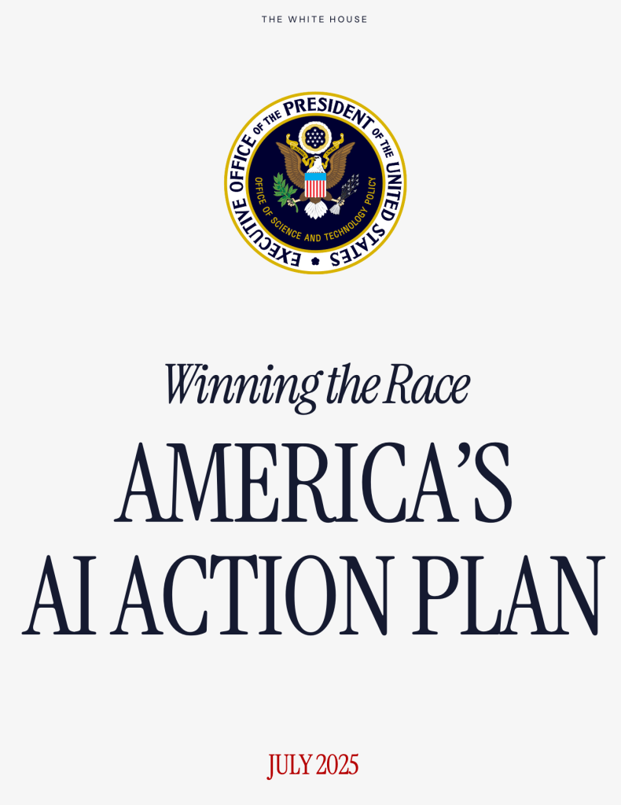

> 이 글은 2twodragon.com(워드프레스)에서 2025-07-29에 처음 게시된 글을 옮긴 것입니다.

안녕하세요! AI 기술이 경제와 안보의 핵심으로 떠오르면서 세계 각국이 주도권을 잡기 위해 총력을 기울이고 있습니다. 이러한 흐름 속에서 최근 미국 백악관이 발표한 <strong>‘미국의 AI 행동 계획(America’s AI Action Plan)’</strong>이 전 세계의 주목을 받고 있습니다. 이 계획은 단순히 AI 기술 발전에만 초점을 맞춘 것이 아니라, <strong>‘신뢰할 수 있는 AI’와 ‘AI를 위한 보안’</strong>이라는 두 가지 중요한 축을 중심으로 국가적 전략을 제시하고 있기 때문입니다.

오늘 포스팅에서는 이 ‘미국의 AI 행동 계획’의 핵심 내용과 함께, 보안 전문 매체인 ‘보안뉴스’가 분석한 보안 관점의 의미를 종합하여 알기 쉽게 정리해 드리겠습니다.

---

### 미국의 AI 행동 계획, 무엇을 담고 있나?

미국의 AI 행동 계획은 글로벌 AI 리더십을 유지하고, AI를 책임감 있게 발전시키기 위한 포괄적인 로드맵을 제시합니다. 그 핵심 목표는 **혁신 촉진, 대중의 신뢰 확보, 그리고 국제적 협력 강화**로 요약할 수 있습니다.

1\. AI 연구개발(R&D)에 대한 장기적 투자 📈

연방정부 차원에서 AI 관련 기초 및 응용 연구에 대한 투자를 대폭 늘려 국방, 보건, 기후 등 국가적 난제를 해결하겠다는 목표입니다. 이를 위해 국립 AI 연구소를 확대하고, 연구자들에게 대규모 컴퓨팅 자원과 고품질 데이터셋을 제공할 계획입니다.

2\. AI 시대에 맞는 인력 양성 및 교육 🧑‍🏫

모든 국민이 AI 시대에 필요한 기술을 갖출 수 있도록 교육 시스템을 개혁하고, AI 전문가를 양성하는 데 주력합니다. K-12 교육 과정에 데이터 및 AI 소양 교육을 포함하고, 기존 근로자들의 재교육을 지원하는 방안이 포함되었습니다.

3\. 신뢰할 수 있는 AI를 위한 기술 표준 및 윤리 가이드라인 마련 📜

AI 시스템이 안전하고, 공정하며, 투명하게 작동하도록 기술 표준과 윤리적 가이드라인을 수립합니다. 이는 AI 기술에 대한 대중의 신뢰를 확보하기 위한 필수적인 조치로, AI의 편향성, 개인정보 침해, 안전 문제를 해결하기 위한 정책 프레임워크를 만드는 것을 목표로 합니다.

4\. 연방정부의 AI 활용 확대 🏛️

정부 서비스의 효율성과 질을 높이기 위해 연방정부 기관의 AI 도입을 적극 장려합니다. 공공 서비스를 개선하고 업무를 자동화하며, 이를 위해 정부 내 AI 전문가 채용과 데이터 인프라 현대화를 추진합니다.

5\. 동맹국과의 국제 협력 강화 🌐

미국과 가치를 공유하는 동맹국들과 협력하여 민주적 가치에 부합하는 글로벌 AI 표준을 만들고, 권위주의 국가의 AI 남용에 대응합니다. AI 안전성, 개인정보 보호 등에 대한 국제적 합의를 주도하고 공동 연구를 진행하여 글로벌 AI 생태계를 이끌어 가겠다는 전략입니다.

---

### 보안 관점에서 본 ‘AI 액션 플랜’의 의미 (보안뉴스 분석)

보안뉴스는 미국의 이번 계획이 AI 기술 발전의 이면에 있는 다양한 보안 위협에 대응하기 위한 구체적인 방안을 제시하고 있다는 점에 주목했습니다. 특히, ‘보안을 위한 AI’와 ‘AI를 위한 보안’이라는 두 가지 개념을 모두 중요하게 다루고 있습니다.

- **AI 정보 공유 및 분석 센터(AI-ISAC) 설립:** 국토안보부(DHS) 주도로 중요 인프라 부문의 AI 보안 위협 정보를 공유하고, 기업의 AI 관련 취약점 및 위협에 대한 대응 지침을 마련할 것을 촉구합니다. 이는 AI 시스템에 대한 공격 정보를 민관이 함께 공유하고 대응하는 체계를 만들겠다는 의미입니다.
- **‘시큐어 바이 디자인(Secure by Design)’ 원칙 강조:** AI 개발 초기 단계부터 보안을 내재화하는 ‘시큐어 바이 디자인’ 원칙을 강조합니다. AI 모델의 취약점, 데이터 오염(Data Poisoning), 적대적 공격(Adversarial Attack) 등 새로운 유형의 위협에 대응하기 위해 개발 단계부터 보안을 고려해야 한다는 것입니다.
- **딥페이크 등 새로운 위협 대응:** 딥페이크와 같은 AI 기반의 새로운 위협에 대한 대응책 마련도 계획에 포함되었습니다.

결론적으로, 미국은 AI 기술의 혁신을 가속화하는 동시에, 그로 인해 발생할 수 있는 보안 위협을 국가 안보 차원에서 체계적으로 관리하겠다는 강력한 의지를 보여주고 있습니다. 이는 AI 기술의 발전이 ‘안전’과 ‘신뢰’라는 기반 위에서 이루어져야 한다는 점을 명확히 한 것으로, 앞으로 글로벌 AI 정책의 중요한 방향성을 제시하고 있습니다.

우리나라 역시 ‘AI 3대 강국’을 목표로 하고 있는 만큼, 미국의 이러한 움직임을 참고하여 AI 기술 발전과 함께 보안 및 신뢰성 확보를 위한 정책을 더욱 강화해 나가야 할 것입니다.

---

### 참고 자료

- **The White House:** [America’s AI Action Plan (PDF)](https://www.whitehouse.gov/wp-content/uploads/2025/07/Americas-AI-Action-Plan.pdf)
- **보안뉴스:** [AI, 피할 수 없는 흐름이라면 ‘보안’이라는 브레이크 장착부터](https://www.boannews.com/media/view.asp?idx=138347)
