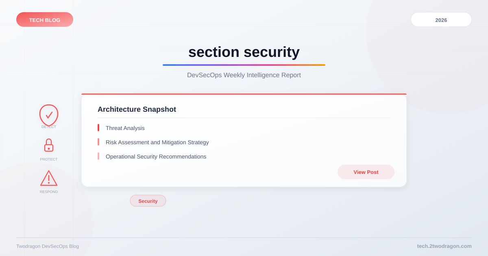

---

author: Twodragon
categories:
- incident
comments: true
date: 2025-09-10 18:17:45 +0900
last_modified_at: 2026-04-16T11:29:01+09:00
description: "2025년 9월 npm 레지스트리 18개 핵심 패키지 악성코드 감염 사태 긴급 분석. debug, chalk, lodash 등 주당 20억 회 이상 다운로드되는 패키지 침해, 영향 범위 확인 스크립트, 긴급 복구 절차, 재발 방지를 위한 공급망 보안 강화 대책을 정리합니다."
excerpt: "2025년 9월 npm 레지스트리 18개 핵심 패키지 악성코드 감염 사태 긴급 분석. debug, chalk, lodash 등 주당 20억 회 이상 다운로드되는 패키지 침해, 영향 범위 확인 스크립트, 긴급 복구 절차, 재발 방지를 위한 공급망 보안 강화 대책을 정리합니다."
image: /assets/images/2025-09-10-npm_Large-scale_Security_20.svg
image_alt: 'Urgent: npm Ecosystem Large-Scale Security Breach: 2 Billion Download Packages'
layout: post
original_url: https://twodragon.tistory.com/692
tags:
- npm
- Supply-Chain
- Malware
- Security-Incident
- JavaScript
- Node.js
keywords: [npm, Supply-Chain, Malware, Security-Incident, JavaScript, Node.js]
title: '[긴급] npm 생태계 대규모 보안 침해: 20억 다운로드 패키지 악성코드 감염'
toc: true
redirect_from:
  - /posts/2025/09/npm_Ecosystem_Large_scale_Security_Breach_20_Download_Package_Malware_Infection/
  - /posts/2025-09-10-npm_Ecosystem_Large_scale_Security_Breach_20_Download_Package_Malware_Infection/
summary_card:
  title: "[긴급] npm 생태계 대규모 보안 침해: 20억 다운로드 패키지 악성코드 감염"
  audience: "SRE, 인시던트 대응 담당자, 운영 엔지니어"
  categories:
    - { class: "security", label: "Incident" }
  tags:
    - "npm"
    - "Supply-Chain"
    - "Malware"
    - "Security-Incident"
    - "JavaScript"
    - "Node.js"
  highlights:
    - { source: "", title: "npm 레지스트리 18개 핵심 패키지(debug, chalk 등) 악성코드 감염" }
    - { source: "", title: "주당 20억 회 이상 다운로드 패키지 침해로 수백만 프로젝트 위험 노출" }
    - { source: "", title: "영향 확인 스크립트 및 긴급 복구 절차 가이드" }
---


### 보안 강화 체크리스트

- 관련 보안 설정 검토 및 적용
- 취약점 스캔 및 점검 수행
- 접근 제어 정책 확인
- 로깅 및 모니터링 설정 점검
- 보안 문서 업데이트

### 위험도 평가

| 항목 | 위험도 | 설명 |
|------|--------|------|
| 전체 위험도 | 높음 (High) | GitHub 권고 [GHSA-4x49-vf9v-38px](https://github.com/advisories/GHSA-4x49-vf9v-38px) 기준 CVSS v4 8.8. 악성 코드는 브라우저에서만 동작하므로, 영향 버전이 들어간 프런트엔드 번들을 받은 사용자의 암호화폐 거래가 실제 위험 대상 |




## 서론

안녕하세요, Twodragon입니다. 이번 포스팅에서는 npm 생태계 보안에 대해 실무 중심으로 정리합니다.

2025년 npm 생태계의 보안 위협은 지속적으로 증가하고 있으며, 공급망 보안이 핵심 이슈로 부상했습니다.

이번 포스팅에서는 다음 내용을 다룹니다:
- 영향받은 패키지와 정확한 악성 버전 (GitHub Advisory Database 기준)
- 악성 코드의 실제 동작: 브라우저에서 암호화폐 지갑 주소를 바꿔치기하는 방식
- 유지관리자 계정을 넘긴 `npmjs[.]help` 피싱 수법과 IOC
- 영향 범위 확인 명령, 정리 절차, 재발 방지 대책

> **정정 (2026-11-21)**: 이전 판의 영향 패키지·버전 표, IOC, 공격 방식 설명은 실제 사건과 달랐습니다. `lodash`, `axios`, `express`, `dotenv` 등은 이 사건의 영향 목록에 없고, postinstall 스크립트로 환경 변수와 클라우드 자격 증명을 빼가는 동작은 이 사건이 아니라 일주일 뒤 퍼진 Shai-Hulud 웜의 특징에 가깝습니다([GitHub 블로그](https://github.blog/security/supply-chain-security/our-plan-for-a-more-secure-npm-supply-chain/)). 아래 내용은 GitHub Advisory Database, 유지관리자 공지, 보안 업체 분석을 근거로 다시 썼습니다.

## 경영진 요약: 공급망 보안 위협 평가

> **경영진 브리핑**: 2025년 9월 8일 npm 유지관리자 한 명의 계정이 2FA 재설정을 가장한 피싱에 넘어가, 주간 다운로드 합계가 20억 회를 넘는 패키지 19개에 브라우저용 암호화폐 탈취 코드가 들어갔습니다. 대부분의 악성 버전은 약 2시간 안에 내려갔고 서버에서 실행되는 Node.js 코드에는 영향이 없지만, 그사이 빌드된 프런트엔드 번들은 다시 빌드하고 캐시를 비워야 합니다.

### 위협 등급 스코어카드

| 평가 항목 | 등급 | 근거 |
|----------|------|------|
| 노출 범위 | Critical | 영향 패키지의 주간 다운로드 합계 20억 회 이상([Aikido](https://www.aikido.dev/blog/npm-debug-and-chalk-packages-compromised)). Wiz 텔레메트리 기준 침해 전 클라우드 환경의 99%가 대상 패키지를 하나 이상 사용([Wiz](https://www.wiz.io/blog/widespread-npm-supply-chain-attack-breaking-down-impact-scope-across-debug-chalk)) |
| 실제 유입 | High | 악성 버전 다운로드 250만 회 이상([JFrog](https://jfrog.com/blog/new-compromised-packages-in-largest-npm-attack-in-history/)). 약 2시간 만에 클라우드 환경의 10% 이상에서 번들·에셋에 악성 코드가 발견됨([Wiz](https://www.wiz.io/blog/widespread-npm-supply-chain-attack-breaking-down-impact-scope-across-debug-chalk)) |
| 계정 탈취 수법 | High | npmjs.com을 복제한 피싱 사이트가 로그인과 2FA 입력을 실제 npm으로 중계하는 동안 새 API 토큰을 발급([DuckDB 사후 분석](https://github.com/advisories/GHSA-w62p-hx95-gf2c)) |
| 영향 대상 | Medium | 브라우저에서만 동작하며 로컬·서버·CLI 환경은 영향 없음([GHSA-4x49-vf9v-38px](https://github.com/advisories/GHSA-4x49-vf9v-38px)). 지갑·결제 흐름이 있는 서비스가 가장 위험([Wiz](https://www.wiz.io/blog/widespread-npm-supply-chain-attack-breaking-down-impact-scope-across-debug-chalk)) |
| 실제 금전 피해 | Low | 연관 지갑을 분석한 결과 탈취액은 약 500달러([JFrog](https://jfrog.com/blog/new-compromised-packages-in-largest-npm-attack-in-history/)) |
| 복구 부담 | High | 번들 재빌드와 빌드·CDN 캐시 무효화가 필요([Wiz](https://www.wiz.io/blog/widespread-npm-supply-chain-attack-breaking-down-impact-scope-across-debug-chalk)). Vercel은 76개 프로젝트의 빌드 캐시를 직접 비움([Vercel](https://vercel.com/blog/critical-npm-supply-chain-attack-response-september-8-2025)) |
| 종합 | High | GitHub 권고 기준 High, CVSS v4 8.8([GHSA-4x49-vf9v-38px](https://github.com/advisories/GHSA-4x49-vf9v-38px)) |

### 비즈니스 영향 분석

| 영향 분야 | 심각도 | 내용 | 대응 시급성 |
|----------|--------|------|-----------|
| 웹 서비스 사용자의 암호화폐 거래 | Critical (지갑·결제 기능 보유 시) | 서명 전에 수신 주소와 승인(approve) 대상이 공격자 주소로 바뀔 수 있음 | 즉시: 번들 재빌드·재배포 |
| 빌드 캐시·CDN·서비스 워커 | High | 의존성을 고쳐도 캐시된 악성 번들이 계속 제공될 수 있음 | 즉시: 캐시 무효화 |
| 사설 레지스트리·미러 | High | 레지스트리에서 삭제된 악성 버전이 미러 캐시에서 다시 설치될 수 있음 | 즉시: 해당 버전 차단 |
| 서버 전용 Node.js 애플리케이션 | Low | 브라우저 환경에서만 동작하므로 직접 영향 없음 | 정기 업데이트 때 정리 |
| 개발·보안 조직의 대응 공수 | Medium | 실제 탈취액보다 업계 전체가 점검에 쓴 시간이 더 큰 피해였다는 평가 | 점검 절차 표준화 |

근거: 영향 범위와 캐시 위험은 [GHSA-4x49-vf9v-38px](https://github.com/advisories/GHSA-4x49-vf9v-38px)와 [Wiz](https://www.wiz.io/blog/widespread-npm-supply-chain-attack-breaking-down-impact-scope-across-debug-chalk) 분석을 따랐습니다. Wiz는 이 사건의 실제 피해를 업계 전체에 대한 일종의 서비스 거부(denial-of-service)였다고 표현했습니다.

## 긴급 공지

2025년 9월 8일 13:16 UTC부터 Aikido 위협 피드가 npm에 올라온 악성 버전을 잡아내기 시작했습니다([Aikido](https://www.aikido.dev/blog/npm-debug-and-chalk-packages-compromised)). 대상은 유지관리자 Josh Junon(GitHub `Qix-`)이 관리하던 `debug`, `chalk`, `ansi-styles` 등이었고, 이 패키지들의 주간 다운로드는 합쳐서 20억 회가 넘습니다. 유지관리자는 같은 날 [debug 저장소 이슈 #1005](https://github.com/debug-js/debug/issues/1005)에서 진짜처럼 보이는 2FA 재설정 메일에 속았다며 계정 탈취를 인정했고, 메일 발신지는 `support@npmjs[.]help`였다고 밝혔습니다.

### 사건 타임라인 (UTC)

| 시각 | 내용 | 근거 |
|------|------|------|
| 9/8 13:12-13:16 | 1차 악성 버전 배포 (`ansi-styles`, `debug`, `chalk`, `supports-color`, `strip-ansi` 등 12개) | [Socket](https://socket.dev/blog/npm-author-qix-compromised-in-major-supply-chain-attack) |
| 9/8 13:16 | Aikido 위협 피드가 탐지 시작 | [Aikido](https://www.aikido.dev/blog/npm-debug-and-chalk-packages-compromised) |
| 9/8 13:19-13:20 | 2차 배포 (`simple-swizzle`, `supports-hyperlinks`, `chalk-template`, `backslash`) | [Socket](https://socket.dev/blog/npm-author-qix-compromised-in-major-supply-chain-attack) |
| 9/8 15:15 | 유지관리자가 Bluesky에서 침해를 확인하고 정리 착수 | [Aikido](https://www.aikido.dev/blog/npm-debug-and-chalk-packages-compromised) |
| 9/8 16:58 | 다른 유지관리자의 `proto-tinker-wc@0.1.87`에서도 같은 공격자의 것으로 보이는 악성 코드 탐지 | [Aikido](https://www.aikido.dev/blog/npm-debug-and-chalk-packages-compromised) |
| 9/8 19:59 | npm이 영향받은 버전을 모두 내렸다고 유지관리자에게 통보 (이슈 기록 기준 21:59 CEST) | [debug#1005](https://github.com/debug-js/debug/issues/1005) |
| 9/9 01:11-01:13 | `duckdb_admin` 계정으로 DuckDB 패키지 4종의 악성 버전 배포 | [Socket](https://socket.dev/blog/duckdb-npm-account-compromised-in-continuing-supply-chain-attack) |
| 9/13 | 유지관리자가 캐시 무효화용 새 패치 버전 배포를 마침 (chalk 계열은 Sindre Sorhus가 먼저 처리) | [debug#1005](https://github.com/debug-js/debug/issues/1005) |
| 9/15 | CVE가 붙은 GitHub 검토 권고 공개 시작 (예: CVE-2025-59144) | [GHSA-4x49-vf9v-38px](https://github.com/advisories/GHSA-4x49-vf9v-38px) |

## 1. 영향받은 패키지 목록

### 1.1 Qix 계정에서 배포된 악성 버전 (19개)

유지관리자가 이슈 #1005에 올린 18개 목록에는 `color@5.0.1`이 있고([debug#1005](https://github.com/debug-js/debug/issues/1005)), Aikido와 Socket이 공개한 목록에는 그 대신 `error-ex@1.3.3`이 있습니다. 둘을 합친 19개 버전은 모두 GitHub Advisory Database에 악성 코드 권고로 올라 있습니다. 주간 다운로드는 사건 당시 [Aikido](https://www.aikido.dev/blog/npm-debug-and-chalk-packages-compromised) 집계이며, `color`는 Aikido 목록에 없어 비워 두었습니다.

| 패키지 | 악성 버전 | 주간 다운로드 | GitHub 권고 |
|--------|----------|-------------|------------|
| `ansi-styles` | 6.2.2 | 371.41M | [GHSA-p5rr-crjh-x7gr](https://github.com/advisories/GHSA-p5rr-crjh-x7gr) |
| `debug` | 4.4.2 | 357.6M | [GHSA-4x49-vf9v-38px](https://github.com/advisories/GHSA-4x49-vf9v-38px) (CVE-2025-59144) |
| `chalk` | 5.6.1 | 299.99M | [GHSA-2v46-p5h4-248w](https://github.com/advisories/GHSA-2v46-p5h4-248w) |
| `supports-color` | 10.2.1 | 287.1M | [GHSA-pj3j-3w3f-j752](https://github.com/advisories/GHSA-pj3j-3w3f-j752) |
| `strip-ansi` | 7.1.1 | 261.17M | [GHSA-vfjc-p7x3-q864](https://github.com/advisories/GHSA-vfjc-p7x3-q864) |
| `ansi-regex` | 6.2.1 | 243.64M | [GHSA-jvhh-2m83-6w29](https://github.com/advisories/GHSA-jvhh-2m83-6w29) |
| `wrap-ansi` | 9.0.1 | 197.99M | [GHSA-2rv4-jp6r-xgq7](https://github.com/advisories/GHSA-2rv4-jp6r-xgq7) |
| `color-convert` | 3.1.1 | 193.5M | [GHSA-pxx3-g568-hxr4](https://github.com/advisories/GHSA-pxx3-g568-hxr4) (CVE-2025-59162) |
| `color-name` | 2.0.1 | 191.71M | [GHSA-5fvm-p68v-5wmh](https://github.com/advisories/GHSA-5fvm-p68v-5wmh) (CVE-2025-59145) |
| `is-arrayish` | 0.3.3 | 73.8M | [GHSA-frh7-2f84-v9mw](https://github.com/advisories/GHSA-frh7-2f84-v9mw) (CVE-2025-59331) |
| `slice-ansi` | 7.1.1 | 59.8M | [GHSA-9xjj-cmqc-578p](https://github.com/advisories/GHSA-9xjj-cmqc-578p) |
| `error-ex` | 1.3.3 | 47.17M | [GHSA-6jp5-hh4c-8c5h](https://github.com/advisories/GHSA-6jp5-hh4c-8c5h) (CVE-2025-59330) |
| `color-string` | 2.1.1 | 27.48M | [GHSA-286p-vc9p-p5qv](https://github.com/advisories/GHSA-286p-vc9p-p5qv) (CVE-2025-59142) |
| `simple-swizzle` | 0.2.3 | 26.26M | [GHSA-9g9j-rggx-7fmg](https://github.com/advisories/GHSA-9g9j-rggx-7fmg) (CVE-2025-59141) |
| `supports-hyperlinks` | 4.1.1 | 19.2M | [GHSA-hggr-35mp-qcxg](https://github.com/advisories/GHSA-hggr-35mp-qcxg) |
| `has-ansi` | 6.0.1 | 12.1M | [GHSA-jff9-gjh4-j359](https://github.com/advisories/GHSA-jff9-gjh4-j359) |
| `chalk-template` | 1.1.1 | 3.9M | [GHSA-3jjr-pvq7-4jq5](https://github.com/advisories/GHSA-3jjr-pvq7-4jq5) |
| `backslash` | 0.2.1 | 0.26M | [GHSA-53mq-f4w3-f7qv](https://github.com/advisories/GHSA-53mq-f4w3-f7qv) (CVE-2025-59140) |
| `color` | 5.0.1 | - | [GHSA-qrmh-qg46-72pp](https://github.com/advisories/GHSA-qrmh-qg46-72pp) (CVE-2025-59143) |

악성 버전은 레지스트리에서 모두 삭제됐고, 이후 유지관리자가 그보다 높은 패치 버전을 새로 배포했습니다. 수정 버전이 명시된 권고를 예로 들면 `debug` 4.4.3, `color-convert` 3.1.2, `error-ex` 1.3.4입니다. 이전 판의 표에 있던 `lodash`, `axios`, `express`, `dotenv`, `uuid`, `moment`는 이 사건과 관계가 없습니다.

### 1.2 같은 캠페인의 후속 피해

같은 피싱 메일은 다른 유지관리자에게도 갔습니다. 9월 8~9일에 확인된 추가 피해는 아래와 같습니다. Wiz는 목록이 계속 늘 수 있으니 사내 레지스트리와 미러를 기준으로 다시 확인하라고 권고했습니다([Wiz](https://www.wiz.io/blog/widespread-npm-supply-chain-attack-breaking-down-impact-scope-across-debug-chalk)).

| 패키지 | 악성 버전 | 경위 | 근거 |
|--------|----------|------|------|
| `proto-tinker-wc` | 0.1.87 | 9/8 16:58 UTC 탐지, 같은 공격자로 추정 | [Aikido](https://www.aikido.dev/blog/npm-debug-and-chalk-packages-compromised), [GHSA-h9m7-rmhq-pfgr](https://github.com/advisories/GHSA-h9m7-rmhq-pfgr) |
| `duckdb`, `@duckdb/node-api`, `@duckdb/node-bindings` | 1.3.3 | `duckdb_admin` 계정 탈취, 같은 피싱 메일 | [GHSA-w62p-hx95-gf2c](https://github.com/advisories/GHSA-w62p-hx95-gf2c) (CVE-2025-59037) |
| `@duckdb/duckdb-wasm` | 1.29.2 | DuckDB 패키지와 같은 경위 | [GHSA-w62p-hx95-gf2c](https://github.com/advisories/GHSA-w62p-hx95-gf2c) |
| `@coveops/abi` | 2.0.1 | JFrog·Wiz가 추가로 보고 | [JFrog](https://jfrog.com/blog/new-compromised-packages-in-largest-npm-attack-in-history/), [Wiz](https://www.wiz.io/blog/widespread-npm-supply-chain-attack-breaking-down-impact-scope-across-debug-chalk) |

## 2. 악성코드 동작 분석

### 2.1 감염 경로와 동작 방식

악성 코드는 설치 스크립트(postinstall)가 아니라 각 패키지의 `index.js`에 난독화된 코드로 추가됐습니다([Semgrep](https://semgrep.dev/blog/2025/chalk-debug-and-color-on-npm-compromised-in-new-supply-chain-attack/)). 설치만으로는 실행되지 않고, Node.js에서 불러오더라도 브라우저 환경이 아니면 동작하지 않습니다. 이 코드가 Babel, Rollup, Vite, Next.js 같은 도구를 거쳐 프런트엔드 번들에 들어가고, 사용자 브라우저에서 실행될 때 동작합니다. GitHub 권고도 로컬·서버·CLI 환경은 영향이 없고 브라우저 번들은 다시 빌드해야 한다고 정리했습니다([GHSA-4x49-vf9v-38px](https://github.com/advisories/GHSA-4x49-vf9v-38px)).

| 단계 | 동작 | 근거 |
|------|------|------|
| 1 | `typeof window !== 'undefined'`로 브라우저에서 실행 중인지 확인 | [Socket](https://socket.dev/blog/npm-author-qix-compromised-in-major-supply-chain-attack) |
| 2 | `fetch`, `XMLHttpRequest`, `window.ethereum.request` 등 지갑 공급자 API를 덮어써 가로챔 | [Socket](https://socket.dev/blog/npm-author-qix-compromised-in-major-supply-chain-attack), [Aikido](https://www.aikido.dev/blog/npm-debug-and-chalk-packages-compromised) |
| 3 | 응답 본문과 거래 데이터에서 ETH, BTC(레거시·SegWit), SOL, TRX, LTC, BCH 주소를 정규식으로 찾음 | [Socket](https://socket.dev/blog/npm-author-qix-compromised-in-major-supply-chain-attack), [JFrog](https://jfrog.com/blog/new-compromised-packages-in-largest-npm-attack-in-history/) |
| 4 | 찾은 주소를 공격자 주소 목록 중 레벤슈타인 거리가 가장 가까운, 즉 겉보기에 가장 비슷한 주소로 바꿈 | [Socket](https://socket.dev/blog/npm-author-qix-compromised-in-major-supply-chain-attack) |
| 5 | `eth_sendTransaction` 등 서명 전 거래의 수신자와 승인(approve) 대상을 공격자 주소로 변경. Uniswap, PancakeSwap, SushiSwap, 1inch 라우터로 가는 거래도 표적 | [Socket](https://socket.dev/blog/npm-author-qix-compromised-in-major-supply-chain-attack), [Wiz](https://www.wiz.io/blog/widespread-npm-supply-chain-attack-breaking-down-impact-scope-across-debug-chalk) |
| 6 | 원래 HTTP 상태 코드와 헤더를 유지하고 성공 응답을 흉내 내 화면상 이상을 숨김 | [Socket](https://socket.dev/blog/npm-author-qix-compromised-in-major-supply-chain-attack) |

Wiz에 따르면 이 코드에는 텔레메트리나 지속성(persistence) 장치가 없습니다. 피해는 서버가 아니라 최종 사용자에게 돌아가고, 오염된 스크립트를 계속 서비스하거나 CDN, 서비스 워커, 브라우저에 캐시돼 있는 동안에만 위험이 남습니다([Wiz](https://www.wiz.io/blog/widespread-npm-supply-chain-attack-breaking-down-impact-scope-across-debug-chalk)).

이전 판에 있던 "postinstall 실행, 환경 변수와 클라우드 자격 증명 수집, 외부 전송" 흐름은 이 사건이 아니라 일주일 뒤 발견된 Shai-Hulud 웜의 특징에 가깝습니다. GitHub는 9월 14일 이 웜을 통보받았고, 웜은 postinstall 스크립트로 퍼지면서 npm 토큰을 포함한 여러 종류의 비밀 정보를 훔쳤습니다([GitHub 블로그](https://github.blog/security/supply-chain-security/our-plan-for-a-more-secure-npm-supply-chain/)). CISA는 9월 23일 500개 이상의 패키지가 감염됐다는 경보를 냈습니다([CISA](https://www.cisa.gov/news-events/alerts/2025/09/23/widespread-supply-chain-compromise-impacting-npm-ecosystem)). 웜 자체는 [Shai-Hulud 분석 글]()에서 따로 다뤘습니다.

### 2.2 계정 탈취: npmjs.help 피싱

메일은 `support@npmjs[.]help`에서 왔습니다([debug#1005](https://github.com/debug-js/debug/issues/1005)). 본문은 마지막 2FA 업데이트 후 12개월이 지났다며 2025년 9월 10일부터 계정을 임시로 잠근다고 압박했습니다([BleepingComputer](https://www.bleepingcomputer.com/news/security/hackers-hijack-npm-packages-with-2-billion-weekly-downloads-in-supply-chain-attack/)). Vercel은 이 메일이 48시간 기한으로 조급함을 만들었다고 정리했고([Vercel](https://vercel.com/blog/critical-npm-supply-chain-attack-response-september-8-2025)), Aikido는 도메인이 공격 사흘 전인 9월 5일에 등록됐다고 확인했습니다([Aikido](https://www.aikido.dev/blog/npm-debug-and-chalk-packages-compromised)).

같은 메일에 당한 DuckDB 팀의 사후 분석을 보면 수법이 구체적으로 드러납니다. `npmjs[.]help`는 npmjs.com을 픽셀 단위로 복제한 사이트였고, 로그인과 2FA 입력, 2FA 재설정 동작을 실제 npm 사이트로 그대로 넘겼습니다. 그사이 공격자는 새 API 토큰을 만들어 악성 버전을 배포했습니다. DuckDB 팀은 브라우저가 비밀번호를 자동 완성하지 않은 것이 경고 신호였다고 돌아봤습니다([GHSA-w62p-hx95-gf2c](https://github.com/advisories/GHSA-w62p-hx95-gf2c)). 피싱 페이지의 로그인 폼은 입력한 계정명과 비밀번호를 별도 서버(`websocket-api2[.]publicvm[.]com`)로도 보냈습니다([BleepingComputer](https://www.bleepingcomputer.com/news/security/hackers-hijack-npm-packages-with-2-billion-weekly-downloads-in-supply-chain-attack/)).

### 2.3 IOC (Indicators of Compromise)

감염 여부와 피싱 노출을 확인할 수 있는 지표입니다. 도메인과 URL은 실수로 열지 않도록 `[.]`, `hxxps`로 표기했습니다.

| 유형 | 값 | 설명 | 근거 |
|------|-----|------|------|
| 피싱 발신 주소 | `support@npmjs[.]help` | 2FA 재설정을 가장한 메일 | [debug#1005](https://github.com/debug-js/debug/issues/1005) |
| 피싱 도메인 | `npmjs[.]help` | npmjs.com 복제 사이트 (현재 내려감) | [Aikido](https://www.aikido.dev/blog/npm-debug-and-chalk-packages-compromised), [Vercel](https://vercel.com/blog/critical-npm-supply-chain-attack-response-september-8-2025) |
| 자격 증명 수집 URL | `hxxps://websocket-api2[.]publicvm[.]com/images/jpg-to-png.php` | 피싱 로그인 폼이 계정명과 비밀번호를 보내는 곳 | [BleepingComputer](https://www.bleepingcomputer.com/news/security/hackers-hijack-npm-packages-with-2-billion-weekly-downloads-in-supply-chain-attack/) |
| 코드 시그니처 | `const _0x112fa8=_0x180f;` | 감염된 `index.js`와 이를 포함한 번들에 들어간 난독화 코드의 시작 부분 | [Wiz](https://www.wiz.io/blog/widespread-npm-supply-chain-attack-breaking-down-impact-scope-across-debug-chalk) |
| 공격자 ETH 주소 | `0xFc4a4858bafef54D1b1d7697bfb5c52F4c166976` | `window.ethereum` 거래를 가로챌 때 수신자로 넣는 주소 (온체인 확인용) | [Aikido](https://www.aikido.dev/blog/npm-debug-and-chalk-packages-compromised) |
| 공격자 지갑 목록 | ETH·SOL·BTC·BCH 주소 약 280개 | 주소 바꿔치기에 쓰는 하드코딩 목록. 전체 목록은 Socket 글의 IOC 항목 참고 | [Socket](https://socket.dev/blog/npm-author-qix-compromised-in-major-supply-chain-attack) |
| 악성 패키지 버전 | 1.1, 1.2 표의 정확한 버전 | lockfile, 사설 레지스트리, 빌드 캐시에서 검색 | [GitHub Advisory Database](https://github.com/advisories?query=type%3Amalware) |

### 2.4 영향 범위 확인 명령

먼저 의존성 트리에 악성 버전이 있는지 봅니다. npm 프로젝트는 `npm ls`로, yarn과 pnpm은 `yarn why <패키지>`, `pnpm why <패키지>`로 실제 설치 버전을 확인합니다. Wiz는 `package-lock.json`, `pnpm-lock.yaml`, `yarn.lock`과 사내 아티팩트 저장소를 정확한 버전으로 검색하라고 권고했습니다([Wiz](https://www.wiz.io/blog/widespread-npm-supply-chain-attack-breaking-down-impact-scope-across-debug-chalk)).

```bash
# 1) 의존성 트리에서 19개 악성 버전 찾기 (npm 7 이상)
npm ls --all 2>/dev/null | grep -E ' (ansi-styles@6\.2\.2|debug@4\.4\.2|chalk@5\.6\.1|supports-color@10\.2\.1|strip-ansi@7\.1\.1|ansi-regex@6\.2\.1|wrap-ansi@9\.0\.1|color-convert@3\.1\.1|color-name@2\.0\.1|is-arrayish@0\.3\.3|slice-ansi@7\.1\.1|color@5\.0\.1|color-string@2\.1\.1|simple-swizzle@0\.2\.3|supports-hyperlinks@4\.1\.1|has-ansi@6\.0\.1|chalk-template@1\.1\.1|backslash@0\.2\.1|error-ex@1\.3\.3)( |$)' || echo "악성 버전 없음"

# 2) node_modules와 빌드 산출물에서 난독화 코드 시그니처 찾기
rg -u --max-columns=80 _0x112fa8
```

두 번째 명령은 Sindre Sorhus가 제안한 방법입니다([The Register](https://www.theregister.com/2025/09/08/dev_falls_for_phishing_email/)). `-u`는 `.gitignore`를 무시하므로 `node_modules`와 `dist` 같은 산출물까지 검색하고, `.next`처럼 숨김 디렉터리까지 보려면 `-uu`를 씁니다. 이미 배포한 번들과 CDN에 올라간 JS 파일도 같은 문자열로 검사해야 합니다([Wiz](https://www.wiz.io/blog/widespread-npm-supply-chain-attack-breaking-down-impact-scope-across-debug-chalk)).

## 3. 대응 및 재발 방지

### 3.1 즉시 조치

GitHub 권고가 제시한 정리 절차는 최신 패치 버전으로 올리고, `node_modules`를 지우고, 패키지 매니저의 전역 캐시를 비운 뒤, 브라우저 번들을 처음부터 다시 빌드하는 것입니다([GHSA-4x49-vf9v-38px](https://github.com/advisories/GHSA-4x49-vf9v-38px)).

```bash
rm -rf node_modules
npm cache clean --force
npm install      # lockfile에 악성 버전이 남아 있으면 먼저 최신 패치 버전으로 갱신
npm run build    # 브라우저 번들은 캐시 없이 처음부터 다시 빌드
```

명령 밖에서 챙길 일도 있습니다.

1. 사설 레지스트리와 프록시에서 악성 버전을 차단하고 안전한 버전으로 고정합니다. 유지관리자가 9월 13일 새 패치 버전을 낸 것도 사설 레지스트리에 남은 악성 버전 캐시를 밀어내기 위해서였습니다([GHSA-4x49-vf9v-38px](https://github.com/advisories/GHSA-4x49-vf9v-38px), [Wiz](https://www.wiz.io/blog/widespread-npm-supply-chain-attack-breaking-down-impact-scope-across-debug-chalk)).
2. CI 러너와 배포 플랫폼의 빌드 캐시를 비웁니다. Vercel은 영향받은 70개 팀, 76개 프로젝트의 빌드 캐시를 직접 비우고 재빌드를 안내했습니다([Vercel](https://vercel.com/blog/critical-npm-supply-chain-attack-response-september-8-2025)).
3. 재배포 후 CDN 캐시를 무효화하고, 클라이언트 스크립트에는 SRI(Subresource Integrity) 적용을 검토합니다([Wiz](https://www.wiz.io/blog/widespread-npm-supply-chain-attack-breaking-down-impact-scope-across-debug-chalk)).
4. 지갑이나 결제 기능이 있다면 9월 8일 오전 9시(미 동부) 이후의 서명 흐름과 승인 내역을 점검하고, 의도한 수신자와 실제 온체인 결과를 비교합니다([Wiz](https://www.wiz.io/blog/widespread-npm-supply-chain-attack-breaking-down-impact-scope-across-debug-chalk)).
5. 서버에서만 쓰는 Node.js 애플리케이션은 직접 영향이 없으므로 버전 정리만 하면 됩니다([GHSA-4x49-vf9v-38px](https://github.com/advisories/GHSA-4x49-vf9v-38px)).

### 3.2 재발 방지

유지관리자 쪽 교훈은 2FA가 켜져 있어도 피싱 사이트가 입력을 실시간으로 중계하면 계정을 지키지 못했다는 점입니다. GitHub는 9월 22일 npm 배포 인증을 강화하는 계획을 발표했습니다([GitHub 블로그](https://github.blog/security/supply-chain-security/our-plan-for-a-more-secure-npm-supply-chain/)).

| 영역 | 발표된 변경 |
|------|-----------|
| 로컬 배포 | 2FA 필수, 2FA 우회 옵션 제거 |
| 토큰 | legacy classic 토큰 폐지, granular 토큰 수명 7일 제한, 토큰을 이용한 배포는 기본 차단 |
| 2FA 방식 | TOTP를 폐지하고 FIDO 기반 2FA로 이전 |
| CI 배포 | 토큰 대신 trusted publishing 사용, 지원 CI 제공자 확대 |

GitHub는 유지관리자에게 2FA를 설정할 때 TOTP 대신 WebAuthn을 쓰라고 권고했습니다. 패키지를 쓰는 쪽에서는 빌드에 lockfile 기반 `npm ci`를 쓰라는 것이 Vercel과 Semgrep의 공통 권고였고, Vercel은 버전 고정도 함께 권했습니다([Vercel](https://vercel.com/blog/critical-npm-supply-chain-attack-response-september-8-2025), [Semgrep](https://semgrep.dev/blog/2025/chalk-debug-and-color-on-npm-compromised-in-new-supply-chain-attack/)).

## 4. 참고 자료

### 4.1 이 사건의 1차 자료

| 자료 | 내용 |
|------|------|
| [debug-js/debug 이슈 #1005](https://github.com/debug-js/debug/issues/1005) | 유지관리자(Qix-)의 침해 확인, 영향 버전 목록, 복구 경과 |
| [GHSA-4x49-vf9v-38px](https://github.com/advisories/GHSA-4x49-vf9v-38px) | `debug@4.4.2` 권고(CVE-2025-59144), 영향 범위와 정리 절차 |
| [GHSA-w62p-hx95-gf2c](https://github.com/advisories/GHSA-w62p-hx95-gf2c) | DuckDB 패키지 침해와 피싱 사후 분석 |
| [Aikido](https://www.aikido.dev/blog/npm-debug-and-chalk-packages-compromised) | 최초 탐지 시각, 패키지별 주간 다운로드, 난독화 해제 분석 |
| [Socket](https://socket.dev/blog/npm-author-qix-compromised-in-major-supply-chain-attack) | 배포 타임라인, 동작 방식, 공격자 지갑 IOC |
| [Socket (DuckDB)](https://socket.dev/blog/duckdb-npm-account-compromised-in-continuing-supply-chain-attack) | DuckDB 계정 탈취와 배포 시각 |
| [Semgrep](https://semgrep.dev/blog/2025/chalk-debug-and-color-on-npm-compromised-in-new-supply-chain-attack/) | `index.js`에 추가된 난독화 코드, 탐지 규칙 |
| [Wiz](https://www.wiz.io/blog/widespread-npm-supply-chain-attack-breaking-down-impact-scope-across-debug-chalk) | 클라우드 환경 노출 규모, 번들 탐지 시그니처, 대응 권고 |
| [JFrog](https://jfrog.com/blog/new-compromised-packages-in-largest-npm-attack-in-history/) | 악성 버전 다운로드 수, 후속 피해 패키지, 탈취액 |
| [BleepingComputer](https://www.bleepingcomputer.com/news/security/hackers-hijack-npm-packages-with-2-billion-weekly-downloads-in-supply-chain-attack/) | 피싱 메일 원문, 자격 증명 수집 URL |
| [Vercel](https://vercel.com/blog/critical-npm-supply-chain-attack-response-september-8-2025) | 빌드 캐시 정리 사례, 피싱 메일의 48시간 기한 |
| [GitHub 블로그](https://github.blog/security/supply-chain-security/our-plan-for-a-more-secure-npm-supply-chain/) | npm 배포 인증 강화 계획 |

### 4.2 공식 보안 권고 및 데이터베이스

| 자료 유형 | URL | 설명 |
|----------|-----|------|
| npm 보안 권고 | [github.com/advisories](https://github.com/advisories?query=ecosystem%3Anpm) | GitHub npm 보안 권고문 데이터베이스 |
| npm 공식 블로그 | [github.blog/tag/npm](https://github.blog/tag/npm/) | npm 관련 공식 블로그 및 보안 공지 |
| Snyk 취약점 DB | [security.snyk.io](https://security.snyk.io/) | 종합 취약점 데이터베이스 (npm 포함) |
| CVE Details | [cvedetails.com/vendor/npmjs](https://www.cvedetails.com/vendor/17956/Npmjs.html) | npm 관련 CVE 목록 |
| NIST NVD | [nvd.nist.gov/vuln/search](https://nvd.nist.gov/vuln/search/results?query=npm) | 미국 국가취약점 데이터베이스 |

### 4.3 보안 도구 및 프레임워크

| 도구/프레임워크 | URL | 설명 |
|---------------|-----|------|
| Socket.dev | [socket.dev](https://socket.dev/) | 실시간 npm 공급망 위협 탐지 플랫폼 |
| Snyk | [snyk.io](https://snyk.io/) | 종합 오픈소스 보안 플랫폼 |
| OWASP Dependency-Check | [owasp.org/www-project-dependency-check](https://owasp.org/www-project-dependency-check/) | 의존성 취약점 스캔 도구 |
| npm audit | [docs.npmjs.com/cli/npm-audit](https://docs.npmjs.com/cli/v10/commands/npm-audit) | npm 내장 보안 감사 도구 |
| Lockfile Lint | [github.com/lirantal/lockfile-lint](https://github.com/lirantal/lockfile-lint) | package-lock.json 무결성 검증 도구 |
| CycloneDX | [cyclonedx.org](https://cyclonedx.org/) | SBOM 표준 및 생성 도구 |
| Syft | [github.com/anchore/syft](https://github.com/anchore/syft) | SBOM 생성 도구 (Anchore) |
| Grype | [github.com/anchore/grype](https://github.com/anchore/grype) | 취약점 스캐너 (Anchore) |

### 4.4 정부 및 국제 기관 가이드

| 기관 | URL | 설명 |
|------|-----|------|
| CISA 공급망 보안 | [cisa.gov/supply-chain](https://www.cisa.gov/supply-chain) | 미국 사이버보안 인프라 보안청 가이드 |
| NIST SSDF | [csrc.nist.gov/sp/800-218](https://csrc.nist.gov/publications/detail/sp/800-218/final) | 보안 소프트웨어 개발 프레임워크 |
| ENISA 공급망 공격 위협 보고서 | [enisa.europa.eu/publications/threat-landscape-for-supply-chain-attacks](https://www.enisa.europa.eu/publications/threat-landscape-for-supply-chain-attacks) | 유럽 사이버보안청의 공급망 공격 위협 분석 |
| 한국인터넷진흥원 | [kisa.or.kr](https://www.kisa.or.kr/) | 한국 사이버 보안 가이드라인 |
| 한국정보통신기술협회 | [tta.or.kr](https://www.tta.or.kr/) | 소프트웨어 보안 표준 |

### 4.5 연구 논문 및 기술 블로그

| 출처 | URL | 설명 |
|------|-----|------|
| GitLab Vulnerability Research | [about.gitlab.com/blog/security](https://about.gitlab.com/blog/categories/security/) | GitLab 보안 연구팀 블로그 |
| Socket.dev Blog | [socket.dev/blog](https://socket.dev/blog) | npm 공급망 공격 분석 리포트 |
| Snyk Research | [snyk.io/blog](https://snyk.io/blog/) | 오픈소스 보안 연구 블로그 |
| GitHub Security Lab | [github.com/github/securitylab](https://github.com/github/securitylab) | GitHub 보안 연구소 |
| npm Security Team | [github.com/npm/feedback](https://github.com/npm/feedback) | npm 보안팀 공식 토론 |

### 4.6 MITRE ATT&CK 참고 자료

| 리소스 | URL | 설명 |
|--------|-----|------|
| T1195.002 기법 | [attack.mitre.org/T1195/002](https://attack.mitre.org/techniques/T1195/002/) | Supply Chain Compromise: Software Supply Chain |
| T1059.007 기법 | [attack.mitre.org/T1059/007](https://attack.mitre.org/techniques/T1059/007/) | Command and Scripting Interpreter: JavaScript |
| ATT&CK Navigator | [mitre-attack.github.io/attack-navigator](https://mitre-attack.github.io/attack-navigator/) | 공격 기법 시각화 도구 |

### 4.7 관련 GitHub 리포지토리

| 리포지토리 | URL | 설명 |
|----------|-----|------|
| awesome-nodejs-security | [github.com/lirantal/awesome-nodejs-security](https://github.com/lirantal/awesome-nodejs-security) | Node.js 보안 리소스 모음 |
| Shai-Hulud 탐지기 | [github.com/gensecaihq/Shai-Hulud-2.0-Detector](https://github.com/gensecaihq/Shai-Hulud-2.0-Detector) | Shai-Hulud 웜 탐지 도구 |
| OreNPMGuard | [github.com/rapticore/OreNPMGuard](https://github.com/rapticore/OreNPMGuard) | npm 공급망 공격 방어 도구 |

### 4.8 교육 및 훈련 자료

| 자료 | URL | 설명 |
|------|-----|------|
| OWASP Top 10 A06 | [owasp.org/Top10/A06](https://owasp.org/Top10/A06_2021-Vulnerable_and_Outdated_Components/) | 취약하고 오래된 구성요소 위험 |
| Node.js Security Best Practices | [github.com/goldbergyoni/nodebestpractices](https://github.com/goldbergyoni/nodebestpractices#6-security-best-practices) | Node.js 보안 모범 사례 |

### 4.9 실시간 위협 인텔리전스

| 서비스 | URL | 설명 |
|--------|-----|------|
| Socket.dev Issues | [socket.dev/npm/issues](https://socket.dev/npm/issues) | 실시간 npm 위협 피드 |
| npm Trends | [npmtrends.com](https://npmtrends.com/) | 패키지 다운로드 추세 분석 |
| Deps.dev | [deps.dev](https://deps.dev/) | Google의 오픈소스 의존성 분석 도구 |

### 4.10 컴플라이언스 및 규정

| 규정 | URL | 설명 |
|------|-----|------|
| SLSA Framework | [slsa.dev](https://slsa.dev/) | Supply-chain Levels for Software Artifacts |
| SSDF (NIST SP 800-218) | [csrc.nist.gov/sp/800-218](https://csrc.nist.gov/publications/detail/sp/800-218/final) | 보안 소프트웨어 개발 프레임워크 |
| SBOM 요구사항 | [ntia.gov/sbom](https://www.ntia.gov/sbom) | 미국 SBOM 최소 요소 |
| EU Cyber Resilience Act | [digital-strategy.ec.europa.eu/cyber-resilience-act](https://digital-strategy.ec.europa.eu/en/policies/cyber-resilience-act) | EU 사이버 복원력 법 |

### 4.11 한국어 리소스

| 자료 | URL | 설명 |
|------|-----|------|
| KISA 보안공지 | [boho.or.kr](https://www.boho.or.kr/kr/bbs/list.do?menuNo=205020&bbsId=B0000133) | 한국인터넷진흥원 보호나라 보안 공지 |
| 보안뉴스 | [boannews.com](https://www.boannews.com/) | 한국 사이버 보안 뉴스 |
| 데일리시큐 | [dailysecu.com](https://www.dailysecu.com/) | 한국 보안 전문 매체 |

---

마지막 업데이트: 2026-11-21 (영향 패키지·IOC·공격 방식을 1차 자료 기준으로 정정)

원본 포스트: [[긴급] npm 생태계 대규모 보안 침해: 20억 다운로드 패키지 악성코드 감염](https://twodragon.tistory.com/692)

---


## 📋 npm 오픈소스 공급망 침해 방어 체크리스트 (Supply Chain Security Checklist)

- [ ] **패키지 매니저 Lockfile 무결성 검증**: `package-lock.json` 또는 `pnpm-lock.yaml`을 Git에 엄격히 관리하고 CI/CD에서 `npm ci`를 사용하여 임의 버전 상향을 원천 차단하는지 확인합니다.
- [ ] **자동화된 악성 패키지 스캐닝 연동**: PR 생성 시 `npm audit`, `Socket.dev`, `Snyk`를 트리거하여 설치 스크립트(`preinstall`, `postinstall`)뿐 아니라 패키지 본문(`index.js` 등)에 추가된 난독화 코드까지 탐지하는지 점검합니다.
- [ ] **사내 프라이빗 패키지 프록시 및 캐싱 계층 운영**: Artifactory, Nexus, AWS CodeArtifact 등을 통해 외부 npm 직접 다운로드를 제한하고 검증된 패키지만 내부 배포하는지 확인합니다.
- [ ] **의심스러운 메타데이터 및 타이포스쿼팅(Typosquatting) 감지**: 신규 추가된 의존성의 생성 일자, 다운로드 추이, 유지보수자 신뢰도 지표를 사전 검증하는 정책이 수립되었는지 점검합니다.
- [ ] **개발자 로컬 환경 및 CI 러너 권한 최소화**: 빌드 머신에서 npm 실행 시 민감한 환경변수(클라우드 시크릿, API Key)가 스크립트에 노출되지 않도록 환경을 격리했는지 확인합니다.
- [ ] **배포 계정의 피싱 저항형 인증**: 패키지를 배포하는 계정은 TOTP 대신 WebAuthn(보안 키·패스키)으로 2FA를 설정하고, CI 배포는 장기 토큰 대신 trusted publishing으로 전환했는지 확인합니다.
- [ ] **번들 재빌드·캐시 무효화 런북**: 의존성 침해가 확인되면 빌드 캐시 삭제, 번들 재빌드, CDN 무효화를 한 번에 수행하는 절차가 문서화돼 있는지 확인합니다.

## 🔗 관련 포스트 및 참고 자료 (Cross References)

- NPM Shai-Hulud 자가 복제 웜 분석: 
- 2026 DevSecOps 기술 로드맵 완벽 분석: 
- AWS Multi-Account 제로 트러스트 거버넌스: 

