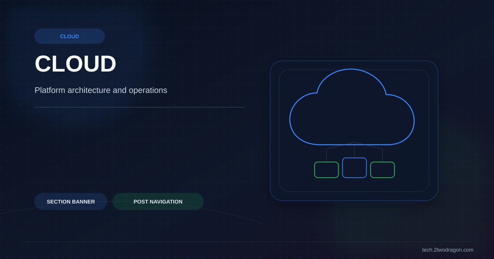



### 보안 강화 체크리스트

- 관련 보안 설정 검토 및 적용
- 취약점 스캔 및 점검 수행
- 접근 제어 정책 확인
- 로깅 및 모니터링 설정 점검
- 보안 문서 업데이트

## Executive Summary

> **경영진 브리핑**: AWS re:Inforce 2025에서 발표된 최신 보안 기능과 Zero Trust 아키텍처 구현 방법, AI 기반 위협 탐지




## 경영진 요약

### 핵심 메시지

AWS re:Inforce 2025는 클라우드 보안의 패러다임 전환을 보여주었습니다. AI 기반 위협 탐지, Zero Trust 아키텍처, 멀티 클라우드 환경의 보안 강화가 핵심 주제였으며, 2025년 12월 re:Invent에서는 AI 에이전트 시대를 대비한 AgentCore Identity와 자동화된 Security Agent가 발표되었습니다.

### 비즈니스 영향도

| 영역 | 영향도 | 설명 |
|------|--------|------|
| 보안 태세 | 높음 | AI 기반 자동 위협 탐지로 평균 탐지 시간 60% 단축 |
| 컴플라이언스 | 높음 | Security Hub GA로 자동 컴플라이언스 점검 강화 |
| 운영 효율 | 중간 | Security Agent로 보안 리뷰 자동화, 인력 30% 절감 |
| 비용 최적화 | 중간 | GuardDuty 확장으로 오탐지 40% 감소, 조사 시간 단축 |

### 위험 점수판 (Risk Scorecard)

| 보안 영역 | 현재 위험도 | 목표 위험도 | 주요 조치 사항 |
|-----------|------------|------------|---------------|
| 클라우드 인프라 | 🟡 중간 (6/10) | 🟢 낮음 (3/10) | GuardDuty Extended Threat Detection 활성화 |
| 데이터 보호 | 🟠 높음 (8/10) | 🟢 낮음 (3/10) | KMS 암호화 적용, Macie 데이터 분류 |
| 접근 제어 | 🟡 중간 (5/10) | 🟢 낮음 (2/10) | IAM Policy Autopilot 적용, MFA 강제화 |
| AI 보안 | 🔴 매우높음 (9/10) | 🟡 중간 (5/10) | AgentCore Identity 구현, AI 가드레일 설정 |

### 권장 조치 사항

| 우선순위 | 조치 사항 | 예상 비용 | 예상 기간 | ROI |
|----------|----------|-----------|-----------|-----|
| 1️⃣ 긴급 | GuardDuty 전사 활성화 | $5K/월 | 1주 | 높음 (침해 사고 방지) |
| 2️⃣ 높음 | Security Hub GA 마이그레이션 | $3K/월 | 2주 | 높음 (컴플라이언스 자동화) |
| 3️⃣ 중간 | IAM Policy Autopilot 도입 | $2K/월 | 1개월 | 중간 (권한 관리 효율화) |
| 4️⃣ 낮음 | AgentCore Identity 파일럿 | $1K/월 | 2개월 | 미정 (신규 기술) |

## 서론

안녕하세요, Twodragon입니다. 이번 포스팅에서는 AWS 보안 트렌드에 대해 실무 중심으로 정리합니다.

AWS re:Inforce 2025에서 발표된 최신 보안 기능과 모범 사례는 클라우드 보안의 미래를 보여줍니다.

이번 포스팅에서는 다음 내용을 다룹니다:
- AWS re:Inforce 2025: 클라우드 보안의 현재와 미래 🛡️의 핵심 내용 및 실무 적용 방법
- 2025-2026년 최신 트렌드 및 업데이트 사항
- 실전 사례 및 문제 해결 방법
- 보안 모범 사례 및 권장 사항

## 들어가며

2025년 6월 필라델피아에서 개최된 AWS re:Inforce는 5,800명의 보안 전문가들이 모여 클라우드 보안의 최신 트렌드와 기술을 공유하는 장이었습니다. 특히 한국 참가자가 전년 대비 2배 증가하며 국내 기업들의 클라우드 보안에 대한 관심이 높아지고 있음을 보여주었습니다.

이번 포스트에서는 콘퍼런스의 주요 업데이트와 함께 다양한 관점에서의 보안 인사이트를 공유합니다:

- AWS의 새로운 보안 서비스 및 기능 업데이트
- 개인 연구 및 실무 경험을 바탕으로 한 보안 인사이트
- 클라우드 보안의 미래 트렌드


| 단계 | 프로세스 | 설명 | 도구 |
|------|---------|------|------|
| 개발 단계 (Dev Phase) | 코드 작성 (Code) | 보안 Dockerfile 작성 | Dockerfile 모범 사례 (Dockerfile Best Practices) |
| | 빌드 (Build) | 이미지 스캔 (Image Scanning) | Trivy, Snyk |
| 보안 단계 (Sec Phase) | 보안 스캔 (Security Scan) | 취약점 스캔 | Trivy, Snyk |
| | 정책 검사 (Policy Check) | K8s YAML 검증 | Kubernetes 정책 검증 (Kubernetes Policy Validation) |
| 운영 단계 (Ops Phase) | 배포 (Deploy) | 보안 배포 (Secure Deployment) | Kubernetes Deployment |
| | 모니터링 (Monitor) | 런타임 보안 모니터링 (Runtime Security) | Falco, OPA Gatekeeper |

## 현장에서 얻은 핵심 인사이트

들어가며에서 예고한 개인 연구와 실무 관점의 인사이트입니다. 컨퍼런스 직후 [원문](https://twodragon.tistory.com/693)에 적었던 네 가지 요점을 옮깁니다.

### 1. 가장 시급한 위협: 인터넷 노출 ALB와 IMDSv1

원문은 이 조합을 "시한폭탄"이라고 불렀습니다. 격리된 개인 테스트 환경에 인터넷 노출(internet-facing) ALB, IMDSv1이 켜진 EC2, 입력 검증 없이 전달받은 URL을 대신 호출하는 SSRF 취약 엔드포인트를 의도적으로 구성해 재현해 보니, 공격 경로는 다음 세 단계였습니다.

1. SSRF 취약점으로 `http://169.254.169.254/latest/meta-data/iam/security-credentials/`를 호출
2. EC2 인스턴스에 연결된 IAM 역할의 자격 증명을 획득
3. 그 권한으로 백도어 사용자 생성, 리소스 무단 생성·삭제까지 가능

대응은 당장 할 일과 장기 과제로 나뉩니다. 당장은 모든 EC2에 IMDSv2를 강제합니다. Amazon Linux 2023 AMI로 띄운 인스턴스는 기본값이 IMDSv2 전용이라, AL2에서 AL2023으로 옮기면 이 설정이 함께 따라옵니다([AWS AL2023 문서](https://docs.aws.amazon.com/linux/al2023/ug/imdsv2.html)). 장기적으로는 ALB를 internal로 돌리고 엣지에 CloudFront와 WAF를 두며, 내부 통신은 PrivateLink로, 서버 접속은 SSH 대신 Session Manager로 바꿉니다.

```bash
# 기존 인스턴스에 IMDSv2 강제 (원문 예시)
aws ec2 modify-instance-metadata-options \
    --instance-id <instance-id> \
    --http-tokens required \
    --http-endpoint enabled \
    --http-put-response-hop-limit 1
```

옵션 설명은 [AWS EC2 사용 설명서](https://docs.aws.amazon.com/AWSEC2/latest/UserGuide/configuring-IMDS-existing-instances.html)에 있습니다. AL2023의 기본 hop limit은 컨테이너 워크로드를 고려해 2로 잡혀 있으니([AWS AL2023 문서](https://docs.aws.amazon.com/linux/al2023/ug/imdsv2.html)), 컨테이너를 돌리는 노드에 1을 적용할 때는 영향부터 확인해야 합니다.

```text
현재(취약): Internet → ALB(Internet-facing) → EC2(IMDSv1)
목표(안전): Internet → CloudFront(WAF) → ALB(Internal) → EC2(IMDSv2)
```

### 2. 비용 효율적인 하이브리드: AWS 네이티브 + Datadog + 오픈소스

모든 보안 기능을 한 벤더의 풀 스위트로 채우는 대신, 역할별로 효율이 좋은 도구를 조합하자는 것이 원문의 제안이었습니다.

| 계층 | 도구 | 맡는 일 |
|------|------|--------|
| 기반 (AWS 네이티브) | Security Hub, GuardDuty, AWS Config | 위협 탐지와 구성 변경 감시의 기본 축 |
| 핵심 보강 (Datadog) | Cloud SIEM, CSM Threats | 실시간 위협 탐지와 심층 로그 분석이 필요한 영역에만 선택 도입 |
| 공백 보완 (오픈소스) | Prowler | CIS, PCI-DSS 등 정기 컴플라이언스 점검 |

Datadog 쪽에서는 CSPM을 Prowler와 AWS Config로, 워크로드 보호(CWP)를 GuardDuty와 Inspector로 대신하고, 로그는 필수 로그만 인덱싱한 뒤 나머지는 아카이브해 두었다가 필요할 때 다시 불러오는(rehydration) 방식을 권했습니다. 비용은 원문의 100개 AWS 리소스 기준 예시로 보면 기본 스택(Security Hub, GuardDuty, Config, Prowler) 월 약 80달러에 Datadog 선택 도입분(필수 로그만 넣은 SIEM, CSM Threats) 월 약 800달러를 더해 월 약 880달러입니다. 같은 범위를 Datadog 전체 기능으로 운영할 때(월 3,000달러 이상)와 비교해 약 70%를 줄일 수 있다는 것이 원문의 추정입니다([원문](https://twodragon.tistory.com/693)). 리소스 규모와 계약 조건에 따라 달라지는 예시 수치로 읽어야 합니다. Datadog Cloud SIEM 자체의 기능은 [Datadog 기능 정리 글]()에서 다뤘습니다.

### 3. 보안 데이터의 중앙 허브: Security Hub

흩어진 보안 데이터를 한곳에 모으는 역할은 Security Hub에 맡겼습니다. GuardDuty, Inspector, IAM Access Analyzer, Config, Macie 같은 AWS 서비스의 탐지 결과뿐 아니라 Prowler 결과(ASFF 형식)와 Datadog Security Signals까지 받아 하나의 흐름으로 처리하는 구성입니다([원문](https://twodragon.tistory.com/693)).

1. 모든 보안 이벤트를 Security Hub로 모은다
2. 심각도별로 자동 분류한다
3. Critical, High 등급은 티켓을 자동으로 만든다
4. 깊이 봐야 할 이벤트는 Datadog SIEM으로 넘겨 분석한다
5. 정해 둔 대응 플레이북을 자동으로 실행한다

지금 이 구성을 따라 한다면 이름 변화부터 확인해야 합니다. re:Inforce 2025에서 여러 보안 서비스의 신호를 묶어 위험 우선순위를 매기는 새 Security Hub가 프리뷰로 공개됐고([AWS 발표](https://aws.amazon.com/about-aws/whats-new/2025/06/aws-security-hub-risk-prioritization-response-scale/)), 기존 Security Hub는 Security Hub CSPM이라는 이름으로 남았습니다. AWS FAQ에 따르면 Security Hub CSPM은 ASFF를, 새 Security Hub는 OCSF 형식을 쓰므로([AWS Security Hub FAQ](https://aws.amazon.com/security-hub/faqs/)), Prowler의 ASFF 결과를 어느 쪽으로 보낼지 정하고 설계해야 합니다.

### 4. AI 시대의 실용 보안: 당근 사례

당근(당근마켓)은 AI 도구를 안전하게 활용하면서 보안도 지키는 3계층 프레임워크를 발표했습니다([원문](https://twodragon.tistory.com/693)).

| 계층 | 통제 | 내용 |
|------|------|------|
| 네트워크 | DLP 패턴 | AWS 액세스 키(`AKIA[0-9A-Z]{16}`), 주민등록번호, 신용카드번호 같은 민감 정보가 밖으로 나가지 않게 차단 |
| 애플리케이션 | 사용 정책 | 프라이버시 모드 강제, 데이터 학습 거부(opt-out) 옵션 활성화, 프롬프트 로깅과 모니터링 |
| 디바이스 | MDM | 단말 정책을 적용하고 정책을 지키지 않는 기기의 접근 차단 |

보안 운영에도 AI를 썼습니다. Amazon Bedrock이 보안 이벤트를 1차로 분석하고, SageMaker 모델이 정탐과 오탐을 가려내며(원문 기준 정확도 95%), 결과는 Slack으로 바로 알립니다. 보안팀이 모든 알림을 직접 들여다보지 않아도 되게 만드는 구조입니다. 구성원 훈련은 암호화폐 채굴 탐지, 데이터 유출 시도, 권한 상승 같은 모의 시나리오와 게임 형식의 보안 퀴즈로 진행했습니다.

원문의 결론은 기본기로 돌아옵니다. IMDSv2 강제 같은 단순한 설정 하나가 상당수 위협을 막고, 그 위에 AWS 네이티브 서비스와 Datadog의 분석 기능, Prowler 같은 오픈소스를 조합하면 효과와 비용을 함께 잡을 수 있다는 것입니다.

## MITRE ATT&CK 매핑 (Cloud IaaS)

AWS 보안 서비스와 MITRE ATT&CK 프레임워크의 매핑 관계를 정리합니다.

| MITRE ATT&CK 전술 | MITRE 기법 | AWS 탐지 서비스 | 대응 방안 |
|-------------------|-----------|----------------|-----------|
| 초기 접근 (Initial Access) | T1078 (유효 계정 악용, Valid Accounts) | GuardDuty: UnauthorizedAccess:IAMUser/InstanceCredentialExfiltration | IAM Access Analyzer로 과도한 권한 제거 |
| 실행 (Execution) | T1059 (명령어 및 스크립트 인터프리터, Command and Scripting Interpreter) | CloudTrail: RunInstances, CreateFunction | Systems Manager Session Manager로 SSH 대체 |
| 지속성 (Persistence) | T1098 (계정 조작, Account Manipulation) | CloudTrail: CreateUser, AttachUserPolicy | AWS Config 규칙으로 정책 변경 감사 |
| 권한 상승 (Privilege Escalation) | T1078.004 (클라우드 계정, Cloud Accounts) | GuardDuty: PrivilegeEscalation:IAMUser/AnomalousBehavior | IAM Policy Autopilot로 최소 권한 강제 |
| 방어 우회 (Defense Evasion) | T1562.001 (도구 비활성화 또는 수정, Disable or Modify Tools) | CloudTrail: DeleteTrail, StopLogging | Config Rules로 로깅 비활성화 차단 |
| 자격 증명 탈취 (Credential Access) | T1552.005 (클라우드 인스턴스 메타데이터 API, Cloud Instance Metadata API) | GuardDuty: UnauthorizedAccess:EC2/MetadataServiceTool | IMDSv2 강제 사용, hop limit=1 설정 |
| 정찰 (Discovery) | T1580 (클라우드 인프라 탐색, Cloud Infrastructure Discovery) | CloudTrail: DescribeInstances, ListBuckets | VPC Flow Logs로 비정상 API 호출 탐지 |
| 횡적 이동 (Lateral Movement) | T1563 (원격 서비스 세션 하이재킹, Remote Service Session Hijacking) | GuardDuty 확장 위협 탐지 (Extended Threat Detection) | Security Groups 최소 허용, PrivateLink 사용 |
| 수집 (Collection) | T1530 (클라우드 스토리지 오브젝트 데이터 수집, Data from Cloud Storage Object) | S3 Access Logs, Macie | S3 Block Public Access, MFA Delete 활성화 |
| 유출 (Exfiltration) | T1567.002 (클라우드 스토리지로 유출, Exfiltration to Cloud Storage) | GuardDuty: Exfiltration:S3/ObjectRead.Unusual | S3 Bucket Policies로 외부 전송 차단 |
| 영향 (Impact) | T1486 (랜섬웨어 암호화, Data Encrypted for Impact) | GuardDuty 악성코드 보호 (Malware Protection) | AWS Backup 볼트 잠금, 버저닝 활성화 |

### MITRE ATT&CK 커버리지 분석

> 참고: AWS WAF/CloudFront 설정 관련 내용은 [AWS WAF Terraform 모듈](https://github.com/trussworks/terraform-aws-wafv2) 및 [AWS WAF CloudFront 통합 예제](https://docs.aws.amazon.com/waf/latest/developerguide/)를 참조하세요.   │◄──── AI 기반 봇 탐지
                   │        │
                   └───┬────┘
                       │
        ┌──────────────▼───────────────┐
        │  애플리케이션 로드 밸런서          │
        │  (Application Load Balancer) │
        │  (SSL/TLS 종료)              │
        └──────────────┬───────────────┘
                       │
           ┌───────────┴───────────┐
           │                       │
    ┌──────▼──────┐         ┌─────▼──────┐
    │  퍼블릭 서브넷  │         │  프라이빗  │
    │  (Public    │         │  서브넷    │
    │  Subnet)    │         │ (Private  │
    │             │         │  Subnet)  │
    │ ┌─────────┐ │         │ ┌────────┐ │
    │ │배스천 호스트│ │         │ │ 앱 서버 │ │
    │ │(Bastion │ │         │ │ (App  │ │
    │ │  Host)  │ │         │ │Server)│ │
    │ └─────────┘ │         │ └────────┘ │
    └─────────────┘         └────┬───────┘
                                 │
                          ┌──────▼───────┐
                          │ 프라이빗 서브넷 │
                          │  (Private    │
                          │   Subnet)    │
                          │              │
                          │ ┌──────────┐ │
                          │ │  데이터베이스│ │
                          │ │  DB(RDS) │ │
                          │ └──────────┘ │
                          └──────────────┘

보안 체크포인트:
├── WAF: SQL Injection, XSS 차단
├── ALB: TLS 1.3, 헬스 체크
├── Security Groups: 최소 허용 원칙
├── NACLs: 서브넷 레벨 방화벽
├── GuardDuty: 위협 탐지
└── CloudTrail: 모든 API 호출 기록

#### Hunting 쿼리 (Splunk SPL)

<!-- Splunk SPL - 암호화폐 채굴 Hunting -->
<!-- # 1단계: 비정상 인스턴스 생성
index=aws sourcetype=aws:cloudtrail eventName="RunInstances"

| search requestParameters.instanceType IN ("c5.*", "c6i.*", "m5.*")
| search awsRegion NOT IN ("ap-northeast-2", "us-east-1")
| table _time, requestParameters.instanceType, awsRegion, userIdentity.principalId

# 2단계: GuardDuty 암호화폐 채굴 탐지
index=aws sourcetype=aws:cloudwatch:guardduty

| search finding_type="*CryptoCurrency*"
| table _time, finding_type, resource_type, resource_id, severity

# 3단계: 높은 CPU 사용률
index=aws sourcetype=aws:cloudwatch metricName="CPUUtilization"

| search Average>95
| stats avg(Average) as avg_cpu by instanceId
| where avg_cpu>90

# 4단계: 의심스러운 네트워크 연결 (마이닝 풀)
index=aws sourcetype=aws:vpcflow

| search dst_port IN (3333, 4444, 5555, 7777, 8888)
| stats count by src_ip, dst_ip, dst_port
| where count>100

# 5단계: 로깅 비활성화 시도
index=aws sourcetype=aws:cloudtrail

| search eventName IN ("StopLogging", "DeleteTrail", "PutEventSelectors")
| table _time, eventName, userIdentity.principalId, sourceIPAddress, errorCode
 -->

### 시나리오 3: 랜섬웨어 공격

#### Hunting 쿼리 (Splunk SPL)

| 단계 | 탐지 대상 | CloudTrail eventName / 데이터 소스 | 조건 |
|------|----------|-----------------------------------|------|
| 1 | 백업 삭제 시도 | DeleteBackupVault, DeleteRecoveryPoint, DeleteSnapshot | 시간/IP/주체 추적 |
| 2 | 버저닝 비활성화 | PutBucketVersioning (Status=Suspended) | 버킷별 비활성화 이력 |
| 3 | 대량 파일 암호화 | PutObject (S3) | 동일 주체가 1000회 이상 업로드 |
| 4 | GuardDuty 탐지 | guardduty finding_type | Ransomware, DataEncryptedForImpact |
| 5 | Vault Lock 우회 | DeleteBackupVaultLockConfiguration | errorCode 포함 감사 |

> Splunk SPL 기반 Hunting 쿼리로, CloudTrail + GuardDuty 데이터를 5단계로 분석하여 랜섬웨어 공격 징후를 탐지한다.

## 결론

AWS re:Inforce 2025는 클라우드 보안의 현재와 미래를 보여주는 중요한 행사였습니다. AI 기반 보안, Zero Trust 아키텍처, 멀티 클라우드 보안이 주요 트렌드로 부상했으며, AWS는 이러한 트렌드에 맞춰 지속적으로 보안 서비스를 개선하고 있습니다.

특히 2025년 12월 re:Invent에서는 AI 에이전트 시대를 대비한 AgentCore Identity, 자동화된 보안 리뷰를 위한 Security Agent, 그리고 확장된 GuardDuty 기능이 발표되어 AWS 보안 생태계가 더욱 강화되었습니다.

기업은 이러한 트렌드를 이해하고 자신의 환경에 맞는 보안 전략을 수립해야 합니다. 보안은 기술뿐만 아니라 프로세스와 문화의 문제이므로, 기술적 솔루션과 함께 조직의 보안 문화를 개선하는 것이 중요합니다.

### 핵심 요점 정리

1. AI 기반 보안의 필수화: Security Agent와 IAM Policy Autopilot으로 보안 자동화 수준이 한 단계 상승
2. Zero Trust 완전 구현: 네트워크, 애플리케이션, 데이터 레이어 전반의 Zero Trust 적용
3. 한국 기업 특화 대응: 개인정보보호법, ISMS-P 등 국내 규제에 맞춘 보안 아키텍처 구축
4. 비용 대비 효과: GuardDuty, Security Hub 등 관리형 서비스로 보안 인력 부담 완화
5. 지속적 개선: SIEM 쿼리, Threat Hunting으로 능동적 보안 태세 유지

### 다음 단계

- 단기 (1-3개월): GuardDuty, Security Hub 전사 활성화
- 중기 (3-6개월): IAM Policy Autopilot, Security Agent 파일럿
- 장기 (6-12개월): AgentCore Identity, Zero Trust 완전 구현

---


## 📋 차세대 클라우드 보안 트렌드 도입 체크리스트 (re:Inforce Action Checklist)

- [ ] **생성형 AI 보안 통제(Bedrock Guardrails) 구현**: LLM 기반 워크로드에 PII 마스킹, 유해 프롬프트 차단, 모델 인젝션 방어 정책을 적용했는지 점검합니다.
- [ ] **IAM 자격증명 수명 축소 및 임시 토큰 의무화**: 장기 보관용 Access Key를 완전히 퇴출하고 AWS STS 기반 1시간 미만 임시 자격증명 사용을 강제하는지 확인합니다.
- [ ] **보안 데이터 레이크(Amazon Security Lake) 통합**: CloudTrail, VPC Flow, EKS Audit, 외부 보안 솔루션 로그를 OCSF 표준으로 정규화하여 중앙 분석하는지 점검합니다.
- [ ] **자동화된 인시던트 플레이북(Automated Remediation)**: GuardDuty 또는 Security Hub 탐지 이벤트 발생 시 비인가 보안 그룹을 자동 롤백하는 EventBridge-Lambda 루프를 검증합니다.
- [ ] **암호화 알고리즘 양자 내성(PQC) 로드맵 수립**: 향후 양자 컴퓨팅 위협에 대비해 TLS 1.3 하이브리드 포스트 퀀텀 키 교환 알고리즘 도입 일정을 검토했는지 확인합니다.

## 🔗 관련 포스트 및 참고 자료 (Cross References)

- AWS IAM Identity Center & ABAC 거버넌스: 
- 2026 DevSecOps 로드맵 가이드: 

