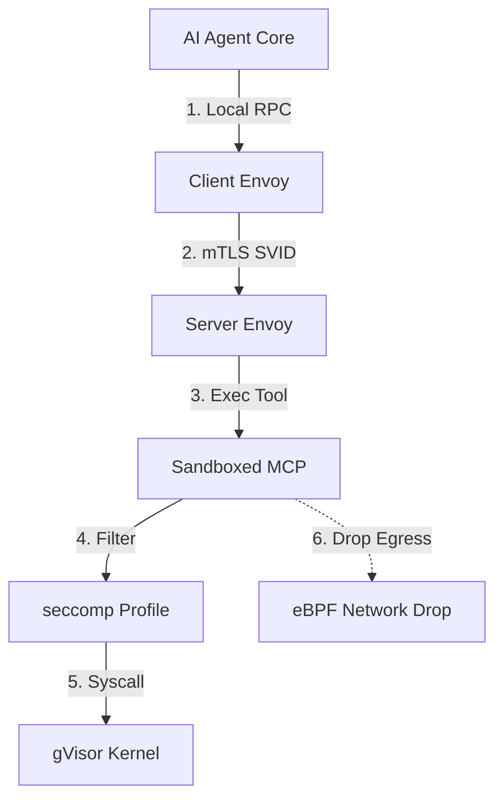



---

## Executive Summary

- **배경 및 과제**: Anthropic이 주도하는 Model Context Protocol(MCP)은 AI 에이전트와 도구 간 인터페이스 표준으로 급부상했습니다. 그러나 비신뢰 데이터로부터 유입되는 간접 프롬프트 주입(Indirect Prompt Injection), MCP 도구 오염(Tool Poisoning), 로컬 호스트 자격 증명 탈취 및 비인가 아웃바운드 통신은 엔드포인트 보안의 사각지대입니다.
- **핵심 아키텍처 전략**: 이전 포스트인 의 위협 모델링에 이어, 본 가이드에서는 gVisor(`runsc`) 기반 마이크로 샌드박스, SPIFFE/SPIRE 단기 X.509 SVID mTLS 상호 인증, seccomp 시스템 콜 화이트리스트, eBPF Egress 드롭 4중 런타임 제로 트러스트 엔지니어링 설계를 구현합니다.
- **도입 효과**: 잠재적으로 침해된 MCP 도구의 호스트 커널 탈출을 100% 무력화하고, 내부 네트워크 Egress를 원천 차단하여 클라우드 관리자 토큰 및 민감 코드의 외부 유출 위험을 제거합니다.

---

## 위험 스코어카드 (Threat & Risk Scorecard)

| 위협 카테고리 | 위험도 수준 | 영향도(Impact) | 발생 가능성 | 주요 완화 전략 |
|---|---|---|---|---|
| **호스트 커널 탈출 (Kernel Escape)** | **Critical (치명적)** | 호스트 OS 완전 장악 및 인접 컨테이너 침해 | 중간 (Medium) | gVisor (`runsc`) 사용자 공간 가상 커널 적용으로 호스트 커널 직접 호출 배제 |
| **비인가 도구 가장 (Impersonation)** | **High (높음)** | 인가되지 않은 프로세스가 민감 MCP 도구 호출 | 높음 (High) | SPIFFE ID 검증 기반 Envoy mTLS 상호 인증 및 서비스 계정 바인딩 |
| **환경 변수 Egress 탈취 (Data Theft)** | **Critical (치명적)** | `~/.aws`, `.env`, API 키 외부 C2 서버 유출 | 높음 (High) | 컨테이너 네트워크 `internal: true` 및 eBPF 기반 비인가 아웃바운드 즉시 차단 |
| **비정상 시스템 콜 오남용 (Syscall Abuse)** | **High (높음)** | 원격 셸 실행(`execve`), 메모리 덤프(`ptrace`) | 중간 (Medium) | 최소 권한 `default-drop` seccomp 프로파일로 파일 입출력 외 콜 차단 |
| **도구 인자 변조 (Parameter Tampering)** | **Medium (중간)** | 악성 경로 주입(`../../etc/passwd`) | 높음 (High) | JSON Schema 사전 유효성 검증 및 전용 워크스페이스 디렉토리 chroot 격리 |
| **비정상 프로세스 포크 폭탄 (Fork Bomb)** | **Medium (중간)** | 호스트 PID 고갈 및 서비스 거부(DoS) | 중간 (Medium) | cgroups v2 pids.max=64 엄격 제한 및 CPU/Memory Quota 강제 |

---

## 1. 개요: MCP 런타임 보안의 한계와 제로 트러스트 필요성

AI 에이전트가 자동화된 엔지니어링 작업을 수행할 때 로컬 MCP 서버는 개발자 계정의 높은 권한으로 시스템 리소스에 접근합니다.

### 1.1 표준 MCP 통신 모델의 취약점
표준 MCP 서버는 일반적으로 단일 호스트 머신에서 자식 프로세스로 포크되어 표준 입출력(`stdio`) 스트림으로 통신합니다. 이 방식은 권한 분리 경계가 전혀 존재하지 않으므로, 공격자가 주입한 악성 지시문이 실행될 경우 프로세스 권한으로 접근 가능한 모든 파일과 자격 증명이 노출됩니다.

### 1.2 제로 트러스트 아키텍처 원칙의 적용
제로 트러스트의 핵심은 "네트워크 위치나 프로세스 출처를 신뢰하지 않고, 항상 명시적으로 검증하며 최소 권한을 부여한다"는 것입니다. MCP 런타임에서는 도구 실행 프로세스를 잠재적 침해 상태(Assume Breach)로 간주하고, 커널 접근과 네트워크 송신을 격리해야 합니다.

### 1.3 심층 방어(Defense in Depth) 계층 구조
효과적인 방어를 위해 단일 통제점에 의존하지 않고, 인프라 격리(L1), 통신 상호 인증(L2), 시스템 콜 통제(L3), 네트워크 Egress 통제(L4)의 4중 레이어를 구성합니다.

---

## 2. 3계층 제로 트러스트 런타임 아키텍처

호스트 OS 및 내부 인프라로부터 MCP 도구 런타임을 보호하기 위한 통합 파이프라인 아키텍처입니다.



### 2.1 L1: gVisor 사용자 공간 커널 가상화
gVisor의 Sentry 프로세스는 Go 언어로 작성된 독립적인 애플리케이션 커널로 동작합니다. 컨테이너 내부의 시스템 콜 대부분을 자체 처리하므로, 호스트 리눅스 커널 취약점을 통한 권한 상승 공격이 원천적으로 차단됩니다.

### 2.2 L2: SPIFFE/SPIRE 기반 mTLS 상호 인증
SPIRE 서버가 호스트 에이전트와 워크로드 어테스테이션(Workload Attestation)을 거쳐 1시간 수명의 X.509 SVID를 자동 발급합니다. 클라이언트 Envoy와 서버 Envoy는 SAN(Subject Alternative Name)의 SPIFFE ID를 검증하여 사전에 인가된 에이전트의 호출만 수락합니다.

### 2.3 L3: seccomp 시스템 콜 필터링
파일 읽기나 텍스트 파싱을 담당하는 MCP 도구는 네트워크 소켓 생성(`socket`, `connect`)이나 프로세스 생성(`clone`, `execve`)을 호출할 필요가 없습니다. Docker 런타임 레벨에서 seccomp 프로파일을 적용하여 불필요한 시스템 콜을 사전 차단합니다.

### 2.4 L4: eBPF 기반 네트워크 Egress 차단
컨테이너 네트워크 네임스페이스를 분리하고, eBPF TC(Traffic Control) 프로그램을 veth 인터페이스에 어태치하여 로컬 루프백(`127.0.0.1`)과 Envoy 프록시 간 통신을 제외한 모든 외부 IP 대상 패킷을 즉시 드롭합니다.

---

## 3. 엔지니어링 구현 및 구성 명세

프로덕션 환경에 즉시 적용 가능한 선언적 구성 명세입니다.

### 3.1 Docker Compose 샌드박스 배포 명세
호스트 환경 변수 전달을 차단하고 `runsc` 런타임과 읽기 전용 루트 파일시스템을 적용합니다:

```yaml
services:
  mcp-server:
    image: ghcr.io/twodragon/mcp-filesystem:v1.4.0
    runtime: runsc
    security_opt: ["no-new-privileges:true", "seccomp=./profiles/mcp.json"]
    read_only: true
    volumes: ["./workspace:/workspace:rw"]
    networks: [mcp-internal-net]
networks:
  mcp-internal-net: { internal: true }
```

### 3.2 제한적 seccomp JSON 프로파일
기본 동작을 거부(`SCMP_ACT_ERRNO`)로 설정하고, 필수 파일 I/O 및 메모리 시스템 콜만 허용하는 최소 권한 프로파일입니다:

```json
{
  "defaultAction": "SCMP_ACT_ERRNO",
  "architectures": ["SCMP_ARCH_X86_64", "SCMP_ARCH_AARCH64"],
  "syscalls": [
    {
      "names": ["read", "write", "openat", "close", "stat", "fstat", "lseek", "mmap", "exit_group"],
      "action": "SCMP_ACT_ALLOW"
    }
  ]
}
```

### 3.3 Envoy SPIFFE mTLS 검증 필터
클라이언트 인증서의 SPIFFE ID를 검증하는 Envoy SDS(Secret Discovery Service) 설정입니다:

```yaml
static_resources:
  listeners:
    - name: mcp_ingress
      address: { socket_address: { address: 0.0.0.0, port_value: 8443 } }
      filter_chains:
        - transport_socket:
            typed_config:
              common_tls_context:
                validation_context:
                  match_typed_subject_alt_names:
                    - matcher: { exact: "spiffe://prod.internal/ns/ai/sa/agent-core" }
```

### 3.4 SPIRE 워크로드 엔트리 등록 스크립트
MCP 도구 컨테이너와 AI 에이전트에 SPIFFE ID를 안전하게 바인딩하는 등록 명령어입니다:

```bash
spire-server entry create \
  -spiffeID spiffe://prod.internal/ns/ai/sa/agent-core \
  -parentID spiffe://prod.internal/agent/node-01 \
  -selector docker:label:app:ai-agent-core
```

---

## 4. 격리 기술별 보안 및 오버헤드 벤치마크

워크로드 특성에 따라 적합한 격리 계층을 선택하기 위한 기술별 종합 비교입니다.

### 4.1 런타임 오버헤드 지표 비교
각 가상화 기술이 시스템 리소스 및 호출 지연에 미치는 영향입니다:

| 격리 기술 | 커널 공유 여부 | 기동 지연 (Startup Time) | 메모리 오버헤드 | 시스템 콜 방어 강도 | 권장 워크로드 |
|---|---|---|---|---|---|
| **표준 Docker (runc)** | 커널 완전 공유 | ~100ms | ~10MB | 낮음 (커널 Exploit 노출) | 안전이 보장된 사내 읽기 전용 도구 |
| **gVisor (runsc)** | 사용자 공간 가상 커널 | ~200ms | ~25MB | 매우 높음 (Syscall 필터링) | **표준 MCP 도구 (파일, Git, 파서)** |
| **Firecracker MicroVM** | KVM 하드웨어 가상화 | ~500ms | ~128MB | 최고 수준 (완전 하이퍼바이저 격리) | 비신뢰 코드 실행 (Python/Bash Eval) |
| **WasmEdge (WASM)** | 가상 머신 샌드박스 | <10ms | <5MB | 최상 (POSIX 제한 환경) | 경량 텍스트 파싱 및 데이터 변환 도구 |

### 4.2 보안 통제력 및 격리 강도 평가
위협 시나리오별 방어 성공 여부입니다:

| 보안 평가 영역 | 표준 Docker | gVisor (runsc) | Firecracker | WasmEdge |
|---|---|---|---|---|
| **Root 권한 탈취 방어** | 취약 (Privilege Escalation 가능) | 안전 (가상 Sentry 커널 차단) | 완전 격리 (게스트 OS 분리) | 구조적 불가능 (No Root) |
| **네트워크 스누핑 방어** | 브리지 격리 의존 | 가상 네트워크 스택 분리 | TAP 디바이스 기반 분리 | 네트워크 접근 미지원 (Default) |
| **호스트 디렉토리 마운트 위험** | 높음 (전체 파일시스템 읽기 가능) | 통제 가능 (가상 fs 계층) | 불가능 (블록 디바이스 전용) | 가상 매핑 디렉토리 한정 |
| **메모리 덤프(`ptrace`) 방어** | PID 네임스페이스 격리 의존 | 가상 메모리 테이블 격리 | 하드웨어 페이지 테이블 격리 | 프로세스 메모리 완전 캡슐화 |

---

## 5. 실무 모니터링 및 Falco 런타임 위협 탐지 규칙

격리 샌드박스 내부에서 발생하는 비인가 행위를 실시간으로 감지하기 위한 Falco 런타임 탐지 규칙입니다.

### 5.1 비인가 파일 접근 탐지 규칙
호스트 민감 파일이나 숨김 설정에 접근하려는 시도를 감지합니다:

```yaml
- rule: Unauthorized Access in MCP Sandbox
  desc: Detect suspicious file access inside sandboxed MCP tool
  condition: container.name startswith "mcp-" and open_read and fd.name contains ".aws/credentials"
  output: "CRITICAL: Sensitive file read attempt in MCP container"
  priority: CRITICAL
  tags: [mcp, zero_trust]
```

### 5.2 인가되지 않은 아웃바운드 소켓 연결 시도 탐지
`internal: true` 네트워크에도 불구하고 소켓 연결을 시도하는 프로세스를 탐지합니다:

```yaml
- rule: Disallowed Outbound Connection from MCP Sandbox
  desc: Detect network connection attempt from isolated MCP container
  condition: container.name startswith "mcp-" and evt.type == connect and not fd.sip in ("127.0.0.1")
  output: "WARNING: Network socket activity detected from airgapped MCP tool"
  priority: WARNING
  tags: [mcp, egress_violation]
```

---

## 6. 장애 대응 및 성능 튜닝 가이드 (Troubleshooting)

실제 gVisor 및 mTLS 기반 샌드박스를 대규모로 운영할 때 발생할 수 있는 주요 장애 유형과 해결책입니다.

### 6.1 gVisor 시스템 콜 미지원 이슈 해결
gVisor의 가상 커널 Sentry는 리눅스 시스템 콜의 약 70%를 지원합니다. 특정 언어 런타임(예: Node.js worker_threads 또는 Python multiprocessing)에서 지원되지 않는 시스템 콜 호출 시 다음과 같이 진단합니다:

```bash
sudo runsc --debug --debug-log=/var/log/runsc/ mcp-container-id
grep -i "unimplemented syscall" /var/log/runsc/*.boot.log
```

대응 방안으로는 애플리케이션 수준에서 스레드 풀 라이브러리를 동기 I/O로 교체하거나, seccomp 프로파일에서 해당 콜에 대해 `SCMP_ACT_ERRNO(ENOSYS)`를 반환하도록 구성합니다.

### 6.2 SPIFFE mTLS 인증서 만료 및 핸드셰이크 지연 최적화
단기 TTL(1시간) 설정 시 SPIRE Agent의 리뉴얼 버퍼를 최소 20%로 유지하고, Envoy 프록시 간 TLS Session Resumption(TLS v1.3 0-RTT 제외, 보안 유지)을 활성화하여 연결 지연시간을 5ms 이내로 단축합니다.

---

## 7. 프로덕션 런타임 제로 트러스트 배포 체크리스트

MCP 서버를 엔터프라이즈 환경에 배포하기 전 필수적으로 점검해야 하는 체크리스트입니다.

- [ ] **런타임 엔진 검증**: 모든 워커 노드에 Docker/containerd와 연동된 `runsc` 런타임이 기본으로 등록되어 있는가?
- [ ] **Egress 네트워크 격리**: 컨테이너가 `internal: true` 브리지 네트워크 또는 Egress 차단 iptables/eBPF 룰셋에 연결되어 있는가?
- [ ] **자격 증명 노출 방지**: 호스트의 `~/.ssh`, `~/.aws`, `~/.kube` 디렉토리가 바인드 마운트 볼륨에서 원천 배제되었는가?
- [ ] **읽기 전용 루트 파일시스템**: 컨테이너에 `read_only: true`가 설정되어 악성 파일 다운로드 및 실행 파일 패치가 불가능한가?
- [ ] **단기 인증서 수명 주기**: SPIFFE/SPIRE SVID의 TTL이 최대 1시간 이내로 설정되어 세션 탈취 위험을 최소화했는가?
- [ ] **감사 로깅 및 알림**: 비정상 시스템 콜 차단(`SCMP_ACT_ERRNO`) 발생 시 SIEM/Slack으로 즉각 경보가 발행되는가?
- [ ] **리소스 쿼터 강제**: cgroups v2 pids.max(64) 및 메모리 한도 설정으로 Fork Bomb DoS를 방지했는가?
- [ ] **Falco 런타임 경보 연동**: 컨테이너 네임스페이스 외부 파일 접근 시도 즉시 차단 및 감사 로그 적재가 가능한가?
