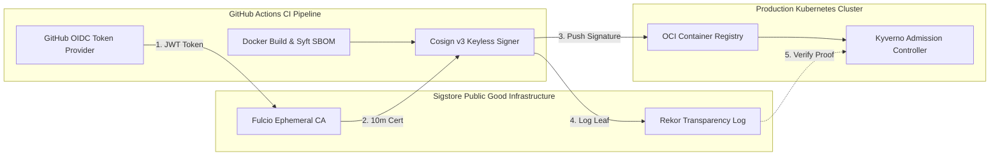



---

## Executive Summary

- **배경 및 과제**: 소프트웨어 공급망 공격(Supply Chain Attack)이 정교화되면서 정적 암호화 키를 장기 보관하는 전통적 PGP/GPG 서명 모델은 CI/CD 시크릿 유출 및 키 로테이션 관리 부채라는 치명적 한계를 드러냈습니다. 빌드 산출물이 파이프라인 외부에서 위변조되지 않았음을 수학적으로 입증할 수 있는 무결성 프레임워크가 필수적입니다.
- **핵심 아키텍처 전략**: 이전 포스트인 에서 다룬 런타임 제로 트러스트에 이어, 본 가이드에서는 배포 이전 단계의 무결성을 보장하기 위해 **Sigstore Cosign v3 키리스(Keyless) 서명**과 **SLSA(Supply-chain Levels for Software Artifacts) Level 3** 표준을 결합합니다. GitHub Actions OIDC 토큰으로 임시 X.509 인증서(Fulcio)를 발급받고, 불변 머클 트리 투명성 로그(Rekor)에 기록합니다.
- **도입 효과**: 하드코딩된 개인키를 100% 제거하여 키 탈취 위험을 원천 무력화하며, 쿠버네티스 Admission Webhook(Kyverno)을 통해 검증되지 않은 컨테이너 이미지의 프로덕션 유입을 0ms 지연으로 차단합니다.

---

## 위험 스코어카드 (Threat & Risk Scorecard)

| 위협 카테고리 | 위험도 수준 | 영향도(Impact) | 발생 가능성 | 주요 완화 전략 |
|---|---|---|---|---|
| **CI/CD 서명 개인키 탈취** | **Critical (치명적)** | 악성 백도어 이미지에 정당한 서명 위조 | 높음 (High) | Sigstore Fulcio 기반 10분 유효 단기 인증서(Keyless) 전환으로 정적 키 보관 폐지 |
| **빌드 산출물 중간자 변조 (MITM)** | **Critical (치명적)** | 레지스트리 푸시 단계에서 이미지 레이어 변조 | 중간 (Medium) | OCI 컨테이너 다이제스트(SHA-256) 기반 서명 및 Rekor 투명성 로그 등록 |
| **허위 빌드 출처 위조 (Fake Provenance)** | **High (높음)** | 비인가 빌드 환경에서 생성된 산출물 속임 | 높음 (High) | 격리된 GitHub Actions 러너에서 SLSA Level 3 빌드 증명 Attestation 강제 |
| **손상된 서명 감사 추적 불가** | **High (높음)** | 사고 발생 시 변조 시점 및 서명자 특정 실패 | 중간 (Medium) | 불변 암호화 머클 트리(Rekor Transparency Log) 영구 감사 레코드 조회 |
| **쿠버네티스 클러스터 미서명 배포** | **Critical (치명적)** | 태그 변경을 통한 악성 이미지 실행 | 높음 (High) | Kyverno 클러스터 정책으로 유효한 Cosign 서명 부재 시 파드 생성 거부 |

---

## 1. 개요: 소프트웨어 공급망 보안의 패러다임 전환

빌드 파이프라인의 보안 수준을 높이기 위해 서명 모델과 공급망 무결성 표준의 현대화가 시급합니다.

### 1.1 정적 키 기반 서명의 구조적 취약점
과거 Docker Content Trust(DCT)나 GPG 서명 방식은 개발자나 CI/CD 파이프라인의 환경 변수에 비공개 키(Private Key)를 주입해야 했습니다. 파이프라인 로깅 결함이나 CI 러너 침해 사고 발생 시 서명 키가 유출되어 전체 빌드 생태계가 신뢰를 잃는 사태가 반복되었습니다.

### 1.2 Sigstore의 키리스(Keyless) 서명 혁신
Sigstore는 개인키를 보관하지 않습니다. CI 러너가 발행하는 짧은 수명의 OIDC Identity Token(예: GitHub Actions 토큰)을 검증하여, Fulcio CA가 10분 동안만 유효한 단기 X.509 인증서를 발행합니다. 서명 완료 후 개인키는 즉시 메모리에서 폐기됩니다.

### 1.3 불변 투명성 원장(Rekor)의 역할
서명 시점의 유효성은 암호화 머클 트리(Merkle Tree) 기반의 투명성 로그(Rekor)에 영구 기록됩니다. 검증자는 만료된 인증서라 할지라도 Rekor의 불변 타임스탬프를 대조하여 서명 당시 인증서가 유효했음을 수학적으로 입증합니다.

---

## 2. Cosign v3 키리스 서명 및 검증 아키텍처

CI 파이프라인부터 쿠버네티스 배포 게이트까지의 전체 무결성 검증 파이프라인 흐름입니다.



### 2.1 L1: OIDC 신원 확인 및 Fulcio 단기 인증서 발급
GitHub Actions 워커는 `id-token: write` 권한을 통해 OIDC 토큰을 획득합니다. 이 토큰에는 워크플로우 저장소, 브랜치, 커밋 해시가 포함되어 있으며 Fulcio는 이를 검증하고 인증서의 SAN(Subject Alternative Name)에 해당 메타데이터를 포함시킵니다.

### 2.2 L2: OCI 레지스트리 기반 서명 및 SBOM 첨부
Cosign은 서명 결과물과 Syft로 생성된 SPDX/CycloneDX 형식의 SBOM(Software Bill of Materials)을 컨테이너 이미지와 동일한 OCI 레지스트리에 태그(`sha256-<hash>.sig`, `.att`) 형태로 업로드합니다.

### 2.3 L3: SLSA Level 3 출처 증명 (Provenance Attestation)
빌드 환경이 소스 코드 체크아웃부터 컴파일, 컨테이너 패키징까지 독립된 격리 빌더에서 수행되었음을 증명하는 In-toto Attestation 규격의 문서를 생성하고 서명합니다.

### 2.4 L4: 쿠버네티스 Admission Controller 차단 게이트
Kubernetes 클러스터에 파드가 스케줄링될 때 Kyverno가 OCI 레지스트리의 서명과 Rekor 로그를 실시간 검증하여, 정책을 통과하지 못한 이미지는 배포를 즉시 거부(`fail-closed`)합니다.

---

## 3. 엔지니어링 구현 및 구성 명세

프로덕션 CI/CD 및 쿠버네티스 환경에 적용 가능한 선언적 구성 명세입니다.

### 3.1 GitHub Actions 키리스 서명 워크플로우
개인키 설정 없이 OIDC 토큰을 활용하여 이미지를 빌드하고 Cosign v3로 서명합니다:

```yaml
jobs:
  build-and-sign:
    runs-on: ubuntu-latest
    permissions:
      contents: read
      packages: write
      id-token: write
    steps:
      - uses: actions/checkout@v4
      - uses: sigstore/cosign-installer@v3.8.0
      - run: |
          cosign sign --yes \
            ghcr.io/twodragon/payment-service:v2.0.0
```

### 3.2 SLSA Level 3 빌드 출처 증명(Provenance) 서명
빌드 환경의 무결성을 입증하는 In-toto 형식의 Provenance Attestation 생성 스크립트입니다:

```bash
cosign attest --yes \
  --predicate provenance.json \
  --type slsaprovenance1 \
  ghcr.io/twodragon/payment-service:v2.0.0
```

### 3.3 로컬 및 CI 환경 수동 검증 명령어
Rekor 머클 트리 로그와 인증서 발급자 OIDC Subject를 검증합니다:

```bash
cosign verify \
  --certificate-identity-regexp "https://github.com/Twodragon0/.*" \
  --certificate-oidc-issuer "https://token.actions.githubusercontent.com" \
  ghcr.io/twodragon/payment-service:v2.0.0
```

### 3.4 Kyverno 쿠버네티스 이미지 검증 정책
인증되지 않은 이미지의 파드 생성을 방지하는 Admission 제어 CRD입니다:

```yaml
apiVersion: kyverno.io/v1
kind: ClusterPolicy
metadata: { name: verify-image-sigstore }
spec:
  validationFailureAction: Enforce
  rules:
    - name: verify-cosign
      match: { any: [{ resources: { kinds: ["Pod"] } }] }
      verifyImages:
        - imageReferences: ["ghcr.io/twodragon/*"]
          attestors:
            - entries:
                - keyless:
                    issuer: "https://token.actions.githubusercontent.com"
                    subjectRegExp: "https://github.com/Twodragon0/.*"
```

---

## 4. 공급망 서명 체계 및 SLSA 등급별 비교

전통적인 서명 방식과 Sigstore 키리스 방식, 그리고 SLSA 레벨별 보안 통제력 비교입니다.

### 4.1 컨테이너 서명 기술 비교 분석
각 서명 아키텍처의 키 관리 및 무결성 보증 능력입니다:

| 비교 항목 | Docker Content Trust (Notary v1) | GPG / Cosign (정적 키 기반) | Sigstore Cosign v3 (키리스 OIDC) |
|---|---|---|---|
| **비공개 키 관리** | 로컬 및 CI 서버에 정적 키 보관 | CI 시크릿에 암호화 키 주입 필요 | **키 보관 불필요 (10분 유효 임시 키)** |
| **신원 증명 기반** | 원시 공개키 지문(Fingerprint) | GPG 키 ID 및 이메일 서명 | **OIDC Identity (GitHub, Google, OIDC)** |
| **감사 불변성 로그** | 지원 안 함 (레지스트리 의존) | 지원 안 함 (로컬 검증) | **Rekor 공개 머클 트리 영구 기록** |
| **키 유출 시 복구** | 복잡한 루트 키 갱신 절차 | 서명된 모든 이미지 재서명 필요 | **인증서 만료(10분)로 키 폐기 불필요** |
| **K8s 네이티브 검증** | 별도 웹훅 에이전트 필요 | 복잡한 Secret 마운트 필요 | **Kyverno/Policy Controller 네이티브 지원** |

### 4.2 SLSA(Supply-chain Levels) 단계별 요건 평가
조직의 빌드 파이프라인이 충족해야 하는 SLSA v1.0 레벨 요구사항입니다:

| SLSA 레벨 | 핵심 요구 조건 | 방어 가능한 공격 유형 | 구현 난이도 |
|---|---|---|---|
| **SLSA Level 1** | 빌드 프로세스 문서화 및 기본 출처 메타데이터 생성 | 단순 실수 및 버전 불일치 | 낮음 (기본 CI 구축) |
| **SLSA Level 2** | 빌드 서비스 호스팅(GitHub Actions) 및 인증된 출처 서명 | 빌드 후 산출물 위변조 및 변종 주입 | 중간 (Cosign 서명 도입) |
| **SLSA Level 3** | 격리된 빌드 환경, 소스 및 빌드 무결성 암호화 증명 | 빌드 인프라 침해 및 파이프라인 스누핑 | **높음 (격리 러너 + 키리스 Attestation)** |

---

## 5. 프로덕션 롤아웃 및 트러블슈팅

Sigstore 키리스 검증 체계를 엔터프라이즈 환경에 적용할 때 직면하는 주요 과제와 해결책입니다.

### 5.1 사설망(Air-gapped) 환경의 Sigstore 프라이빗 인프라 구축
외부 인터넷 접속이 차단된 엔터프라이즈 인프라에서는 공개 Sigstore를 사용할 수 없습니다. 이 경우 Helm 차트를 통해 사내 쿠버네티스 클러스터에 자체 Fulcio CA, Rekor 로그, 사내 OIDC IdP(Keycloak, Okta)를 프라이빗 배포하여 완전히 독립된 공급망 서명망을 운영합니다.

### 5.2 OIDC 토큰 발급 실패 및 권한 누락 대응
GitHub Actions에서 `Error: getting signer: error getting keyless signing credentials` 에러 발생 시 워크플로우에 토큰 발급 권한이 명시되어 있는지 점검합니다:

```yaml
permissions:
  id-token: write # 필수: OIDC 토큰 발행 권한
  packages: write # 필수: OCI 서명 아티팩트 푸시 권한
```

---

## 6. 프로덕션 SLSA Level 3 공급망 무결성 배포 체크리스트

공급망 무결성 서명 체계를 프로덕션 배포 파이프라인에 적용하기 위한 7단계 체크리스트입니다.

- [ ] **정적 시크릿 폐기**: 빌드 파이프라인 환경 변수에서 모든 고정 서명 개인키가 안전하게 제거되었는가?
- [ ] **OIDC 최소 권한 바인딩**: 워크플로우에 `id-token: write` 권한만 부여되고 브랜치 보호 규칙이 강제되었는가?
- [ ] **SBOM 자동 생성 및 첨부**: Syft 등을 통해 OCI 이미지 빌드 시 SBOM이 자동 생성되어 서명과 함께 레지스트리에 푸시되는가?
- [ ] **Rekor 투명성 로그 등록 확인**: 서명 완료 후 Rekor 엔트리 인덱스가 정상 발행되었는지 확인하였는가?
- [ ] **Kyverno 감사 모드 사전 운영**: 차단 정책 적용 전 최소 2주간 `validationFailureAction: Audit`으로 예외 이미지를 전수 조사했는가?
- [ ] **Enforce 차단 모드 전환**: 운영 클러스터에 `validationFailureAction: Enforce`를 적용하여 미서명 파드 기동을 원천 차단했는가?
- [ ] **SLSA Level 3 Attestation 주기적 검증**: 프로덕션 릴리스 주기에 맞춰 Provenance 검증 자동화 테스트가 회귀 없이 통과하는가?
