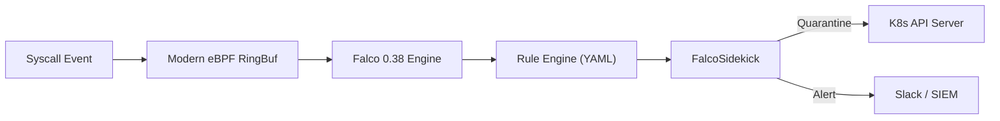



---

## Executive Summary

- **배경 및 과제**: 쿠버네티스 클러스터 환경에서 컨테이너 내부 침투 및 권한 상승(Privilege Escalation) 위협이 증가함에 따라 런타임 보안(Runtime Security)의 중요성이 커졌습니다. 그러나 전통적인 Falco 배포 방식은 호스트 OS 커널 헤더(Kernel Headers) 설치 및 전용 드라이버 컴파일이 필요하여, 클라우드 관리형 노드(AWS Bottlerocket, Google COS)나 최신 Linux 배포판에서 잦은 빌드 실패와 부하를 유발했습니다.
- **핵심 아키텍처 전략**: 이전 포스트인 에서 다룬 인커널 차단과 의 네트워크 격리에 이어, 본 가이드에서는 **Falco 0.38**의 **Modern eBPF CO-RE(Compile Once - Run Everywhere)** 프로브 아키텍처를 분석합니다. 커널 헤더 빌드 없이 단일 바이너리로 시스템 콜(Syscall)을 수집하고, **FalcoSidekick**을 연동하여 위험 파드를 쿠버네티스 API 수준에서 즉시 격리(Isolate & Evict)합니다.
- **도입 효과**: 드라이버 컴파일 오버헤드 0%, 컨테이너 탈옥 및 민감 디렉토리 변조 1초 이내 탐지, 침해 파드의 자동 네트워크 정책 차단 파이프라인을 구축할 수 있습니다.

---

## 위험 스코어카드 (Threat & Risk Scorecard)

| 위협 벡터 | 레거시 커널 모듈 위험도 | Modern eBPF 완화 수준 | 잔여 리스크 | 주요 방어 매커니즘 |
|---|---|---|---|---|
| 노드 커널 패닉 (Kernel Panic) | High (잘못된 모듈로 노드 크래시) | Very Low (eBPF Verifier 안전성) | Very Low | 리눅스 커널 내부 eBPF 검증기 |
| 호스트 커널 헤더 부재 오류 | Critical (Bottlerocket 배포 실패) | Zero (BTF 기반 CO-RE 동작) | Low | 커널 헤더 의존성 원천 제거 |
| 컨테이너 탈옥 (Container Escape) | High (nsenter / cgroup 조작) | Low (setns, clone 감시) | Low | 커널 레벨 시스템콜 실시간 감사 |
| 런타임 메모리 덤프 (ptrace) | Medium (메모리 시크릿 탈취) | Low (ptrace 호출 즉시 차단) | Very Low | Falco Rule 기반 이상 프로세스 감지 |
| 침해 파드의 횡적 이동 (Lateral Move)| Critical (클러스터 내부 전파) | Low (Sidekick 자동 격리 적용) | Low | 파드 자동 NetworkPolicy 격리 라벨링 |
| 리버스 셸 (Reverse Shell) 생성 | High (nc, bash 악용) | Low (비정상 통신 차단) | Low | 아웃바운드 세션 커널 추적 |

---

## 1. 레거시 드라이버의 한계와 Modern eBPF 패러다임

런타임 위협 탐지 도구의 핵심은 커널 시스템 콜 이벤트를 얼마나 안전하고 가볍게 가로채느냐에 달려 있습니다.

| 비교 항목 | Traditional Kernel Module | Legacy eBPF Probe | Modern eBPF (CO-RE) |
|---|---|---|---|
| **설치 요구조건** | 커널 헤더 + gcc 컴파일 도구 | clang/llvm 클러스터 노드 내장 | 커널 BTF(BPF Type Format) 지원 |
| **빌드 방식** | 노드 기동 시 인라인 C 모듈 컴파일 | 노드 기동 시 eBPF 바이트코드 컴파일 | 사전 컴파일된 단일 바이너리 로드 |
| **안전성** | 커널 메모리 직접 접근 (위험) | eBPF 검증기 보장 | eBPF 검증기 + 최소 링 버퍼 |
| **불변 OS 지원** | Bottlerocket / Talos 설치 불가 | 불변 OS에서 설치 매우 복잡 | 완벽 지원 (단일 컨테이너 구동) |
| **CPU/메모리 부하** | 낮음 (단, 잠재적 불안정) | 중간 (컴파일 시 순간 스파이크) | 매우 낮음 (로드 즉시 구동) |

### 1.1 커널 모듈 드라이버 컴파일 실패의 근본 원인
전통적인 Falco는 호스트의 커널 버전과 정확히 일치하는 `linux-headers` 패키지를 다운로드하여 로컬에서 `.ko` 모듈을 빌드했습니다. 그러나 AWS EKS 최적화 AMI나 Bottlerocket과 같은 미니멀 컨테이너 OS는 보안상의 이유로 패키지 매니저와 커널 헤더를 제공하지 않으므로 부트스트랩 단계에서 에러가 빈번하게 발생했습니다.

### 1.2 BPF CO-RE(Compile Once - Run Everywhere)의 기술적 혁신
Modern eBPF는 리눅스 커널 5.8 이상에서 표준화된 **BTF(BPF Type Format)** 메타데이터를 활용합니다. 개발 단계에서 한 번만 컴파일된 eBPF 바이트코드를 타깃 커널의 구조체 오프셋에 맞춰 런타임에 재배치(Relocation)하므로, 별도의 외부 헤더 파일 없이도 모든 노드에서 즉각 실행됩니다.

---

## 2. Falco 0.38 Modern eBPF 엔진 아키텍처

Falco 0.38은 커널 스페이스와 유저 스페이스 간의 데이터 교환 구조를 최신 링 버퍼(Ring Buffer) 모델로 전면 개선했습니다.



### 2.1 Per-CPU Ring Buffer 메커니즘
과거의 perf 버퍼 방식은 대량의 시스템 콜 발생 시 이벤트 유실(Drop)이 발생하거나 버퍼 잠금 경합이 심했습니다. Modern eBPF 프로브는 커널 링 버퍼를 채택하여 잠금 없는(Lock-free) 방식으로 유저 스페이스 Falco 엔진에 이벤트를 전달합니다.

### 2.2 시스템 콜 필터링 최적화
모든 시스템콜을 캡처하면 시스템 성능이 급격히 저하됩니다. Falco 0.38은 `execve`, `openat`, `socket`, `ptrace`, `setns` 등 보안상 민감한 80여 개의 시스템 콜만을 커널 내부에서 선별 필터링하여 유저 스페이스 컨텍스트 스위칭을 최소화합니다.

### 2.3 컨테이너 런타임 메타데이터 연동
Falco는 노드의 containerd 또는 CRI-O 소켓과 직접 통신하여 커널 PID를 쿠버네티스 파드 이름, 네임스페이스, 컨테이너 ID와 1:1로 실시간 맵핑합니다.

---

## 3. 실무 구성: Modern eBPF 기반 Falco 및 FalcoSidekick 배포

Helm을 사용하여 노드 컴파일 없는 Modern eBPF 프로브 모드로 Falco를 배포하는 표준 구성입니다.

### 3.1 Helm values 설정 (Modern eBPF 활성화)

드라이버 로더를 비활성화하고 `modern_ebpf` 엔진을 활성화합니다.

```yaml
driver:
  kind: modern_ebpf
collectors:
  enabled: true
  containerd: {socket: /run/containerd/containerd.sock}
falcosidekick:
  enabled: true
  webui: {enabled: true}
```

### 3.2 Helm 배포 명령어 실행

Helm 레포지토리를 추가하고 values 파일을 적용하여 데몬셋을 배포합니다.

```bash
helm repo add falcosecurity https://falcosecurity.github.io/charts
helm repo update
helm upgrade --install falco falcosecurity/falco \
  --namespace falco --create-namespace \
  -f values-modern-ebpf.yaml
```

### 3.3 컨테이너 탈옥 및 권한 상승 탐지 룰(Rule) 작성

`setns` 시스템 콜을 악용한 네임스페이스 탈옥 시도를 탐지하는 커스텀 룰셋입니다.

```yaml
- rule: Container Escape via setns
  desc: Detect namespace change inside container
  condition: >
    evt.type = setns and
    container and not proc.name in (valid_procs)
  output: >
    Alert: Container Escape (user=%user.name pod=%k8s.pod.name cmd=%proc.cmdline)
  priority: CRITICAL
  tags: [container, escape, mitre_privilege_escalation]
```

### 3.4 민감 디렉토리 쓰기 방어 룰 정의

프로덕션 컨테이너 내부에서 바이너리 디렉토리에 파일을 생성하거나 덮어쓰는 행위를 추적합니다.

```yaml
- rule: Write below binary dir
  desc: Write attempt to /bin /sbin /usr/bin
  condition: >
    open_write and container and
    fd.name glob "/bin/*" or fd.name glob "/usr/bin/*"
  output: >
    File modified in binary dir (file=%fd.name pod=%k8s.pod.name)
  priority: ERROR
  tags: [filesystem, mitre_persistence]
```

---

## 4. FalcoSidekick을 활용한 침해 파드 자동 격리

위협이 탐지된 즉시 수동 분석을 기다리지 않고 쿠버네티스 API를 통해 공격 파드를 격리합니다.

### 4.1 FalcoSidekick Response 설정

FalcoSidekick의 Kubernetes 플러그인을 활성화하여 Critical 알림 발생 시 자동으로 레이블을 주입합니다.

```yaml
falcosidekick:
  config:
    kubernetes:
      allownodes: false
      customlabels:
        quarantine: "true"
        isolated-at: "{{ .Timestamp }}"
```

### 4.2 자동 격리 NetworkPolicy 선언

`quarantine=true` 레이블이 부여된 파드의 모든 인바운드/아웃바운드 트래픽을 즉시 0ms 지연으로 차단합니다.

```yaml
apiVersion: networking.k8s.io/v1
kind: NetworkPolicy
metadata:
  name: quarantine-isolated-pods
  namespace: default
spec:
  podSelector:
    matchLabels: {quarantine: "true"}
  policyTypes: ["Ingress", "Egress"]
```

### 4.3 위협 탐지 및 격리 동작 검증

배포된 테스트 파드에서 위협 행위를 시뮬레이션하고 격리 결과를 확인합니다.

```bash
# 테스트 파드 생성 및 민감 디렉토리 파일 생성 시뮬레이션
kubectl run test-sec --image=alpine -- sh -c "touch /bin/malicious_payload"

# FalcoSidekick 로그를 통한 quarantine 레이블 주입 확인
kubectl logs -n falco -l app.kubernetes.io/name=falcosidekick | grep "quarantine"

# 파드 레이블 확인 및 격리 상태 진단
kubectl get pod test-sec --show-labels
```

---

## 5. 프로덕션 클러스터 롤아웃 체크리스트

대규모 엔터프라이즈 환경에서 Modern eBPF Falco를 안정적으로 운영하기 위한 점검 항목입니다.

- [ ] 대상 노드의 Linux 커널 버전이 5.8 이상이며 `CONFIG_DEBUG_INFO_BTF=y` 지원 여부 검증
- [ ] 호스트 OS의 `/sys/kernel/debug` 및 `/sys/fs/bpf` 마운트 권한 확인
- [ ] 시스템 모니터링 데몬(Datadog, Prometheus 등)의 정상적인 시스템 콜 예외 화이트리스트 등록
- [ ] FalcoSidekick을 통한 Slack/SIEM 알림 채널 연동 및 심각도(Priority)별 라우팅 구성
- [ ] 자동 격리(NetworkPolicy) 적용 시 무중단 서비스 영향도 평가 및 격리 파드 분석 파이프라인 수립
- [ ] 노드당 Falco CPU 점유율 2% 이하, 메모리 200MB 이하 리소스 Limit 튜닝

---

## 결론 및 아키텍처 제언

Falco 0.38의 Modern eBPF 아키텍처는 컨테이너 런타임 보안의 오랜 난제였던 커널 드라이버 빌드 문제를 완벽하게 해결했습니다. 앞서 다룬 정적 이미지 서명 과 실시간 인커널 차단 , 그리고 네트워크 레벨의 에 이어, Falco Modern eBPF와 자동 격리 체계를 유기적으로 결합함으로써 완벽한 **다계층 런타임 심층 방어(Defense-in-Depth)**를 구축할 수 있습니다.
